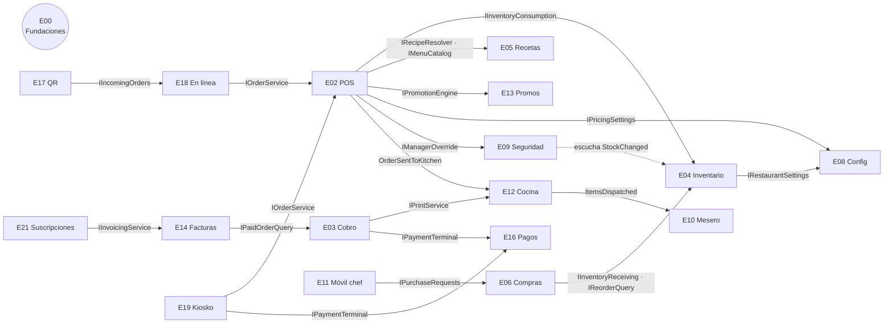

# Contratos entre epics

Aquí están **todas** las interfaces que un epic le ofrece a otro, más los eventos de tiempo real. Cada epic implementa las suyas y consume las de los demás. Si alguien necesita cambiar una firma, lo propone en un PR que toque este archivo y el `plan.md` del epic dueño, y lo aprueba la otra persona.

Las interfaces de dominio viven en `Resto.Domain/<Feature>/Abstractions/`. Los DTOs y eventos, en `Resto.Contracts/`.

## Mapa

Todos dependen de E00 (`ICurrentUser`, `IAuditLog`, `INotificationService`, `IMessageDelivery`, `RestaurantHub` y permisos) y `IModuleGate`, que también es de E00, así que no se dibujan.

## Interfaces

| Interfaz | Dueño | La usan | Para qué |
|---|---|---|---|
| `ICurrentUser` | E00 | Todos | `UserId`, `RestaurantId`, `OrganizationId`, `DeviceId`, `HasPermission(p)` |
| `IAuditLog` | E00 | Todos | `WriteAsync(module, action, detail, before, after)` |
| `INotificationService` | E00 | E02, E04, E06, E09, E10, E11, E12, E18 | Avisos a un usuario o a un rol: campana en escritorio y *push* en celular |
| `IClock` | E00 | Todos | Hora actual en UTC y en la zona del restaurante (para pruebas) |
| `IIdempotencyStore` | E00 | Endpoints que reciben datos del celular | Evita duplicados al reenviar desde la cola sin conexión |
| `IMessageDelivery` | E00 | E03, E06, E07, E14, E21 | Enviar correo (con adjuntos) y WhatsApp (según E03 P-01) |
| `IPersonalDataEraser` | E00 (define) | Lo implementan E14 y E18 | Anonimizar los datos personales de un cliente a petición, sin borrar ventas ni facturas (E00 BR-PLT-16) |
| `IRealtimePublisher` | E00 | Todos | Publicar eventos de SignalR sin depender de SignalR |
| `IRestaurantSettings` | E08 | E04, E05, E12 | Merma general, días de caducidad, propiedades extra, estaciones |
| `IPricingSettings` | E08 | E02, E03, E13, E14 | Impuestos y si los precios los incluyen |
| `IInventoryConsumption` | E04 | E02 | Descontar al enviar a cocina y regresar al cancelar |
| `IInventoryReceiving` | E04 | E06 | Entrada por compra |
| `IReorderQuery` | E04 | E06, E11 | Insumos bajo el mínimo con su sugerido |
| `IMenuCatalog` | E05 | E02, E10, E13, E17, E19 | Platillos, precios, categorías, extras, porciones disponibles |
| `IRecipeResolver` | E05 | E02 | Convierte platillo + extras + paquete en líneas de insumo |
| `IPurchaseRequests` | E06 | E11 | Agregar a la lista de compras |
| `IOrderService` | E02 | E10, E18, E19 | Abrir orden, agregar, enviar, cancelar |
| `IOrderQuery` | E02 | E01, E03, E12 | Órdenes abiertas y su detalle |
| `IPaidOrderQuery` | E03 | E14, E15 | Tickets pagados con su desglose |
| `ICashSessionService` | E03 | E16 | Turno de caja abierto para registrar pagos |
| `IPrintService` | E12 | E02, E03, E14 | Imprimir comanda, cuenta, ticket y corte |
| `IManagerOverride` | E09 | E02, E03, E07 | Validar el PIN de quien autoriza, con su permiso |
| `ISecurityAlerts` | E09 | E02, E03 (E00 y E04 solo publican eventos que E09 escucha) | Levantar una alerta |
| `IPromotionEngine` | E13 | E02 | Calcular los descuentos automáticos de una cuenta |
| `IInvoicingService` | E14 | E03, E17 | Facturar un ticket o hacer la factura global |
| `IPaymentTerminal` | E16 | E03, E19 | Cobrar con terminal y obtener la autorización |
| `IIncomingOrders` | E18 | E17 | Registrar un pedido externo (QR, web o app) por aceptar |
| `ISecurityRules` | E09 | E02, E03 | Umbrales de alertas y reimpresiones |
| `IModuleGate` | E00 (E21 escribe los módulos según el plan) | Todos (vía `.RequireModule()`) | Saber si el plan del cliente incluye un módulo |

**Regla para avanzar en paralelo:** si un epic necesita una interfaz que todavía no existe, la usa a través de una **implementación provisional** (`Default…` o `Null…`) que vive en el proyecto del dueño. Cuando el dueño entrega la real, se reemplaza en el registro de dependencias y nada más cambia.

## Eventos de tiempo real (SignalR, `RestaurantHub`)

**Grupos:**
- `restaurant:{id}`: todos los dispositivos del restaurante
- `role:{rol}`: por ejemplo, `role:chef`
- `user:{id}`
- `station:{id}`: cada estación de cocina

| Evento | Lo emite | Grupo | Payload | Lo escuchan |
|---|---|---|---|---|
| `OrderChanged` | E02 | restaurant | `OrderSummaryDto` | E01, E03, E10 |
| `OrderSentToKitchen` | E02 | station de cada platillo | `KitchenTicketDto` | E12 |
| `OrderItemCancelled` | E02 | station + restaurant | `{OrderId, ItemId}` | E12, E01 |
| `ItemsDispatched` | E12 | restaurant + user mesero | `{OrderId, ItemIds[]}` | E01, E02, E10, E18 |
| `BillRequested` | E10 | role:cajero + role:gerente | `{OrderId, Table}` | E01, E03 |
| `OrderPaid` | E03 | restaurant | `{OrderId, Total}` | E01, E14, E15 |
| `StockChanged` | E04 | restaurant | `{IngredientId, Stock, Level}` | E04, E05, E10 |
| `IngredientBelowMinimum` | E04 | role:chef | `{IngredientId, Name, Stock}` | E11 |
| `PurchaseRequestChanged` | E06 | role:compras + user que pidió | `PurchaseRequestDto` | E06, E11 |
| `SecurityAlertRaised` | E09 | role:gerente | `SecurityAlertDto` | E09 |
| `IncomingOrderReceived` | E18 | role:cajero + mesero de la mesa | `IncomingOrderDto` | E10, E18 |
| `NotificationCreated` | E00 | user | `NotificationDto` | Todos (campana y *push*) |
| `SettingsChanged` | E08 | restaurant | `{ Section }` | Todos los que leen configuración |
| `PromotionsChanged` | E13 | restaurant | — | E02, E10, E17, E19 |
| `MenuChanged` | E05 | restaurant | `{ MenuItemIds[] }` | E02, E10, E17, E18 |
| `PrintJobRequested` / `PrintJobFailed` | E12 | device (caja anfitriona) / role:cajero | `PrintJobDto` | E12 (caja) |
| `PrintTestRequested` | E08 | device (caja anfitriona) | `{ PrinterId }` | E12 (caja) |
| `StockCountUpdated` | E04 | role:gerente + role:chef | `{ CountId, Counted, Total }` | E04, E11 |
| `TerminalPaymentUpdated` | E16 | user | `{ PaymentId, Status, Brand, Last4, Auth }` | E03, E19 |
