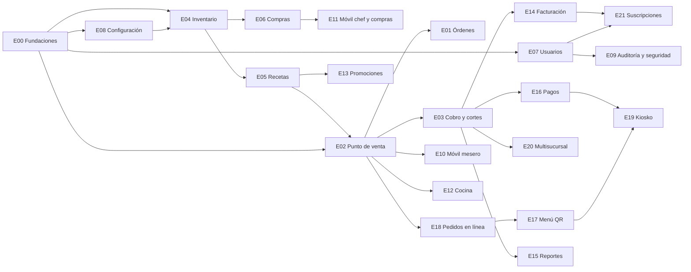

# Mapa de epics

Cada epic es una **superficie → módulo** que una persona puede llevar de principio a fin. Son 22 (E00 a E21). Cada uno tiene su carpeta en `specs/` con `spec.md`, `plan.md`, `tasks.md` e `img/` (capturas del demo, cuando la pantalla existe en el demo).

**Superficies:** Plataforma (lo que no se ve), Escritorio (caja y administración), Móvil (mesero, chef y compras), Cocina (pantalla e impresoras) y Cliente (QR, web y kiosko).

**Todo entra en el producto.** No hay piloto ni recortes. La columna *Ola* solo indica el **orden de construcción** según las dependencias:
- **Ola 1 · Operación:** lo que hace funcionar el restaurante día a día. Va primero porque todo lo demás se apoya en esto.
- **Ola 2 · Cobro y control:** facturación, pagos, promociones, reportes y suscripciones (cómo nos pagan los restaurantes).
- **Ola 3 · Canales y sucursales:** QR, apps de delivery, kiosko y multisucursal.

## Tabla de epics

| ID | Superficie → módulo | Qué entrega | Ola | Depende de | Responsable | Documentos |
|---|---|---|---|---|---|---|
| **E00** | Plataforma → Fundaciones | Solución .NET, base de datos, multi restaurante, login con usuario y PIN, auditoría, SignalR, sincronización sin conexión, tokens de diseño, respaldos, monitoreo, seguridad y aviso de privacidad | 1 | — | Por definir | [spec](../specs/E00-plataforma-fundaciones/spec.md) · [plan](../specs/E00-plataforma-fundaciones/plan.md) · [tareas](../specs/E00-plataforma-fundaciones/tasks.md) |
| **E01** | Escritorio → Órdenes abiertas | Mapa de mesas, tarjetas de órdenes, estados y avance de cocina | 1 | E00, E02 | Por definir | [spec](../specs/E01-escritorio-ordenes-abiertas/spec.md) · [plan](../specs/E01-escritorio-ordenes-abiertas/plan.md) · [tareas](../specs/E01-escritorio-ordenes-abiertas/tasks.md) |
| **E02** | Escritorio → Punto de venta | Abrir orden (comedor, para llevar, drive thru), agregar platillos, enviar a cocina, cancelar con motivo, historial de la orden | 1 | E00, E05 | Por definir | [spec](../specs/E02-escritorio-punto-de-venta/spec.md) · [plan](../specs/E02-escritorio-punto-de-venta/plan.md) · [tareas](../specs/E02-escritorio-punto-de-venta/tasks.md) |
| **E03** | Escritorio → Cobro, caja y cortes | Cobro en efectivo con cambio, tarjeta, mixto, propina, dividir cuenta, retiros, corte X, cierre Z por denominación | 1 | E02 | Por definir | [spec](../specs/E03-escritorio-cobro-caja-cortes/spec.md) · [plan](../specs/E03-escritorio-cobro-caja-cortes/plan.md) · [tareas](../specs/E03-escritorio-cobro-caja-cortes/tasks.md) |
| **E04** | Escritorio → Inventario | Lista con estado, filtros, ajustes, alta de insumos, movimientos, descuento automático por receta y merma, unidad de compra, importar de Excel, kardex y toma de inventario física | 1 | E00, E08 | Por definir | [spec](../specs/E04-escritorio-inventario/spec.md) · [plan](../specs/E04-escritorio-inventario/plan.md) · [tareas](../specs/E04-escritorio-inventario/tasks.md) |
| **E05** | Escritorio → Recetas y paquetes | Receta por platillo, costo y margen, porciones disponibles, paquetes y extras, alérgenos, traducción sugerida e importar menú de Excel | 1 | E04 | Por definir | [spec](../specs/E05-escritorio-recetas-paquetes/spec.md) · [plan](../specs/E05-escritorio-recetas-paquetes/plan.md) · [tareas](../specs/E05-escritorio-recetas-paquetes/tasks.md) |
| **E06** | Escritorio → Compras y proveedores | Sugeridos, lista de compras, proveedores, órdenes de compra, entrada a inventario | 1 | E04 | Por definir | [spec](../specs/E06-escritorio-compras-proveedores/spec.md) · [plan](../specs/E06-escritorio-compras-proveedores/plan.md) · [tareas](../specs/E06-escritorio-compras-proveedores/tasks.md) |
| **E07** | Escritorio → Usuarios y roles | Alta de usuarios con PIN, roles configurables, matriz de permisos | 1 | E00 | Por definir | [spec](../specs/E07-escritorio-usuarios-roles/spec.md) · [plan](../specs/E07-escritorio-usuarios-roles/plan.md) · [tareas](../specs/E07-escritorio-usuarios-roles/tasks.md) |
| **E08** | Escritorio → Configuración | Impuestos (cuenta o producto), merma general y por insumo, días de aviso de caducidad, propiedades del inventario, estaciones e impresoras, datos del restaurante | 1 | E00 | Por definir | [spec](../specs/E08-escritorio-configuracion/spec.md) · [plan](../specs/E08-escritorio-configuracion/plan.md) · [tareas](../specs/E08-escritorio-configuracion/tasks.md) |
| **E09** | Escritorio → Auditoría y seguridad | Consulta de auditoría, autorización con PIN de gerente, alertas antifraude y sus reglas (incluye las de inventario descontado de más que manda E04) | 1 | E00, E07 | Por definir | [spec](../specs/E09-escritorio-auditoria-seguridad/spec.md) · [plan](../specs/E09-escritorio-auditoria-seguridad/plan.md) · [tareas](../specs/E09-escritorio-auditoria-seguridad/tasks.md) |
| **E10** | Móvil → Mesero | Mesas, menú por categoría, notas y extras, enviar a cocina, pedir cuenta, avisos de "ya salió" | 1 | E02 | Por definir | [spec](../specs/E10-movil-mesero/spec.md) · [plan](../specs/E10-movil-mesero/plan.md) · [tareas](../specs/E10-movil-mesero/tasks.md) |
| **E11** | Móvil → Chef y compras | Faltantes con un toque, lista del comprador por proveedor, marcar comprado, *No lo encontré*, contar inventario desde el celular, avisos entre ambos | 1 | E06 | Por definir | [spec](../specs/E11-movil-chef-compras/spec.md) · [plan](../specs/E11-movil-chef-compras/plan.md) · [tareas](../specs/E11-movil-chef-compras/tasks.md) |
| **E12** | Cocina → Pantalla e impresión | Comandas por estación, tiempos, despachar por platillo o completa, impresión ESC/POS por estación | 1 | E02 | Por definir | [spec](../specs/E12-cocina-pantalla-impresion/spec.md) · [plan](../specs/E12-cocina-pantalla-impresion/plan.md) · [tareas](../specs/E12-cocina-pantalla-impresion/tasks.md) |
| **E13** | Escritorio → Promociones | 2x1 y porcentaje por categoría, por día y horario, aplicación automática | 2 | E02, E05 | Por definir | [spec](../specs/E13-escritorio-promociones/spec.md) · [plan](../specs/E13-escritorio-promociones/plan.md) · [tareas](../specs/E13-escritorio-promociones/tasks.md) |
| **E14** | Escritorio → Facturación | CFDI 4.0 con PAC, validación de RFC, portal de autofacturación con QR, factura global | 2 | E03 | Por definir | [spec](../specs/E14-escritorio-facturacion/spec.md) · [plan](../specs/E14-escritorio-facturacion/plan.md) · [tareas](../specs/E14-escritorio-facturacion/tasks.md) |
| **E15** | Escritorio → Reportes | Ventas por día, hora, canal y mesero, utilidad por platillo, exportar a Excel | 2 | E03, E05 | Por definir | [spec](../specs/E15-escritorio-reportes/spec.md) · [plan](../specs/E15-escritorio-reportes/plan.md) · [tareas](../specs/E15-escritorio-reportes/tasks.md) |
| **E16** | Plataforma → Pagos | Terminal bancaria integrada y conciliación con el corte | 2 | E03 | Por definir | [spec](../specs/E16-plataforma-pagos/spec.md) · [plan](../specs/E16-plataforma-pagos/plan.md) · [tareas](../specs/E16-plataforma-pagos/tasks.md) |
| **E17** | Cliente → Menú QR | Menú con fotos en español e inglés, pedido desde la mesa, pedir la cuenta | 3 | E02, E13, E18 | Por definir | [spec](../specs/E17-cliente-menu-qr/spec.md) · [plan](../specs/E17-cliente-menu-qr/plan.md) · [tareas](../specs/E17-cliente-menu-qr/tasks.md) |
| **E18** | Escritorio → Pedidos en línea | Tablero de apps de delivery y pedido web, aceptar o rechazar, pausar canales | 3 | E02 | Por definir | [spec](../specs/E18-escritorio-pedidos-en-linea/spec.md) · [plan](../specs/E18-escritorio-pedidos-en-linea/plan.md) · [tareas](../specs/E18-escritorio-pedidos-en-linea/tasks.md) |
| **E19** | Cliente → Kiosko | Autoservicio con pago y turno | 3 | E16, E17 | Por definir | [spec](../specs/E19-cliente-kiosko/spec.md) · [plan](../specs/E19-cliente-kiosko/plan.md) · [tareas](../specs/E19-cliente-kiosko/tasks.md) |
| **E20** | Plataforma → Multisucursal | Varias sucursales, catálogos compartidos, almacenes con traspasos, reportes consolidados | 3 | toda la ola 1 | Por definir | [spec](../specs/E20-plataforma-multisucursal/spec.md) · [plan](../specs/E20-plataforma-multisucursal/plan.md) · [tareas](../specs/E20-plataforma-multisucursal/tasks.md) |
| **E21** | Plataforma → Suscripciones y planes | Registro en línea, prueba de 30 días, planes Esencial, Completo y Pro, cobro recurrente, módulos por plan, factura de la licencia, ayuda y soporte por WhatsApp, y consola interna | 2 | E00, E07, E14 | Por definir | [spec](../specs/E21-plataforma-suscripciones/spec.md) · [plan](../specs/E21-plataforma-suscripciones/plan.md) · [tareas](../specs/E21-plataforma-suscripciones/tasks.md) |

## Dependencias

## Fuera del producto por ahora

Para que nadie lo empiece por su cuenta. Si un cliente lo pide, se anota aquí y se decide si se vuelve un epic nuevo.

| Tema | Por qué no entra todavía |
|---|---|
| Reservaciones y lista de espera | No lo pidieron los usuarios ni está en el PDF de Soft Restaurant que comparamos |
| Nómina, asistencia y checador | Es otro producto; se resuelve con integraciones |
| Contabilidad (pólizas, bancos, cuentas por pagar) | Se exportan ventas, compras y facturas a Excel (E15) para el contador |
| Programa de lealtad y monedero | Se revisa cuando estén las ventas en línea (E18) |
| Tienda de apps o integraciones abiertas (API pública) | Primero se estabiliza la API interna |
| Pedido a domicilio con repartidores propios | Se cubre con las apps de delivery (E18) |

La relación entre lo que se pidió y cada epic está en [`trazabilidad.md`](trazabilidad.md).

## Para la reunión de reparto

El reparto queda por definir. Estos datos ayudan a decidirlo:

- **Hay dos cadenas naturales que casi no se tocan:**
  - **Venta:** E00 → E07 → E02 → E01 → E03 → E10 → E12 → E09 → E14 → E16 → E21 → E18 → E19
  - **Inventario y cocina:** E08 → E04 → E05 → E06 → E11 → E13 → E15 → E17 → E20
- **El único punto de contacto fuerte** entre ambas es el descuento de inventario al enviar a cocina: E02 llama a E04. Está descrito en [`contratos.md`](contratos.md).
- **E00 va primero y lo lleva una sola persona.** Mientras tanto, la otra puede empezar las tareas que no dependen de nada: `E12-T001` a `T003` (impresión ESC/POS), y las reglas de Domain marcadas `[P]` de E02, E03, E04 y E05.
- **Antes de la ola 2 hay que decidir proveedores:** PAC (E14), terminal (E16), procesador de suscripciones (E21) e integrador de delivery (E18). Y hay que juntarse con un contador por las preguntas fiscales de E02, E08 y E14.
- Cada epic tiene sus tareas numeradas. Si prefieren repartir por tarea y no por epic, `tasks.md` ya marca cuáles se pueden hacer en paralelo (`[P]`).

Cuando decidan, escriban el nombre en la columna *Responsable* de la tabla y en el encabezado de cada `spec.md`.

## Cómo crear la spec de un epic

1. Copia `docs/plantillas/` a `specs/E05-escritorio-recetas/`.
2. Abre el demo en la pantalla del módulo y toma capturas a `img/` (o pídeselo a la IA).
3. Llena `spec.md`. Puedes pedirle a la IA un borrador con este prompt:
   > Lee `docs/constitucion.md`, `docs/epics.md`, `specs/E04-escritorio-inventario/spec.md` como ejemplo, y el demo `docs/demo/resto-demo.html` en el módulo Recetas. Escribe `specs/E05-escritorio-recetas/spec.md` siguiendo la plantilla. No inventes reglas: lo que no esté claro va en Preguntas abiertas.
4. **La otra persona revisa la spec** antes de pasar al plan. Este paso es el más importante.
5. Luego se escriben el plan y las tareas, que también se pueden pedir a la IA con el mismo método.
