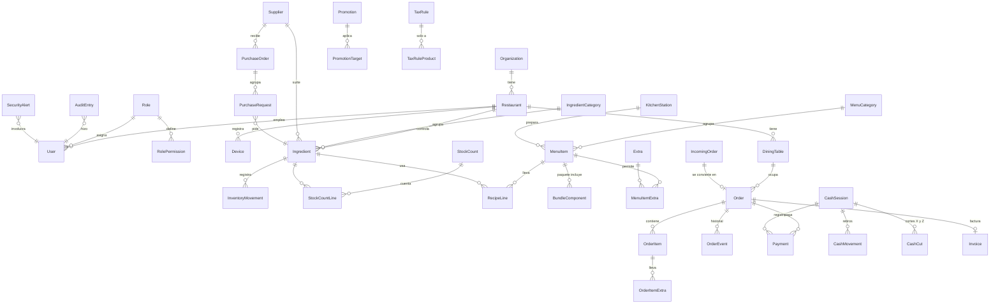

# Modelo de datos (vista general)

Un mapa de todas las tablas para que nadie cree dos veces lo mismo. El detalle de columnas está en el `plan.md` de cada epic, en la columna *Dueño*.

## Reglas para todas las tablas

- Llave `Id` de tipo `Guid` (UUID v7, ordenable por fecha).
- `OrganizationId` y `RestaurantId` en toda tabla de negocio, con filtro global (E00). Una *organización* es el cliente que paga y un *restaurante* es cada sucursal. Desde el día uno se modela así, aunque la mayoría tenga una sola sucursal, para que E20 no obligue a migrar todo.
- `CreatedAt`, `CreatedBy`, `UpdatedAt` y `UpdatedBy` los llena E00 automáticamente.
- Nada se borra físicamente. Se usa `IsActive` o un estado.
- El dinero va en `numeric(12,2)` y las cantidades de inventario en `numeric(12,3)`.

## Diagrama

## Dueño de cada tabla

| Dueño | Tablas |
|---|---|
| E00 Fundaciones | `organizations`, `restaurants`, `devices`, `device_pairing_codes`, `audit_entries`, `notifications`, `idempotency_keys`, `pin_attempts`, `organization_modules` |
| E02 Punto de venta | `orders`, `order_items`, `order_item_extras`, `order_events` |
| E03 Cobro y cortes | `cash_sessions`, `payments`, `cash_movements`, `cash_cuts`, `cut_delivery_settings` |
| E04 Inventario | `ingredients`, `ingredient_categories`, `inventory_movements`, `inventory_imports`, `stock_counts`, `stock_count_lines` |
| E05 Recetas | `menu_categories`, `menu_items`, `recipe_lines`, `bundle_components`, `extras`, `extra_targets`, `menu_imports` |
| E06 Compras | `suppliers`, `purchase_requests`, `purchase_orders` |
| E07 Usuarios | `users`, `roles`, `role_permissions` (versión mínima creada en E00) |
| E08 Configuración | `restaurant_settings`, `tax_rules`, `tax_rule_products`, `custom_field_definitions`, `kitchen_stations`, `dining_tables` |
| E09 Seguridad | `security_rules`, `security_alerts`, `override_tokens` |
| E12 Cocina e impresión | `print_jobs`, `printers` |
| E13 Promociones | `promotions`, `promotion_targets`, `order_item_discounts` |
| E14 Facturación | `invoice_settings`, `menu_category_fiscal_keys`, `invoices`, `invoice_orders`, `fiscal_customers` |
| E15 Reportes | `daily_sales_summary`, `daily_item_summary` |
| E16 Pagos | `payment_terminals`, `terminal_transactions`, `settlements`, `settlement_lines` |
| E17 Menú QR | `table_qr_tokens` |
| E18 Pedidos en línea | `incoming_orders`, `channel_settings`, `channel_prices`, `web_ordering_settings` |
| E20 Multisucursal | `user_branch_roles`, `menu_item_branch_overrides`, `storage_locations`, `ingredient_stocks`, `stock_transfers`, `stock_transfer_lines` |
| E21 Suscripciones | Esquema `platform`: `plans`, `subscriptions`, `subscription_charges`, `module_trials`, `support_sessions` (sin filtro por restaurante) |

E10, E11 y E19 no tienen tablas en el servidor; usan las de otros epics.

### Tablas locales (SQLite en la app MAUI)

No viajan al servidor tal cual: se envían como comandos por la cola de E00.

| Tabla | Dueño | Para qué |
|---|---|---|
| `outbox` | E00 | Cola de comandos pendientes con su `Idempotency-Key` |
| `cache_*` (menú, insumos, mesas, personal) | E00 | Copia de lectura para trabajar sin conexión |
| `waiter_drafts` | E10 | Orden que el mesero está armando |
| `chef_selection` | E11 | Insumos marcados en *Faltan* antes de enviar |
| `count_drafts` | E11 | Conteos capturados sin conexión |

### Columnas que un epic agrega a la tabla de otro

| Tabla | Columna | La agrega |
|---|---|---|
| `ingredients` | `SupplierId` (FK) | E06 |
| `order_items` | `UnitCostSnapshot` | E15 |
| `restaurant_settings` | `PrintHostDeviceId` | E12 |
| `devices` | `CashSessionRegisterId` | E19 |
| `menu_items` | `Scope` | E20 |
