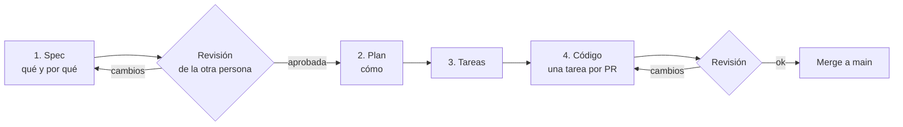

# Cómo trabajamos

## El ciclo de cada epic

| Paso | Archivo | Quién lo escribe | Quién lo aprueba |
|---|---|---|---|
| Spec | `spec.md` | El dueño del epic, con o sin IA | La otra persona |
| Plan | `plan.md` | El dueño del epic, con o sin IA | La otra persona, sobre todo los contratos con otros epics |
| Tareas | `tasks.md` | Se sacan del plan | No requiere aprobación |
| Código | `src/`, `tests/` | Cualquiera, con cualquier IA | La otra persona en el PR |

## Reglas

1. **Si no está en la spec, no se construye.** Si algo falta, primero se agrega a la spec en el mismo PR y se explica por qué.
2. **Una tarea = una rama = un PR.** La rama se llama `E04-T007-ajuste-existencia`.
3. **Los PRs son chicos.** Si una tarea pasa de ~400 líneas, se parte.
4. **Las preguntas no se adivinan.** Van en *Preguntas abiertas* de la spec, con quién debe contestar.
5. **Los contratos entre epics** (lo que uno llama del otro) viven en el `plan.md` del que los implementa. Cambiarlos requiere avisar a la otra persona.

## Trabajar con IA (Claude, Codex, Copilot, Cursor…)

Todas leen `AGENTS.md`, así que las reglas son las mismas para todos. Un buen prompt para una tarea se ve así:

> Trabaja en la tarea **E04-T007** de `specs/E04-escritorio-inventario/tasks.md`. Lee primero `AGENTS.md`, la constitución y la spec y el plan de E04. Haz solo esa tarea, escribe las pruebas que pide, corre `dotnet test` y marca la casilla.

Tips:
- Dale **una** tarea, no el epic completo.
- Si la IA propone algo que no está en la spec, la respuesta es "agrégalo a Preguntas abiertas" y no "sí, hazlo".
- Revisa el código de la IA igual que el de una persona.

## Tablero

En `tasks.md`, cada tarea tiene casilla, dueño y estado. Si quieren algo más visual, cada tarea se puede copiar como issue de GitHub con el ID en el título (`E04-T007 Ajustar existencia`).
