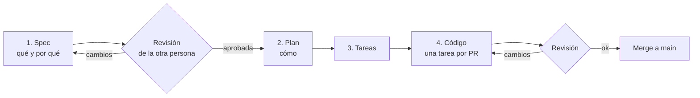

# Cómo trabajamos

## El ciclo de cada epic

| Paso | Archivo | Quién lo escribe | Quién lo aprueba |
|---|---|---|---|
| Spec | `spec.md` | El dueño del epic, con o sin IA | La otra persona |
| Plan | `plan.md` | El dueño del epic, con o sin IA | La otra persona, sobre todo los contratos con otros epics |
| Tareas | `tasks.md` | Se sacan del plan | No requiere aprobación |
| Código | `src/`, `tests/` | Cualquiera, con cualquier IA | La otra persona en el PR |

## Reglas

1. **Si no está en la spec, no se construye.** Si algo falta, primero se agrega a la spec en el mismo PR y se explica por qué.
2. **Una tarea = una rama = un PR.** La rama se llama `E04-T007-ajuste-existencia`.
3. **Los PRs son chicos.** Si una tarea pasa de ~400 líneas, se parte.
4. **Las preguntas no se adivinan.** Van en *Preguntas abiertas* de la spec, con quién debe contestar.
5. **Los contratos entre epics** (lo que uno llama del otro) viven en el `plan.md` del que los implementa. Cambiarlos requiere avisar a la otra persona.

## Trabajar con IA (Claude, Codex, Copilot, Cursor…)

Todas leen `AGENTS.md`, así que las reglas son las mismas para todos. Un buen prompt para una tarea se ve así:

> Trabaja en la tarea **E04-T007** de `specs/E04-escritorio-inventario/tasks.md`. Lee primero `AGENTS.md`, la constitución y la spec y el plan de E04. Haz solo esa tarea, escribe las pruebas que pide, ejecuta las verificaciones disponibles y registra su resultado.

Tips:
- Dale **una** tarea, no el epic completo.
- Si la IA propone algo que no está en la spec, la respuesta es "agrégalo a Preguntas abiertas" y no "sí, hazlo".
- Revisa el código de la IA igual que el de una persona.

## Tablero

En `tasks.md`, cada tarea tiene casilla, dueño y estado. Si quieren algo más visual, cada tarea se puede copiar como issue de GitHub con el ID en el título (`E04-T007 Ajustar existencia`).

## Cierre e integración entre epics

La implementación propia de un epic se integra antes de empezar el siguiente. Para E00 → E08 → E04 se exigen los controles disponibles y el registro de la validación diferida según esta política. Una integración que necesita una capacidad posterior pertenece al epic que introduce esa capacidad, con tarea y criterios de aceptación identificados. No se crean servicios provisionales, falsos ni operaciones vacías en producción para cerrar el epic anterior.

En la evidencia de cada AC se distingue: **implementación propia**, **verificación de contrato** sobre la implementación real disponible y **verificación de extremo a extremo pendiente** con su epic/tarea dueño. Probar un contrato no acredita el escenario completo. Mover una responsabilidad no completa una tarea ni un requisito; las integraciones pendientes conservan sus BR/AC originales y sus casillas sin marcar. Las matrices de las specs E00, E08 y E04 delimitan su cierre sin eliminar requisitos.

## Validación diferida

Política aprobada el 2026-11-09 para implementar E00 → E08 → E04. Durante la implementación se ejecutan las pruebas unitarias locales y todos los controles aplicables disponibles. Cuando falta infraestructura, las pruebas de integración dependientes de PostgreSQL se pueden diferir al hito de Inventario. Se conservan su código, configuración, cobertura y criterios de aceptación. Las pruebas diferidas se registran como pendientes, con cualquier fallo de arranque identificado por separado, y jamás se contabilizan como aprobadas. Los fallos funcionales que se detecten se corrigen antes de integrar.

En el PR y en `tasks.md` se registra la evidencia con estos estados:

- **Implementación integrada**. Identificar el PR integrado tras revisión humana.
- **Validación disponible aprobada**. Registrar compilación, pruebas, análisis estático y controles ejecutados, con sus resultados.
- **Validación de integración pendiente**. Registrar ID de tarea, nombres de pruebas o suite, motivo, infraestructura requerida e hito previsto. Registrar el resultado real cuando se ejecute.
- **Validación completa**. Marcar la casilla cuando todas las verificaciones requeridas se hayan aprobado. Un epic conserva su estado de validación pendiente mientras falte cualquiera de sus verificaciones.

Una implementación integrada con controles disponibles aprobados puede satisfacer una dependencia de implementación aunque quede validación de infraestructura registrada. Se conserva una tarea por rama y PR.

## Hito de validación de Inventario

Tras integrar la funcionalidad requerida de E00, E08 y E04, ejecutar las suites PostgreSQL diferidas y realizar QA de extremo a extremo en Azure STG. Registrar evidencia por tarea y AC, corregir los fallos y volver a ejecutar las verificaciones afectadas antes de declarar la validación completa.

| Área | Verificación |
|---|---|
| PostgreSQL y aislamiento | Aplicar y revertir migraciones. Verificar aislamiento por organización y restaurante, y persistencia de los metadatos. |
| Acceso | Comprobar autenticación, autorización y permisos efectivos en el servidor. |
| Persistencia de Inventario | Verificar altas y cambios de insumos, existencias, ajustes y kardex con PostgreSQL. |
| Consumo | Comprobar consumo, devolución de existencias y comportamiento ante faltantes con los contratos y capacidades disponibles. |
| Operación | Validar notificaciones de Inventario, importación y conteos físicos. |
| QA | Recorrer los flujos de Inventario de extremo a extremo en Azure STG y registrar los resultados. |

Los escenarios que requieren capacidades de epics posteriores conservan su dueño y verificación de extremo a extremo según las matrices de las specs. El hito verifica los contratos disponibles y la funcionalidad propia de E00, E08 y E04, incluyendo todos los pendientes de infraestructura de esas capacidades. Azure DEV/STG se provisiona por separado por la persona asignada. iOS se valida en la fase final del proyecto.
