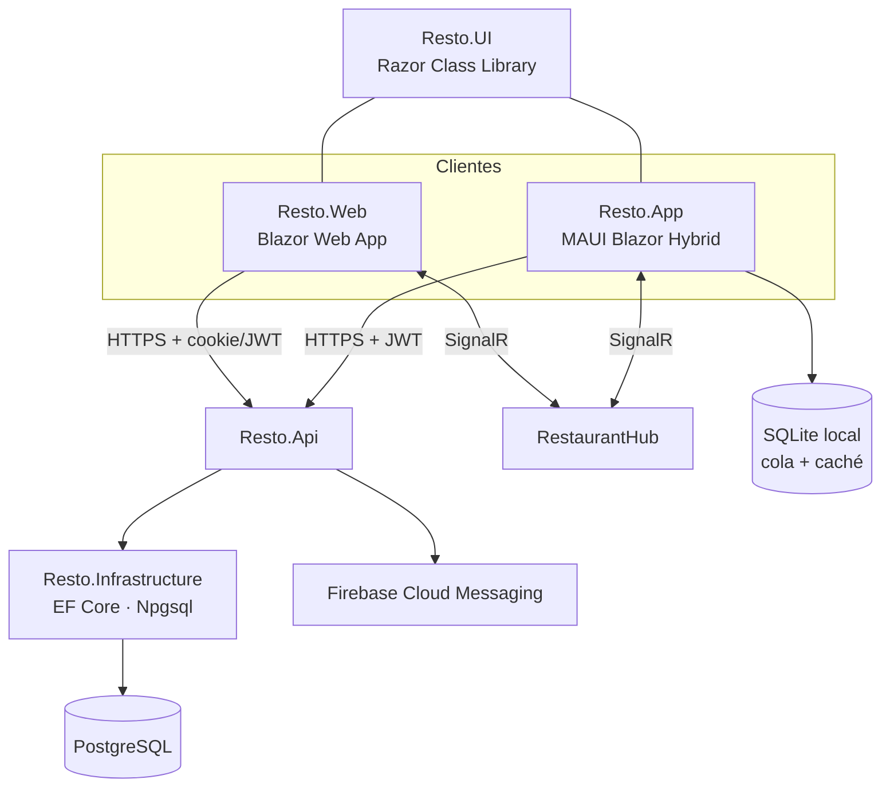

# E00 · Plataforma → Fundaciones · Plan técnico

## 1. Resumen



## 2. Solución y proyectos

Se crea con la plantilla **MAUI Blazor Hybrid and Web App** de .NET 10 y se agregan los demás proyectos.

| Proyecto | Tipo | Referencias |
|---|---|---|
| `Resto.Domain` | classlib `net10.0` | — |
| `Resto.Contracts` | classlib `net10.0` | — |
| `Resto.Infrastructure` | classlib `net10.0` | Domain, Contracts |
| `Resto.Api` | ASP.NET Core | Domain, Contracts, Infrastructure |
| `Resto.UI` | Razor Class Library | Contracts |
| `Resto.App` | MAUI Blazor Hybrid (Windows, Android, iOS) | UI, Contracts, Domain |
| `Resto.Web` | Blazor Web App | UI, Contracts |
| `Resto.Printing` | classlib `net10.0` | Contracts (lo llena E12) |
| `tests/*` | xUnit | lo que prueban |

Comunes: `Directory.Build.props` con `Nullable=enable`, `TreatWarningsAsErrors=true` en Domain y Contracts, `LangVersion=latest` y `Directory.Packages.props` (versiones centralizadas).

## 3. Modelo de datos

| Tabla | Columnas clave | Notas |
|---|---|---|
| `organizations` | `Id`, `Name`, `LegalName`, `CreatedAt` | El cliente que paga |
| `restaurants` | `Id`, `OrganizationId`, `Name`, `BranchName`, `TimeZone` (`America/Tijuana`), `BusinessDayCutoff` (`04:00`), `NextOrderNumber` | Cada sucursal |
| `devices` | `Id`, `RestaurantId`, `Name`, `Kind` (`Register`, `WaiterPhone`, `KitchenBuyerPhone`, `KitchenDisplay`, `Kiosk`), `TokenHash`, `RegisteredAt`, `RevokedAt`, `LastSeenAt`, `PushToken` | BR-PLT-02 |
| `device_pairing_codes` | `Code` (6), `RestaurantId`, `Kind`, `ExpiresAt`, `UsedAt` | BR-PLT-02 |
| `audit_entries` | `Id`, `RestaurantId`, `UserId`, `DeviceId`, `OccurredAt`, `Module`, `Action`, `Detail`, `BeforeJson`, `AfterJson`, `EntityType`, `EntityId` | Solo `INSERT` (BR-PLT-06). Índices por `(RestaurantId, OccurredAt desc)`, por `EntityId` y por `UserId`. |
| `notifications` | `Id`, `RestaurantId`, `UserId`, `Text`, `DeepLink`, `CreatedAt`, `ReadAt` | Se borran tras 30 días con un job (BR-PLT-12) |
| `idempotency_keys` | `Key`, `RestaurantId`, `ResponseStatus`, `ResponseBody`, `CreatedAt` | Vence a las 24 h (BR-PLT-07) |
| `pin_attempts` | `UserId`, `DeviceId`, `FailedCount`, `LockedUntil` | BR-PLT-01 |

Los usuarios, roles y permisos son tablas de E07. E00 crea una versión mínima (`users` con `PinHash` y `PasswordHash`, `roles` y `role_permissions`) que E07 completa.

**Clase base** `TenantEntity { Id, OrganizationId, RestaurantId, CreatedAt, CreatedBy, UpdatedAt, UpdatedBy }`:
- Un `SaveChangesInterceptor` llena los campos.
- Otro interceptor escribe la auditoría de las entidades marcadas con `[Audited]`.

## 4. Seguridad

- **Correo y contraseña:** se hashean con `PasswordHasher<User>` de ASP.NET Core Identity, sin usar todo Identity.
- **PIN:** se hashea con el mismo hasher. Al validarlo, el servidor revisa `pin_attempts`.
- **Tokens:** JWT de acceso de 15 minutos con *claims* `sub`, `org`, `rest`, `dev` y `perm` (lista), más un *refresh token* de 30 días ligado al dispositivo.
- **Dispositivo:** al registrarse recibe un `DeviceToken` (aleatorio de 256 bits, guardado con hash). La app lo guarda en `SecureStorage` y lo manda en el encabezado `X-Device-Token`, que se valida en cada petición (BR-PLT-02).
- **Permisos:** catálogo `Permissions` (constantes `"inventory.view"`, …) en Contracts. Filtro de endpoint `.RequirePermission(Permissions.InventoryView)`. En la UI, `<PermissionView Permission="…">`.
- **Web:** cookie `HttpOnly` y `SameSite=Strict` para la Web App. La app MAUI usa JWT.

## 5. Contratos que ofrece (ver [`docs/contratos.md`](../../docs/contratos.md))

```csharp
public interface ICurrentUser
{
    Guid UserId { get; }
    Guid OrganizationId { get; }
    Guid RestaurantId { get; }
    Guid? DeviceId { get; }
    bool HasPermission(string permission);
}

public interface IAuditLog
{
    Task WriteAsync(AuditRecord record, CancellationToken ct);
}
public sealed record AuditRecord(string Module, string Action, string Detail,
    string? EntityType = null, Guid? EntityId = null, object? Before = null, object? After = null);

public interface INotificationService
{
    Task ToUserAsync(Guid userId, string text, string deepLink, CancellationToken ct);
    Task ToRoleAsync(string roleKey, string text, string deepLink, CancellationToken ct);
}

public interface IMessageDelivery   // correo y WhatsApp (E03, E06, E07, E14, E21)
{
    Task SendEmailAsync(string to, string subject, string html, IReadOnlyList<Attachment>? attachments, CancellationToken ct);
    Task SendWhatsAppAsync(string phone, string templateKey, IReadOnlyDictionary<string,string> values, Attachment? document, CancellationToken ct);
}

public interface IClock
{
    DateTimeOffset UtcNow { get; }
    DateOnly BusinessDay(DateTimeOffset utc); // BR-PLT-11
}
```

## 6. Tiempo real

- `RestaurantHub` en `/hubs/restaurant` con autenticación JWT.
- Al conectar, agrega al cliente a `restaurant:{id}`, `user:{id}`, `role:{rolKey}` y, si es pantalla de cocina, a `station:{id}`.
- `IHubContext<RestaurantHub>` se envuelve en `IRealtimePublisher.PublishAsync(group, eventName, payload)` para que los epics no dependan de SignalR.
- **Cliente:** `RealtimeConnection` en UI con reconexión automática. Al reconectar, dispara el evento `Resynced` y cada página vuelve a cargar su estado (BR-PLT-13).

## 7. Sin conexión (app MAUI)

- `LocalDbContext` (SQLite) con dos tablas:
  - `outbox`: `Id`, `IdempotencyKey`, `Method`, `Path`, `Body`, `CreatedAt`, `Attempts`, `LastError`.
  - `cache`: `Key`, `Json`, `UpdatedAt`.
- `ApiClient` envuelve `HttpClient`:
  - Si hay red, envía directo con `Idempotency-Key`.
  - Si no hay red y el endpoint está marcado como `[OfflineCapable]`, guarda en `outbox` y regresa un resultado provisional.
- `OutboxSyncService` (en segundo plano) escucha `Connectivity.ConnectivityChanged` y reintenta según BR-PLT-09.
- `ConnectivityBanner.razor` muestra la barra con los pendientes.
- Cada epic decide qué endpoints son `[OfflineCapable]` y qué guarda en `cache`.

## 8. Pantallas (`Resto.UI/Shell/` y `Features/Auth/`)

| Componente | Responsabilidad | Captura |
|---|---|---|
| `MainLayout.razor` | Menú lateral, barra superior y área de trabajo | 01 |
| `NavRail.razor` | Módulos filtrados por permiso, contadores y "Nuevo" | 01, 05 |
| `TopBar.razor` | Tema, usuario y campana | 01 |
| `NotificationBell.razor` | Lista y marcar como leído | 02 |
| `ToastHost.razor` + `IToastService` | Mensajes de confirmación | 04 |
| `ModalHost.razor` + `IModalService` | Modales con foco atrapado y cierre con Esc | — |
| `ThemeService` | Sistema, claro u oscuro, guardado en `Preferences` / `localStorage` | 03 |
| `PageHeader.razor` | Título, ayuda y acciones | 01 |
| `LoginPage.razor` | Sección 3.5 de la spec | 06 |
| `PinPadPage.razor`, `LockScreen.razor` | Sección 3.5 | 07 |
| `PairDevicePage.razor` | Sección 3.5 | 08 |
| `LegalLinks.razor` (aviso de privacidad y términos, lo reutilizan E17, E18, E19 y E21) | BR-PLT-16 | 06 |
| `NoAccessPage.razor`, `ErrorBoundaryView.razor` | Estados | — |
| `ConnectivityBanner.razor` | Estados | 09 |
| `wwwroot/css/tokens.css`, `base.css`, `components.css` | Tokens de la constitución §8 y componentes base | 01, 03 |

## 9. API

| Método y ruta | Permiso | Notas |
|---|---|---|
| `POST /api/auth/login` | público | Correo y contraseña → tokens (BR-PLT-03) |
| `POST /api/auth/pin` | dispositivo válido | `{ UserId, Pin }` → tokens. Aplica bloqueo (BR-PLT-01) |
| `POST /api/auth/refresh` | refresh token | |
| `GET /api/auth/staff` | dispositivo válido | Personal activo para el teclado de PIN (nombre e iniciales) |
| `POST /api/devices/pairing-codes` | `platform.devices` | Genera un código |
| `POST /api/devices/pair` | público + código | Regresa el `DeviceToken` |
| `GET /api/devices`, `POST /api/devices/{id}/revoke` | `platform.devices` | |
| `GET /api/notifications`, `POST /api/notifications/{id}/read` | sesión | |
| `GET /api/me` | sesión | Usuario, restaurante y permisos |

## 10. Infraestructura

- **CI** (GitHub Actions): `dotnet build` + `dotnet test` en cada PR (Windows y Linux). La compilación de iOS corre en `macos-latest` solo en `main`.
- **Logs:** `ILogger` con salida estructurada (JSON) y `TraceId` en cada respuesta de error para el código de referencia.
- **Migraciones:** `dotnet ef migrations` en Infrastructure. En producción se aplican al desplegar.
- **Respaldos (BR-PLT-14):** PostgreSQL administrado con *point-in-time restore* de 7 días + exportación mensual (`pg_dump`) a almacenamiento frío con retención de 12 meses. Job mensual `RestoreDrill` en GitHub Actions que restaura a *staging*, corre `/health` y deja el resultado en `docs/bitacora-restauraciones.md`.
- **Monitoreo:** `MapHealthChecks("/health")` con revisión de base de datos y SignalR. OpenTelemetry → Application Insights (o el equivalente del hospedaje de P-01). Alertas: 3 fallas seguidas, errores 5xx > 1% en 5 min o respuesta p95 > 2 s.
- **Seguridad (BR-PLT-15):** `UseHttpsRedirection` + `UseHsts`, `AddRateLimiter` (ventana fija de 20 por minuto por IP en `/api/auth/*` y endpoints públicos), encabezados CSP, `X-Content-Type-Options` y `Referrer-Policy`. Secretos en variables de entorno o *Key Vault*. Revisión OWASP Top 10 en la lista de cada versión.
- **Privacidad (BR-PLT-16):** interfaz `IPersonalDataEraser` que cada epic con datos de clientes implementa (E14 `fiscal_customers`, E18 `incoming_orders`). El borrado reemplaza nombre, teléfono y correo por "Eliminado" y queda en auditoría.
- **Ambientes:** `Development`, `Staging` y `Production`, cada uno con su base de datos y sus secretos.
- **Datos semilla de desarrollo:** el restaurante *Mariscos El Faro* con los mismos usuarios, insumos y platillos del demo (`DevSeed.cs`), para que todos prueben con los datos de las capturas.

## 11. Pruebas

| Proyecto | Qué cubre |
|---|---|
| Domain.Tests | `IClock.BusinessDay` (BR-PLT-11) y reglas de PIN |
| Api.Tests | AC-PLT-01 a 08, 11, 14 y 15 con Testcontainers. **Prueba de aislamiento** que recorre todas las entidades `TenantEntity` y verifica que no se ven datos de otro restaurante (BR-PLT-05). |
| UI.Tests | `NavRail` por permisos, `ConnectivityBanner` y `LockScreen` |
| Manual | AC-PLT-09, 10, 13 y 16 (sin conexión, *push* y reconexión) |

## 12. Paquetes

| Paquete | Dónde | Para qué |
|---|---|---|
| `Npgsql.EntityFrameworkCore.PostgreSQL` | Infrastructure | PostgreSQL |
| `Microsoft.EntityFrameworkCore.Sqlite` | App | Caché y cola sin conexión |
| `Microsoft.AspNetCore.Authentication.JwtBearer` | Api | Tokens |
| `Microsoft.AspNetCore.SignalR.Client` | UI | Tiempo real |
| `FluentValidation.DependencyInjectionExtensions` | Api | Validación de peticiones (todos los epics la usan) |
| `FirebaseAdmin` | Infrastructure | *Push* (sujeto a P-02) |
| Proveedor de correo (SMTP o API, por ejemplo SendGrid o Amazon SES) | Infrastructure | `IMessageDelivery` (correo). WhatsApp se conecta en E03-T012. |
| `Plugin.Firebase.CloudMessaging` | App | Recibir *push* (sujeto a P-02) |
| `xunit`, `bunit`, `Testcontainers.PostgreSql`, `Microsoft.AspNetCore.Mvc.Testing` | tests | Pruebas |
