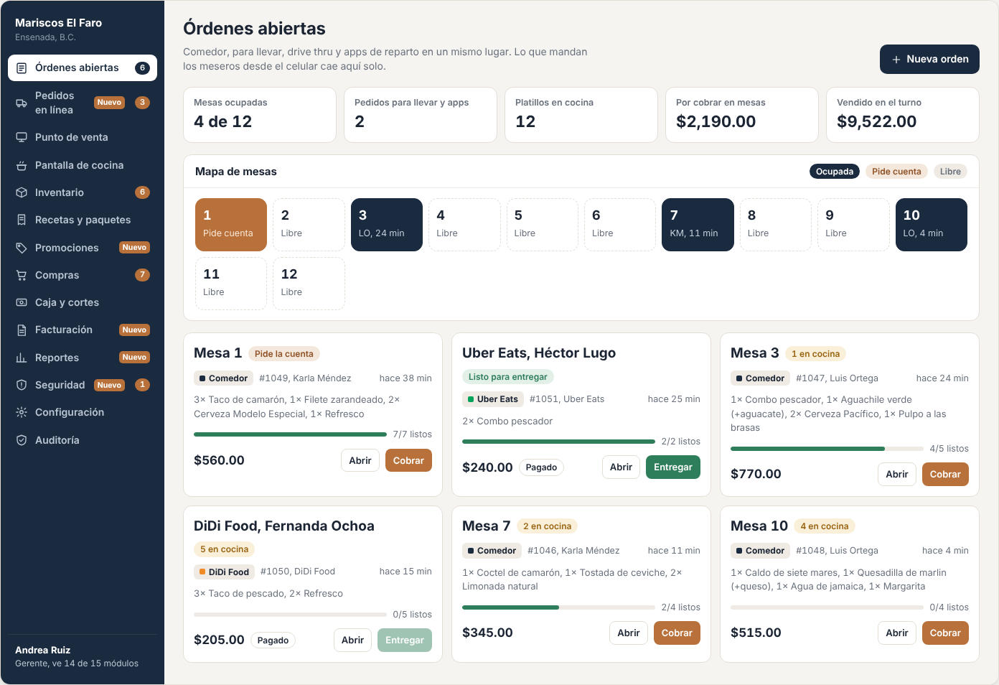
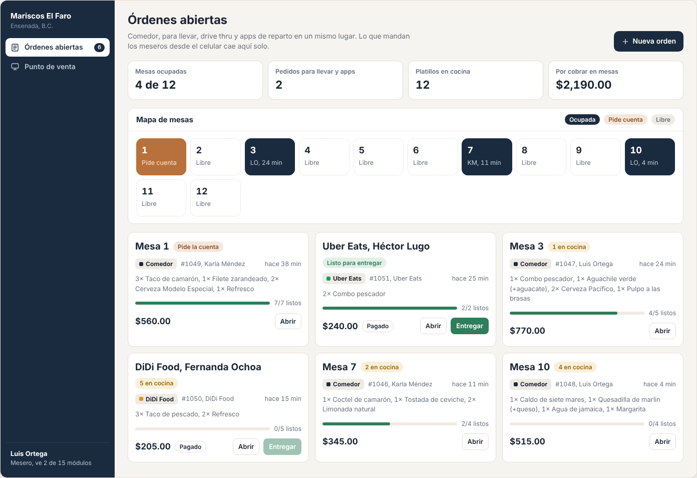
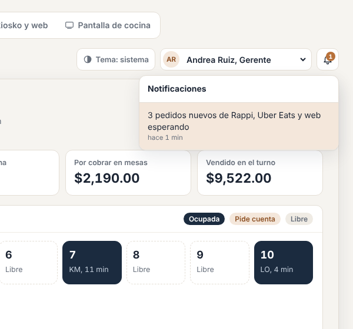
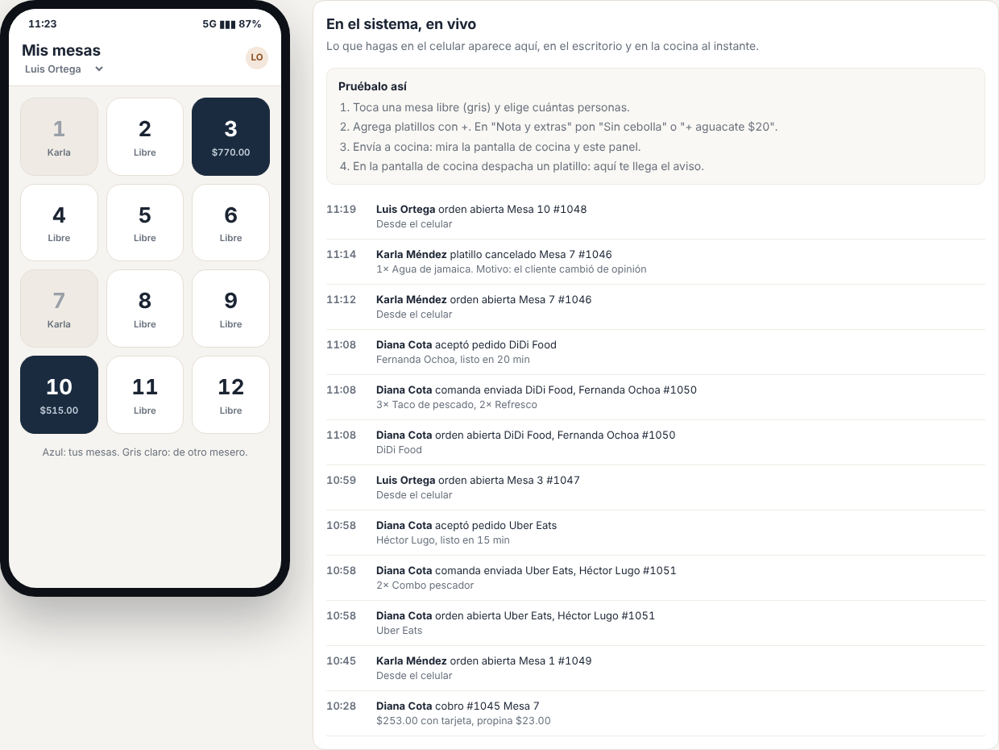
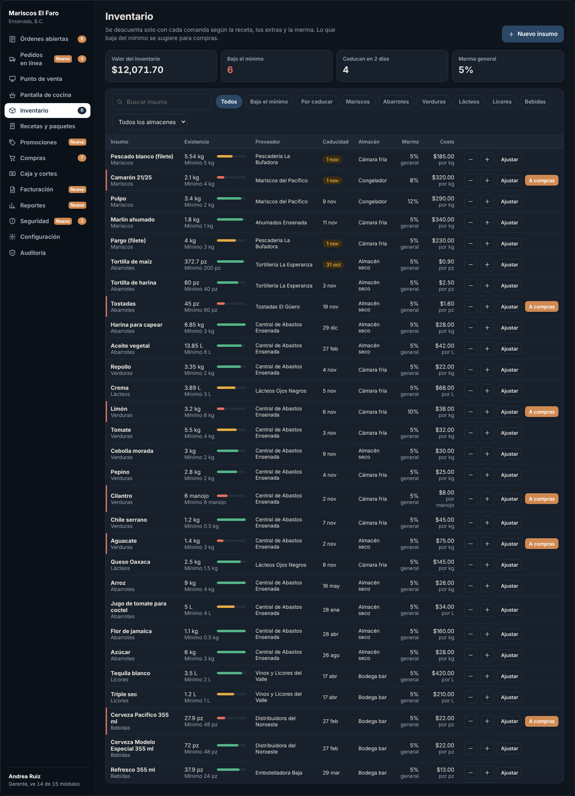
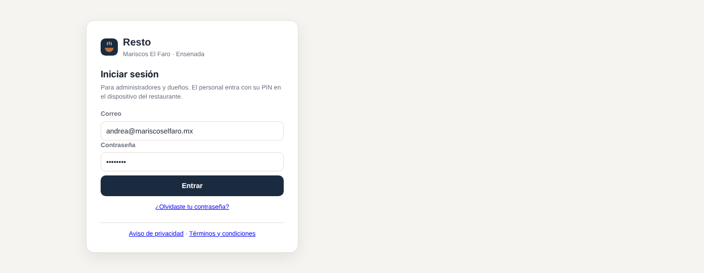
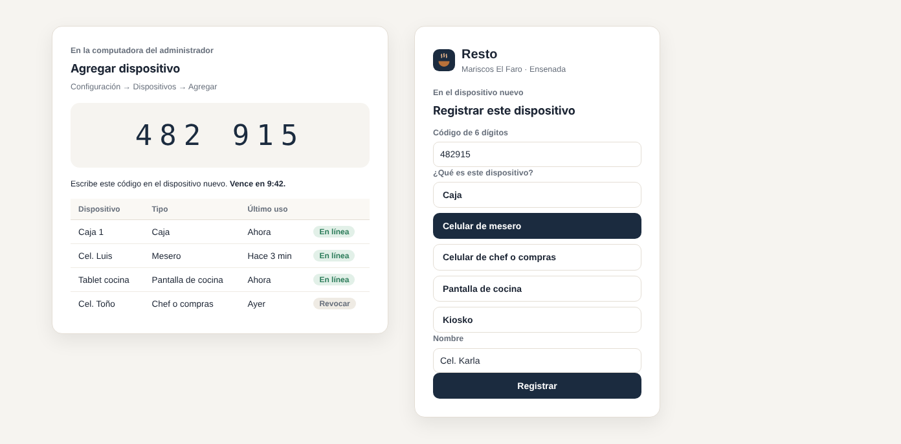
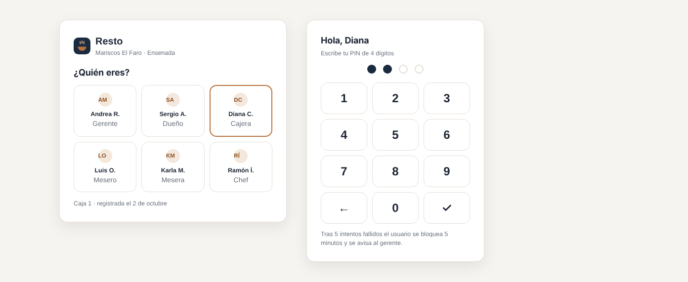
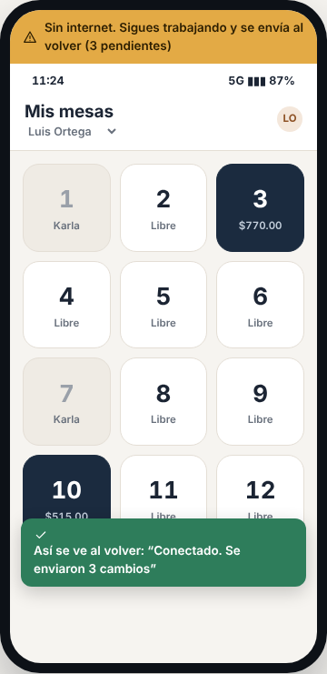

# E00 · Plataforma → Fundaciones · Spec

| | |
|---|---|
| **Epic** | E00 |
| **Superficie** | Plataforma (servidor, app y web) |
| **Ola** | 1 · Operación. **Va antes que todo.** |
| **Responsable** | Por definir |
| **Revisa** | Por definir |
| **Estado** | Borrador para revisión |
| **Depende de** | — |
| **Lo usan** | Todos los epics |
| **Diseño** | Estructura general del demo (menú lateral, barra superior, avisos y modales). Capturas en [`img/`](img/) |

## 1. Problema

Todos los módulos necesitan lo mismo: saber quién es el usuario y de qué restaurante, qué puede hacer, dejar registro de lo que hizo, avisar a otros en tiempo real, seguir funcionando sin internet y verse igual. Si cada epic lo resuelve por su lado, terminamos con cinco formas distintas de hacer lo mismo.

**Lo que queremos:** una base común, probada y aburrida, sobre la que los demás epics solo agreguen su módulo.

## 2. Quién lo usa

| Rol | Qué hace aquí |
|---|---|
| Dueño o administrador | Entra con correo y contraseña, registra los dispositivos del restaurante |
| Todo el personal | Entra con su PIN en un dispositivo registrado y cambia de usuario rápido |
| Los demás epics | Usan la sesión, los permisos, la auditoría, los avisos, el tiempo real y la cola sin conexión |

## 3. Pantallas

### 3.1 Estructura del escritorio

- **Menú lateral** azul marino con el nombre del restaurante y la sucursal arriba, los módulos con contadores y, abajo, el usuario y su rol.
- **Barra superior** con el selector de tema (sistema, claro u oscuro), el usuario actual (para cambiar de usuario) y la campana de avisos.
- **Área de trabajo** con encabezado (título, ayuda y acciones a la derecha).
- En pantallas de menos de 900 px, el menú lateral pasa a una barra horizontal con scroll.

### 3.2 Menú según el rol

Solo aparecen los módulos para los que el rol tiene permiso. Abajo dice "Mesero, ve 2 de 15 módulos". Si alguien entra por URL a un módulo sin permiso, ve la pantalla **"No tienes acceso a este módulo"** con el botón *Ir al inicio*.

### 3.3 Avisos

- **Campana** con un contador de no leídos. Al abrirla se ven los últimos 8; los no leídos llevan fondo cobre claro.
- Al tocar un aviso, te lleva a la pantalla correspondiente (por ejemplo, "Mesa 1 pide la cuenta" abre esa cuenta en Punto de venta).
- **Toast:** un mensaje abajo al centro que confirma cada acción ("Limón: 2.5 kg") y desaparece a los 4.5 segundos.
- **En el celular:** *push* si la app está cerrada, o un banner arriba si está abierta (ver la captura).

### 3.4 Modo oscuro

Se usa el tema del sistema por defecto. La elección de cada usuario se guarda en su dispositivo. **El celular del mesero siempre va en claro** y **la pantalla de cocina siempre en oscuro** (constitución §8).

### 3.5 Acceso, dispositivos y estados (capturas de maqueta)

| Pantalla | Contenido |
|---|---|
| **Iniciar sesión (administrador)** | Logo, correo, contraseña, *Entrar* y *¿Olvidaste tu contraseña?*. Funciona en web y en la app. Abajo: enlaces a *Aviso de privacidad* y *Términos*.  |
| **Registrar este dispositivo** | El administrador entra a *Configuración → Dispositivos → Agregar*, el sistema muestra un **código de 6 dígitos** válido por 10 minutos, y en el dispositivo nuevo se escribe ese código. Se elige el tipo: Caja, Celular de mesero, Celular de chef o compras, Pantalla de cocina o Kiosko.  |
| **Entrar con PIN** | Teclado numérico grande con las fotos o iniciales del personal del restaurante. Tocas tu nombre, escribes tu PIN de 4 dígitos y entras.  |
| **Pantalla bloqueada** | Igual que *Entrar con PIN*, con el último usuario seleccionado. Aparece tras la inactividad de BR-PLT-04. |
| **Barra "Sin conexión"** | Una franja ámbar arriba que dice "Sin internet. Sigues trabajando y se envía al volver (3 pendientes)". Cuando vuelve la conexión dice "Conectado. Se enviaron 3 cambios" y desaparece.  |
| **Error inesperado** | "Algo salió mal. Ya quedó registrado. Intenta de nuevo." con el botón *Reintentar* y un código corto de referencia para soporte. |

### 3.6 Lo que no se ve pero tiene que estar

| Tema | Qué se garantiza |
|---|---|
| **Respaldos** | Copia automática diaria de la base de datos con recuperación a cualquier minuto de los últimos 7 días (*point-in-time*) y copias mensuales por 12 meses. Una vez al mes se **restaura una copia** en un ambiente aparte para comprobar que sirve (BR-PLT-14). |
| **Monitoreo** | Revisión de salud (`/health`) cada minuto; si la API o la base de datos fallan 3 veces seguidas, avisa al equipo por correo y WhatsApp. Errores y tiempos de respuesta en un tablero. |
| **Seguridad** | Solo HTTPS (TLS 1.2+), contraseñas con hash (ASP.NET Identity, PBKDF2), límite de intentos por IP en login y endpoints públicos, encabezados de seguridad y revisión contra OWASP Top 10 antes de cada versión (BR-PLT-15). |
| **Privacidad** | *Aviso de privacidad* y *Términos y condiciones* conforme a la LFPDPPP, enlazados en el login, el registro (E21), el menú QR, el kiosko y los pedidos web. Los datos personales de clientes (nombre, teléfono, correo, RFC) solo se usan para su pedido o factura y se pueden borrar a petición (BR-PLT-16). |
| **Ambientes** | Desarrollo, pruebas (*staging*) y producción, cada uno con su base de datos. Nunca se prueba con datos reales de clientes. |

## 4. Historias de usuario

| ID | Como… | Quiero… | Para… |
|---|---|---|---|
| US-PLT-01 | administrador | entrar con correo y contraseña | configurar mi restaurante desde cualquier lado |
| US-PLT-02 | administrador | registrar los dispositivos con un código | que solo mis equipos tengan acceso |
| US-PLT-03 | mesero | entrar con mi PIN en el celular del restaurante | no escribir correos ni contraseñas en pleno servicio |
| US-PLT-04 | cajero | cambiar de usuario en dos toques | que cada quien quede registrado con su nombre |
| US-PLT-05 | gerente | que la sesión se bloquee si nadie la usa | que nadie cobre con mi usuario |
| US-PLT-06 | cualquiera | ver solo los módulos que me tocan | no perderme ni tocar lo que no debo |
| US-PLT-07 | cualquiera | recibir avisos en la campana o en el celular | enterarme sin estar preguntando |
| US-PLT-08 | mesero | seguir tomando órdenes si se cae el internet | no dejar de vender |
| US-PLT-09 | dueño | que todo quede en auditoría sin que nadie lo tenga que recordar | saber quién hizo qué |
| US-PLT-10 | usuario con varias sucursales | elegir en cuál estoy trabajando | ver los datos correctos |

## 5. Reglas de negocio

| ID | Regla |
|---|---|
| **BR-PLT-01** | El **PIN** es de 4 dígitos y único por restaurante. Se guarda con hash, nunca en texto. Tras **5 intentos fallidos** seguidos, ese usuario queda bloqueado 5 minutos en ese dispositivo y se levanta una alerta de seguridad (E09). |
| **BR-PLT-02** | Un **dispositivo** pertenece a un solo restaurante. El código de vinculación es de 6 dígitos, de un solo uso, y vence a los 10 minutos. El administrador puede **revocar** un dispositivo, y entonces pierde el acceso en la siguiente petición. |
| **BR-PLT-03** | El **PIN** solo funciona en un dispositivo registrado. El **correo con contraseña** funciona en cualquier lugar, pero solo para usuarios con el permiso `platform.remote_login` (dueño, gerente o administrador). |
| **BR-PLT-04** | **Bloqueo por inactividad**, configurable por tipo de dispositivo: caja 5 min, celulares 3 min, cocina y kiosko nunca. Al bloquear se conserva el trabajo en pantalla. |
| **BR-PLT-05** | **Aislamiento.** Ninguna consulta regresa datos de otro restaurante. Se garantiza con el filtro global de EF y con una prueba automática por entidad. |
| **BR-PLT-06** | **Auditoría** automática en toda escritura: usuario, dispositivo, restaurante, fecha UTC, módulo, acción, detalle legible en español y valores antes y después (JSON). No se edita ni se borra. Se conserva mínimo 5 años. |
| **BR-PLT-07** | **Idempotencia.** Toda petición que cambia datos desde un dispositivo lleva un `Idempotency-Key` (GUID que genera el cliente). Si llega dos veces en 24 horas, se responde lo mismo sin repetir la acción. |
| **BR-PLT-08** | **Sin conexión.** Sin internet funciona: tomar y modificar órdenes, imprimir comandas en impresoras de red locales, cobrar en efectivo y consultar el menú y la última copia del inventario. **No** funciona: facturar, cobrar con terminal integrada, pedidos en línea, reportes ni configuración. Lo que no funciona se ve deshabilitado con la leyenda "Requiere internet". |
| **BR-PLT-09** | **Cola sin conexión.** Los cambios se guardan en orden y se envían en el mismo orden al volver, reintentando cada 5, 10, 30 y 60 s. Si el servidor rechaza un cambio (por ejemplo, la mesa ya la cobró otro), se avisa al usuario con lo que pasó y **no** se reintenta. |
| **BR-PLT-10** | **Folios.** Las órdenes llevan un folio consecutivo por restaurante (#1046) que asigna el servidor. Una orden creada sin conexión lleva un folio provisional ("L-07") hasta sincronizar. |
| **BR-PLT-11** | **Fechas.** Se guardan en UTC y se muestran en la zona del restaurante (por defecto `America/Tijuana`). El "día de operación" termina a la hora de cierre configurada (por defecto 4:00 a.m.), así una venta a la 1:00 a.m. cuenta para el día anterior. |
| **BR-PLT-12** | **Avisos.** Se guardan 30 días. Uno dirigido a un rol llega a todos los usuarios activos de ese rol. El *push* solo se manda si la app no está abierta. Si está abierta, se usa el banner. |
| **BR-PLT-13** | **Tiempo real.** Al reconectarse, la pantalla vuelve a pedir su estado completo. No se confía en haber recibido todos los eventos mientras estaba desconectada. |
| **BR-PLT-14** | **Respaldos:** recuperación a cualquier minuto de los últimos 7 días y copias mensuales por 12 meses. La restauración se prueba cada mes y se anota. Objetivo: perder como máximo 5 minutos de datos y volver a operar en menos de 1 hora. |
| **BR-PLT-15** | **Seguridad:** solo HTTPS, límite de 20 intentos por minuto por IP en login, PIN y endpoints públicos (429), encabezados de seguridad (HSTS, CSP) y secretos fuera del código (variables de entorno o *Key Vault*). |
| **BR-PLT-16** | **Privacidad (LFPDPPP):** aviso de privacidad visible antes de pedir datos personales. Un cliente puede pedir que se borren sus datos: se anonimizan sin borrar ventas ni facturas. |

## 6. Criterios de aceptación

| ID | Dado… | Cuando… | Entonces… |
|---|---|---|---|
| AC-PLT-01 | un dispositivo sin registrar | alguien intenta entrar con PIN | ve "Este dispositivo no está registrado. Pide al administrador un código." |
| AC-PLT-02 | el administrador generó el código 482915 | lo escribo en la tablet a los 3 minutos | la tablet queda registrada como "Pantalla de cocina" y aparece en la lista de dispositivos |
| AC-PLT-03 | el mismo código | se intenta usar a los 11 minutos o por segunda vez | se rechaza con "El código venció o ya se usó" |
| AC-PLT-04 | Luis Ortega con PIN 5512 en un celular registrado | escribe 5512 | entra y ve solo *Mis mesas* |
| AC-PLT-05 | Luis | se equivoca 5 veces | queda bloqueado 5 minutos y el gerente recibe la alerta "5 intentos fallidos de PIN: Luis Ortega, celular 3" |
| AC-PLT-06 | la caja abierta con Diana | pasan 5 minutos sin tocarla | aparece la pantalla bloqueada; Diana pone su PIN y sigue donde estaba |
| AC-PLT-07 | un usuario de *Mariscos El Faro* | consulta `/api/inventory/ingredients` con el `Id` de un insumo de otro restaurante | recibe 404, no 403, para no revelar que existe |
| AC-PLT-08 | cualquier cambio de datos | se guarda | existe un `AuditEntry` con usuario, dispositivo, antes y después |
| AC-PLT-09 | un celular sin internet | el mesero envía una orden | ve la barra "Sin internet… (1 pendiente)", la comanda se imprime en la impresora de red y la orden aparece con folio L-01 |
| AC-PLT-10 | el mismo celular | vuelve el internet | la orden se envía sola, recibe su folio real (#1052) y la barra dice "Se envió 1 cambio" |
| AC-PLT-11 | la misma petición con el mismo `Idempotency-Key` | llega dos veces | solo existe una orden |
| AC-PLT-12 | sin internet | abro Facturación | el módulo dice "Requiere internet" y no deja facturar |
| AC-PLT-13 | un aviso para el rol Chef | lo emite el sistema | lo ven Ramón (campana) y su celular (*push*), y no lo ve el mesero |
| AC-PLT-14 | un usuario con permiso solo de Órdenes | entra a `/inventario` por URL | ve "No tienes acceso a este módulo" |
| AC-PLT-15 | una venta a la 1:30 a.m. | se consulta el día | cuenta para el día de operación anterior |
| AC-PLT-16 | una pantalla que estuvo 2 minutos sin conexión | se reconecta | muestra el estado correcto aunque se hayan perdido eventos |
| AC-PLT-17 | la copia de ayer a las 15:00 | se restaura en *staging* | la app abre con las órdenes de ayer hasta las 15:00 y el resultado queda anotado en la bitácora de restauraciones |
| AC-PLT-18 | 20 intentos de login fallidos desde la misma IP en un minuto | llega el intento 21 | responde 429 "Demasiados intentos, espera un minuto" |
| AC-PLT-19 | un cliente pide borrar sus datos | el gerente lo hace desde E14 o E18 | su nombre, teléfono y correo se reemplazan por "Eliminado" y las ventas y facturas se conservan (obligación fiscal) |

## 7. Fuera de alcance

- Gestión de usuarios, roles y matriz de permisos (E07). E00 solo **valida** permisos.
- Planes, suscripción y cobro de la licencia (E21).
- Pantallas de configuración del restaurante (E08). E00 solo crea la tabla `restaurants`.

## 8. Preguntas abiertas

| ID | Pregunta | Contesta | Estado |
|---|---|---|---|
| P-01 | ¿Dónde se hospeda? La propuesta es Azure App Service + Azure Database for PostgreSQL en una región de EUA (cerca de Baja California). | Equipo | Abierta |
| P-02 | ¿Se acepta Firebase Cloud Messaging para las notificaciones *push* (Android y iOS)? | Equipo | Abierta |
| P-03 | ¿5 años de auditoría es suficiente, o el SAT y los clientes piden más? | Equipo | Abierta |
| P-04 | ¿Qué proveedor de correo transaccional usamos (por ejemplo, SendGrid o Amazon SES)? | Equipo | Abierta |
| P-05 | ¿Quién redacta el aviso de privacidad y los términos (abogado)? | Equipo | Abierta |
