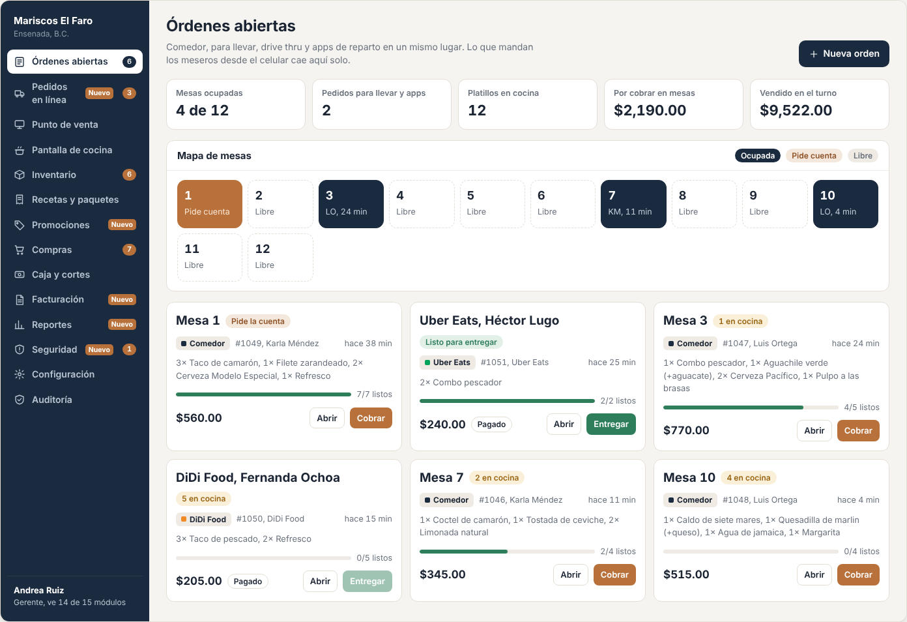
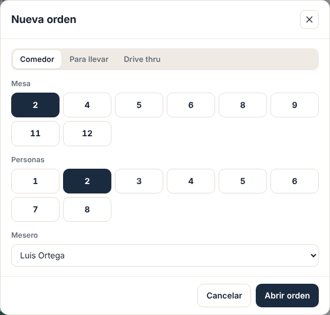
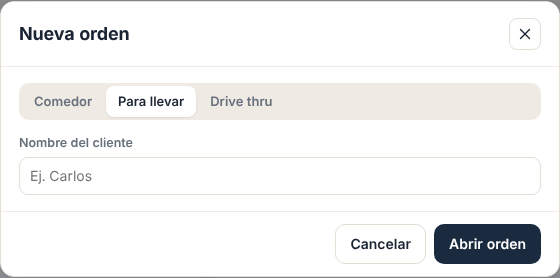

# E01 · Escritorio → Órdenes abiertas · Spec

| | |
|---|---|
| **Epic** | E01 |
| **Superficie** | Escritorio |
| **Fase** | 2 · Venta · paso 12 de 22 en el [orden de construcción](../../docs/epics.md) |
| **Responsable** | Por definir |
| **Revisa** | Por definir |
| **Estado** | Borrador para revisión |
| **Depende de** | E00, E02 (órdenes), E03 (cobrar), E08 (número de mesas) |
| **Lo usan** | Gerente y caja como pantalla de inicio |
| **Diseño** | Demo → Escritorio → Órdenes abiertas. Capturas en [`img/`](img/) |

## 1. Problema

En pleno servicio, el gerente necesita saber de un vistazo qué mesas están ocupadas, cuáles piden la cuenta, qué se está tardando en cocina y cuánto hay por cobrar, sin abrir orden por orden.

**Lo que queremos:** un tablero en vivo que sea la pantalla de inicio de la caja, desde donde se abre o se cobra cualquier orden con un toque.

## 2. Quién lo usa

| Rol | Permiso |
|---|---|
| Gerente, cajero y mesero (en caja) | `orders.view` |
| Ver "Vendido en el turno" | `cash.view` |
| Botón *Cobrar* | `cash.charge` |
| Botón *Nueva orden* | `pos.take` |

## 3. Pantallas

1. **Encabezado:** "Órdenes abiertas", una línea de ayuda y el botón *Nueva orden*.
2. **Indicadores:**
   - *Mesas ocupadas* "4 de 12"
   - *Pedidos para llevar y apps*
   - *Platillos en cocina*
   - *Por cobrar en mesas* (sin contar los prepagados)
   - *Vendido en el turno* (solo con `cash.view`)
3. **Mapa de mesas:**
   - Una casilla por mesa configurada (E08).
   - *Libre*: borde punteado. Al tocarla, abre *Nueva orden* con esa mesa.
   - *Ocupada*: azul, con las iniciales del mesero y los minutos abierta. Al tocarla, abre la orden en Punto de venta.
   - *Pide cuenta*: cobre.
   - Arriba a la derecha, la leyenda de colores.
4. **Tarjetas de órdenes:** todas las abiertas, incluidas para llevar, drive thru, apps y kiosko. Ordenadas primero por "pide la cuenta" y después de la más vieja a la más nueva. Cada tarjeta lleva:
   - Mesa o etiqueta, y una etiqueta de estado: *Pide la cuenta*, *N en cocina*, *Todo servido* o *Listo para entregar*.
   - Canal, folio, mesero o canal, y cuánto tiempo lleva abierta.
   - Platillos en una línea.
   - Barra de avance "3/5 listos".
   - Total, más la etiqueta *Pagado* si es prepagada.
   - Botones *Abrir* y *Cobrar* (o *Entregar* si es prepagada).

**Nueva orden** se abre desde aquí. El modal es de E02:

**Estados:**

| Estado | Qué se ve |
|---|---|
| Sin órdenes | Mapa con todas las mesas libres y "No hay órdenes abiertas. Cuando un mesero envíe una comanda aparece aquí." |
| Sin conexión | Se muestra la última copia con la barra de E00. El mapa sigue funcionando con las órdenes locales. |

## 4. Historias de usuario

| ID | Como… | Quiero… | Para… |
|---|---|---|---|
| US-ORD-01 | gerente | ver el mapa de mesas con su estado | saber cómo está el salón |
| US-ORD-02 | cajero | ver primero las que piden la cuenta | cobrar sin hacer esperar |
| US-ORD-03 | gerente | ver el avance de cocina de cada orden | detectar las que se están tardando |
| US-ORD-04 | cajero | abrir una orden tocando una mesa libre | empezar más rápido |
| US-ORD-05 | gerente | ver las órdenes de para llevar y apps en el mismo lugar | no tener que revisar varias pantallas |

## 5. Reglas de negocio

| ID | Regla |
|---|---|
| **BR-ORD-01** | El mapa muestra exactamente las mesas configuradas en E08, ordenadas por número. Cada mesa puede tener zona o nombre (por ejemplo "Terraza 2"), si E08 lo define. |
| **BR-ORD-02** | Estado de la mesa: *Libre* sin orden abierta; *Pide cuenta* si la orden tiene `BillRequestedAt`; si no, *Ocupada*. |
| **BR-ORD-03** | Avance = platillos servidos ÷ platillos no cancelados, contando cantidades. |
| **BR-ORD-04** | *Por cobrar en mesas* = Σ total de las órdenes abiertas **sin** prepago (con `OrderPricing` de E02). |
| **BR-ORD-05** | Orden de las tarjetas: (1) pide la cuenta, (2) más antigua primero. |
| **BR-ORD-06** | Todo se actualiza en vivo con `OrderChanged`, `ItemsDispatched`, `BillRequested` y `OrderPaid`, sin recargar. Los minutos se recalculan cada 30 s. |
| **BR-ORD-07** | Una tarjeta se pone en ámbar si tiene platillos en cocina con 10 minutos o más, y en rojo con 20 o más. Los umbrales se configuran en E08 (los mismos que usa la pantalla de cocina, E12). |

## 6. Criterios de aceptación

| ID | Dado… | Cuando… | Entonces… |
|---|---|---|---|
| AC-ORD-01 | 12 mesas, con la 1, 3, 7 y 10 ocupadas | abro la pantalla | veo "4 de 12" y las 4 en azul |
| AC-ORD-02 | la Mesa 1 pidió la cuenta | abro la pantalla | la Mesa 1 está en cobre y su tarjeta es la primera |
| AC-ORD-03 | la Mesa 5 libre | la toco | se abre *Nueva orden* con la Mesa 5 seleccionada |
| AC-ORD-04 | la Mesa 3 ocupada | la toco | se abre en Punto de venta |
| AC-ORD-05 | la orden #1048 con 4 platillos en cocina | cocina despacha 2 | la barra pasa a "2/4 listos" sin recargar |
| AC-ORD-06 | un pedido de Uber Eats prepagado y todo listo | veo su tarjeta | dice *Listo para entregar*, *Pagado* y botón *Entregar* (no *Cobrar*) |
| AC-ORD-07 | un usuario sin `cash.view` | abre la pantalla | no ve el indicador *Vendido en el turno* |
| AC-ORD-08 | una orden con un platillo en cocina hace 26 minutos | veo su tarjeta | está marcada en rojo |

## 7. Fuera de alcance

- Diseño visual del salón (arrastrar mesas a su posición real). Ver P-01.
- El modal de nueva orden y la pantalla de orden (E02). El cobro (E03).

## 8. Preguntas abiertas

| ID | Pregunta | Contesta | Estado |
|---|---|---|---|
| P-01 | ¿Hace falta un **plano del salón** con las mesas acomodadas como en la realidad, en lugar de cuadrícula? | Equipo | Abierta |
