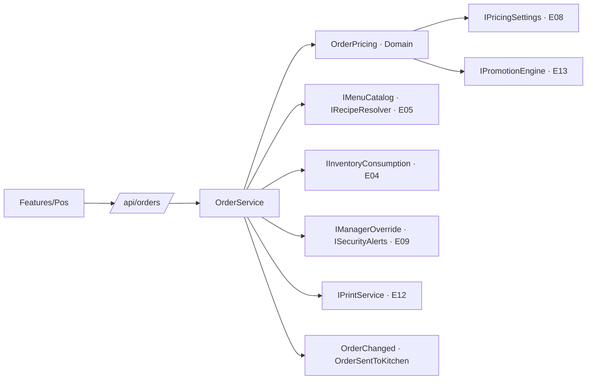

# E02 · Escritorio → Punto de venta · Plan técnico

## 1. Resumen



## 2. Modelo de datos

### `Order` (`orders`)

| Propiedad | Tipo | Notas |
|---|---|---|
| `Id`, `OrganizationId`, `RestaurantId` | `Guid` | |
| `Number` | `int?` | Folio del servidor (E00 BR-PLT-10) |
| `ProvisionalNumber` | `string?` | "L-07" sin conexión |
| `Channel` | `SalesChannel` | `DineIn`, `TakeOut`, `DriveThru`, `TableQr`, `Web`, `UberEats`, `Rappi`, `DidiFood`, `Kiosk` |
| `DiningTableId` | `Guid?` | Solo comedor y QR. Índice único parcial `(DiningTableId) WHERE Status = 'Open'` (BR-POS-02). |
| `Label` | `string?` | "Para llevar, Carlos" |
| `Guests` | `int` | |
| `WaiterId` | `Guid?` | |
| `Status` | `OrderStatus` | `Open`, `Paid`, `Voided` |
| `OpenedAt`, `ClosedAt` | `DateTimeOffset` | |
| `BillRequestedAt` | `DateTimeOffset?` | BR-POS-12 |
| `BillPrintCount` | `int` | BR-POS-10 |
| `ManualDiscountPercent`, `ManualDiscountReason`, `ManualDiscountAuthorizedBy` | `decimal?`, `string?`, `Guid?` | BR-POS-09 |
| `PrepaidMethod` | `string?` | Para E18 y E19 (pagado en app o kiosko) |
| `ExternalRef` | `string?` | Código de la app de delivery (E18) |

### `OrderItem` (`order_items`)

`Id`, `OrderId`, `MenuItemId`, `NameSnapshot`, `UnitPriceSnapshot` (`numeric(12,2)`), `Quantity` (`int`), `Note`, `Status` (`New`, `InKitchen`, `Served`, `Cancelled`), `KitchenStationId`, `AddedBy`, `AddedAt`, `SentAt`, `ServedAt`, `CancelReason`, `CancelledBy`, `CancelAuthorizedBy`, `CancelledAt`, `IsBundle`.

### Otras tablas

- `OrderItemExtra` (`order_item_extras`): `OrderItemId`, `ExtraId`, `NameSnapshot`, `PriceSnapshot`.
- `OrderEvent` (`order_events`): `Id`, `OrderId`, `UserId`, `OccurredAt`, `Kind` (enum), `Text` (español, listo para mostrar) y `DataJson`.

## 3. Domain (`Resto.Domain/Orders/`)

| Archivo | Contenido | Reglas |
|---|---|---|
| `Order.cs` | `AddItem`, `RemoveUnsent`, `SendToKitchen() → IReadOnlyList<OrderItem>`, `CancelItem`, `Void`, `ApplyDiscount`, `RemoveDiscount`, `MoveToTable`, `TransferTo`, `RegisterBillPrint`, `RequestBill`. Cada método agrega su `OrderEvent` y valida el estado. | BR-POS-01 a 03, 06, 09 a 12, 14, 16 y 17 |
| `OrderPricing.cs` | `Calculate(lines, manualDiscount, promoDiscounts, taxRules, pricesIncludeTax) → PriceBreakdown` | BR-POS-08 |
| `PriceBreakdown.cs` | `Gross`, `Discounts[] (Name, Amount)`, `Subtotal`, `Taxes[] (Name, Rate, Amount)`, `Total` | |
| `CancelPolicy.cs` | Decide si regresa inventario y si levanta alerta según el estado | BR-POS-06 |

`OrderPricing` es la **única** fuente de totales. La usan el servidor, la caja, el celular del mesero (para mostrar el total) y E03 al cobrar.

## 4. API (`/api/orders`)

| Método y ruta | Permiso | Sin conexión | Notas |
|---|---|---|---|
| `GET /api/orders?status=open` | `pos.take` u `orders.view` | caché | Para la lista y E01 |
| `GET /api/orders/{id}` | idem | caché | Con líneas, desglose y eventos |
| `POST /api/orders` | `pos.take` | ✅ | `OpenOrderRequest { Channel, TableId?, Guests, WaiterId?, Label? }` |
| `POST /api/orders/{id}/items` | `pos.take` | ✅ | `{ MenuItemId, Quantity, Note?, ExtraIds[] }` |
| `DELETE /api/orders/{id}/items/{itemId}` | `pos.take` | ✅ | Solo `New` |
| `PATCH /api/orders/{id}/items/{itemId}` | `pos.take` | ✅ | Cantidad y nota, solo `New` |
| `POST /api/orders/{id}/send` | `pos.take` | ✅ | BR-POS-04 |
| `POST /api/orders/{id}/items/{itemId}/cancel` | `pos.cancel` u *override* | ❌ | `{ Reason, OverrideToken? }` |
| `POST /api/orders/{id}/discount` | `pos.discount` u *override* | ❌ | `{ Percent, Reason, OverrideToken? }` |
| `DELETE /api/orders/{id}/discount` | `pos.discount` | ❌ | |
| `POST /api/orders/{id}/print-bill` | `pos.take`; con `pos.reprint` u *override* después de N | ❌ | |
| `POST /api/orders/{id}/move` | `pos.take` | ✅ | `{ TableId }` |
| `POST /api/orders/{id}/transfer` | `pos.transfer` | ❌ | `{ WaiterId }` |
| `POST /api/orders/{id}/void` | `pos.cancel` u *override* | ❌ | `{ Reason, OverrideToken? }` (BR-POS-17) |
| `POST /api/orders/{id}/merge` | `pos.take` (`pos.transfer` si son de otro mesero) | ❌ | `{ SourceOrderId }` (BR-POS-18) |
| `POST /api/orders/{id}/split` | `pos.take` | ❌ | `{ Lines: [{ ItemId, Qty }], TargetOrderId? }` → orden destino (BR-POS-19) |
| `POST /api/orders/{id}/request-bill` | `pos.take` | ✅ | Lo usa E10 |

**Override (E09):** el modal de PIN llama a `POST /api/security/override { Pin, Permission }`, que devuelve un `OverrideToken` válido 60 segundos para una sola acción. El endpoint lo valida con `IManagerOverride` y registra quién autorizó.

## 5. Tiempo real

- `OrderChanged`: se emite tras **cualquier** cambio, con el `OrderSummaryDto`.
- `OrderSentToKitchen`: se emite por estación con `KitchenTicketDto { OrderId, Number, Label, Channel, Waiter, Items[] (Id, Qty, Name, Extras, Note, Components) }`.
- `OrderItemCancelled`: lo escucha E12 para quitar la línea de la pantalla de cocina.

## 6. Contratos que ofrece

```csharp
public interface IOrderService   // lo usan E10, E18 y E19
{
    Task<OrderDto> OpenAsync(OpenOrderRequest r, CancellationToken ct);
    Task<OrderDto> AddItemsAsync(Guid orderId, IReadOnlyList<AddItemRequest> items, CancellationToken ct);
    Task<OrderDto> SendToKitchenAsync(Guid orderId, CancellationToken ct);
    Task RequestBillAsync(Guid orderId, CancellationToken ct);
}

public interface IOrderQuery     // lo usan E01, E03 y E12
{
    Task<IReadOnlyList<OrderSummaryDto>> GetOpenAsync(CancellationToken ct);
    Task<OrderDetailDto?> GetAsync(Guid orderId, CancellationToken ct);
}
```

## 7. Pantallas (`Resto.UI/Features/Pos/`)

| Componente | Captura |
|---|---|
| `PosPage.razor` (`/caja`, `/caja/{orderId}`) | 01 |
| `OpenOrdersList.razor` | 01 |
| `MenuGrid.razor` + `MenuItemTile.razor` (agotado, quedan N y etiqueta de promo) | 01 |
| `TicketPanel.razor` + `TicketLine.razor` + `PriceBreakdownView.razor` | 01, 06 |
| `OrderHistory.razor` | 02 |
| `NewOrderDialog.razor` | E01 img 02 y 03 |
| `CancelItemDialog.razor` | 03 |
| `DiscountDialog.razor` | 04 |
| `ManagerPinDialog.razor` (lo comparte E09) | 05 |
| `MoveTableDialog.razor`, `TransferWaiterDialog.razor`, `ItemNoteEditor.razor` | 07 |
| `VoidOrderDialog.razor` | 08 |
| `MergeOrdersDialog.razor` | 09 |
| `SplitOrderDialog.razor` | 10 |

## 8. Pruebas

| Proyecto | Qué cubre |
|---|---|
| Domain.Tests | `OrderPricing` con AC-POS-06, 07 y 08 **exactos al centavo**, más casos con precios sin impuestos incluidos, descuento de 100% y cuenta vacía. Las reglas de `Order` (estados y eventos). |
| Api.Tests | AC-POS-01 a 05 y 09 a 17, incluida la concurrencia (AC-POS-16) y que el envío llama a `IInventoryConsumption` con las líneas de `IRecipeResolver` |
| UI.Tests | Botones según estado y permiso, y vista previa del descuento |

## 9. Paquetes

Ninguno nuevo.
