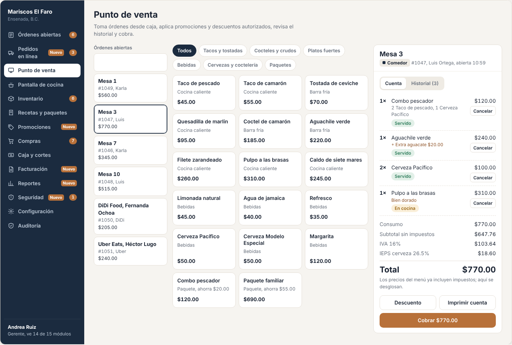
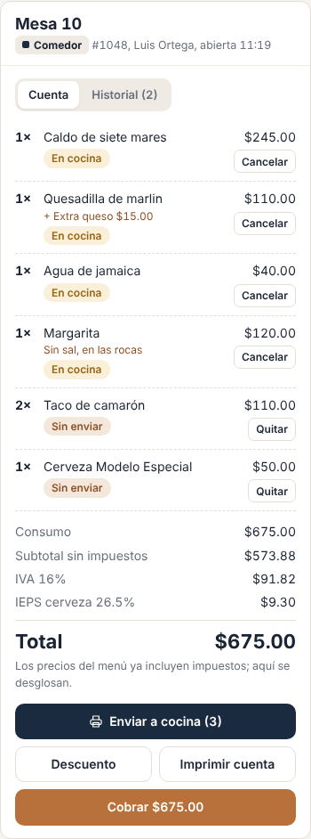
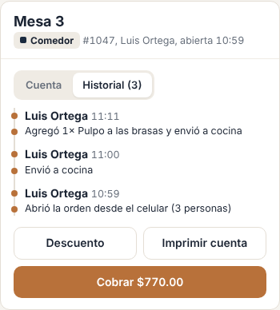
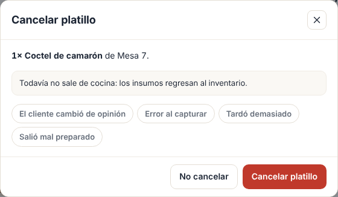
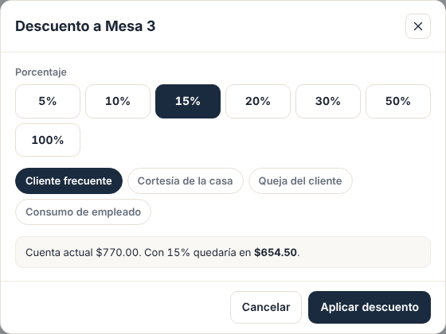
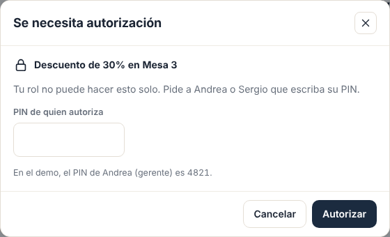
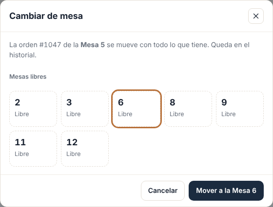
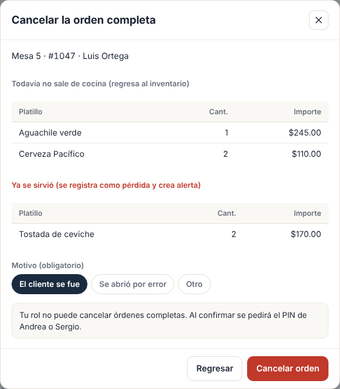
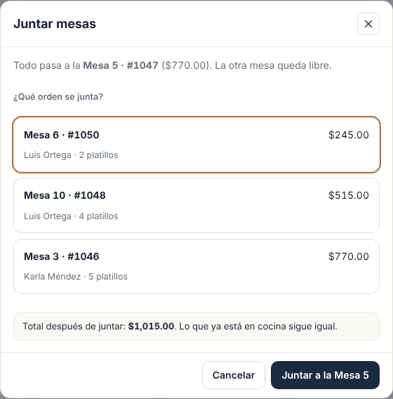
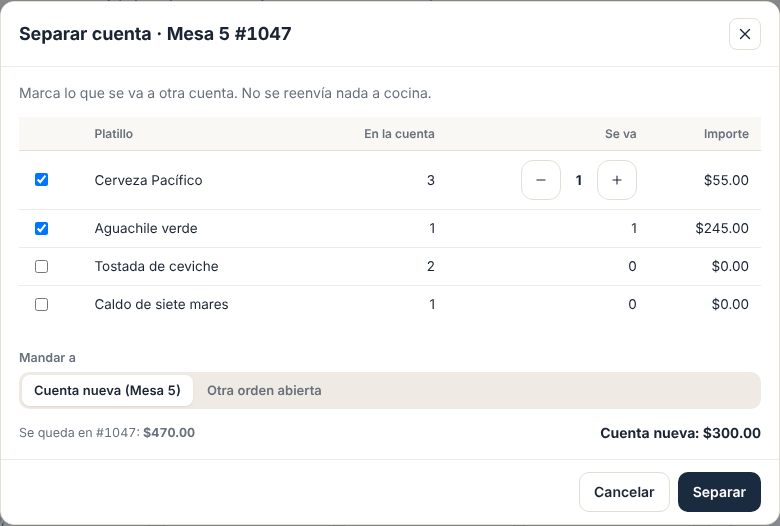

# E02 · Escritorio → Punto de venta · Spec

| | |
|---|---|
| **Epic** | E02 |
| **Superficie** | Escritorio (caja) |
| **Fase** | 2 · Venta · paso 9 de 22 en el [orden de construcción](../../docs/epics.md) |
| **Responsable** | Por definir |
| **Revisa** | Por definir |
| **Estado** | Borrador para revisión |
| **Depende de** | E00, E05 (menú y recetas), E04 (descuento de inventario), E08 (impuestos), E09 (PIN de autorización) |
| **Lo usan** | E01, E03, E10, E12, E13, E18, E19 |
| **Diseño** | Demo → Escritorio → Punto de venta. Capturas en [`img/`](img/) |

## 1. Problema

La orden es el centro de todo: de ahí sale la comanda a cocina, el descuento de inventario, la cuenta, el cobro y la factura. Si la orden no es confiable (precios que cambian, cancelaciones sin rastro, descuentos sin control), todo lo demás falla.

**Lo que queremos:** abrir y llenar una orden en segundos, mandarla a cocina con un botón, y que cada cambio quede en su historial con nombre y hora.

## 2. Quién lo usa

| Rol | Qué hace | Permiso |
|---|---|---|
| Cajero | Abre órdenes, agrega platillos, envía a cocina, imprime la cuenta | `pos.take` |
| Mesero | Lo mismo desde su celular (E10). Desde caja, si su rol lo permite. | `pos.take` |
| Gerente | Además, cancela, aplica descuentos, autoriza reimpresiones, cambia de mesa y transfiere | `pos.cancel`, `pos.discount`, `pos.reprint`, `pos.transfer` |

## 3. Pantallas

### 3.1 Punto de venta

Tres columnas (en menos de 1,100 px, la lista de órdenes pasa arriba en horizontal):

1. **Órdenes abiertas:** botón *Nueva orden* y una tarjeta por orden con la mesa o etiqueta, el folio, el mesero o canal, y el total. La seleccionada lleva borde azul.
2. **Menú:**
   - Chips de categoría (*Todos* + las de E05) y cuadrícula de platillos.
   - Cada platillo muestra: nombre, estación (o "Paquete, ahorra $20.00"), etiqueta de promoción activa ("2×1 ahora", de E13) y precio.
   - Si quedan menos de 6 porciones: "Quedan 4". Si no alcanza el inventario: "Agotado", deshabilitado (BR-POS-05).
3. **Cuenta de la orden** con dos pestañas:
   - **Cuenta:**
     - Líneas con cantidad, nombre, componentes del paquete, extras con precio, nota y estado (*Sin enviar*, *En cocina*, *Servido* o *Cancelado*).
     - Cada línea tiene el botón *Quitar* (si no se ha enviado) o *Cancelar* (si ya se envió).
     - Abajo, el desglose de totales (BR-POS-08).
   - **Historial:** línea de tiempo con quién, hora y qué hizo (BR-POS-11).

   Debajo de las pestañas van los botones:
   - **Enviar a cocina (N)**, solo si hay platillos sin enviar.
   - **Descuento** o **Quitar descuento**.
   - **Imprimir cuenta** (cambia a *Reimprimir* si ya se imprimió).
   - **Cobrar $720.00**, que lleva a E03.
   - En el menú "⋯" de la orden: *Cambiar de mesa* y *Transferir a otro mesero*.

### 3.2 Nueva orden (modal)

Las capturas están en E01 ([comedor](../E01-escritorio-ordenes-abiertas/img/02-nueva-orden-comedor.png) y [para llevar](../E01-escritorio-ordenes-abiertas/img/03-nueva-orden-para-llevar.png)).

- Selector de canal: **Comedor**, **Para llevar** o **Drive thru**.
- **Comedor:** mesas libres, número de personas (1 a 8+) y mesero.
- **Para llevar:** nombre del cliente.
- **Drive thru:** nombre o placas.
- Botón **Abrir orden**.

### 3.3 Cancelar platillo (modal)

- Muestra el platillo y la orden, y un aviso que cambia según el estado:
  - **Aún en cocina:** "los insumos regresan al inventario".
  - **Ya servido:** "los insumos no regresan y se avisa al gerente".
- Motivos (obligatorio): *El cliente cambió de opinión*, *Error al capturar*, *Tardó demasiado*, *Salió mal preparado*.
- Si el usuario no tiene `pos.cancel`, el botón lleva candado y pide PIN (E09).

### 3.4 Descuento (modal)

- Porcentajes: 5, 10, 15, 20, 30, 50 y 100%.
- Motivos: *Cliente frecuente*, *Cortesía de la casa*, *Queja del cliente*, *Consumo de empleado*.
- Vista previa: "Cuenta actual $770.00. Con 15% quedaría en $654.50."
- Si pasa el umbral de alerta (E09), avisa "Este descuento genera alerta al gerente".

### 3.5 Más pantallas (capturas de maqueta)

| Pantalla | Contenido |
|---|---|
| **Cambiar de mesa** | Lista de mesas libres. Al elegir una, la orden se mueve y queda en el historial.  |
| **Cancelar orden completa** | Desde el menú "⋯" de la orden: resumen de lo que se cancela (separando lo que ya salió de cocina), motivo obligatorio y PIN si hace falta.  |
| **Juntar mesas** | Desde el menú "⋯": eliges la otra orden abierta (por ejemplo, la Mesa 6 se junta a la 5). Todas las líneas pasan a una sola orden, con su estado de cocina, y la otra mesa queda libre.  |
| **Separar cuenta** | Marcas con casillas los platillos que se van a otra cuenta (o la cantidad de una línea, por ejemplo 1 de 3 cervezas) y eliges *Cuenta nueva* o una orden abierta. Así cada quien paga lo suyo.  |
| **Transferir a otro mesero** | Lista de meseros activos. Requiere `pos.transfer`. |
| **Editar nota** | Al tocar una línea sin enviar: notas rápidas + texto libre (60 caracteres). |

**Estados:**

| Estado | Qué se ve |
|---|---|
| Sin orden seleccionada | Panel derecho: "Elige una orden o abre una nueva". |
| Orden vacía | "Toca platillos del menú para agregarlos." |
| Sin conexión | Funciona abrir, agregar, enviar y quitar (BR-POS-15). *Descuento* y *Reimprimir* piden conexión porque necesitan PIN del servidor. |

## 4. Historias de usuario

| ID | Como… | Quiero… | Para… |
|---|---|---|---|
| US-POS-01 | cajero | abrir una orden de comedor, para llevar o drive thru | empezar a atender |
| US-POS-02 | cajero | agregar platillos tocando el menú | capturar rápido |
| US-POS-03 | cajero | ver qué platillos están agotados o por acabarse | no vender lo que no hay |
| US-POS-04 | cajero | agregar notas a un platillo | que cocina lo prepare como lo pidieron |
| US-POS-05 | cajero | enviar lo nuevo a cocina con un botón | que se empiece a preparar |
| US-POS-06 | gerente | cancelar un platillo con motivo | corregir errores sin perder rastro |
| US-POS-07 | gerente | aplicar un descuento autorizado | atender quejas o cortesías con control |
| US-POS-08 | cajero | imprimir la cuenta | que el cliente la revise |
| US-POS-09 | gerente | ver el historial de una orden | saber quién hizo qué |
| US-POS-10 | cajero | ver el desglose de impuestos y promociones | explicarle la cuenta al cliente |
| US-POS-11 | gerente | cambiar una orden de mesa o de mesero | reacomodar sin cancelar y volver a capturar |
| US-POS-12 | gerente | cancelar una orden completa con motivo | cuando el cliente se va sin consumir o se abrió por error |
| US-POS-13 | mesero | juntar dos mesas en una cuenta | cobrar una sola vez cuando se juntan |
| US-POS-14 | cajero | separar platillos a otra cuenta | que cada quien pague lo que consumió |

## 5. Reglas de negocio

| ID | Regla |
|---|---|
| **BR-POS-01** | **Canales.** *Comedor* necesita una mesa libre y un mesero. *Para llevar* necesita nombre del cliente. *Drive thru* necesita nombre o placas. Los canales externos (QR, web, apps y kiosko) los crean E17, E18 y E19 con la misma orden. |
| **BR-POS-02** | Solo hay **una orden abierta por mesa**. |
| **BR-POS-03** | Tocar un platillo sin extras ni nota que ya está *Sin enviar* suma 1 a esa línea. Si lleva extras o nota distinta, es una línea nueva. |
| **BR-POS-04** | **Enviar a cocina:** todas las líneas *Sin enviar* pasan a *En cocina* con hora de envío. En la misma operación: se descuenta inventario (E04 `IInventoryConsumption`), se publica `OrderSentToKitchen` por estación y se imprime la comanda por estación si está activo (E12). Si falla el descuento de inventario, **la comanda sale igual** y se registra el error para revisión: nunca se frena el servicio por inventario. |
| **BR-POS-05** | **Disponibilidad.** Un platillo con 0 porciones posibles (E05 `IMenuCatalog`) sale *Agotado* y no se puede agregar. Con menos de 6 muestra "Quedan N". |
| **BR-POS-06** | **Quitar** una línea *Sin enviar* no pide permiso y queda en el historial. **Cancelar** una línea enviada pide motivo y `pos.cancel` (o PIN de quien lo tenga). Si estaba *En cocina*, se regresa el inventario. Si estaba *Servida*, no se regresa y se levanta una alerta (E09). |
| **BR-POS-07** | **Precio congelado.** Al agregar una línea se copian nombre, precio y precio de extras. Un cambio de precio en el menú no afecta órdenes abiertas. |
| **BR-POS-08** | **Totales**, en este orden: (1) consumo = Σ precio × cantidad, con extras; (2) promociones automáticas de E13 por línea; (3) descuento manual sobre lo que queda; (4) impuestos de E08 por línea según su alcance. Si los precios incluyen impuestos: `total = Σ neto` redondeado a 2, cada impuesto = Σ de su monto por línea redondeado a 2, y `subtotal = total − Σ impuestos`. Si no los incluyen: `subtotal = Σ neto`, se suman los impuestos y `total = subtotal + Σ impuestos`. Así el desglose **siempre** suma exacto. |
| **BR-POS-09** | **Descuento manual:** uno por orden, porcentaje de la lista, motivo obligatorio, y requiere `pos.discount` o PIN. Si pasa el umbral de E09, se levanta una alerta. Quitarlo también queda en el historial. |
| **BR-POS-10** | **Imprimir cuenta:** las primeras N impresiones son libres (N lo configura E09, por defecto 1). Las siguientes piden `pos.reprint` o PIN y levantan una alerta. |
| **BR-POS-11** | **Historial (`OrderEvent`):** toda acción sobre la orden agrega un evento con usuario, hora y texto. No se edita. |
| **BR-POS-12** | **Cuenta pedida:** cuando el mesero la pide (E10), la orden muestra la etiqueta "Pide la cuenta" y la mesa se pinta cobre en E01. |
| **BR-POS-13** | **Concurrencia:** dos dispositivos pueden agregar a la misma orden al mismo tiempo y ambos cambios se conservan. Si dos personas cancelan la misma línea, la segunda recibe "Ya la canceló Karla Méndez a las 14:32". |
| **BR-POS-14** | **Cambiar de mesa** solo a una mesa libre. **Transferir** cambia el mesero de toda la orden y requiere `pos.transfer`. Ambos van al historial. |
| **BR-POS-15** | **Sin conexión** funciona abrir, agregar, quitar y enviar (E00 BR-PLT-08). |
| **BR-POS-16** | Una orden pagada (E03) queda **cerrada**: no se le agregan ni cancelan platillos. |
| **BR-POS-17** | **Cancelar la orden completa:** requiere `pos.cancel` (o PIN) y motivo (*El cliente se fue*, *Se abrió por error*, *Otro*). Cancela cada línea con las reglas de BR-POS-06 (regresa inventario de lo que no salió y levanta alerta por lo servido), pasa la orden a *Anulada*, libera la mesa y avisa a cocina. Una orden con pagos registrados no se puede anular: primero se anulan los cobros (E03). |
| **BR-POS-18** | **Juntar mesas:** requiere `pos.take` si ambas órdenes son del mismo mesero y `pos.transfer` si no. Solo órdenes abiertas sin pagos. La orden destino conserva su folio; la otra pasa a *Unida a #folio*, libera su mesa y ambas guardan el movimiento en su historial. Descuentos y promociones se recalculan sobre la orden unida. |
| **BR-POS-19** | **Separar cuenta:** mueve líneas completas o parte de una línea (se parte en dos con la misma hora de envío y estado de cocina) a una orden nueva del mismo canal y mesa, o a otra orden abierta. No cambia el inventario ni la cocina. Una línea con descuento manual se mueve con su descuento. Queda en el historial de ambas. |

## 6. Criterios de aceptación

Datos del demo: Mesa 3, #1047, con 1 Combo pescador $120, 1 Aguachile verde con extra aguacate $240, 2 Cerveza Pacífico $100 y 1 Pulpo a las brasas $310. IVA 16% a toda la cuenta, IEPS 26.5% solo a cervezas, precios con impuestos incluidos.

| ID | Dado… | Cuando… | Entonces… |
|---|---|---|---|
| AC-POS-01 | la Mesa 2 libre | abro una orden de comedor para 4 personas con Karla | se crea con folio consecutivo, mesero Karla y el evento "Abrió la orden (Comedor, 4 personas)" |
| AC-POS-02 | la Mesa 3 ocupada | intento abrir otra orden en la Mesa 3 | no aparece en las mesas libres; por API recibe 409 |
| AC-POS-03 | "Para llevar" sin nombre | toco Abrir orden | sale "Escribe el nombre para llamarlo cuando esté listo." |
| AC-POS-04 | la orden de la Mesa 10 | toco 2 veces *Taco de camarón* | queda **una** línea "2× Taco de camarón · Sin enviar" |
| AC-POS-05 | 2 líneas sin enviar | toco *Enviar a cocina (3)* | pasan a *En cocina*, se descuenta inventario, la comanda aparece en la pantalla de cocina en menos de 2 s y se imprime en su estación |
| AC-POS-06 | la Mesa 3 sin promociones activas | veo la cuenta | Consumo $770.00 · Subtotal $647.76 · IVA $103.64 · IEPS $18.60 · **Total $770.00** |
| AC-POS-07 | la misma cuenta con "Hora feliz 2×1 en cerveza" activa | veo la cuenta | −$50.00 por la promoción · Subtotal $612.67 · IVA $98.03 · IEPS $9.30 · **Total $720.00** |
| AC-POS-08 | la Mesa 3 sin promociones | aplico 15% por *Cliente frecuente* | el total queda en **$654.50** y el historial dice "Aplicó descuento de 15% (cliente frecuente), autorizó Andrea Ruiz" |
| AC-POS-09 | Diana (cajera, sin `pos.discount`) | aplica 30% | aparece el modal de PIN; con 1234 dice "PIN incorrecto"; con 4821 se aplica, el historial dice "autorizó Andrea Ruiz" y se levanta una alerta (30% > 20%) |
| AC-POS-10 | el Agua de jamaica *En cocina* | la cancelo por *Error al capturar* | queda tachada como *Cancelado* y sus insumos regresan al inventario |
| AC-POS-11 | un Pulpo ya *Servido* | lo cancelo | no regresa inventario y el gerente recibe la alerta "Cancelación después de servir, Mesa 3 #1047" |
| AC-POS-12 | la cuenta ya impresa una vez | Diana toca *Reimprimir* | pide PIN; al autorizar se imprime, el historial dice "Reimprimió la cuenta (2ª vez), autorizó Andrea Ruiz" y se levanta la alerta |
| AC-POS-13 | un platillo con 0 porciones posibles | veo el menú | dice "Agotado" y no se puede tocar |
| AC-POS-14 | un precio cambia de $45 a $50 en Recetas | veo una orden abierta que ya lo tenía | sigue en $45 |
| AC-POS-15 | la Mesa 3 abierta | la cambio a la Mesa 8 | la Mesa 3 queda libre, la 8 ocupada y el historial dice "Cambió de Mesa 3 a Mesa 8" |
| AC-POS-16 | dos cajas agregan a la Mesa 3 al mismo tiempo | guardan | la orden tiene los platillos de las dos |
| AC-POS-17 | una orden pagada | intento agregar un platillo por API | recibe 409 "La orden ya está cerrada" |
| AC-POS-18 | la Mesa 7 con 1 coctel *En cocina* y 2 limonadas *Servidas* | el gerente cancela la orden por *El cliente se fue* | el coctel regresa inventario, las limonadas no, se levanta una alerta, la orden queda *Anulada*, la Mesa 7 se libera y la pantalla de cocina quita el coctel |
| AC-POS-19 | Mesa 5 ($770) y Mesa 6 ($245), sin pagos | junto la 6 a la 5 | la Mesa 5 queda con $1,015 y todas las líneas; la Mesa 6 aparece libre y su orden dice "Unida a #1047" |
| AC-POS-20 | Mesa 5 con 3 Cerveza Pacífico y 1 Aguachile | separo 1 cerveza y el aguachile a *Cuenta nueva* | queda la línea "2 Cerveza Pacífico" en la #1047 y una orden nueva de la Mesa 5 con 1 cerveza y el aguachile; nada se reenvía a cocina |

## 7. Fuera de alcance

- Cobro, propinas, dividir cuenta y ticket (E03).
- Configuración de promociones (E13) y de impuestos (E08). Aquí solo se aplican.
- Mapa de mesas (E01).

## 8. Preguntas abiertas

| ID | Pregunta | Contesta | Estado |
|---|---|---|---|
| P-01 | Un **paquete que incluye cerveza** (Combo pescador), ¿lleva IEPS por la parte de la cerveza? Hoy el paquete solo lleva IVA. Es un tema fiscal: conviene confirmarlo con el contador. | Equipo + contador | Abierta |
| P-02 | ¿Hace falta **unir dos cuentas** (dos mesas que se juntan) o **separar** platillos a otra orden? | Equipo | Resuelta: sí, BR-POS-18 y 19 |
| P-03 | ¿Se necesitan **tiempos** (entradas primero, platos fuertes después) para mandar a cocina por partes? | Equipo | Abierta |
