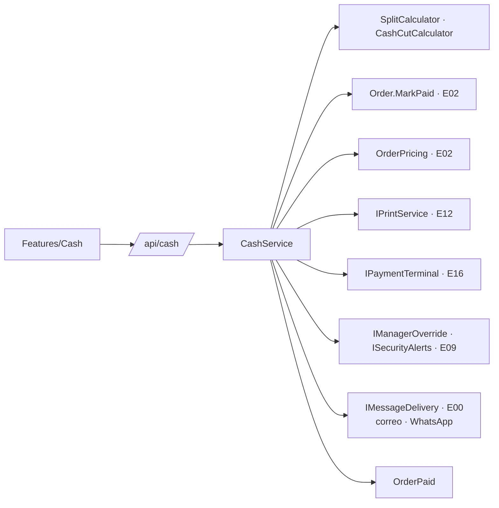

# E03 · Escritorio → Cobro, caja y cortes · Plan técnico

## 1. Resumen

## 2. Modelo de datos

| Tabla | Columnas | Notas |
|---|---|---|
| `cash_sessions` | `Id`, `RestaurantId`, `RegisterDeviceId`, `OpenedBy`, `OpenedAt`, `OpeningFloat`, `ClosedBy`, `ClosedAt`, `Status` (`Open`, `Closed`) | Índice único parcial `(RegisterDeviceId) WHERE Status='Open'` (BR-CAJ-01) |
| `payments` | `Id`, `OrderId`, `CashSessionId`, `Method` (`Cash`, `Card`, `Mixed`, `Transfer`, `Platform`), `Amount`, `CashAmount`, `CardAmount`, `Tip`, `Received`, `Change`, `CardAuth`, `TransferRef`, `TerminalTxId`, `PartIndex`, `PartsTotal`, `Status` (`Completed`, `Voided`), `VoidReason`, `VoidedBy`, `VoidAuthorizedBy`, `CreatedBy`, `CreatedAt` | Nunca se borra |
| `cash_movements` | `Id`, `CashSessionId`, `Kind` (`Withdrawal`), `Amount`, `Reason`, `CreatedBy`, `CreatedAt` | |
| `cash_cuts` | `Id`, `CashSessionId`, `Type` (`X`, `Z`), `SnapshotJson`, `CountJson` (denominaciones), `Counted`, `Expected`, `Difference`, `CreatedBy`, `CreatedAt`, `DeliveredToJson` | El snapshot guarda todo lo de BR-CAJ-12 |
| `cut_delivery_settings` | `RestaurantId`, `EmailEnabled`, `Email`, `WhatsAppEnabled`, `WhatsAppNumber` | |

## 3. Domain (`Resto.Domain/Cash/`)

| Archivo | Contenido | Reglas |
|---|---|---|
| `TipCalculator.cs` | Por porcentaje o por monto | BR-CAJ-02 |
| `SplitCalculator.cs` | `Parts(total, n) → decimal[]` | BR-CAJ-03 |
| `PaymentValidator.cs` | Valida cada método | BR-CAJ-04 |
| `CashSession.cs` | `RegisterPayment`, `Withdraw`, `ExpectedCash`, `Close(count, nextFloat)` | BR-CAJ-01, 06, 07 y 09 |
| `CashCutCalculator.cs` | Arma el `CashCutSnapshot` a partir de pagos, movimientos y órdenes | BR-CAJ-12 |
| `Denominations.cs` | Lista MXN y `Count(dict) → decimal` | BR-CAJ-09 |

## 4. API (`/api/cash`)

| Método y ruta | Permiso | Sin conexión |
|---|---|---|
| `GET /api/cash/session` (del dispositivo actual) | `cash.view` | caché |
| `POST /api/cash/session/open` `{ OpeningFloat }` | `cash.charge` | ❌ |
| `GET /api/cash/orders/{orderId}/quote?tipPercent=&tipAmount=&parts=` | `cash.charge` | ✅ (calcula local con Domain) |
| `POST /api/cash/orders/{orderId}/payments` `{ Method, Amount, Received?, CashAmount?, CardAuth?, TransferRef?, Tip, PartIndex, PartsTotal }` | `cash.charge` | ✅ solo `Cash` |
| `POST /api/cash/payments/{id}/void` `{ Reason, OverrideToken? }` | `cash.refund` u *override* | ❌ |
| `POST /api/cash/withdrawals` `{ Amount, Reason }` | `cash.withdraw` | ❌ |
| `POST /api/cash/cuts/x` | `cash.cut` | ❌ |
| `POST /api/cash/cuts/z` `{ Count: { "1000": 0, …, "coins": 45 }, NextFloat }` | `cash.cut` | ❌ |
| `GET /api/cash/cuts?from=&to=` | `cash.view` | ❌ |
| `GET/PUT /api/cash/delivery-settings` | `cash.settings` | ❌ |

## 5. Contratos

- **Ofrece:** `IPaidOrderQuery` (E14 y E15) y `ICashSessionService` (E01 y E16), como en [`contratos.md`](../../docs/contratos.md).
- **Usa:** `IPrintService.PrintReceiptAsync`, `PrintCashCutAsync` (E12); `IPaymentTerminal.ChargeAsync` (E16, opcional); `IManagerOverride` e `ISecurityAlerts` (E09).
- `CutDeliveryService` arma el mensaje y el PDF (QuestPDF) y los manda con `IMessageDelivery` de E00 (correo, y WhatsApp según P-01).

## 6. Pantallas (`Resto.UI/Features/Cash/`)

| Componente | Captura |
|---|---|
| `ChargeDialog.razor` (propina, dividir, métodos y partes) | 01, 02 |
| `PaidSummary.razor` + `ReceiptPreview.razor` | 03 |
| `CashPage.razor` (`/caja/cortes`) + `CutPreview.razor` + `CutDeliverySettings.razor` + `CutHistory.razor` | 04 |
| `WithdrawalDialog.razor` | 05 |
| `CloseCashDialog.razor` (conteo por denominación) | 06 |
| `OpenSessionDialog.razor`, `VoidPaymentDialog.razor` | — |

## 7. Pruebas

| Proyecto | Qué cubre |
|---|---|
| Domain.Tests | AC-CAJ-02, 03, 04, 06, 09, 10 y 11 exactos al centavo; propina sobre total con descuento; división entre 1 y entre 7 |
| Api.Tests | AC-CAJ-01, 05, 07, 08, 12, 13; turno único por caja; pago idempotente desde la cola sin conexión |
| UI.Tests | Botones rápidos, bloqueo de propina y partes después del primer pago |

## 8. Paquetes

| Paquete | Para qué |
|---|---|
| `QuestPDF` (licencia Community gratuita para empresas que facturan menos de USD 1M al año; revisar al crecer) | PDF del corte y, después, reportes |
