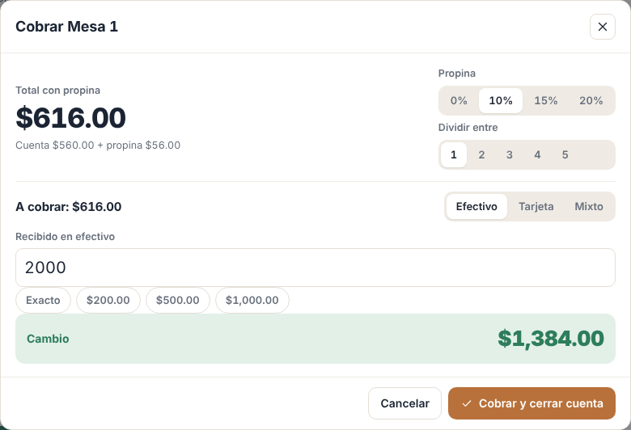
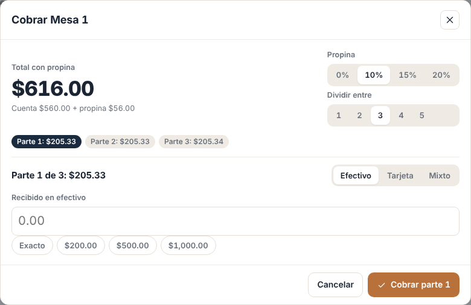
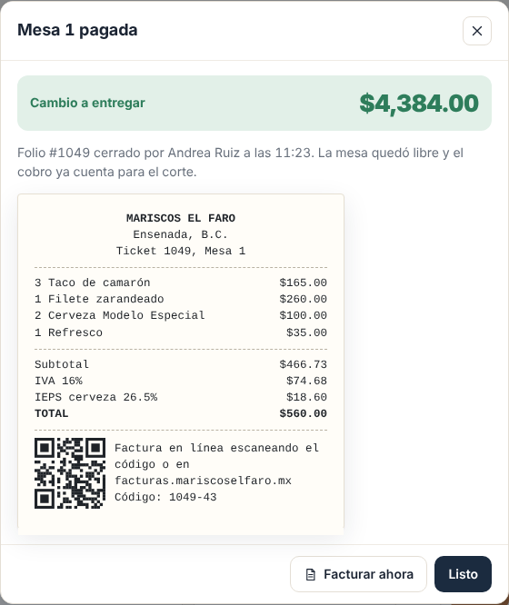
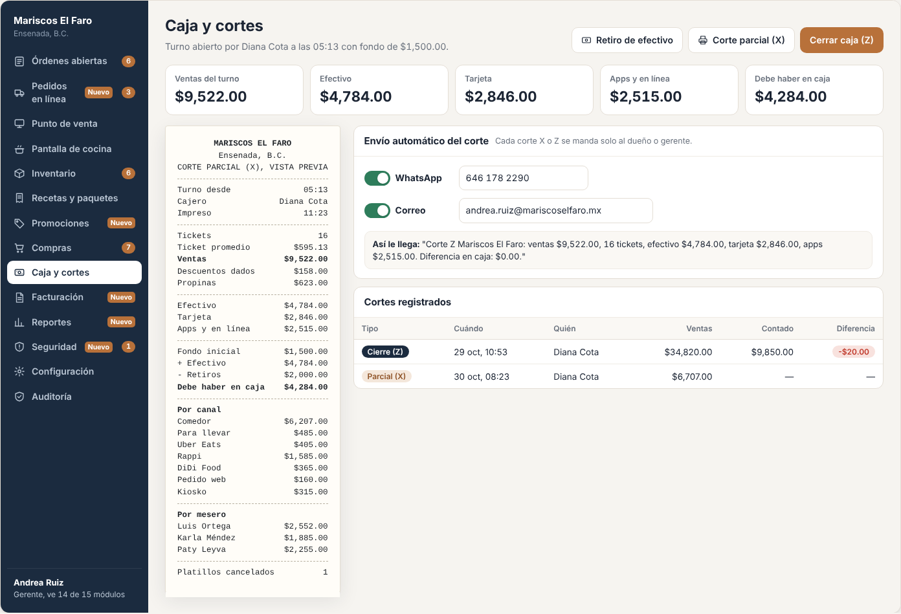
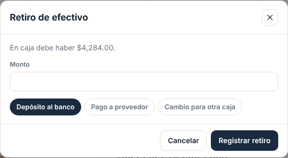
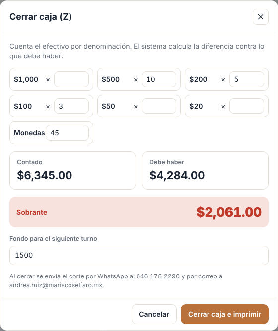
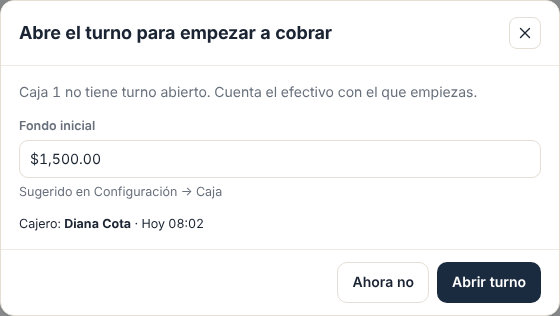
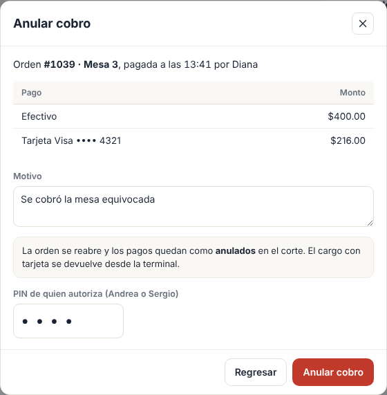

# E03 · Escritorio → Cobro, caja y cortes · Spec

| | |
|---|---|
| **Epic** | E03 |
| **Superficie** | Escritorio (caja) |
| **Ola** | 1 · Operación |
| **Responsable** | Por definir |
| **Revisa** | Por definir |
| **Estado** | Borrador para revisión |
| **Depende de** | E00, E02 (orden y totales), E09 (PIN y alertas), E12 (impresión), E08 (fondo por defecto) |
| **Lo usan** | E14 (facturar tickets pagados), E15 (reportes), E16 (terminal) |
| **Diseño** | Demo → Cobrar y Caja y cortes. Capturas en [`img/`](img/) |

## 1. Problema

Al final del día, lo que más preocupa al dueño es que **cuadre la caja**. Hoy el corte se hace a mano, la propina se mezcla con la venta y nadie sabe por qué faltan $200.

**Lo que queremos:** cobrar rápido (efectivo con cambio, tarjeta, mixto, transferencia y dividir la cuenta), separar propinas, registrar retiros, y que el corte diga exactamente cuánto debe haber, cuánto hay y quién estaba en la caja. El corte le llega al dueño solo.

## 2. Quién lo usa

| Rol | Qué hace | Permiso |
|---|---|---|
| Cajero | Abre turno, cobra, hace retiros y cortes X y Z | `cash.charge`, `cash.view`, `cash.withdraw`, `cash.cut` |
| Gerente | Además anula cobros y configura el envío del corte | `cash.refund`, `cash.settings` |

## 3. Pantallas

### 3.1 Cobrar (modal amplio)

- **Arriba:**
  - "Total con propina" en grande y, abajo, "Cuenta $560.00 (ya con $X de descuento) + propina $56.00".
  - Selector de **propina**: 0, 10, 15, 20% u *Otra* (monto).
  - Selector de **dividir entre** 1 a 5 personas (o *Otra*).
- **Método:**
  - **Efectivo:** campo "Recibido", botones rápidos *Exacto*, $200, $500 y $1,000, y la franja verde "Cambio $1,384.00" (o roja "Falta $X").
  - **Tarjeta:** "Cobra $X en la terminal" con campo de autorización (o la terminal integrada de E16).
  - **Mixto:** parte en efectivo, y el resto a tarjeta se calcula solo.
  - **Transferencia:** campo de referencia.
- Botón **Cobrar y cerrar cuenta**, o *Cobrar parte 2 de 3* si se dividió.

Al dividir, se muestran etiquetas por parte: *Pagado Parte 1: $205.33*, *Parte 2: $205.33* (la actual) y *Parte 3: $205.34*. Después del primer pago, la propina y el número de partes ya no se pueden cambiar.

### 3.2 Cuenta pagada

- Franja verde "Cambio a entregar".
- "Folio #1049 cerrado por Andrea Ruiz a las 14:32. La mesa quedó libre y el cobro ya cuenta para el corte."
- Vista previa del ticket con el QR de facturación (E14).
- Botones *Facturar ahora* (E14), *Imprimir ticket* y *Listo*.

### 3.3 Caja y cortes

- **Encabezado:** "Turno abierto por Diana Cota a las 9:12 con fondo de $1,500.00", con los botones *Retiro de efectivo*, *Corte parcial (X)* y *Cerrar caja (Z)*.
- **Indicadores:** ventas del turno, efectivo, tarjeta, apps y en línea, transferencias, y *Debe haber en caja*.
- **Vista previa del corte X** con formato de ticket (BR-CAJ-12).
- **Envío automático del corte:** WhatsApp (número) y correo, cada uno con su switch, y una muestra de cómo llega el mensaje.
- **Cortes registrados:** tipo, cuándo, quién, ventas, contado y diferencia (en verde si cuadra, en rojo si no).

**Cierre Z:**
- Conteo por denominación ($1,000, $500, $200, $100, $50 y $20, más un total en monedas).
- Se ven *Contado* contra *Debe haber* y la franja "Cuadra", "Faltante $X" o "Sobrante $X".
- Campo "Fondo para el siguiente turno".
- Leyenda "Se envía por WhatsApp a… y por correo a…".
- Botón *Cerrar caja e imprimir*.

### 3.4 Más pantallas (capturas de maqueta)

| Pantalla | Contenido |
|---|---|
| **Abrir turno** | Al entrar a cobrar sin turno abierto en esta caja: "Abre el turno para empezar a cobrar". Campo de fondo inicial (sugerido de E08) y botón *Abrir turno*.  |
| **Anular cobro** | Desde el historial de la orden pagada: motivo y PIN de gerente. La orden se reabre y el pago queda como anulado.  |

## 4. Historias de usuario

| ID | Como… | Quiero… | Para… |
|---|---|---|---|
| US-CAJ-01 | cajero | abrir mi turno con un fondo | que el corte tenga punto de partida |
| US-CAJ-02 | cajero | cobrar en efectivo y ver el cambio | no equivocarme al dar cambio |
| US-CAJ-03 | cajero | cobrar con tarjeta, mixto o transferencia | aceptar cualquier forma de pago |
| US-CAJ-04 | cajero | agregar propina por porcentaje o monto | separarla de la venta |
| US-CAJ-05 | cajero | dividir la cuenta en partes iguales | cobrar a cada quien |
| US-CAJ-06 | cajero | registrar un retiro con motivo | que el corte lo descuente |
| US-CAJ-07 | gerente | hacer un corte parcial sin cerrar | revisar a media tarde |
| US-CAJ-08 | cajero | cerrar la caja contando billetes | saber si cuadra |
| US-CAJ-09 | dueño | recibir el corte por WhatsApp y correo | enterarme sin ir al restaurante |
| US-CAJ-10 | gerente | anular un cobro mal hecho | corregirlo con rastro |

## 5. Reglas de negocio

| ID | Regla |
|---|---|
| **BR-CAJ-01** | **Turno.** Para cobrar hace falta un turno abierto en esa caja (dispositivo tipo *Caja*). Hay un turno abierto por caja como máximo. El fondo inicial es ≥ 0. |
| **BR-CAJ-02** | **Propina** = total de la cuenta × % (redondeado a 2 decimales) o un monto libre ≥ 0. La propina **no es venta**: no lleva impuestos, no entra en "Ventas" y se reporta aparte por mesero. |
| **BR-CAJ-03** | **Dividir** entre N: cada parte = ⌊(total + propina) ÷ N⌋ a 2 decimales, y la última absorbe los centavos. Después del primer pago, la propina y N se bloquean. |
| **BR-CAJ-04** | **Métodos.** *Efectivo:* recibido ≥ monto de la parte y cambio = recibido − monto. *Tarjeta:* autorización opcional (o la que regresa E16). *Mixto:* 0 < efectivo < monto, y tarjeta = monto − efectivo. *Transferencia:* referencia obligatoria. |
| **BR-CAJ-05** | **Cerrar la cuenta:** cuando se pagan todas las partes, la orden pasa a *Pagada* (E02 BR-POS-16), se libera la mesa, se emite `OrderPaid` y se imprime el ticket si está activo. |
| **BR-CAJ-06** | **Efectivo esperado** = fondo inicial + efectivo cobrado (venta + propina en efectivo) − retiros. |
| **BR-CAJ-07** | **Retiro:** monto > 0 y ≤ efectivo esperado, con motivo de la lista (*Depósito al banco*, *Pago a proveedor*, *Cambio para otra caja*) u *Otro* con texto. |
| **BR-CAJ-08** | **Corte X:** foto del turno en ese momento. No cierra nada. Se guarda, se imprime y se envía si está activo. |
| **BR-CAJ-09** | **Corte Z:** contado = Σ denominación × cantidad + monedas, y diferencia = contado − esperado. Cierra el turno y abre uno nuevo con el fondo indicado. Si la diferencia es ≥ $100 en valor absoluto (umbral de E09), se levanta una alerta. |
| **BR-CAJ-10** | Si al hacer el **Z** hay órdenes abiertas, se avisa "Hay 3 órdenes abiertas. Pasan al siguiente turno." y se permite cerrar. |
| **BR-CAJ-11** | **Anular un cobro** requiere `cash.refund` o PIN y motivo. El pago queda *Anulado* (no se borra), la orden vuelve a *Abierta* y se levanta una alerta. Si ya tenía factura, primero hay que cancelarla en E14. |
| **BR-CAJ-12** | **Contenido del corte:** restaurante, sucursal, tipo, turno (inicio y cajero), hora de impresión, tickets, ticket promedio, ventas, descuentos dados, propinas, efectivo, tarjeta, transferencia, apps y en línea, fondo, retiros, debe haber, contado y diferencia (solo en Z), ventas por canal, ventas por mesero y platillos cancelados. |
| **BR-CAJ-13** | **Envío del corte:** por correo siempre que esté activo. Por WhatsApp, según P-01. El mensaje es: "Corte Z Mariscos El Faro: ventas $X, N tickets, efectivo $X, tarjeta $X, apps $X. Diferencia en caja: $X." más el PDF del corte. |
| **BR-CAJ-14** | **Sin conexión** solo se puede cobrar en **efectivo**. Se guarda en la cola de E00 y se sincroniza. Tarjeta integrada, transferencia y cortes requieren internet. |

## 6. Criterios de aceptación

Datos: Mesa 1 #1049 sin promociones = $560.00. Turno con fondo de $1,500.

| ID | Dado… | Cuando… | Entonces… |
|---|---|---|---|
| AC-CAJ-01 | sin turno abierto | toco *Cobrar* | sale "Abre el turno para empezar a cobrar" |
| AC-CAJ-02 | la Mesa 1 con 10% de propina | veo el modal | Total con propina **$616.00** (cuenta $560.00 + propina $56.00) |
| AC-CAJ-03 | lo anterior en efectivo | escribo 2000 | dice "Cambio $1,384.00". Con 600 dice "Falta $16.00" y no deja cobrar. |
| AC-CAJ-04 | lo anterior dividido entre 3 | veo las partes | $205.33, $205.33 y **$205.34** |
| AC-CAJ-05 | la parte 1 pagada | intento cambiar la propina | el selector está bloqueado |
| AC-CAJ-06 | mixto con $500 en efectivo | veo el resto | "Resto a tarjeta $116.00" |
| AC-CAJ-07 | las 3 partes pagadas | se cierra | la orden queda *Pagada*, la Mesa 1 libre, se imprime el ticket con QR y E01 se actualiza solo |
| AC-CAJ-08 | efectivo esperado $5,740 | registro un retiro de $6,000 | dice "No puede ser mayor a lo que hay en caja ($5,740.00)" |
| AC-CAJ-09 | fondo $1,500, efectivo $6,240 y retiro $2,000 | abro *Cerrar caja (Z)* | *Debe haber* = **$5,740.00** |
| AC-CAJ-10 | lo anterior | cuento $5,720 | dice "Faltante $20.00". Al cerrar se guarda el corte con diferencia −$20, se abre un turno nuevo y no hay alerta (< $100). |
| AC-CAJ-11 | contado con 10×$500, 5×$200, 3×$100 y $45 en monedas | veo el total | *Contado* **$6,345.00** |
| AC-CAJ-12 | envío por correo activo | hago un corte X | el gerente recibe el correo con el PDF y el turno sigue abierto |
| AC-CAJ-13 | un cobro de $616 | el gerente lo anula con PIN | el pago queda *Anulado*, la orden se reabre y aparece la alerta "Cobro anulado #1049" |
| AC-CAJ-14 | sin internet | cobro en efectivo | se cierra la orden localmente y se sincroniza al volver. Las opciones de tarjeta y transferencia dicen "Requiere internet". |

## 7. Fuera de alcance

- Terminal bancaria integrada (E16). Aquí la tarjeta se captura a mano.
- Facturación (E14).
- Varias monedas (dólares). Ver P-02.

## 8. Preguntas abiertas

| ID | Pregunta | Contesta | Estado |
|---|---|---|---|
| P-01 | **WhatsApp:** mandarlo automático requiere la API de WhatsApp Business (Meta Cloud API o un proveedor como Twilio) y una plantilla aprobada. ¿Lo contratamos o empezamos solo con correo? | Equipo | Abierta |
| P-02 | En Baja California se cobra mucho en **dólares**. ¿Aceptamos USD en efectivo con tipo de cambio configurable? | Equipo | Abierta |
| P-03 | ¿La propina con tarjeta se le paga al mesero en efectivo al cierre (y se descuenta del efectivo esperado)? | Equipo | Abierta |
