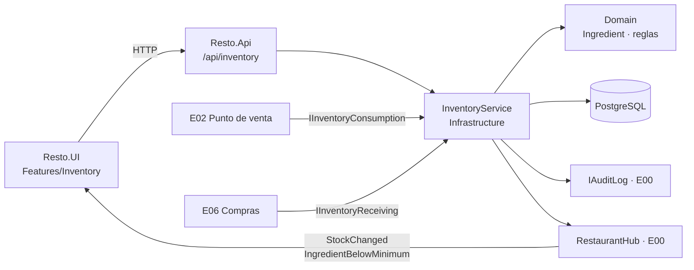

# E04 · Escritorio → Inventario · Plan técnico

> Cómo se construye lo que pide [`spec.md`](spec.md). Si algo aquí contradice la spec, gana la spec y se corrige este archivo.

## 1. Resumen



## 2. Modelo de datos

### `Ingredient` (tabla `ingredients`)

| Propiedad | Tipo C# | Columna | Notas |
|---|---|---|---|
| `Id` | `Guid` | `uuid` PK | |
| `OrganizationId`, `RestaurantId` | `Guid` | `uuid` | Filtro global (constitución §4.2). Las columnas de auditoría `CreatedAt/By` y `UpdatedAt/By` las pone E00. |
| `Name` | `string` | `varchar(80)` | |
| `NormalizedName` | `string` | `varchar(80)` | En minúsculas, sin acentos y con trim. Índice único `(RestaurantId, NormalizedName)` para BR-INV-08. |
| `CategoryId` | `Guid` | FK `ingredient_categories` | |
| `SupplierId` | `Guid?` | FK `suppliers` (E06) | Proveedor principal. Mientras E06 no exista, la columna queda sin FK y se agrega en la migración de E06. |
| `Unit` | `UnitOfMeasure` | `varchar(10)` | Enum: `Kg`, `L`, `Piece`, `Bunch` |
| `Stock` | `decimal` | `numeric(12,3)` | Nunca < 0 (BR-INV-01). Check constraint `stock >= 0`. |
| `MinStock` | `decimal` | `numeric(12,3)` | |
| `UnitCost` | `decimal` | `numeric(12,2)` | |
| `WastePercent` | `decimal?` | `numeric(5,2)` | `null` = usa la merma general |
| `ExpiresOn` | `DateOnly?` | `date` | |
| `PurchaseUnitName` | `string?` | `varchar(30)` | Por ejemplo "caja". `null` = se compra en la unidad base (BR-INV-15). |
| `PurchaseUnitFactor` | `decimal?` | `numeric(12,3)` | Unidades base por unidad de compra, > 0. Debe tener valor si `PurchaseUnitName` lo tiene. |
| `CustomFields` | `Dictionary<string,string>` | `jsonb` | Llave = `CustomFieldDefinition.Key` (E08) |
| `IsActive` | `bool` | `boolean` | BR-INV-12 |
| `Version` | `uint` | `xmin` | Concurrencia optimista solo para editar datos, **no** para la existencia |

### `InventoryMovement` (tabla `inventory_movements`)

| Propiedad | Tipo | Notas |
|---|---|---|
| `Id`, `RestaurantId`, `IngredientId` | `Guid` | Índice `(IngredientId, OccurredAt desc)` |
| `Type` | `InventoryMovementType` | Ver la tabla de tipos en la spec |
| `Quantity` | `decimal(12,3)` | Con signo: lo que realmente se movió |
| `StockBefore`, `StockAfter` | `decimal(12,3)` | |
| `Shortfall` | `decimal(12,3)` | 0 salvo en el caso de BR-INV-01 |
| `UnitCostAtTime` | `decimal(12,2)` | Para reportes de costo (E15) |
| `UserId` | `Guid` | |
| `OccurredAt` | `DateTimeOffset` | UTC |
| `ReferenceType`, `ReferenceId` | `string?`, `Guid?` | `Order`, `OrderItem`, `PurchaseRequest`, `InventoryImport` |
| `Note` | `string?` | máx. 200 |

### `InventoryImport` (tabla `inventory_imports`)

`Id`, `RestaurantId`, `FileName`, `UploadedBy`, `UploadedAt`, `Status` (`Previewed`, `Committed`, `Expired`), `UpdateExisting`, `CreatedCount`, `UpdatedCount`, `ErrorCount` y `PreviewJson` (`jsonb` con las filas ya validadas). Las vistas previas sin confirmar expiran a los 30 minutos.

### `StockCount` y `StockCountLine` (tablas `stock_counts`, `stock_count_lines`)

`StockCount`: `Id`, `RestaurantId`, `Scope` (`All`, `Location`, `Category`), `ScopeValue`, `Status` (`Open`, `Applied`, `Cancelled`), `StartedBy`, `StartedAt`, `AppliedBy`, `AppliedAt`.
`StockCountLine`: `CountId`, `IngredientId`, `Counted?`, `TheoreticalAtCount?` (existencia al capturar el conteo), `CountedBy`, `CountedAt`. Al aplicar: `Stock += Counted − TheoreticalAtCount`, con el mismo bloqueo `FOR UPDATE`. BR-INV-17.

### `IngredientCategory`

`Id`, `RestaurantId`, `Name`, `SortOrder`. Las categorías por defecto se cargan con E00 o E08: Mariscos, Abarrotes, Verduras, Lácteos, Licores y Bebidas.

## 3. Reglas en Domain (`Resto.Domain/Inventory/`)

| Archivo | Contenido | Reglas |
|---|---|---|
| `Ingredient.cs` | Entidad con `ApplyMovement(type, delta, …) → InventoryMovement`. Es el **único** lugar donde cambia `Stock`. | BR-INV-01, 09 |
| `UnitOfMeasure.cs` | Enum + `QuickStep(unit)` y `RoundUpForPurchase(unit, qty)` | BR-INV-07, 11 |
| `WasteCalculator.cs` | `ConsumptionFor(recipeQty, units, wastePercent) → decimal` | BR-INV-02, 14 |
| `StockLevel.cs` | `IsBelowMinimum`, `Level` (Red/Yellow/Green), `FillRatio` | BR-INV-03, 04 |
| `ExpiryRule.cs` | `IsExpiringSoon(expiresOn, todayInRestaurantTz, warningDays)`. `warningDays` viene de configuración (0–30). | BR-INV-05 |
| `PurchaseUnit.cs` | *Value object* `(Name, Factor)` con `ToBase(qty)`, `FromBaseRoundedUp(qty)` y `UnitCostFromPurchase(totalPaid, baseQty)` | BR-INV-15 |
| `IngredientImportRow.cs` | Validación de una fila de Excel con las mismas reglas del alta. Devuelve `New`, `Existing` o `Error(mensaje)`. | BR-INV-16 |
| `ReorderSuggestion.cs` | `Suggest(stock, min, unit, purchaseUnit?) → (BaseQuantity, PurchaseQuantity?)` | BR-INV-11, 15 |
| `NameNormalizer.cs` | `Normalize("  Limón ") == "limon"` | BR-INV-08 |

Todo lo de Domain es puro, sin EF, sin reloj del sistema (la fecha se recibe como parámetro) y 100% probado.

## 4. Persistencia y concurrencia

- `IngredientConfiguration.cs` y `InventoryMovementConfiguration.cs` en `Resto.Infrastructure/Persistence/Configurations/`.
- Migración: `AddInventory`.
- **Cambio de existencia (AC-INV-14):** dentro de una transacción se ejecuta
  ```sql
  SELECT stock FROM ingredients WHERE id = @id FOR UPDATE;
  ```
  luego `Ingredient.ApplyMovement(...)` y se guardan juntos el `UPDATE` y el `INSERT` del movimiento. Así dos ajustes simultáneos se aplican uno tras otro y ninguno se pierde.
- El consumo por venta (E02) puede tocar 5 a 10 insumos por platillo. Se bloquean **ordenados por `Id`** para evitar *deadlocks*.

## 5. API (`Resto.Api/Endpoints/InventoryEndpoints.cs`)

| Método y ruta | Permiso | Cuerpo / query | Respuesta |
|---|---|---|---|
| `GET /api/inventory/ingredients` | `inventory.view` | `?search=&categoryId=&filter=below-min\|expiring&location=` | `IngredientListItemDto[]` |
| `GET /api/inventory/summary` | `inventory.view` | — | `InventorySummaryDto` (valor, bajo mínimo, por caducar, merma general) |
| `GET /api/inventory/ingredients/{id}` | `inventory.view` | — | `IngredientDetailDto` |
| `POST /api/inventory/ingredients` | `inventory.adjust` | `CreateIngredientRequest` | 201 + `IngredientDetailDto` · 409 si el nombre ya existe |
| `PUT /api/inventory/ingredients/{id}` | `inventory.adjust` | `UpdateIngredientRequest` (sin `Stock`) | 200 · 409 por versión · 422 si cambia la unidad y ya tiene movimientos |
| `POST /api/inventory/ingredients/{id}/deactivate` | `inventory.adjust` | — | 204 |
| `POST /api/inventory/ingredients/{id}/adjustments` | `inventory.adjust` | `AdjustStockRequest { Type, Quantity, Note }` | 200 + `AdjustStockResult { Stock, Shortfall }` |
| `POST /api/inventory/ingredients/{id}/quick-adjust` | `inventory.adjust` | `{ Direction: +1 \| -1 }` | 200 + `AdjustStockResult` |
| `GET /api/inventory/ingredients/{id}/movements` | `inventory.view` | `?from=&to=&page=` | `PagedResult<InventoryMovementDto>` |
| `POST /api/inventory/counts` `{ Scope, ScopeValue }` · `GET /api/inventory/counts?status=open` · `GET /api/inventory/counts/{id}` · `PUT …/counts/{id}/lines/{ingredientId}` `{ Counted }` · `POST …/counts/{id}/apply` · `POST …/counts/{id}/cancel` | `inventory.adjust` | — | Toma de inventario (BR-INV-17). Las líneas se pueden capturar sin conexión desde el celular (E11). |
| `GET /api/inventory/import/template` | `inventory.adjust` | — | `.xlsx` con columnas base + propiedades activas + una fila de ejemplo |
| `POST /api/inventory/import/preview` | `inventory.adjust` | `multipart/form-data` (archivo ≤ 5 MB, ≤ 2,000 filas) | `ImportPreviewDto { ImportId, Rows[], NewCount, ExistingCount, ErrorCount }` · 422 si no es `.xlsx` o se pasa del límite |
| `POST /api/inventory/import/{importId}/commit` | `inventory.adjust` | `{ UpdateExisting: bool }` | `ImportResultDto { Created, Updated, Skipped }` · 410 si la vista previa expiró |

- Validación con *FluentValidation* o `DataAnnotations` (lo define E00). Los mensajes de error van en español y salen de recursos.
- Los DTOs viven en `Resto.Contracts/Inventory/`.

## 6. Tiempo real (SignalR, hub de E00)

| Evento | Payload | Cuándo |
|---|---|---|
| `StockChanged` | `{ IngredientId, Stock, Level, IsBelowMinimum }` | En cada movimiento |
| `StockCountUpdated` | `{ CountId, Counted, Total }` | Al capturar una línea de la toma (la ven la computadora y los celulares que cuentan) |
| `IngredientBelowMinimum` | `{ IngredientId, Name, Stock, Unit }` | Solo al cruzar el mínimo (BR-INV-10). Se envía al grupo `role:chef`. |

La lista se actualiza al recibir `StockChanged` sin recargar (AC-INV-15).

## 7. Pantallas (`Resto.UI/Features/Inventory/`)

| Componente | Responsabilidad | Captura |
|---|---|---|
| `InventoryPage.razor` (`@page "/inventario"`) | Arma la página, se suscribe al hub y valida `inventory.view` | 01 |
| `InventorySummaryCards.razor` | Los 4 indicadores | 01 |
| `InventoryFilters.razor` | Buscador (con *debounce* de 250 ms), chips y almacén | 02, 03 |
| `IngredientTable.razor` | Tabla y estados vacío, cargando y error | 01–03 |
| `StockLevelBar.razor` | Barra de nivel (BR-INV-04) | 01 |
| `AdjustStockDialog.razor` | Modal de ajuste | 04 |
| `IngredientFormDialog.razor` | Alta y edición, con los campos dinámicos de E08 | 05 |
| `MovementHistoryPanel.razor` | Panel lateral con el kardex paginado | 11 |
| `StockCountPage.razor` (`/inventario/toma`) | Los 4 pasos de la toma | 12 |
| `ImportIngredientsDialog.razor` | Los 3 pasos: plantilla, subir y vista previa con totales, switch "Actualizar los que ya existen" y botón Importar | 10 |
| `InventoryApiClient.cs` | Cliente HTTP tipado | — |

El estilo viene de los tokens de la constitución §8. Las clases CSS del demo (`.tbl`, `.kpi`, `.pill`, `.bar`, `.chip`, `.modal`) se pasan a `Resto.UI/wwwroot/css/components.css`.

## 8. Contrato con otros epics

Estas interfaces viven en `Resto.Domain/Inventory/Abstractions/`. **No se cambian sin avisar** al dueño del otro epic.

```csharp
// La llama E02 (Punto de venta) al enviar a cocina y al cancelar.
public interface IInventoryConsumption
{
    Task ConsumeForOrderItemAsync(ConsumeRequest request, CancellationToken ct);
    Task ReturnForCancelledItemAsync(Guid orderItemId, CancellationToken ct);
}

public sealed record ConsumeRequest(
    Guid OrderId,
    Guid OrderItemId,
    IReadOnlyList<ConsumptionLine> Lines); // ya "aplanadas": paquetes y extras resueltos por E05

public sealed record ConsumptionLine(Guid IngredientId, decimal RecipeQuantity, int Units);

// La llama E06 (Compras) al marcar algo como comprado.
public interface IInventoryReceiving
{
    Task ReceivePurchaseAsync(Guid purchaseRequestId, Guid ingredientId,
        decimal quantity, decimal? totalPaid, CancellationToken ct);
}

// La consulta E06 y E11 para la lista de faltantes.
public interface IReorderQuery
{
    Task<IReadOnlyList<ReorderCandidate>> GetBelowMinimumAsync(CancellationToken ct);
}
```

- E04 aplica la merma (BR-INV-02). E05 solo entrega cantidades de receta.
- `ReturnForCancelledItemAsync` busca los movimientos `SaleConsumption` de ese `OrderItemId` y los revierte exactos.
- **Mientras E08 no exista**, la merma general (5%), los días de "por caducar" (2) y las propiedades por defecto se leen de `IRestaurantSettings` con una implementación provisional (`DefaultRestaurantSettings`).

```csharp
// La implementa E08. E04 solo la lee.
public interface IRestaurantSettings
{
    decimal DefaultWastePercent { get; }
    int ExpiryWarningDays { get; }               // 0–30, por defecto 2
    IReadOnlyList<CustomFieldDefinition> InventoryCustomFields { get; }
}

// La implementa E09. E04 la llama cuando hay Shortfall (BR-INV-01).
public interface ISecurityAlerts
{
    Task RaiseAsync(SecurityAlert alert, CancellationToken ct);
}
```

- **Mientras E09 no exista**, `ISecurityAlerts` tiene una implementación provisional que solo escribe en auditoría.
- `IReorderQuery` devuelve la sugerencia en unidad base **y** en unidad de compra (si tiene), para que E06 y E11 muestren "3 cajas (150 pz)".

## 9. Pruebas

| Proyecto | Qué cubre |
|---|---|
| `Resto.Domain.Tests/Inventory/` | Cada `BR-INV-xx` con su ID en el nombre, más casos límite (0, decimales, unidades) |
| `Resto.Api.Tests/Inventory/` | AC-INV-01 a 16 que son de servidor: permisos 403, 409 por nombre duplicado, concurrencia (dos tareas en paralelo), auditoría escrita y evento SignalR emitido |
| `Resto.UI.Tests/Inventory/` (bUnit) | Validaciones del formulario, estados vacío y error, botones ocultos sin permiso (AC-INV-13) |
| Manual | Comparar contra las capturas en 1366 px y en modo oscuro |

## 10. Paquetes

| Paquete | Proyecto | Para qué |
|---|---|---|
| `ClosedXML` (licencia MIT) | `Resto.Infrastructure` | Leer el Excel de importación y generar la plantilla. No se usa en Domain ni en UI. |
