# E04 · Escritorio → Inventario · Spec

| | |
|---|---|
| **Epic** | E04 |
| **Superficie** | Escritorio (MAUI en Windows y web) |
| **Ola** | 1 · Operación |
| **Responsable** | Por definir |
| **Revisa** | Por definir |
| **Estado** | Borrador para revisión. Preguntas P-01 a P-04 contestadas por Benji el 2026-10-30 |
| **Depende de** | E00 Fundaciones (restaurante, usuarios, permisos, auditoría), E08 Configuración (merma general, propiedades extra) |
| **Lo usan** | E02 Punto de venta (descuento por venta), E05 Recetas (existencias y costo), E06 Compras (sugeridos y entradas), E11 Móvil chef |
| **Diseño** | Demo → Escritorio → Inventario. Capturas en [`img/`](img/) |

## 1. Problema

Hoy el inventario de un restaurante se lleva en una libreta o en Excel y nadie lo actualiza a tiempo. El chef se entera de que falta camarón cuando ya no hay, y nadie sabe cuánto se tira.

**Lo que queremos:** que el inventario **se descuente solo** con cada platillo vendido, según su receta y un porcentaje de merma, y que el sistema **avise qué falta** antes de que se acabe. Las personas solo tocan el inventario para corregir (conteos, entradas y desperdicio), y eso les toma segundos.

## 2. Quién lo usa

| Rol | Qué hace aquí | Permiso |
|---|---|---|
| Gerente / Administrador | Todo: ver, ajustar, dar de alta, desactivar | `inventory.view`, `inventory.adjust` |
| Chef | Ver y ajustar (conteos y merma del día) | `inventory.view`, `inventory.adjust` |
| Compras | Solo ver, para saber qué comprar | `inventory.view` |
| Mesero, Cajero | No ve el módulo | — |

## 3. Pantallas

### 3.1 Lista de inventario

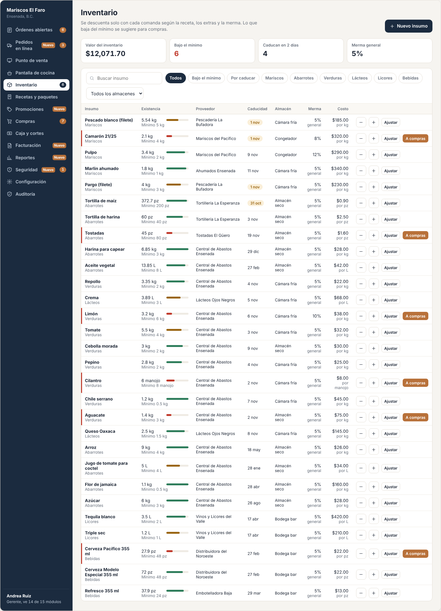

De arriba a abajo:

1. **Encabezado:** título "Inventario", una línea de ayuda y los botones **Importar de Excel** y **Nuevo insumo** (solo con `inventory.adjust`).
2. **Indicadores:**
   - *Valor del inventario* (BR-INV-06)
   - *Bajo el mínimo*, en rojo si es mayor a 0 (BR-INV-03)
   - *Caducan en N días*, donde N se configura en E08 y por defecto es 2 (BR-INV-05)
   - *Merma general* (viene de E08)
3. **Barra de filtros:** buscador por nombre; chips *Todos*, *Bajo el mínimo*, *Por caducar* y uno por cada categoría; selector de almacén.
4. **Tabla**, con una fila por insumo activo:

| Columna | Contenido |
|---|---|
| Insumo | Nombre en negritas y categoría abajo. Si está bajo el mínimo, lleva una franja roja a la izquierda. |
| Existencia | Cantidad con unidad, una barra de nivel (verde, amarilla o roja según BR-INV-04) y "Mínimo X" abajo. |
| Proveedor | Proveedor principal (de E06). |
| Propiedades extra | Una columna por cada propiedad activa en E08 (por defecto Caducidad y Almacén). La caducidad próxima se resalta en amarillo. |
| Merma | Porcentaje. Si usa la general, dice "general" abajo. |
| Costo | Costo por unidad, con "por kg" abajo. Si tiene unidad de compra, abajo dice también "caja de 50 pz". |
| Acciones | Botones **−** y **+** (ajuste rápido), **Ajustar**, y **A compras** si está bajo el mínimo. Si ya está en la lista de compras, muestra la etiqueta "En la lista". |

5. **Clic en el nombre:** abre el panel de detalle con los movimientos (US-INV-08).

**Estados:**

| Estado | Qué se ve |
|---|---|
| Cargando | Esqueleto de 8 filas. Los indicadores muestran "—". |
| Sin insumos (restaurante nuevo) | Mensaje "Aún no tienes insumos. Da de alta el primero o importa tu lista de Excel." con los botones **Importar de Excel** y **Nuevo insumo**. |
| Búsqueda sin resultados | Ver la captura de abajo. |
| Error de red | Aviso "No se pudo cargar el inventario. Revisa tu conexión." con el botón **Reintentar**. Si hay copia local, se muestra la copia con la etiqueta "Sin conexión, datos de las 14:32". |

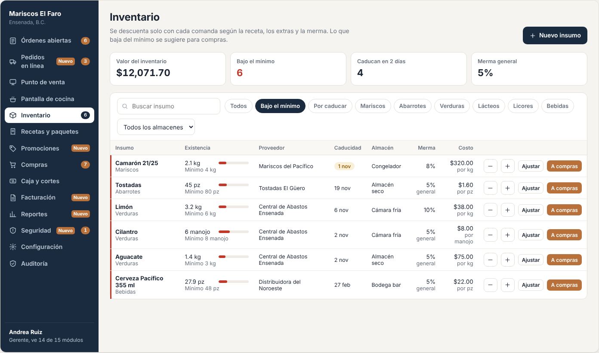

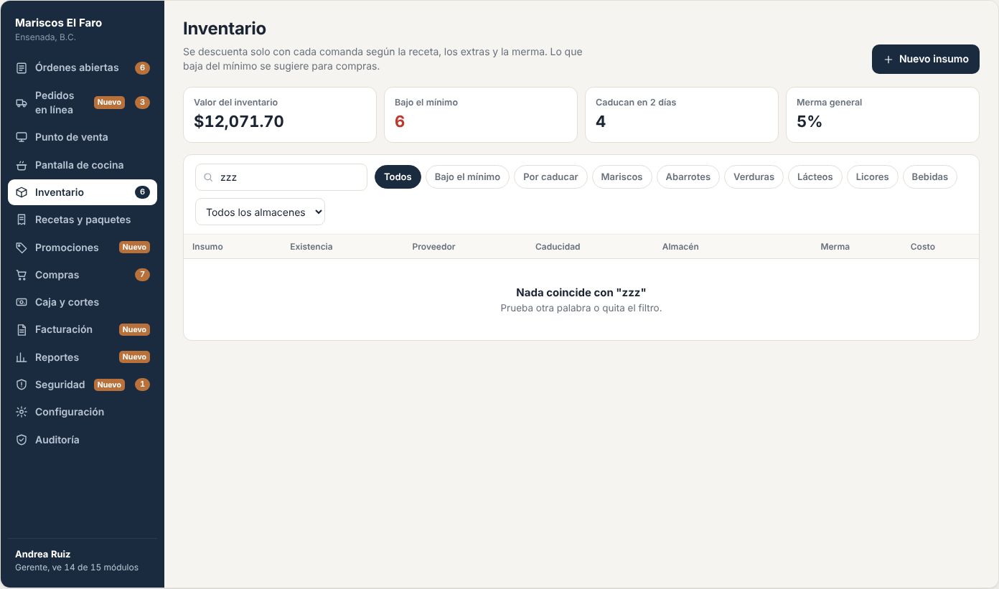

### 3.2 Ajustar existencia (modal)

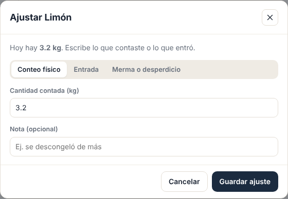

- Muestra la existencia actual: "Hoy hay **3.2 kg**".
- Selector de tipo:
  - **Conteo físico:** escribes lo que contaste y el sistema calcula la diferencia.
  - **Entrada:** escribes lo que entra y se suma.
  - **Merma o desperdicio:** escribes lo que se tira y se resta.
- Campo de cantidad, en la unidad del insumo, y nota opcional.
- **Guardar ajuste** cierra el modal, actualiza la fila y muestra el aviso "Limón: 2.5 kg."

### 3.3 Nuevo insumo (modal)

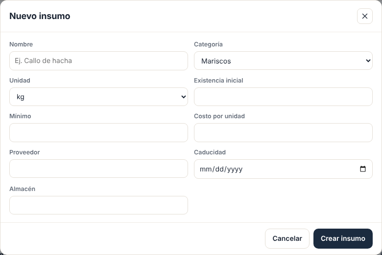

| Campo | Regla |
|---|---|
| Nombre | Obligatorio, de 2 a 80 caracteres, único (BR-INV-08) |
| Categoría | Lista de categorías del restaurante. Obligatorio. |
| Unidad | `kg`, `L`, `pz` o `manojo`. Obligatorio y **no se puede cambiar** después de que tenga movimientos. |
| Existencia inicial | ≥ 0. Si es mayor a 0, genera un movimiento *Inventario inicial*. |
| Mínimo | ≥ 0 |
| Costo por unidad | ≥ 0, con 2 decimales |
| Proveedor | Opcional. Lista de proveedores de E06 |
| Unidad de compra (opcional) | Nombre, por ejemplo "caja", y cuántas unidades base trae (> 0), por ejemplo 50 pz. Si se deja vacío, se compra en la unidad base. (BR-INV-15) |
| Propiedades extra | Un campo por cada propiedad activa en E08, con el tipo correcto (texto, número o fecha) |

### 3.4 Importar de Excel (modal en 3 pasos)

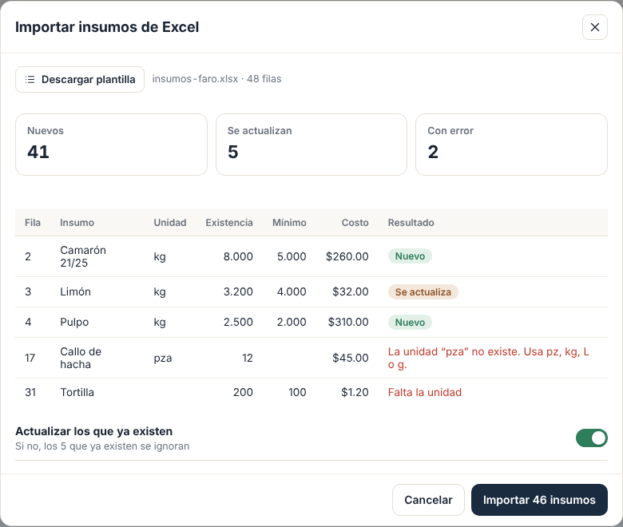

1. **Descargar plantilla.** Es un `.xlsx` con las columnas *Nombre, Categoría, Unidad, Existencia, Mínimo, Costo, Merma %, Unidad de compra, Cantidad por unidad de compra* y una columna por cada propiedad extra activa. Trae una fila de ejemplo.
2. **Subir el archivo.** Se aceptan `.xlsx` de hasta 2,000 filas.
3. **Vista previa.** Es una tabla con todas las filas y una columna *Resultado*:
   - ✅ **Nuevo:** se va a crear.
   - 🔄 **Ya existe:** se ignora, salvo que actives "Actualizar los que ya existen".
   - ❌ **Error:** dice qué está mal, por ejemplo "Unidad 'kilos' no válida, usa kg, L, pz o manojo".
   
   Arriba de la tabla se muestran los totales ("120 nuevos · 8 ya existen · 3 con error") y el botón **Importar 120 insumos**. Las filas con error nunca se importan, y el archivo no se aplica a medias: o se importan todas las filas válidas o ninguna (BR-INV-16).

### 3.5 Movimientos de un insumo (kardex)

Al tocar el nombre de un insumo se abre un panel a la derecha:
- Existencia actual y la barra de nivel.
- Filtros de periodo (por defecto 7 días) y de tipo de movimiento.
- Lista de movimientos: fecha y hora, tipo, cantidad con signo, existencia antes y después, quién, y la referencia (por ejemplo, "Orden #1047", "Compra de Toño" o "Conteo").
- Totales del periodo: entradas, salidas y mermas.

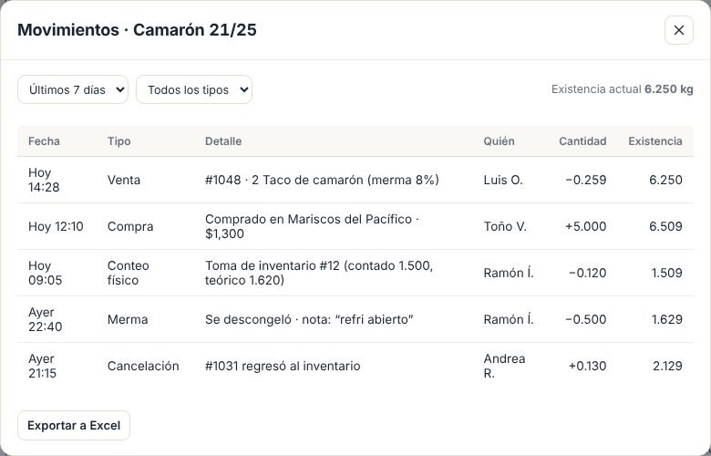

### 3.6 Toma de inventario completa

Una vez a la semana o al mes se cuenta todo. Desde el botón **Toma de inventario**:

1. **Elegir alcance:** todo, o un almacén o una categoría.
2. **Contar:** una tabla con insumo, existencia teórica oculta (para no influir en el conteo) y el campo *Contado*. Se puede contar desde la computadora o desde el celular (E11, pestaña *Contar*). Varias personas pueden contar al mismo tiempo partes distintas.
3. **Revisar diferencias:** se muestran teórico, contado, diferencia y su costo, en rojo si la diferencia pasa de 5%. Se puede volver a contar una línea.
4. **Aplicar:** crea un movimiento `PhysicalCount` por insumo con diferencia y deja la toma como *Aplicada*, con quién y cuándo. Los insumos no contados no se tocan.

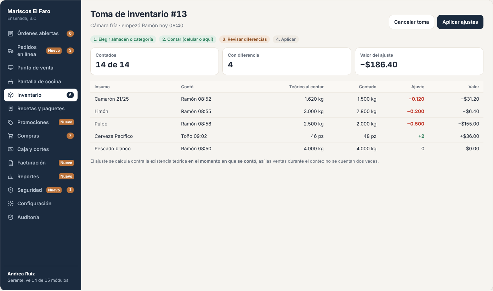

### 3.7 Configuración relacionada (la construye E08, aquí solo se lee)

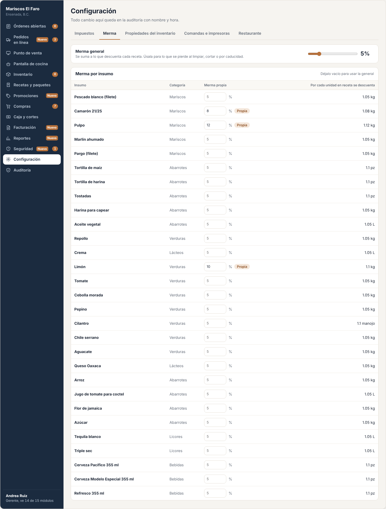

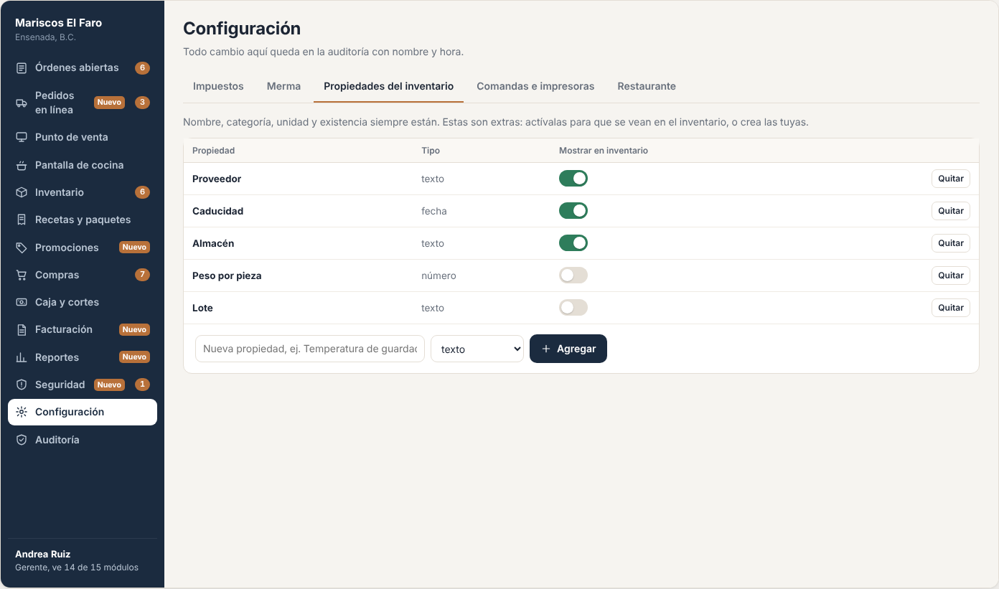

### 3.8 Sin permiso

Un usuario sin `inventory.view` (por ejemplo, un mesero) **no ve** "Inventario" en el menú, y si entra por URL directa recibe 403 con la pantalla "No tienes acceso a este módulo".

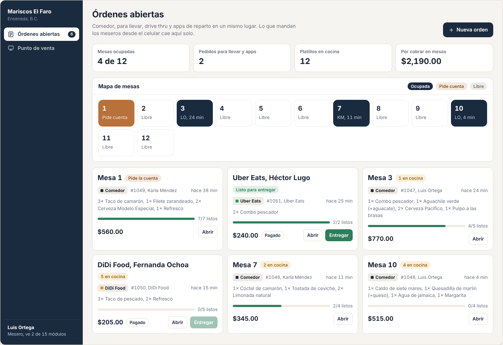

### 3.9 Relación con el celular del chef (lo construye E11)

Los insumos bajo el mínimo que calcula este epic son los que el chef ve en "Faltan":

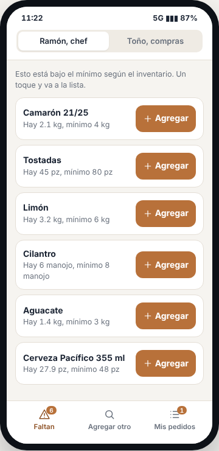

## 4. Historias de usuario

| ID | Como… | Quiero… | Para… |
|---|---|---|---|
| US-INV-01 | gerente | ver todos los insumos con su existencia y si están bajos | saber de un vistazo cómo estoy |
| US-INV-02 | chef | buscar y filtrar por nombre, categoría, bajo mínimo, caducidad y almacén | encontrar rápido lo que busco |
| US-INV-03 | chef | registrar un conteo físico, una entrada o una merma | que el sistema refleje lo que hay de verdad |
| US-INV-04 | chef | sumar o restar de a poco con − y + | corregir rápido sin abrir formularios |
| US-INV-05 | gerente | dar de alta un insumo con sus propiedades | empezar a controlarlo |
| US-INV-06 | gerente | editar o desactivar un insumo | corregir datos sin perder historial |
| US-INV-07 | gerente | mandar a compras un insumo bajo con un clic | no tener que escribir la lista |
| US-INV-08 | gerente | ver los movimientos de un insumo (kardex) | saber quién movió qué y cuándo |
| US-INV-09 | sistema | descontar insumos cuando se envía una comanda, y regresarlos si se cancela antes de prepararse | que el inventario esté al día sin que nadie capture |
| US-INV-10 | chef | recibir un aviso cuando algo baja del mínimo | pedirlo a tiempo |
| US-INV-11 | gerente | importar mi lista de insumos desde Excel | no capturar cientos de insumos uno por uno al arrancar |
| US-INV-12 | gerente | definir que un insumo se compra por caja (o bulto, o costal) | que el comprador vea "3 cajas" y no "150 pz" |
| US-INV-13 | gerente | hacer una toma de inventario completa con revisión de diferencias | cuadrar el inventario cada semana o mes y medir la fuga |

## 5. Reglas de negocio

| ID | Regla |
|---|---|
| **BR-INV-01** | La existencia **nunca es negativa**. Si un consumo o una merma pide más de lo que hay, la existencia queda en 0, el movimiento guarda la cantidad faltante en `Shortfall` y se genera una **alerta de seguridad** en E09 ("Se descontó más de lo que había"), porque indica un conteo mal hecho o una fuga. |
| **BR-INV-02** | Cantidad que se descuenta por venta = `cantidad en receta × piezas vendidas × (1 + merma% / 100)`, redondeada a 3 decimales. `merma%` es la merma propia del insumo y, si no tiene, la merma general (E08). |
| **BR-INV-03** | Un insumo está **bajo el mínimo** cuando `existencia ≤ mínimo`. |
| **BR-INV-04** | Color de la barra de nivel: rojo si está bajo el mínimo; amarillo si `existencia < mínimo × 1.4`; verde en otro caso. El largo de la barra es `min(100%, existencia / (mínimo × 2))`. |
| **BR-INV-05** | Un insumo está **por caducar** si tiene fecha de caducidad y faltan N días o menos (hoy incluido) en la zona horaria del restaurante. N se configura por restaurante en E08 (de 0 a 30, por defecto 2). |
| **BR-INV-06** | Valor del inventario = Σ `existencia × costo` de los insumos activos. |
| **BR-INV-07** | El ajuste rápido mueve **1** en `pz` y `manojo`, y **0.5** en `kg` y `L`. Nunca baja de 0. |
| **BR-INV-08** | El nombre es único por restaurante, sin distinguir mayúsculas, acentos ni espacios al inicio o al final. "Limón" y " limon " son el mismo. |
| **BR-INV-09** | **Toda** variación de existencia se registra como `InventoryMovement` con `antes`, `después`, tipo, usuario, fecha y referencia. La existencia del insumo y la suma de sus movimientos siempre cuadran. |
| **BR-INV-10** | El aviso de "bajó del mínimo" se manda **solo al cruzar** el umbral (estaba arriba y ahora está en o debajo), una vez por cruce, a los usuarios con rol Chef. |
| **BR-INV-11** | Cantidad sugerida para comprar = `max(2 × mínimo − existencia, 0.5 × mínimo)`, redondeada hacia arriba al entero en `pz` y `manojo`, y al 0.5 en `kg` y `L`. Si el insumo tiene unidad de compra, la sugerencia se expresa en esa unidad, redondeada hacia arriba al entero (BR-INV-15). |
| **BR-INV-12** | No se borran insumos. Se desactivan. Uno desactivado no aparece en la lista ni en recetas nuevas, pero conserva su historial. |
| **BR-INV-13** | Al cancelar un platillo que **no** se ha preparado, se regresa exactamente lo que se descontó (movimiento *Devolución por cancelación*). Si ya se preparó, no se regresa nada (decisión de E02). |
| **BR-INV-14** | Los extras de un platillo (por ejemplo, "+ aguacate") descuentan su propio insumo con la misma fórmula de BR-INV-02. |
| **BR-INV-15** | **Unidad de compra.** Un insumo puede tener una unidad de compra opcional (nombre + factor > 0). La existencia, las recetas y el mínimo **siempre** están en la unidad base. Al comprar o sugerir: `unidades base = cantidad en unidad de compra × factor` y `sugerido en unidad de compra = ⌈sugerido base ÷ factor⌉`. El costo por unidad base = precio pagado ÷ unidades base. |
| **BR-INV-16** | **Importación.** Se valida cada fila con las mismas reglas que el alta manual (BR-INV-08, unidades válidas, números ≥ 0). Se importa todo lo válido en **una sola transacción**: si falla al guardar, no queda nada a medias. Cada insumo importado con existencia > 0 genera un movimiento `InitialStock` o, si se actualiza uno existente, un `PhysicalCount`. Se registra una entrada de auditoría por importación con el nombre del archivo y los totales. |
| **BR-INV-17** | **Toma de inventario:** al capturar el conteo de un insumo se guarda también su existencia teórica **en ese momento**, y `ajuste = contado − teórico al contar`. Al aplicar, se suma el ajuste a la existencia actual. Así, las ventas y compras que pasan durante la toma no se cuentan dos veces. Solo puede haber una toma abierta por almacén. Aplicar requiere `inventory.adjust` y queda en auditoría con el total de diferencias en pesos. |

### Tipos de movimiento

| Tipo (código) | Pantalla | Signo | Origen |
|---|---|---|---|
| `InitialStock` | Inventario inicial | + | Alta de insumo |
| `PhysicalCount` | Conteo físico | ± (diferencia) | Modal ajustar |
| `ManualEntry` | Entrada | + | Modal ajustar |
| `Waste` | Merma o desperdicio | − | Modal ajustar |
| `QuickAdjust` | Ajuste rápido | ± | Botones − y + |
| `SaleConsumption` | Consumo por venta | − | E02 al enviar a cocina |
| `CancellationReturn` | Devolución por cancelación | + | E02 al cancelar |
| `PurchaseEntry` | Entrada por compra | + | E06 al marcar comprado |
| `Import` | Importación de Excel | + o ± | Importar de Excel (BR-INV-16) |

## 6. Criterios de aceptación

Datos de ejemplo del demo: Limón con 3.2 kg, mínimo 6 kg, merma propia de 10%; merma general de 5%; Taco de pescado lleva 0.09 kg de pescado blanco.

| ID | Dado… | Cuando… | Entonces… |
|---|---|---|---|
| AC-INV-01 | 29 insumos activos, 6 bajo el mínimo | abro Inventario | veo 29 filas y el indicador "Bajo el mínimo: 6" en rojo |
| AC-INV-02 | la lista completa | toco el chip "Bajo el mínimo" | veo solo los 6, cada uno con la franja roja y el botón "A compras" |
| AC-INV-03 | la lista completa | escribo "zzz" en el buscador | veo "Nada coincide con 'zzz'" |
| AC-INV-04 | Limón con 3.2 kg | hago un conteo físico de 2.5 | la existencia queda en 2.5 y se crea un movimiento `PhysicalCount` de −0.7 con antes 3.2 y después 2.5 |
| AC-INV-05 | Limón con 3.2 kg | registro una merma de 5 | la existencia queda en 0, el movimiento guarda `Shortfall` = 1.8, aparece el aviso "Se registró más merma de la que había" y en Seguridad (E09) se crea una alerta con usuario e insumo |
| AC-INV-06 | Cilantro con 6 manojos | toco + | queda en 7; con Aguacate en 1.4 kg, al tocar − queda en 0.9 |
| AC-INV-07 | un insumo "Limón" | intento crear " limon " | el formulario dice "Ya existe 'Limón'" y no se crea |
| AC-INV-08 | pescado blanco con 6.2 kg y merma general de 5% | E02 envía 3 Tacos de pescado | queda en 5.916 kg (se descuenta 0.284) con movimiento `SaleConsumption` que referencia la orden |
| AC-INV-09 | la orden anterior, aún sin preparar | E02 cancela 1 taco | se regresan 0.095 kg con `CancellationReturn` |
| AC-INV-10 | Aguacate con 3.1 kg y mínimo 3 | se vende algo que descuenta 0.2 | el chef recibe **un** aviso "Aguacate bajó del mínimo (2.9 kg)"; una segunda venta no manda otro aviso |
| AC-INV-11 | Camarón con 2.1 kg y mínimo 4 | toco "A compras" | se crea en la lista de compras con 6 kg sugeridos (BR-INV-11) y la fila muestra "En la lista" |
| AC-INV-12 | un usuario Mesero | entra a `/inventario` | recibe 403 y no ve el módulo en el menú |
| AC-INV-13 | un usuario Compras (solo `inventory.view`) | abre Inventario | ve la lista pero no ve Nuevo insumo, −, +, Ajustar ni la edición |
| AC-INV-14 | dos personas ajustan el mismo insumo al mismo tiempo | guardan | ambos movimientos quedan registrados y la existencia final es la suma correcta de los dos |
| AC-INV-15 | cualquier ajuste | guardo | la otra PC con Inventario abierto ve el cambio en menos de 2 segundos sin recargar |
| AC-INV-16 | cualquier ajuste | reviso Auditoría (E09) | aparece "Inventario · Ajuste por conteo físico · Limón: de 3.2 kg a 2.5 kg" con usuario y hora |
| AC-INV-17 | el restaurante configuró 5 días para "por caducar" | abro Inventario | el indicador dice "Caducan en 5 días" y cuenta los insumos que caducan hoy o en los próximos 5 |
| AC-INV-18 | Tostadas con 45 pz, mínimo 80 y unidad de compra "caja de 50 pz" | toco "A compras" | se sugieren **3 cajas** (150 pz), porque el sugerido base es 115 pz |
| AC-INV-19 | la misma compra de 3 cajas pagada en $240 | E06 la marca como comprada | la existencia sube 150 pz y el costo queda en $1.60 por pz |
| AC-INV-20 | un Excel con 131 filas: 120 válidas, 8 con nombre existente y 3 con unidad inválida | lo subo sin activar "Actualizar" | la vista previa dice "120 nuevos · 8 ya existen · 3 con error", e **Importar** crea exactamente 120 insumos con su movimiento inicial |
| AC-INV-21 | el mismo Excel con "Actualizar los que ya existen" activo | importo | se crean 120 insumos, se actualizan 8 (con movimiento `PhysicalCount` si cambió la existencia) y las 3 filas con error se ignoran |
| AC-INV-22 | un Excel con más de 2,000 filas o que no es `.xlsx` | lo subo | aparece "El archivo debe ser .xlsx y tener máximo 2,000 filas" y no se procesa |
| AC-INV-23 | una toma de *Cámara fría* con Limón en 3.2 kg | se venden platillos que descuentan 0.2 kg, se cuentan 2.8 kg, se vende otro platillo que descuenta 0.1 kg y se aplica | el ajuste es −0.2 kg (2.8 contado − 3.0 teórico al contar) y la existencia final queda en **2.7 kg** |
| AC-INV-24 | una toma con 12 insumos con diferencia | toco *Aplicar* | se crean 12 movimientos `PhysicalCount` y la auditoría dice "Aplicó toma de inventario: 12 diferencias, −$486.20" |
| AC-INV-25 | el kardex del Camarón | lo abro | veo los movimientos de 7 días con antes, después, quién y referencia, y los totales de entradas y salidas |

## 7. Fuera de alcance

- Varios almacenes con traspasos (E20). Aquí "Almacén" es solo una propiedad para filtrar.
- Lotes y caducidad por lote. Hoy cada insumo tiene una sola fecha de caducidad.
- Reportes de costo real contra teórico (E15).

## 8. Preguntas abiertas

| ID | Pregunta | Contesta | Estado |
|---|---|---|---|
| P-01 | ¿El umbral de "por caducar" debe ser configurable por restaurante? | Benji | **Sí.** Se configura en E08 (BR-INV-05, AC-INV-17) |
| P-02 | ¿Entra la unidad de compra? | Benji | **Sí.** BR-INV-15, US-INV-12, AC-INV-18 y 19 |
| P-03 | ¿Entra importar insumos desde Excel? | Benji | **Sí.** Sección 3.4, BR-INV-16, US-INV-11, AC-INV-20 a 22 |
| P-04 | ¿El `Shortfall` genera alerta de seguridad en E09? | Benji | **Sí.** BR-INV-01, AC-INV-05 |
