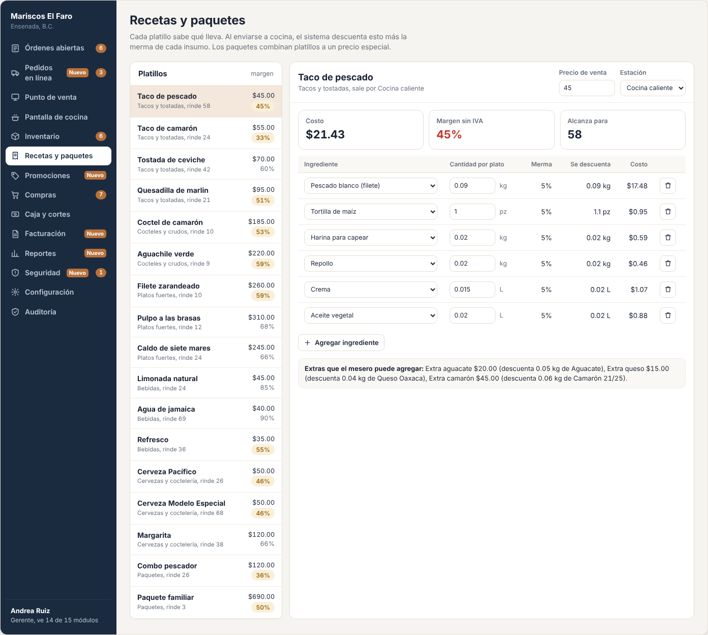
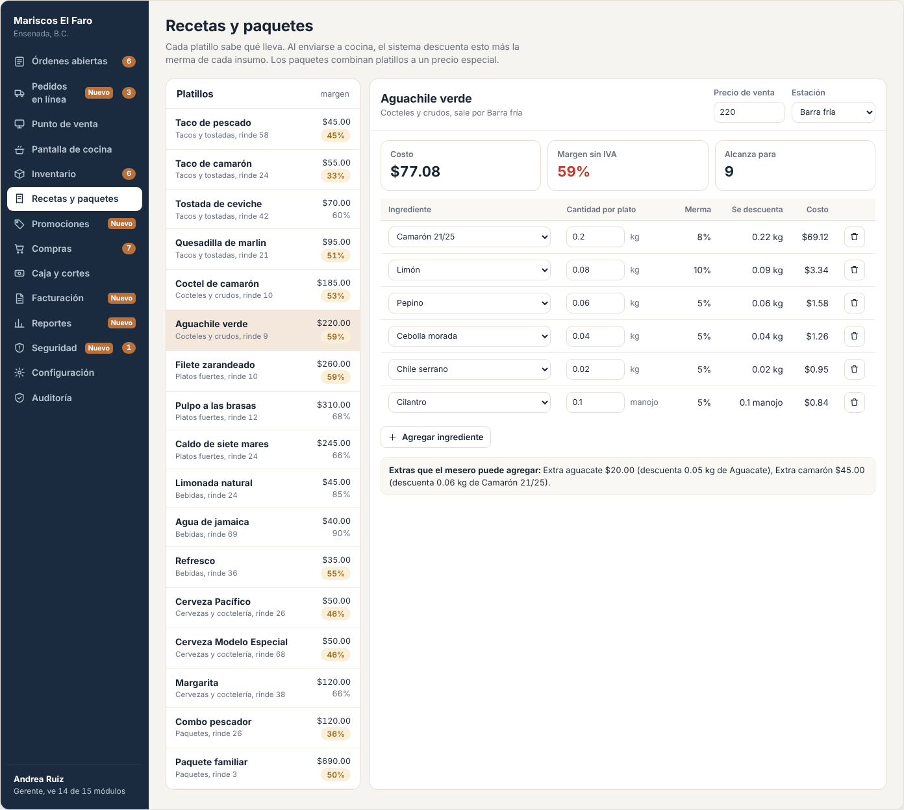
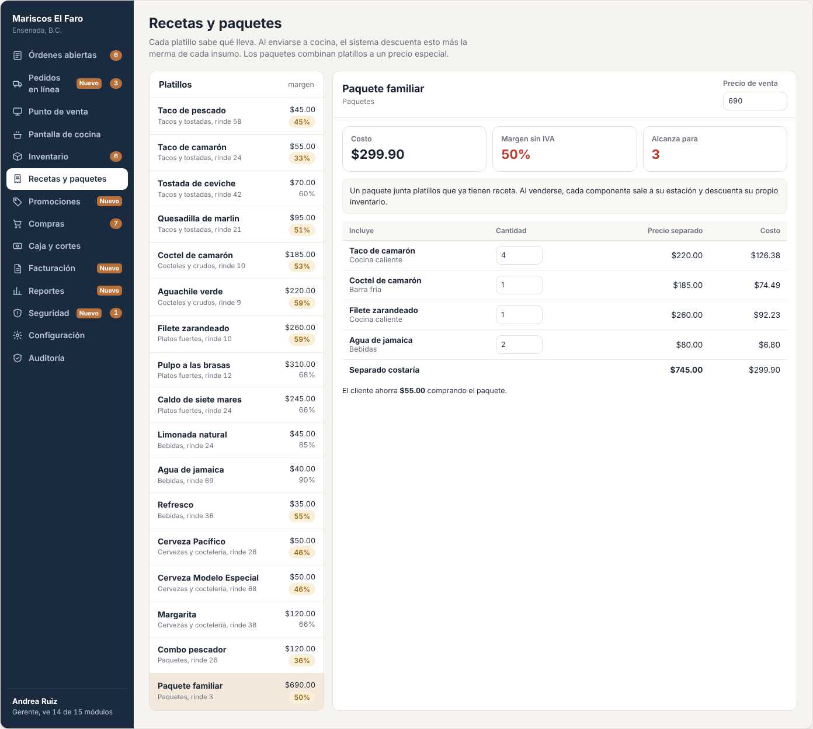
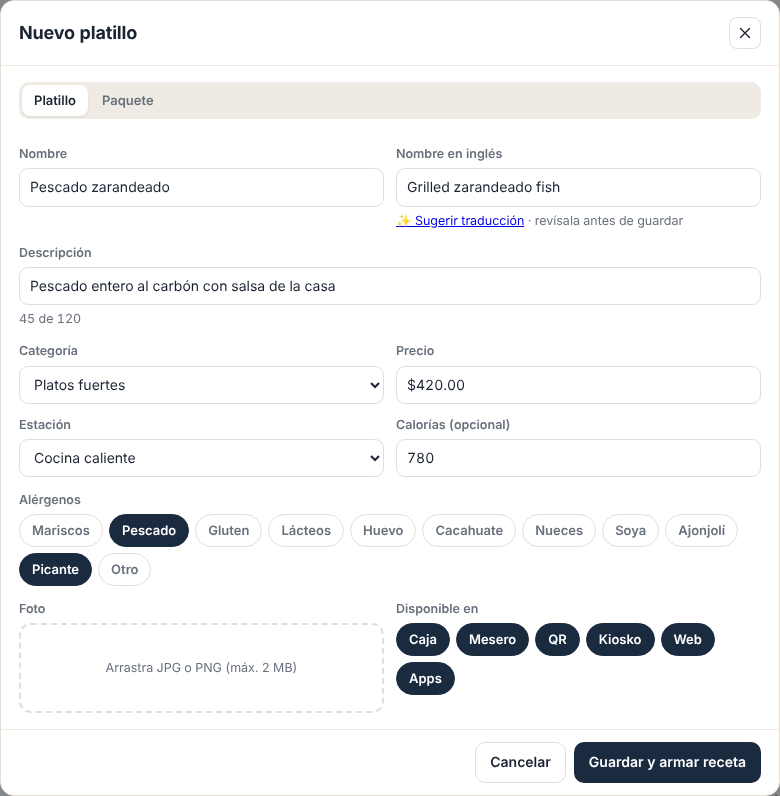
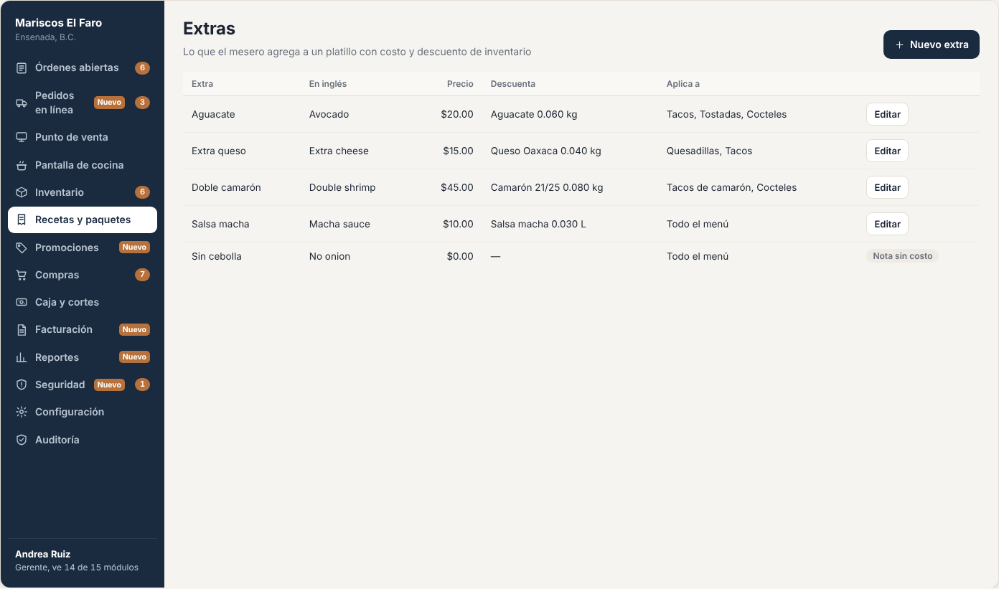
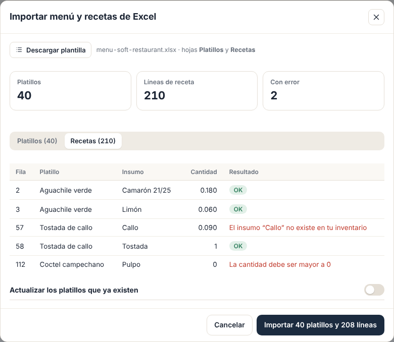

# E05 · Escritorio → Recetas y paquetes · Spec

| | |
|---|---|
| **Epic** | E05 |
| **Superficie** | Escritorio |
| **Ola** | 1 · Operación |
| **Responsable** | Por definir |
| **Revisa** | Por definir |
| **Estado** | Borrador para revisión |
| **Depende de** | E00, E04 (insumos, existencia, merma y costo), E08 (impuestos y estaciones) |
| **Lo usan** | E02 y E10 (menú y disponibilidad), E04 (lo que se descuenta), E13 (promos sobre platillos), E15 (utilidad), E17 y E19 (menú del cliente) |
| **Diseño** | Demo → Escritorio → Recetas y paquetes. Capturas en [`img/`](img/) |

## 1. Problema

Para que el inventario se descuente solo, cada platillo tiene que saber qué lleva y cuánto. Además, el dueño casi nunca sabe cuánto le cuesta hacer un taco ni cuánto le gana.

**Lo que queremos:** el menú completo (platillos, paquetes y extras) con su receta, su costo real con merma, su margen y cuántos se pueden preparar con lo que hay.

## 2. Quién lo usa

| Rol | Permiso |
|---|---|
| Gerente, Chef | `menu.view`, `menu.edit` (recetas, precios, platillos y paquetes) |
| Cajero, Mesero | Solo consumen el menú a través de E02 y E10 |

## 3. Pantallas

### 3.1 Receta de un platillo

- **Columna izquierda:** lista de platillos con categoría, "rinde N" y precio. El margen aparece en ámbar si es menor al umbral (60% por defecto, configurable en E08).
- **Columna derecha:**
  - **Encabezado:** nombre, categoría, estación, campo *Precio de venta* y selector *Estación*.
  - **Indicadores:** *Costo* (BR-REC-01), *Margen sin IVA* (BR-REC-02) y *Alcanza para* N (BR-REC-03), en rojo si es menor a 6.
  - **Tabla de ingredientes:** selector de insumo, cantidad por plato con su unidad, merma, cuánto se descuenta realmente, costo y el botón quitar.
  - Botón *Agregar ingrediente*.

Si el platillo admite extras, abajo aparece "Extras que el mesero puede agregar: Extra aguacate $20.00 (descuenta 0.05 kg de Aguacate)…".

### 3.2 Paquete

- Una nota explica que el paquete junta platillos que ya tienen receta y que cada componente sale a su estación.
- Tabla con lo que incluye: platillo, estación, cantidad editable, precio separado y costo.
- Fila "Separado costaría $745.00".
- Leyenda "El cliente ahorra $55.00 comprando el paquete".

### 3.3 Más pantallas (capturas de maqueta)

| Pantalla | Contenido |
|---|---|
| **Nuevo platillo o paquete** | Nombre (ES y EN), descripción (ES y EN, 120 caracteres) con el botón **Sugerir traducción** (BR-REC-11), categoría, precio, estación, foto (JPG o PNG ≤ 2 MB, se recorta a 4:3), **alérgenos** (mariscos, gluten, lácteos, cacahuate, picante…), **calorías** opcionales, *Disponible en*: caja, mesero, QR, kiosko, web y apps. Tipo: platillo o paquete.  |
| **Categorías del menú** | Lista ordenable (arrastrar) con nombre ES y EN. |
| **Extras** | Catálogo: nombre ES y EN, precio, insumo y cantidad que descuenta, y a qué categorías o platillos aplica.  |
| **Importar menú y recetas de Excel** | Igual que la importación de insumos (E04): plantilla con dos hojas, *Platillos* (nombre, categoría, precio, estación, nombre EN) y *Recetas* (platillo, insumo, cantidad). Vista previa con totales y errores por fila, e importación todo o nada. Sirve para migrar desde otro sistema (por ejemplo, Soft Restaurant exporta su catálogo a Excel).  |
| **Agotar hoy** | Switch por platillo "Agotado hoy" para cuando cocina decide no hacerlo aunque haya insumos. Se reinicia al cambiar el día de operación. |

## 4. Historias de usuario

| ID | Como… | Quiero… | Para… |
|---|---|---|---|
| US-REC-01 | chef | capturar la receta de cada platillo | que el inventario se descuente solo |
| US-REC-02 | dueño | ver el costo y el margen de cada platillo | poner precios que me dejen ganancia |
| US-REC-03 | chef | ver cuántos platillos me alcanzan | saber qué voy a agotar hoy |
| US-REC-04 | gerente | armar paquetes con precio especial | vender más por ticket |
| US-REC-05 | gerente | definir extras con precio | cobrar el "+ aguacate" sin pensar |
| US-REC-06 | gerente | dar de alta platillos con foto y descripción en dos idiomas | que el menú QR y el kiosko se vean bien |
| US-REC-07 | chef | marcar un platillo como agotado por hoy | que nadie lo venda |
| US-REC-08 | gerente | cambiar un precio | sin afectar las cuentas abiertas |
| US-REC-09 | gerente | importar mi menú y recetas desde Excel | migrar desde mi sistema anterior en un día |
| US-REC-10 | gerente | marcar alérgenos y calorías | que el cliente los vea en el menú QR y el kiosko |
| US-REC-11 | gerente | que me sugiera la traducción al inglés | no tener que traducir todo a mano |

## 5. Reglas de negocio

| ID | Regla |
|---|---|
| **BR-REC-01** | **Costo del platillo** = Σ cantidad × (1 + merma% del insumo) × costo por unidad del insumo (E04 BR-INV-02), redondeado a 2 decimales al final. **Costo del paquete** = Σ costo del componente × cantidad. |
| **BR-REC-02** | **Margen** = (precio sin impuestos − costo) ÷ precio sin impuestos. El precio sin impuestos se calcula con los impuestos que le aplican a ese platillo según E08. Se marca en ámbar si es menor al umbral (60% por defecto). |
| **BR-REC-03** | **Alcanza para** = mín. sobre cada insumo de ⌊existencia ÷ (cantidad total en la receta × (1 + merma%))⌋. En un paquete se suman las cantidades del mismo insumo de todos sus componentes. Un platillo **sin receta** no tiene límite y muestra "Sin receta: no descuenta inventario". |
| **BR-REC-04** | **Paquete:** sus componentes son platillos normales (no se anidan paquetes) con cantidad ≥ 1. Si el precio del paquete es ≥ al precio separado, se avisa "El paquete no tiene ahorro" (se permite guardar). |
| **BR-REC-05** | **Extras:** cada extra tiene precio ≥ 0, un insumo y una cantidad. Aplica a categorías o platillos específicos. Descuenta con la misma fórmula de merma (E04 BR-INV-14). |
| **BR-REC-06** | **Cambios de precio** no afectan órdenes abiertas (E02 BR-POS-07). Se audita "Precio de Taco de pescado: de $45.00 a $50.00". |
| **BR-REC-07** | **Agotado hoy** gana sobre las porciones calculadas y se reinicia al cambiar el día de operación (E00 BR-PLT-11). |
| **BR-REC-08** | **Disponible en:** un platillo solo aparece en los canales marcados. Por defecto, todos. |
| **BR-REC-09** | Un insumo **desactivado** (E04) que sigue en una receta hace que el platillo muestre "Revisa la receta: usa un insumo dado de baja". |
| **BR-REC-10** | **Resolución para inventario** (`IRecipeResolver`): platillo × cantidad + extras → líneas por insumo. El paquete se expande en sus componentes. Las cantidades salen **sin merma**, porque la aplica E04. |
| **BR-REC-11** | **Sugerir traducción:** llena los campos EN con una traducción automática (servicio según P-03) que el usuario revisa y puede editar antes de guardar. Nunca se publica una traducción sin que alguien la guarde. |
| **BR-REC-12** | **Importar menú:** valida cada fila con las mismas reglas del alta (categoría existente o nueva, precio > 0, insumo existente en E04, cantidad > 0). Importa todo lo válido en una transacción. Un platillo que ya existe por nombre se ignora salvo que se active "Actualizar los que ya existen". |
| **BR-REC-13** | **Alérgenos:** lista fija de 10 opciones + *Otro*. Se muestran como íconos con texto en el menú del cliente (E17 y E19). Las calorías son opcionales y enteras. |

## 6. Criterios de aceptación

| ID | Dado… | Cuando… | Entonces… |
|---|---|---|---|
| AC-REC-01 | Taco de pescado con la receta del demo y merma general de 5% | abro su receta | *Costo* **$21.43** |
| AC-REC-02 | lo anterior con precio de $45 e IVA 16% | veo el margen | **45%**, en ámbar (< 60%) |
| AC-REC-03 | 6.2 kg de pescado y el resto con existencia de sobra | veo *Alcanza para* | **65** (limita el pescado: 6.2 ÷ 0.0945) |
| AC-REC-04 | el Paquete familiar | lo abro | "Separado costaría **$745.00**" y "El cliente ahorra **$55.00**" |
| AC-REC-05 | el Combo pescador | subo su precio a $150 | aparece "El paquete no tiene ahorro" y aun así se guarda |
| AC-REC-06 | Aguachile con extra aguacate | lo resuelvo para inventario con 1 unidad | regresa las 6 líneas de la receta + Aguacate 0.05, sin merma |
| AC-REC-07 | el Paquete familiar × 1 | lo resuelvo | regresa los insumos de 4 tacos de camarón, 1 coctel, 1 zarandeado y 2 aguas, con camarón **sumado** |
| AC-REC-08 | marco Pulpo como "Agotado hoy" | abro el punto de venta | sale *Agotado*. Al día siguiente vuelve a estar disponible. |
| AC-REC-09 | cambio el precio del Taco de pescado a $50 | veo la auditoría | "Recetas · Cambió precio · Taco de pescado: de $45.00 a $50.00" |
| AC-REC-10 | un platillo marcado solo para caja y mesero | abro el menú QR | no aparece |
| AC-REC-11 | una receta con cantidad 0 o negativa | guardo | "La cantidad debe ser mayor a 0" |
| AC-REC-12 | un Excel con 40 platillos y 210 líneas de receta, 2 con un insumo que no existe | lo importo | la vista previa marca esas 2 líneas con "El insumo 'Callo' no existe en tu inventario" y se importan los 40 platillos con 208 líneas |
| AC-REC-13 | el Aguachile con alérgeno *Mariscos* y *Picante* | lo veo en el menú QR | aparecen los dos íconos con su texto |
| AC-REC-14 | un platillo nuevo "Pescado zarandeado" | toco *Sugerir traducción* | se llena "Grilled fish zarandeado" (o similar) en EN, editable, y no se guarda hasta tocar *Guardar* |

## 7. Fuera de alcance

- Modificadores con opciones obligatorias (término de la carne, tipo de tortilla). Ver P-01.
- Recetas de subrecetas (salsa base usada en varios platillos). Ver P-02.

## 8. Preguntas abiertas

| ID | Pregunta | Contesta | Estado |
|---|---|---|---|
| P-01 | ¿Necesitamos **modificadores obligatorios** ("elige: maíz o harina") además de extras opcionales? | Equipo | Abierta |
| P-02 | ¿Necesitamos **subrecetas** (preparaciones intermedias con su propio inventario, como salsas o caldos base)? | Equipo | Abierta |
| P-03 | ¿Qué servicio usamos para sugerir traducciones (por ejemplo, Azure Translator o un modelo de IA)? | Equipo | Abierta |
