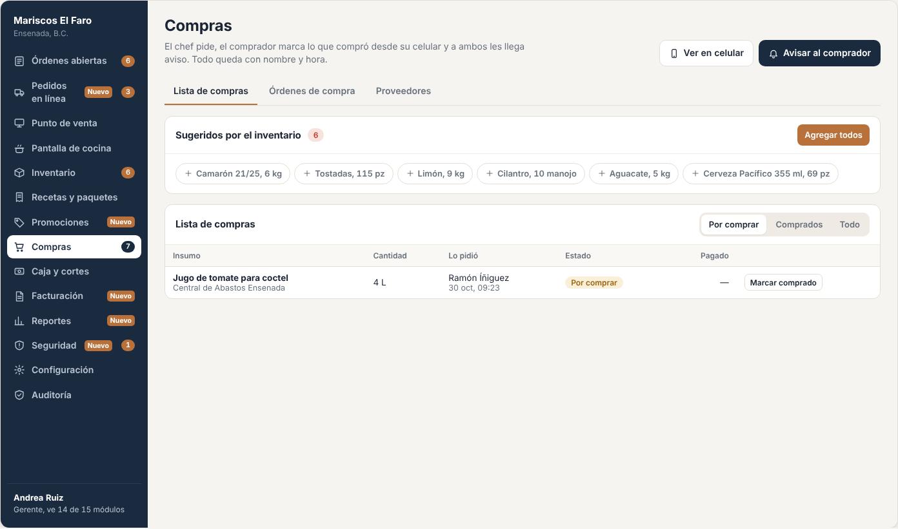
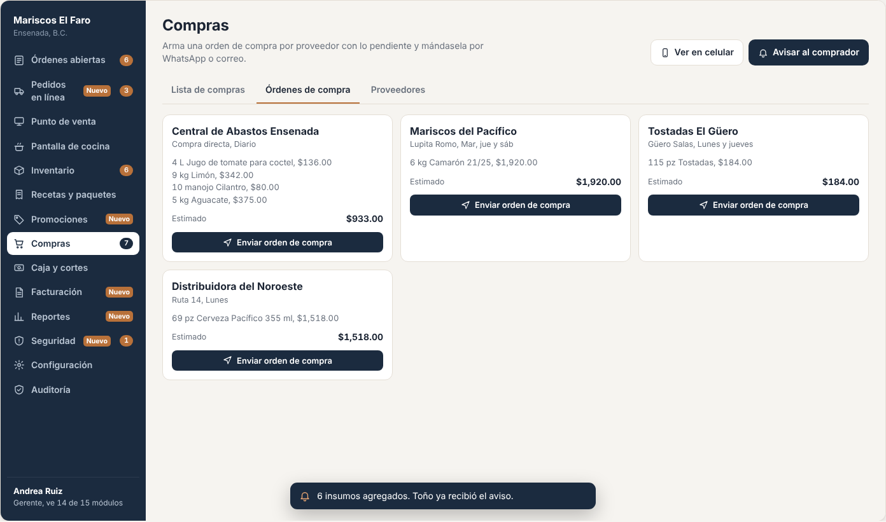
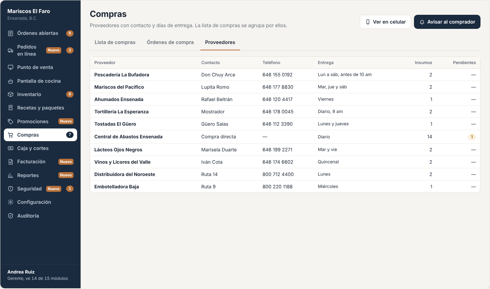
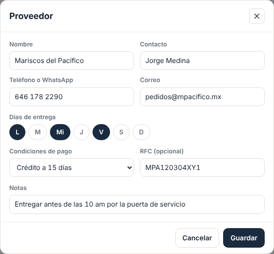
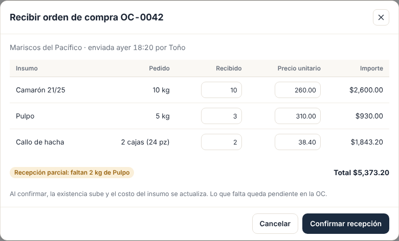

# E06 · Escritorio → Compras y proveedores · Spec

| | |
|---|---|
| **Epic** | E06 |
| **Superficie** | Escritorio |
| **Fase** | 1 · Inventario · paso 5 de 22 en el [orden de construcción](../../docs/epics.md) |
| **Responsable** | Por definir |
| **Revisa** | Por definir |
| **Estado** | Borrador para revisión |
| **Depende de** | E00 (avisos), E04 (sugeridos y entradas a inventario) |
| **Lo usan** | E04 (botón "A compras"), E11 (celular del chef y del comprador), E15 (compras por proveedor) |
| **Diseño** | Demo → Escritorio → Compras. Capturas en [`img/`](img/) |

## 1. Problema

El chef le dice al comprador lo que falta de palabra o por WhatsApp, el comprador se olvida de algo, nadie sabe qué ya se compró, y el inventario no se actualiza con lo que llegó.

**Lo que queremos:** una lista de compras compartida que se llena con un toque (o sola, con los sugeridos), que el comprador marca desde su celular, que sube el inventario sola, y que avisa a cada quien cuando le toca. Todo con nombre y hora.

## 2. Quién lo usa

| Rol | Qué hace | Permiso |
|---|---|---|
| Chef | Pide lo que falta | `purchasing.request` |
| Compras | Ve la lista, marca lo comprado y arma órdenes de compra | `purchasing.view`, `purchasing.buy` |
| Gerente | Todo, más proveedores | además `purchasing.suppliers` |

## 3. Pantallas

### 3.1 Lista de compras

- **Encabezado:** botones *Ver en celular* y *Avisar al comprador*.
- **Pestañas:** *Lista de compras*, *Órdenes de compra* y *Proveedores*.
- **Panel "Sugeridos por el inventario":** chips con "+ Camarón 21/25, 6 kg" (o "3 cajas") y el botón *Agregar todos*.
- **Tabla:**
  - Insumo y proveedor.
  - Cantidad en unidad de compra y en unidad base.
  - Quién lo pidió y cuándo.
  - Estado: *Por comprar*, *Comprado* (con quién y cuándo) o *No se consiguió*.
  - Pagado.
  - Acciones: *Marcar comprado* y *Cancelar*.
- **Filtro:** *Por comprar*, *Comprados* o *Todo*.

### 3.2 Órdenes de compra

Una tarjeta por proveedor con lo pendiente:
- Nombre, contacto y días de entrega.
- Líneas con cantidad y costo estimado.
- Total estimado.
- Botón *Enviar orden de compra*.

Al enviarla se genera un folio (OC-0012) y se manda por WhatsApp o correo (según E03 P-01).

### 3.3 Proveedores

Tabla con proveedor, contacto, teléfono (seleccionable para copiar), días de entrega, número de insumos y pendientes. Al tocar uno se abre el formulario de edición.

### 3.4 Más pantallas (capturas de maqueta)

| Pantalla | Contenido |
|---|---|
| **Proveedor (alta y edición)** | Nombre, contacto, teléfono, correo, días de entrega, condiciones de pago (contado o crédito a N días), RFC (opcional) y notas.  |
| **Marcar comprado (escritorio)** | El mismo flujo que el celular (E11): cantidad real con − y +, y cuánto se pagó (opcional). |
| **Recibir orden de compra** | Desde la OC: por cada línea, cantidad recibida y precio. Se puede recibir parcial.  |

## 4. Historias de usuario

| ID | Como… | Quiero… | Para… |
|---|---|---|---|
| US-COM-01 | chef | agregar a la lista lo que el sistema sugiere con un toque | no escribir la lista |
| US-COM-02 | chef | agregar algo que no está bajo el mínimo | pedir para un evento o una promoción |
| US-COM-03 | gerente | avisarle al comprador que hay lista nueva | que salga a comprar |
| US-COM-04 | comprador | marcar lo que compré, cuánto y cuánto pagué | que el inventario y el costo se actualicen solos |
| US-COM-05 | comprador | marcar lo que no se consiguió | que el chef lo sepa y busque alternativa |
| US-COM-06 | gerente | mandar órdenes de compra por proveedor | pedir por teléfono sin dictar la lista |
| US-COM-07 | gerente | dar de alta proveedores con sus datos | tener a quién pedirle cada cosa |
| US-COM-08 | chef | recibir aviso cuando compraron lo que pedí | planear la cocina |

## 5. Reglas de negocio

| ID | Regla |
|---|---|
| **BR-COM-01** | Solo puede haber **una solicitud pendiente por insumo**. Si se vuelve a pedir, se muestra "Ya pedido" y no se duplica. Se puede editar la cantidad de la pendiente. |
| **BR-COM-02** | La **cantidad sugerida** viene de E04 (BR-INV-11 y 15), en unidad de compra si el insumo la tiene. |
| **BR-COM-03** | **Avisos** (E00): al agregar desde escritorio, el comprador (rol Compras) recibe "Andrea agregó Camarón a tu lista". Con *Agregar todos* o *Enviar a compras* (E11) se manda **un solo aviso** con el total ("Ramón te mandó 5 cosas por comprar"). |
| **BR-COM-04** | **Marcar comprado:** cantidad real > 0 (puede ser distinta a la pedida) y pagado ≥ 0 opcional. Llama a E04 `IInventoryReceiving` en la misma operación (sube la existencia y, si hay pagado, el costo). Avisa a quien lo pidió. |
| **BR-COM-05** | **No se consiguió:** pide un motivo (*No había*, *Muy caro, pregunto antes*, *Mala calidad* u *Otro*) y una nota opcional, cambia el estado, avisa a quien lo pidió con el motivo y lo deja fuera de la lista activa. El insumo vuelve a sugerirse si sigue bajo el mínimo. |
| **BR-COM-06** | **Terminé las compras** (E11): manda un resumen a cada persona que pidió algo: "Toño terminó: 5 compradas, 1 no se consiguió". |
| **BR-COM-07** | **Orden de compra:** agrupa las pendientes por proveedor del insumo. Costo estimado = cantidad base × último costo. Folio consecutivo por restaurante (OC-0001). Una solicitud solo puede estar en una OC abierta. |
| **BR-COM-08** | **Recibir una OC** marca cada línea como comprada (BR-COM-04). Si se recibe parcial, la OC queda *Parcial* y lo que falta sigue pendiente. |
| **BR-COM-09** | **Proveedor:** nombre único por restaurante. No se borra, se desactiva. Un insumo sin proveedor aparece en la OC "Sin proveedor". |
| **BR-COM-10** | Todo cambio queda en auditoría y en el historial de la solicitud. |

## 6. Criterios de aceptación

| ID | Dado… | Cuando… | Entonces… |
|---|---|---|---|
| AC-COM-01 | Camarón 2.1 kg, mínimo 4, sin pendiente | toco su chip en sugeridos | se crea la solicitud de **6 kg** por Andrea y desaparece de sugeridos |
| AC-COM-02 | el Camarón ya pedido | intento pedirlo otra vez desde Inventario | se muestra "Ya pedido" y no hay segunda solicitud |
| AC-COM-03 | 6 sugeridos | toco *Agregar todos* | se crean 6 solicitudes y Toño recibe **un** aviso "Andrea agregó 6 cosas a tu lista" |
| AC-COM-04 | la solicitud de 4 L de jugo de tomate | Toño marca 4 L pagados en $140 | el inventario sube 4 L, el costo queda en $35.00 por L y Ramón recibe "Toño compró 4 L de Jugo de tomate para coctel" |
| AC-COM-05 | la solicitud de Cilantro | Toño marca "No se consiguió" | Ramón recibe el aviso y el cilantro vuelve a aparecer en sugeridos |
| AC-COM-06 | 3 pendientes de *Central de Abastos* y 1 de *Mariscos del Pacífico* | abro *Órdenes de compra* | veo 2 tarjetas, con 3 y 1 líneas y su total estimado (camarón 6 kg × $320 = **$1,920.00**) |
| AC-COM-07 | la OC de Mariscos del Pacífico | toco *Enviar* | se crea OC-0001, queda *Enviada* y el mensaje sale al teléfono del proveedor |
| AC-COM-08 | una OC con 3 líneas | recibo 2 | la OC queda *Parcial* y la tercera sigue *Por comprar* |
| AC-COM-09 | un proveedor con el mismo nombre que otro | guardo | "Ya existe ese proveedor" |
| AC-COM-10 | un usuario con solo `purchasing.request` | abre Compras | no ve *Marcar comprado*, *Órdenes de compra* ni *Proveedores* |

## 7. Fuera de alcance

- Cuentas por pagar y pagos a proveedores. Ver P-01.
- Comparar precios entre proveedores.

## 8. Preguntas abiertas

| ID | Pregunta | Contesta | Estado |
|---|---|---|---|
| P-01 | ¿Hace falta llevar **cuentas por pagar** a proveedores a crédito (saldo, vencimientos, pagos)? | Equipo | Abierta |
| P-02 | ¿Se puede cargar la **foto del ticket** del proveedor al marcar comprado, como comprobante? | Equipo | Abierta |
