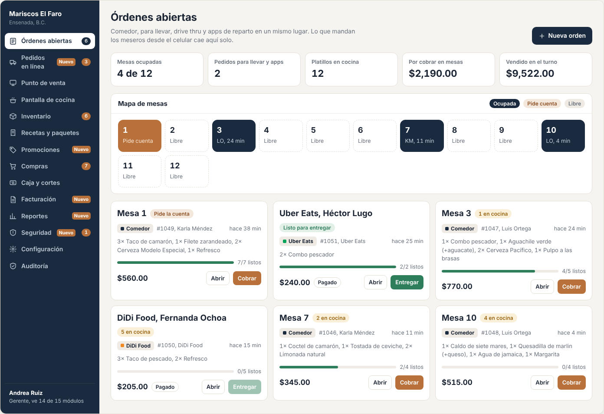
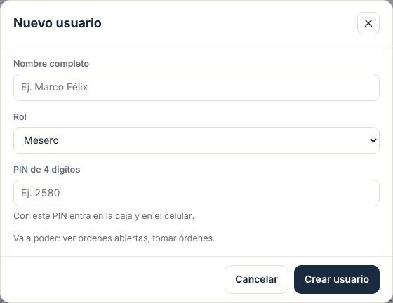
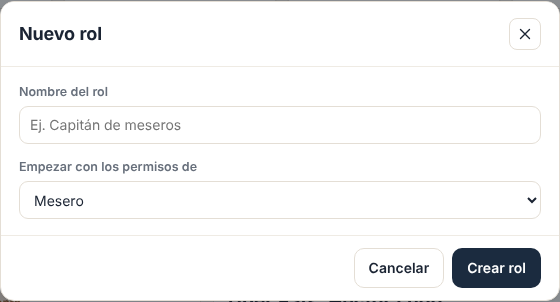
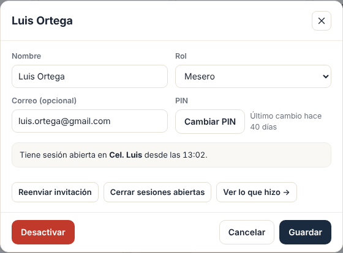
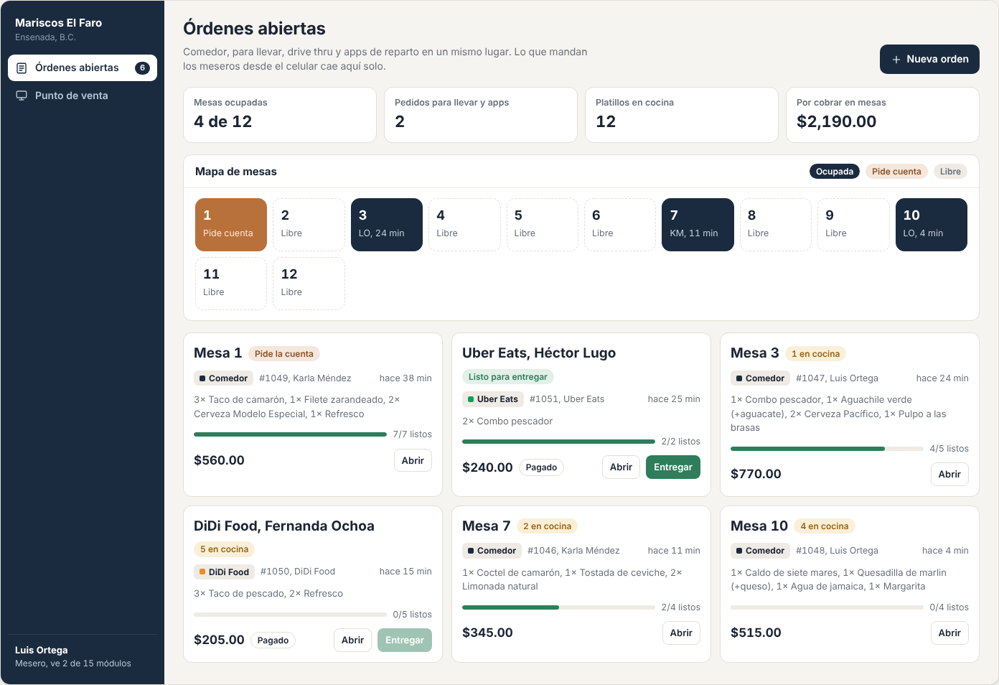

# E07 · Escritorio → Usuarios y roles · Spec

| | |
|---|---|
| **Epic** | E07 |
| **Superficie** | Escritorio |
| **Ola** | 1 · Operación |
| **Responsable** | Por definir |
| **Revisa** | Por definir |
| **Estado** | Borrador para revisión |
| **Depende de** | E00 (sesión, PIN y validación de permisos) |
| **Lo usan** | Todos (cada epic declara sus permisos en el catálogo de abajo) |
| **Diseño** | Demo → Escritorio → Usuarios y roles. Capturas en [`img/`](img/) |

## 1. Problema

Cada restaurante se organiza distinto: en uno el capitán de meseros puede cancelar, y en otro solo el gerente. Si los roles están fijos en el código, no sirve para vender a varios restaurantes.

**Lo que queremos:** que cada restaurante cree a su gente con un PIN, arme sus propios roles marcando casillas, y que eso decida qué ve y qué puede hacer cada quien.

## 2. Quién lo usa

| Rol | Permiso |
|---|---|
| Administrador (y quien él designe) | `users.manage` |

## 3. Pantallas

### 3.1 Usuarios

- Pestañas *Usuarios (9)* y *Roles y permisos (6)*. Botón *Nuevo usuario*.
- Tabla con avatar e iniciales, nombre, rol (selector), PIN oculto (••••), último acceso y switch de activo.
- Al tocar un nombre se abre **Editar usuario** (sección 3.4).

### 3.2 Roles y permisos

- Matriz con una fila por permiso, agrupados por módulo, y una columna por rol con "N personas" debajo del nombre.
- Casillas que se guardan al momento.
- El rol **Administrador** está bloqueado (todo marcado).
- Botón *Nuevo rol*.

### 3.3 Nuevo usuario y nuevo rol

- **Nuevo usuario:** nombre completo, rol y PIN de 4 dígitos. Abajo se muestra "Va a poder: ver órdenes abiertas, tomar órdenes…", que se actualiza al cambiar el rol.
- Si el rol tiene `platform.remote_login`, además pide correo y envía la invitación para crear contraseña.

- **Nuevo rol:** nombre y "Empezar con los permisos de" otro rol.

### 3.4 Más pantallas (capturas de maqueta)

| Pantalla | Contenido |
|---|---|
| **Editar usuario** | Nombre, rol, *Cambiar PIN*, correo y *Reenviar invitación* (si aplica), *Cerrar sesiones abiertas*, *Desactivar*, y la liga "Ver lo que hizo" que abre la Auditoría (E09) filtrada por esa persona.  |
| **Editar o eliminar rol** | Renombrar. *Eliminar* solo si no tiene personas asignadas. |

### 3.5 Lo que ve cada rol

## 4. Historias de usuario

| ID | Como… | Quiero… | Para… |
|---|---|---|---|
| US-USR-01 | administrador | dar de alta a mi personal con nombre, rol y PIN | que empiecen a trabajar hoy |
| US-USR-02 | administrador | crear roles a mi medida copiando uno existente | no empezar de cero |
| US-USR-03 | administrador | marcar y desmarcar permisos por rol | controlar qué puede hacer cada puesto |
| US-USR-04 | administrador | desactivar a alguien que ya no trabaja aquí | que no pueda entrar, sin perder su historial |
| US-USR-05 | administrador | cambiar el PIN de alguien que lo olvidó | que siga trabajando |
| US-USR-06 | administrador | invitar por correo al gerente | que entre desde su casa |
| US-USR-07 | administrador | ver lo que hizo una persona | revisar un problema |

## 5. Reglas de negocio

| ID | Regla |
|---|---|
| **BR-USR-01** | **Nombre** con nombre y apellido (al menos 2 palabras), de 3 a 60 caracteres. |
| **BR-USR-02** | **PIN:** 4 dígitos, único entre los usuarios **activos** del restaurante. No se permiten 0000, 1111 … 9999, 1234 ni 4321. Se guarda con hash (E00). |
| **BR-USR-03** | Los roles con `platform.remote_login` necesitan **correo** único en toda la plataforma. La invitación vence a las 48 horas. |
| **BR-USR-04** | **Administrador** es un rol de sistema: no se edita ni se borra. Siempre debe quedar al menos **un** administrador activo. |
| **BR-USR-05** | **Nadie puede desactivarse a sí mismo** ni quitarse `users.manage`. |
| **BR-USR-06** | **Desactivar** a un usuario cierra sus sesiones al momento, libera su PIN y conserva todo su historial. Sus órdenes abiertas siguen abiertas con su nombre. |
| **BR-USR-07** | **Cambios de permisos:** surten efecto en la siguiente petición de cualquier usuario con ese rol. Se guarda un `PermissionsVersion` por rol. Un token con versión vieja se rechaza con 401 y la app lo renueva sola. |
| **BR-USR-08** | Un **rol** se elimina solo si no tiene usuarios. Su nombre es único por restaurante. |
| **BR-USR-09** | **Roles iniciales** de un restaurante nuevo: Administrador, Gerente, Cajero, Mesero, Chef y Compras, con los permisos de la tabla de abajo. |
| **BR-USR-10** | Todo cambio queda en auditoría: "Cambió permiso · Cajero: ya no puede cancelar platillos". |

### Catálogo de permisos

Cada epic usa estas llaves. Para agregar una nueva, se agrega aquí en el mismo PR.

| Módulo | Llave | En pantalla | Admin | Gerente | Cajero | Mesero | Chef | Compras |
|---|---|---|---|---|---|---|---|---|
| Plataforma | `platform.remote_login` | Entrar con correo desde cualquier lugar | ✔ | ✔ | | | | |
| | `platform.devices` | Registrar dispositivos | ✔ | ✔ | | | | |
| Órdenes | `orders.view` | Ver órdenes abiertas | ✔ | ✔ | ✔ | ✔ | ✔ | |
| Punto de venta | `pos.take` | Tomar órdenes | ✔ | ✔ | ✔ | ✔ | | |
| | `pos.cancel` | Cancelar platillos | ✔ | ✔ | | | | |
| | `pos.discount` | Autorizar descuentos | ✔ | ✔ | | | | |
| | `pos.reprint` | Autorizar reimpresiones | ✔ | ✔ | | | | |
| | `pos.transfer` | Transferir mesas entre meseros | ✔ | ✔ | | | | |
| Caja | `cash.view` | Ver caja y cortes | ✔ | ✔ | ✔ | | | |
| | `cash.charge` | Cobrar | ✔ | ✔ | ✔ | | | |
| | `cash.withdraw` | Retiros de efectivo | ✔ | ✔ | ✔ | | | |
| | `cash.cut` | Cortes X y Z | ✔ | ✔ | ✔ | | | |
| | `cash.refund` | Anular cobros | ✔ | ✔ | | | | |
| | `cash.settings` | Envío del corte | ✔ | ✔ | | | | |
| Cocina | `kitchen.view` | Pantalla de cocina | ✔ | ✔ | | | ✔ | |
| | `kitchen.manage` | Agotar platillos del día | ✔ | ✔ | | | ✔ | |
| Inventario | `inventory.view` | Ver inventario | ✔ | ✔ | | | ✔ | ✔ |
| | `inventory.adjust` | Ajustar existencias e insumos | ✔ | ✔ | | | ✔ | |
| Menú | `menu.view` | Ver recetas y costos | ✔ | ✔ | | | ✔ | |
| | `menu.edit` | Editar platillos, recetas y precios | ✔ | ✔ | | | ✔ | |
| Compras | `purchasing.request` | Pedir a compras | ✔ | ✔ | | | ✔ | |
| | `purchasing.view` | Ver lista de compras | ✔ | ✔ | | | ✔ | ✔ |
| | `purchasing.buy` | Marcar compras y órdenes de compra | ✔ | ✔ | | | | ✔ |
| | `purchasing.suppliers` | Proveedores | ✔ | ✔ | | | | ✔ |
| Promociones | `promos.manage` | Promociones | ✔ | ✔ | | | | |
| Facturación | `invoicing.issue` | Facturar tickets | ✔ | ✔ | ✔ | | | |
| | `invoicing.global` | Factura global | ✔ | ✔ | | | | |
| | `invoicing.cancel` | Cancelar facturas | ✔ | ✔ | | | | |
| | `invoicing.settings` | Datos fiscales y PAC | ✔ | | | | | |
| Reportes | `reports.view` | Ver reportes | ✔ | ✔ | | | | |
| Pedidos en línea | `online.manage` | Aceptar y pausar pedidos en línea | ✔ | ✔ | ✔ | | | |
| Seguridad | `audit.view` | Ver auditoría | ✔ | ✔ | | | | |
| | `security.manage` | Alertas y reglas | ✔ | ✔ | | | | |
| Usuarios | `users.manage` | Usuarios y roles | ✔ | | | | | |
| Configuración | `settings.manage` | Configuración | ✔ | ✔ | | | | |
| Sucursales | `branches.manage` | Varias sucursales | ✔ | | | | | |
| Suscripción | `billing.manage` | Plan y pagos de Resto | ✔ | | | | | |

## 6. Criterios de aceptación

| ID | Dado… | Cuando… | Entonces… |
|---|---|---|---|
| AC-USR-01 | el PIN 5512 ya es de Luis | creo a Marco Félix con 5512 | "Ese PIN ya lo usa alguien más. Elige otro." |
| AC-USR-02 | un usuario nuevo | uso el PIN 1234 | "Ese PIN es muy fácil de adivinar" |
| AC-USR-03 | el rol Cajero | quito "Cancelar platillos" | en menos de 1 minuto, Diana ya no puede cancelar (recibe 403 sin cerrar sesión) y la auditoría lo registra |
| AC-USR-04 | un rol nuevo "Capitán de meseros" copiado de Mesero | lo creo | tiene los mismos permisos que Mesero y aparece en la matriz |
| AC-USR-05 | Brenda activa con sesión abierta en un celular | la desactivo | su siguiente acción la saca a la pantalla de PIN y su PIN ya no funciona |
| AC-USR-06 | soy el único administrador | intento desactivarme | "No puedes desactivar tu propio usuario" |
| AC-USR-07 | el rol Compras con 1 persona | intento eliminarlo | "Primero cambia de rol a las personas que lo tienen" |
| AC-USR-08 | un nuevo Gerente | lo creo | pide correo y le llega la invitación para crear su contraseña |
| AC-USR-09 | Luis (Mesero) | entra en la caja | ve solo *Órdenes abiertas* y *Punto de venta* |

## 7. Fuera de alcance

- Horarios, asistencia y nómina. Ver P-01.
- Permisos por sucursal (un gerente en una sucursal, cajero en otra) (E20).

## 8. Preguntas abiertas

| ID | Pregunta | Contesta | Estado |
|---|---|---|---|
| P-01 | ¿Registrar **entrada y salida** del personal con su PIN? | Equipo | Abierta |
| P-02 | ¿Foto del empleado en el teclado de PIN? | Equipo | Abierta |
