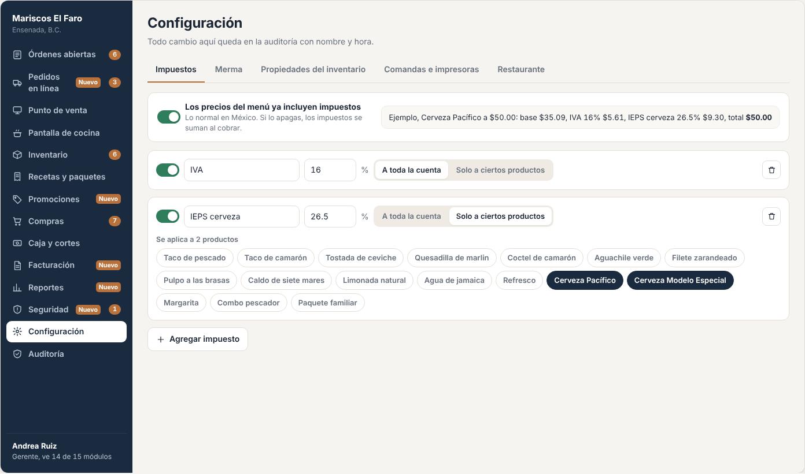
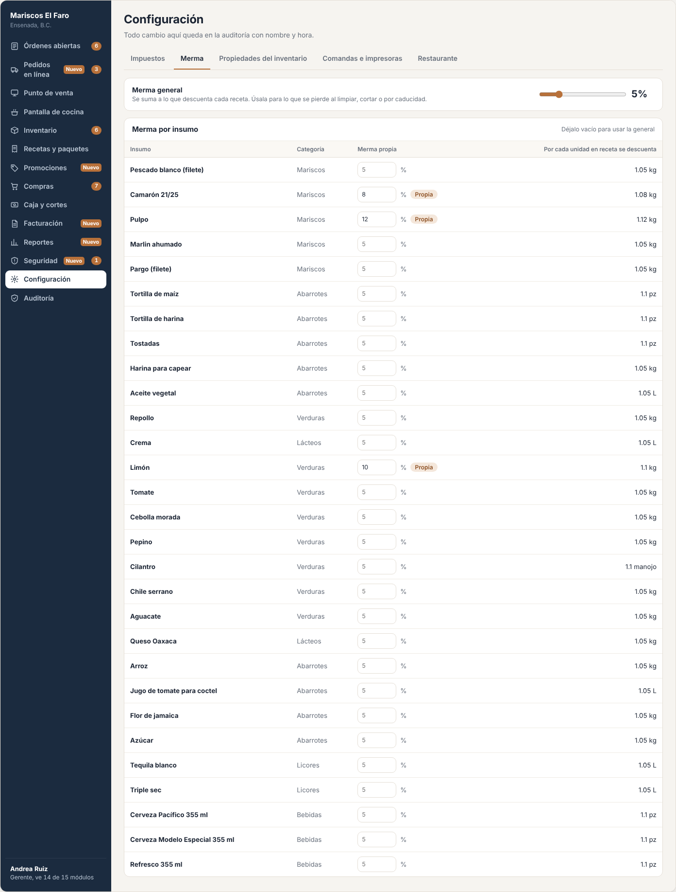
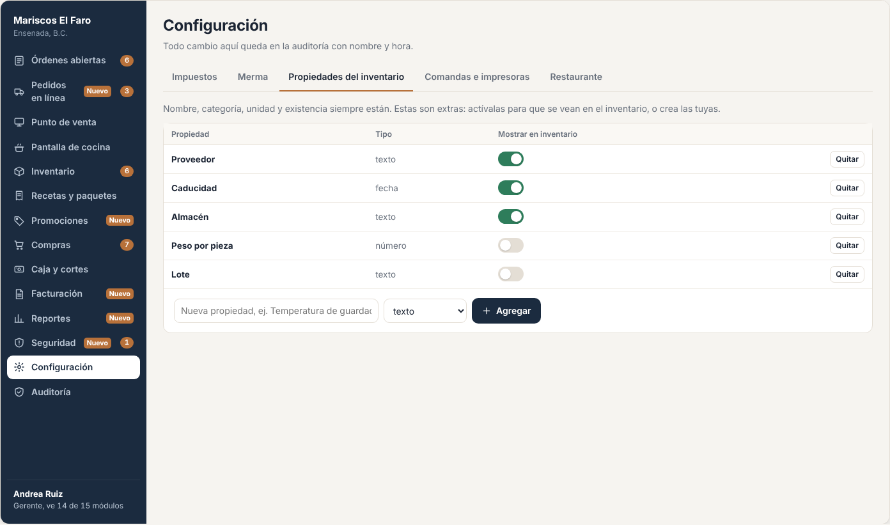
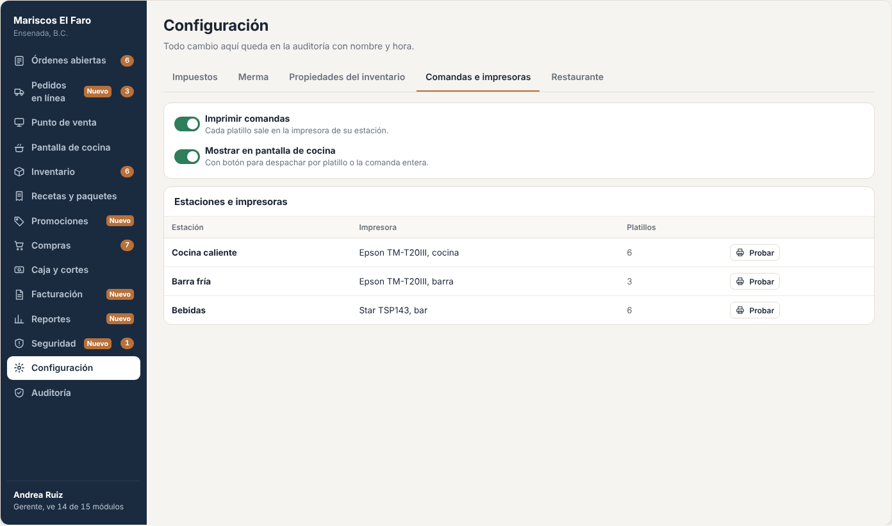
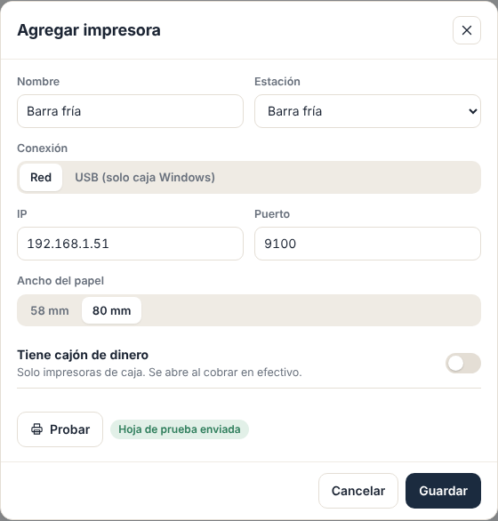
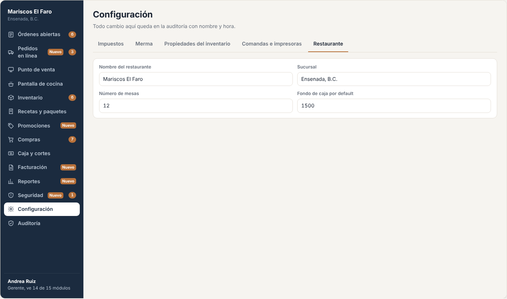

# E08 · Escritorio → Configuración · Spec

| | |
|---|---|
| **Epic** | E08 |
| **Superficie** | Escritorio |
| **Ola** | 1 · Operación |
| **Responsable** | Por definir |
| **Revisa** | Por definir |
| **Estado** | Borrador para revisión |
| **Depende de** | E00 |
| **Lo usan** | E01 (mesas), E02 y E03 (impuestos y fondo), E04 (merma, caducidad y propiedades), E05 (umbral de margen), E12 (estaciones e impresoras), E13 y E14 (impuestos) |
| **Diseño** | Demo → Escritorio → Configuración. Capturas en [`img/`](img/) |

## 1. Problema

Cada restaurante cobra impuestos distinto (por ejemplo, IVA de 8% en la franja fronteriza o IEPS en bebidas alcohólicas), tira distinto, imprime en distintas estaciones y quiere controlar distintos datos de su inventario. Si eso está en el código, cada cliente nuevo es un cambio de programación.

**Lo que queremos:** que todo lo que cambia entre restaurantes se configure en una sola pantalla, y que cada cambio quede en auditoría.

## 2. Quién lo usa

| Rol | Permiso |
|---|---|
| Administrador, Gerente | `settings.manage` |

## 3. Pantallas

Pestañas: *Impuestos*, *Merma*, *Propiedades del inventario*, *Comandas e impresoras* y *Restaurante*. Debajo del título: "Todo cambio aquí queda en la auditoría con nombre y hora."

### 3.1 Impuestos

- **Switch "Los precios del menú ya incluyen impuestos"**, con su explicación y un ejemplo en vivo: "Cerveza Pacífico a $50.00: base $35.09, IVA 16% $5.61, IEPS cerveza 26.5% $9.30, total $50.00".
- **Una tarjeta por impuesto:**
  - Switch de activo, nombre, tasa en %, eliminar.
  - Selector *A toda la cuenta* / *Solo a ciertos productos*. Si es por productos, aparecen chips con los platillos ("Se aplica a 2 productos").
- Botón *Agregar impuesto*. Los nuevos se crean **inactivos**.

### 3.2 Merma

- **Merma general:** barra de 0 a 25% con el valor en grande y la explicación.
- **Tabla por insumo:** insumo, categoría, campo "Merma propia" (vacío = general, con la general como texto de ayuda), etiqueta *Propia* y "Por cada unidad en receta se descuenta 1.10 kg".

### 3.3 Propiedades del inventario

- Texto: "Nombre, categoría, unidad, existencia y proveedor siempre están. Estas son extras."
- **Tabla:** propiedad, tipo (texto, número, fecha o lista), switch "Mostrar en inventario" y *Quitar* con confirmación en la misma fila ("Se borra el dato de los 29 insumos. Quitar / No").
- Al pie, la fila para agregar: nombre + tipo + *Agregar*.
- **Por defecto:** Caducidad (fecha, activa), Almacén (texto, activa), Peso por pieza (número, inactiva) y Lote (texto, inactiva).

### 3.4 Comandas e impresoras

- **Switches:** *Imprimir comandas* y *Mostrar en pantalla de cocina*.
- **Estaciones e impresoras:** estación, impresora, número de platillos y *Probar*. Se pueden agregar, renombrar o desactivar estaciones.
- **Impresora de caja** para tickets y cortes.

**Agregar impresora:**
- Nombre.
- Conexión: *Red* (IP y puerto, por defecto 9100) o *USB* (solo en la caja Windows; se elige de la lista de impresoras instaladas).
- Ancho del papel: 58 o 80 mm.
- Casilla **Tiene cajón de dinero** (solo impresoras de caja, E12 BR-COC-13).
- Botón *Probar*.

### 3.5 Restaurante

| Campo | Regla | Lo usa |
|---|---|---|
| Nombre del restaurante, sucursal | Obligatorios | Tickets, encabezados |
| Número de mesas | 1 a 200. Al bajar, solo se desactivan mesas sin orden abierta. | E01 |
| Fondo de caja por defecto | ≥ 0 | E03 |
| Zona horaria | Lista IANA, por defecto `America/Tijuana` | E00 |
| Fin del día de operación | Hora, por defecto 04:00 | E00 BR-PLT-11 |
| Días para avisar caducidad | 0 a 30, por defecto 2 | E04 BR-INV-05 |
| Margen mínimo de platillos | 0 a 95%, por defecto 60% | E05 BR-REC-02 |
| Tiempos de cocina | Aviso (por defecto 10 min) y atraso (por defecto 20 min) | E01 BR-ORD-07, E12 |
| Bloqueo por inactividad | Caja (5 min) y celulares (3 min) | E00 BR-PLT-04 |
| Categorías de insumos | Lista editable | E04 |

## 4. Historias de usuario

| ID | Como… | Quiero… | Para… |
|---|---|---|---|
| US-CFG-01 | dueño | configurar mis impuestos y a qué productos aplican | cobrar bien según mi régimen y mi zona |
| US-CFG-02 | dueño | decir si mis precios ya traen impuestos | que el ticket se desglose correcto |
| US-CFG-03 | chef | poner una merma general y una por insumo | que el inventario refleje lo que de verdad se tira |
| US-CFG-04 | gerente | agregar o quitar datos que llevo de cada insumo | controlar lo que a mí me importa |
| US-CFG-05 | gerente | decir qué estación imprime cada platillo y en qué impresora | que la comanda llegue a quien la prepara |
| US-CFG-06 | gerente | ajustar mesas, fondo, tiempos y horarios | que el sistema se adapte a mi operación |

## 5. Reglas de negocio

| ID | Regla |
|---|---|
| **BR-CFG-01** | **Impuesto:** nombre obligatorio y único, tasa de 0 a 100 con hasta 4 decimales, y alcance *Cuenta* o *Productos*. Uno por productos sin productos seleccionados no aplica a nada y lo avisa. |
| **BR-CFG-02** | **Cuándo aplica un cambio de impuestos:** a las cuentas **abiertas** se les recalcula con la configuración vigente. Al **cobrar**, el desglose se congela en el pago (E03) y ya no cambia. |
| **BR-CFG-03** | **Ejemplo en vivo:** usa `OrderPricing` de E02 con el primer producto que tenga más impuestos, para que lo que se ve aquí sea exactamente lo que se cobra. |
| **BR-CFG-04** | **Merma general** de 0 a 25%. **Merma por insumo** de 0 a 60% (vacío = general). Solo afecta movimientos **nuevos**: no recalcula descuentos pasados. |
| **BR-CFG-05** | **Propiedades extra:** nombre único, tipo inmutable después de crear. **Quitar** borra el valor de todos los insumos, con confirmación en la misma fila. **Ocultar** solo deja de mostrarla. |
| **BR-CFG-06** | **Estaciones:** al menos una activa. No se desactiva una estación con platillos asignados sin reasignarlos antes ("Mueve primero los 6 platillos de Barra fría"). |
| **BR-CFG-07** | **Impresoras:** *Probar* imprime una hoja con el nombre de la estación, la fecha y "Prueba de Resto". Una impresora USB solo puede usarla el dispositivo al que está conectada. |
| **BR-CFG-08** | Si **"Imprimir comandas"** y **"Mostrar en pantalla de cocina"** están apagados al mismo tiempo, se avisa "Así cocina no se entera de los pedidos" y no se permite guardar. |
| **BR-CFG-09** | Todo cambio queda en auditoría con antes y después, y se emite `SettingsChanged` para que las pantallas abiertas lo tomen sin recargar. |

## 6. Criterios de aceptación

| ID | Dado… | Cuando… | Entonces… |
|---|---|---|---|
| AC-CFG-01 | IVA 16% a la cuenta e IEPS 26.5% a 2 cervezas, con precios con impuestos | veo el ejemplo | "Cerveza Pacífico a $50.00: base **$35.09**, IVA 16% **$5.61**, IEPS 26.5% **$9.30**, total **$50.00**" |
| AC-CFG-02 | lo anterior | apago "Los precios ya incluyen impuestos" | el ejemplo dice base $50.00, IVA $8.00, IEPS $13.25, total **$71.25**, y la Mesa 3 abierta se recalcula |
| AC-CFG-03 | un impuesto nuevo | lo agrego | aparece como "Nuevo impuesto", inactivo, con 0% |
| AC-CFG-04 | merma general de 5% | la cambio a 8% | la auditoría dice "Cambió merma general: de 5% a 8%" y el siguiente taco descuenta con 8% |
| AC-CFG-05 | Limón con merma vacía | escribo 10 | aparece la etiqueta *Propia* y la columna dice "1.10 kg" |
| AC-CFG-06 | la propiedad Lote | la quito y confirmo | desaparece de la tabla y del inventario, con su entrada en auditoría |
| AC-CFG-07 | la Barra fría con 3 platillos | intento desactivarla | "Mueve primero los 3 platillos de Barra fría" |
| AC-CFG-08 | una impresora de red en 192.168.1.50:9100 | toco *Probar* | sale la hoja de prueba. Si no responde: "No se pudo conectar con la impresora de Barra fría (192.168.1.50). Revisa que esté encendida y en la misma red." |
| AC-CFG-09 | las dos opciones de comandas | intento apagarlas ambas | aparece el aviso y no se guarda |
| AC-CFG-10 | 12 mesas con la Mesa 12 ocupada | cambio a 10 mesas | "La Mesa 12 tiene una orden abierta" y no se guarda |

## 7. Fuera de alcance

- Datos fiscales y PAC (E14). Promociones (E13). Dispositivos (E00).

## 8. Preguntas abiertas

| ID | Pregunta | Contesta | Estado |
|---|---|---|---|
| P-01 | **Región fronteriza norte:** muchos restaurantes de Baja California aplican IVA de 8% con el estímulo fiscal. ¿Lo dejamos como un impuesto más que cada cliente configura, o ponemos una plantilla "Frontera norte"? Conviene validarlo con el contador. | Equipo + contador | Abierta |
| P-02 | ¿Hace falta el tipo de propiedad **lista** (opciones fijas)? | Equipo | Abierta |
