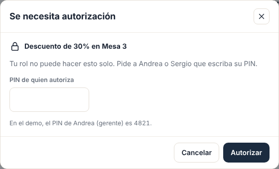
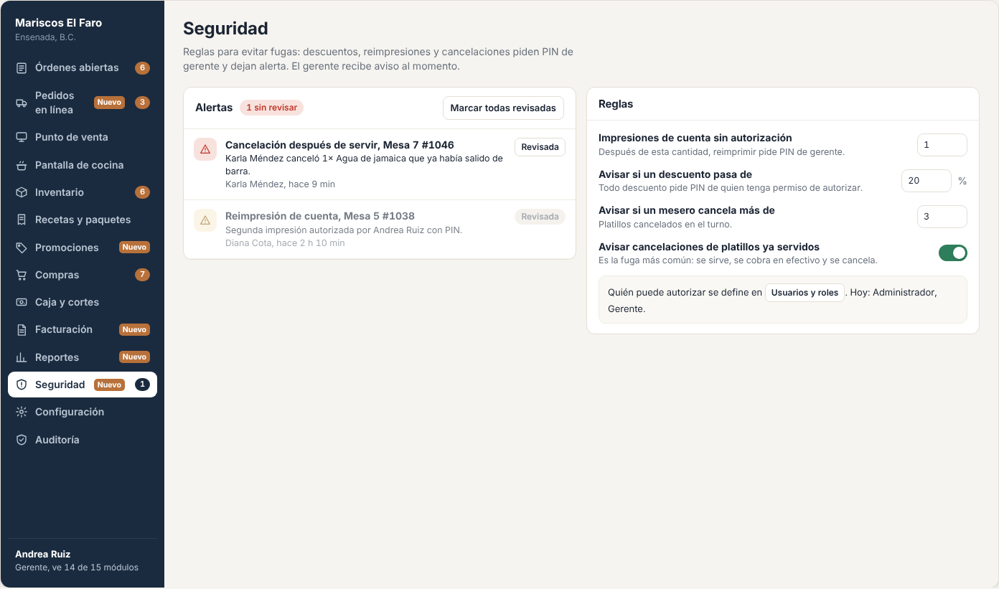
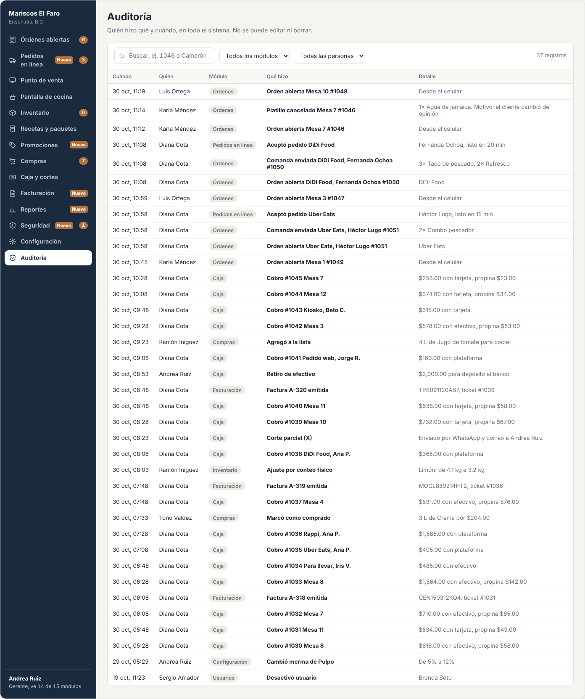
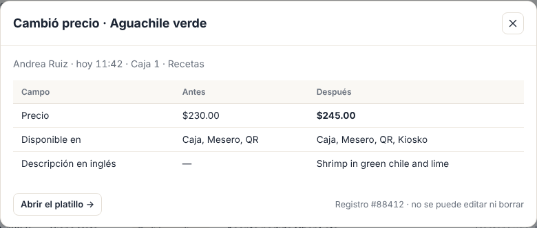

# E09 · Escritorio → Auditoría y seguridad · Spec

| | |
|---|---|
| **Epic** | E09 |
| **Superficie** | Escritorio |
| **Ola** | 1 · Operación |
| **Responsable** | Por definir |
| **Revisa** | Por definir |
| **Estado** | Borrador para revisión |
| **Depende de** | E00 (auditoría y avisos), E07 (usuarios y permisos) |
| **Lo usan** | E02 y E03 (PIN de autorización y alertas), E04 (alerta por descontar de más), E00 (alerta por intentos de PIN) |
| **Diseño** | Demo → Escritorio → Seguridad y Auditoría. Capturas en [`img/`](img/) |

## 1. Problema

Las fugas en un restaurante casi siempre son las mismas: cancelar algo que ya se sirvió y quedarse con el efectivo, reimprimir una cuenta para cobrar dos veces, descuentos "de cuates" y diferencias en caja. El dueño se entera semanas después o nunca.

**Lo que queremos:** que las acciones de riesgo pidan el PIN de alguien con permiso, que se avise al gerente en el momento, y que cualquier cosa se pueda rastrear en la auditoría.

## 2. Quién lo usa

| Rol | Permiso |
|---|---|
| Gerente, dueño | `audit.view`, `security.manage` |
| Cualquiera que pida autorización | El permiso de la acción lo tiene quien autoriza |

## 3. Pantallas

### 3.1 Autorización con PIN (modal)

- Candado + la acción ("Descuento de 30% en Mesa 3").
- "Tu rol no puede hacer esto solo. Pide a Andrea o Sergio que escriba su PIN." Los nombres son los usuarios activos con ese permiso.
- Campo de PIN (oculto, 4 dígitos) con Enter para autorizar.
- Botones *Cancelar* y *Autorizar*.
- Errores: "PIN incorrecto." / "Brenda no tiene permiso para autorizar esto."

### 3.2 Seguridad

- **Columna izquierda, Alertas:**
  - Contador "N sin revisar" y botón *Marcar todas revisadas*.
  - Cada alerta lleva un ícono de severidad (alta en rojo, media en ámbar), título, detalle, quién y cuándo, y el botón *Revisada* (o la etiqueta *Revisada*).
  - Al tocar una alerta, se abre la orden o el corte relacionado.
- **Columna derecha, Reglas:**
  - *Impresiones de cuenta sin autorización* (número, por defecto 1).
  - *Avisar si un descuento pasa de* (%, por defecto 20).
  - *Avisar si un mesero cancela más de* (por turno, por defecto 3).
  - *Avisar cancelaciones de platillos ya servidos* (switch, por defecto activo).
  - *Avisar si la diferencia del corte es mayor a* ($, por defecto 100).
  - Al pie, quién puede autorizar hoy, con liga a *Usuarios y roles*.

### 3.3 Auditoría

- **Filtros:** búsqueda de texto ("1046", "Camarón"), módulo, persona y rango de fechas (por defecto, hoy).
- Contador "N registros".
- **Tabla:** cuándo, quién, módulo (etiqueta), qué hizo (negritas) y detalle.
- Al tocar una fila, se abre un panel con el **antes y después** campo por campo, el dispositivo y la liga a la entidad.

- Botón *Exportar a Excel* con lo filtrado.

## 4. Historias de usuario

| ID | Como… | Quiero… | Para… |
|---|---|---|---|
| US-SEG-01 | cajero | pedir el PIN del gerente cuando no tengo permiso | resolver al cliente sin buscar al gerente para que tome mi lugar |
| US-SEG-02 | gerente | recibir una alerta cuando pasa algo de riesgo | actuar en el momento |
| US-SEG-03 | dueño | ajustar las reglas de alerta | que se adapte a mi restaurante |
| US-SEG-04 | dueño | buscar en la auditoría quién hizo algo | aclarar diferencias |
| US-SEG-05 | dueño | ver el antes y después de un cambio | saber qué cambió exactamente |
| US-SEG-06 | gerente | marcar alertas como revisadas | llevar control de lo que ya vi |

## 5. Reglas de negocio

| ID | Regla |
|---|---|
| **BR-SEG-01** | **Autorización con PIN:** el PIN debe ser de un usuario **activo** del mismo restaurante que tenga el permiso de la acción. Si es válido, se emite un `OverrideToken` de **un solo uso**, que vence en 60 s, ligado a la acción y a la entidad. Se registra quién pidió y quién autorizó. |
| **BR-SEG-02** | Los intentos fallidos de PIN de autorización cuentan para el bloqueo de E00 (BR-PLT-01) **del usuario dueño de ese PIN**, si se puede identificar. Si no corresponde a nadie, cuentan para el dispositivo. |
| **BR-SEG-03** | **Alertas** y sus disparadores. **Alta:** cancelación de algo ya servido, diferencia de corte ≥ umbral, cobro anulado, 5 intentos de PIN. **Media:** reimpresión fuera de la regla, descuento > umbral, mesero con más de N cancelaciones, más de 5 aperturas del cajón sin venta en un turno (E12 BR-COC-13), descuento de inventario mayor a la existencia (E04). |
| **BR-SEG-04** | Cada alerta avisa **al momento** a los roles con `security.manage` (campana y *push*) y queda en la lista hasta marcarla como revisada. Marcar como revisada también queda en auditoría. |
| **BR-SEG-05** | Los cambios de reglas aplican desde la siguiente acción. |
| **BR-SEG-06** | **Auditoría:** solo lectura. Búsqueda en `Action` y `Detail` sin distinguir mayúsculas ni acentos. Paginada de 50 en 50, de lo más nuevo a lo más viejo. El rango máximo de una consulta es de 93 días. |
| **BR-SEG-07** | **Exportar** genera un `.xlsx` con lo filtrado, hasta 50,000 filas, y deja su propia entrada de auditoría ("Exportó auditoría"). |

## 6. Criterios de aceptación

| ID | Dado… | Cuando… | Entonces… |
|---|---|---|---|
| AC-SEG-01 | Diana pide un descuento de 30% | el modal se abre | dice "Pide a Andrea o Sergio…", que son los usuarios activos con `pos.discount` |
| AC-SEG-02 | lo anterior | Andrea escribe 4821 | se aplica, el historial dice "autorizó Andrea Ruiz", y como 30% > 20% se crea una alerta media que Andrea y Sergio reciben al momento |
| AC-SEG-03 | un `OverrideToken` ya usado | se intenta usar otra vez o después de 60 s | 403 "La autorización venció. Vuelve a pedirla." |
| AC-SEG-04 | la regla de reimpresión en 1 | se imprime la cuenta por segunda vez | pide PIN y crea la alerta "Reimpresión de cuenta, Mesa 5 #1038" |
| AC-SEG-05 | Karla cancela su 4ª línea del turno con la regla en 3 | se guarda | se crea la alerta "Karla Méndez lleva 4 cancelaciones en el turno" |
| AC-SEG-06 | un corte Z con −$150 | se cierra | se crea una alerta alta "Diferencia de −$150.00 en el cierre de caja" |
| AC-SEG-07 | 2 alertas sin revisar | toco *Marcar todas revisadas* | quedan atenuadas con la etiqueta *Revisada*, el contador del menú desaparece y queda en auditoría |
| AC-SEG-08 | la auditoría de hoy | busco "1046" | veo solo los registros de esa orden |
| AC-SEG-09 | un cambio de merma | abro el registro | el panel muestra `WastePercent: 5 → 12` |
| AC-SEG-10 | un usuario sin `audit.view` | entra a `/auditoria` | "No tienes acceso a este módulo" |

## 7. Fuera de alcance

- Detección automática de patrones con IA. Ver P-01.

## 8. Preguntas abiertas

| ID | Pregunta | Contesta | Estado |
|---|---|---|---|
| P-01 | ¿Un **resumen diario de alertas** por correo al dueño, aunque no las abra? | Equipo | Abierta |
| P-02 | ¿Se permite autorizar **a distancia** (el gerente aprueba desde su celular sin estar presente)? | Equipo | Abierta |
