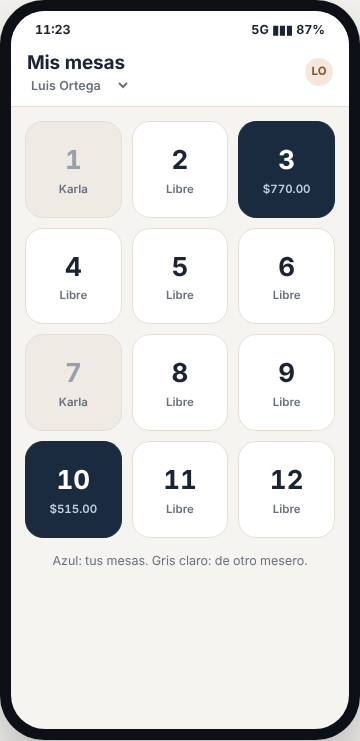
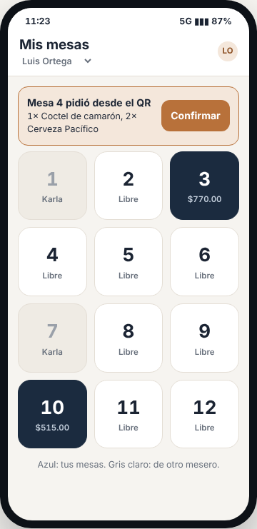
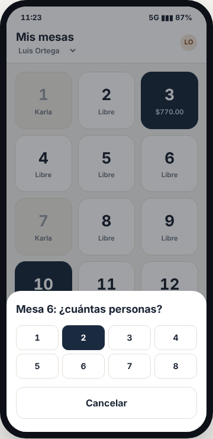
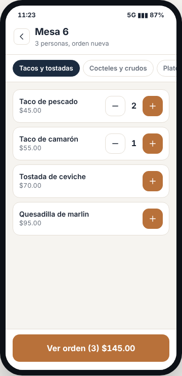
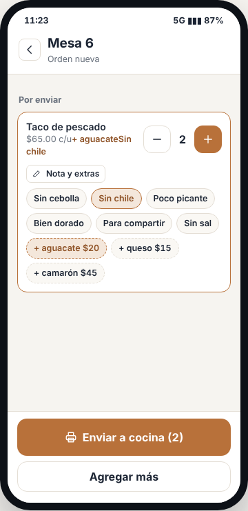
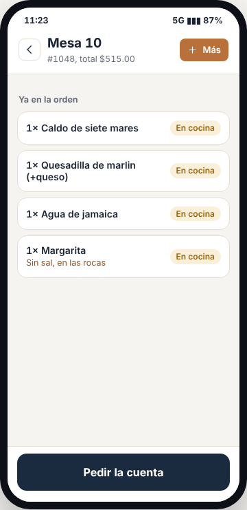
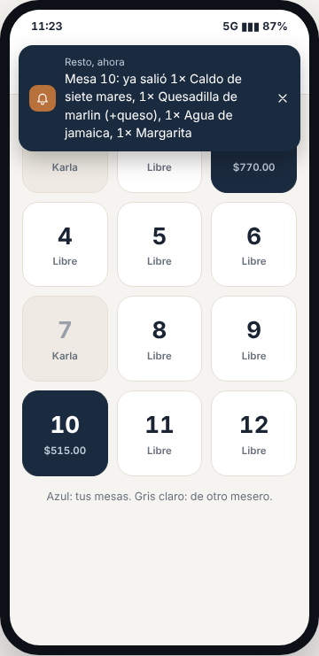

# E10 · Móvil → Mesero · Spec

| | |
|---|---|
| **Epic** | E10 |
| **Superficie** | Móvil (MAUI en Android y iOS) |
| **Ola** | 1 · Operación |
| **Responsable** | Por definir |
| **Revisa** | Por definir |
| **Estado** | Borrador para revisión |
| **Depende de** | E00 (PIN, sin conexión y *push*), E02 (órdenes), E05 (menú), E12 (avisos de despacho) |
| **Lo usan** | E17 (confirmar pedidos del QR) |
| **Diseño** | Demo → Celular del mesero. Capturas en [`img/`](img/) |

## 1. Problema

El mesero apunta en libreta, camina a la caja, lo vuelve a capturar y se le olvida el "sin cebolla". Eso es tiempo perdido, errores y platillos que regresan.

**Lo que queremos:** que el mesero levante la orden en la mesa con el celular, con botones grandes y en pocos toques, que la comanda llegue sola a cocina, y que le avisen cuando su platillo ya salió.

## 2. Quién lo usa

| Rol | Permiso |
|---|---|
| Mesero | `pos.take` en un dispositivo tipo *Celular de mesero* |

## 3. Pantallas

La app **siempre se ve en tema claro**. Todo botón tocable mide al menos 44×44 px.

### 3.1 Mis mesas

- **Encabezado:** "Mis mesas", nombre del mesero (se toca para cambiar de usuario con PIN) e iniciales.
- **Cuadrícula de 3 columnas** con todas las mesas:
  - *Libre*: blanco.
  - *Mía*: azul, con el total.
  - *Mía pide cuenta*: cobre.
  - *De otro mesero*: gris claro con su nombre, deshabilitada.
- Leyenda: "Azul: tus mesas. Gris claro: de otro mesero."
- Si hay **pedidos del QR por confirmar** en mis mesas, aparece arriba una tarjeta cobre "Mesa 4 pidió desde el QR" con los platillos y el botón *Confirmar*:

### 3.2 ¿Cuántas personas?

Al tocar una mesa libre sube una hoja con los números 1 a 8, *Más* y *Cancelar*. Al elegir, se abre el menú.

### 3.3 Menú

- **Encabezado:** regresar, "Mesa 6" y "3 personas, orden nueva" (o "Orden #1048, agregando más").
- **Chips de categoría** con scroll horizontal.
- **Platillos:** nombre y precio (o "Agotado" en rojo), y el control − N + (solo + si no hay ninguno).
- **Botón fijo abajo:** "Ver orden (3) $145.00".

### 3.4 Orden

- **"Por enviar"** (borde cobre): platillo, precio unitario con extras, extras y nota, − N +, y el botón *Nota y extras*. Al tocarlo se despliegan las notas rápidas (*Sin cebolla*, *Sin chile*, *Poco picante*, *Bien dorado*, *Para compartir*, *Sin sal*) y los extras con precio, con borde punteado ("+ Aguacate $20").
- **"Ya en la orden"**: lo enviado antes, con su estado *En cocina* o *Listo*.
- **Abajo:**
  - Con algo por enviar: **Enviar a cocina (N)** y *Agregar más*.
  - Sin nada por enviar: **Pedir la cuenta**, o "Cuenta pedida a caja" ya deshabilitado.

### 3.5 Aviso "ya salió"

Un banner arriba: "Mesa 10: ya salió 1× Caldo de siete mares, 1× Quesadilla de marlin (+queso)…". Al tocarlo se abre esa orden. Si la app está cerrada, llega como *push*.

### 3.6 Estados

| Estado | Qué se ve |
|---|---|
| Sin conexión | La barra de E00. Se puede abrir, agregar y enviar. Las comandas se imprimen si la impresora de red está en la misma red local. |
| Platillo agotado mientras se armaba la orden | Al enviar: "El Pulpo a las brasas se agotó. Quítalo o cámbialo." y se resalta la línea. |
| Mesa ocupada por otro mientras elegía | "La Mesa 6 la acaba de abrir Karla." y regresa a *Mis mesas*. |

## 4. Historias de usuario

| ID | Como… | Quiero… | Para… |
|---|---|---|---|
| US-MES-01 | mesero | ver mis mesas y las libres | saber dónde atender |
| US-MES-02 | mesero | abrir una mesa con el número de personas | empezar la orden |
| US-MES-03 | mesero | agregar platillos con un toque | levantar rápido en la mesa |
| US-MES-04 | mesero | poner notas y extras | que salga como lo pidió el cliente |
| US-MES-05 | mesero | enviar a cocina desde la mesa | no caminar a la caja |
| US-MES-06 | mesero | agregar más a una orden ya enviada | atender una segunda ronda |
| US-MES-07 | mesero | que me avisen cuando salió mi platillo | llevarlo caliente |
| US-MES-08 | mesero | pedir la cuenta a caja | que el cliente no espere |
| US-MES-09 | mesero | confirmar lo que pidieron por QR | revisar antes de que llegue a cocina |

## 5. Reglas de negocio

| ID | Regla |
|---|---|
| **BR-MES-01** | El mesero solo abre **mesas libres** y solo entra a **sus** mesas. Las de otro se ven, pero no se tocan. |
| **BR-MES-02** | Lo que está **por enviar se guarda en el celular** (SQLite) hasta tocar *Enviar*. Si se cierra la app o se acaba la batería, se conserva. No existe en el servidor hasta enviarlo. |
| **BR-MES-03** | **Enviar** hace en una sola operación (y con una sola `Idempotency-Key`): abrir la orden si es nueva, agregar las líneas y enviarlas a cocina (E02 BR-POS-04). Funciona sin conexión (E00). |
| **BR-MES-04** | Mismas reglas de agrupación que E02 BR-POS-03: el mismo platillo sin extras ni nota suma cantidad; con extras o nota distinta es otra línea. |
| **BR-MES-05** | Los **extras** disponibles son los del platillo (E05). El precio unitario mostrado incluye los extras. El total de *Ver orden* usa `OrderPricing` (con promociones vigentes). |
| **BR-MES-06** | **Pedir la cuenta** marca la orden (E02 BR-POS-12) y avisa a los roles Cajero y Gerente. Solo se puede una vez. |
| **BR-MES-07** | El aviso "ya salió" le llega **solo al mesero de la orden**. |
| **BR-MES-08** | Los **pedidos del QR** (E17) de una mesa le llegan al mesero de esa mesa. Si la mesa está libre, le llegan a todos los meseros activos y el primero que confirma se queda con la mesa. |
| **BR-MES-09** | El celular se bloquea por inactividad según E00 (3 min por defecto) y el siguiente mesero entra con su PIN. Las mesas siempre se filtran por el usuario actual. |

## 6. Criterios de aceptación

| ID | Dado… | Cuando… | Entonces… |
|---|---|---|---|
| AC-MES-01 | Luis con las Mesas 3 y 10, y Karla con la 1 y la 7 | Luis abre la app | ve la 3 y la 10 en azul con su total, la 1 y la 7 en gris con "Karla", y las demás libres |
| AC-MES-02 | la Mesa 6 libre | Luis la toca, elige 3 personas, agrega 2 *Taco de pescado* y 1 *Taco de camarón* | el botón dice "Ver orden (3) $145.00" |
| AC-MES-03 | lo anterior | agrega "Sin chile" y "+ Aguacate" a los tacos de pescado | la línea dice $65.00 c/u, "+ Aguacate" y "Sin chile" |
| AC-MES-04 | lo anterior | cierra la app y la vuelve a abrir | la orden sigue *Por enviar* con todo |
| AC-MES-05 | lo anterior | toca *Enviar a cocina (3)* | la Mesa 6 aparece en azul en su celular y en caja, la comanda llega a cocina con nota y extras, y se descuentan 0.05 kg extra de aguacate por cada taco |
| AC-MES-06 | sin internet | envía | la comanda se imprime en la impresora de red, ve "1 pendiente" y al volver la señal se sincroniza sin duplicar |
| AC-MES-07 | la Mesa 10 de Luis | cocina despacha todo | Luis recibe el banner (o *push*) "Mesa 10: ya salió…". Karla no recibe nada. |
| AC-MES-08 | la Mesa 10 | Luis toca *Pedir la cuenta* | caja recibe "Mesa 10 pide la cuenta (Luis Ortega)" y el botón queda "Cuenta pedida a caja" |
| AC-MES-09 | la Mesa 4 libre y un pedido del QR | Luis toca *Confirmar* | se abre la Mesa 4 a su nombre y el pedido llega a cocina |
| AC-MES-10 | el Pulpo se agotó mientras armaba la orden | envía | aparece el aviso y la línea resaltada; nada se envía hasta corregirlo |

## 7. Fuera de alcance

- Cobrar desde el celular (eso es caja, E03, o terminal, E16). Ver P-01.

## 8. Preguntas abiertas

| ID | Pregunta | Contesta | Estado |
|---|---|---|---|
| P-01 | ¿El mesero debe poder **cobrar en la mesa** con una terminal portátil? | Equipo | Abierta |
| P-02 | ¿Asignar **zonas** de mesas a cada mesero por turno? | Equipo | Abierta |
