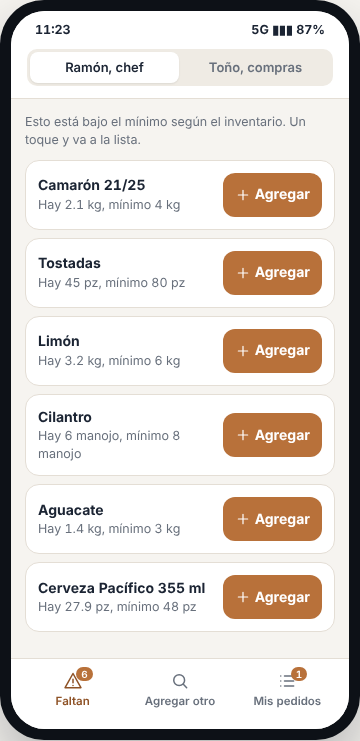
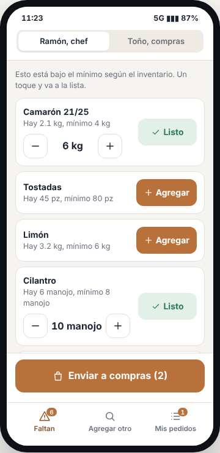
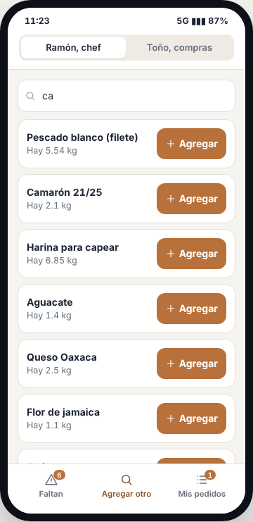
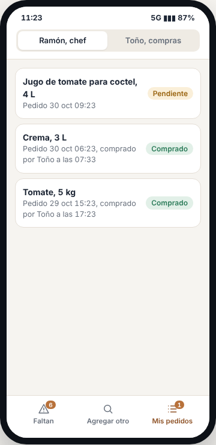
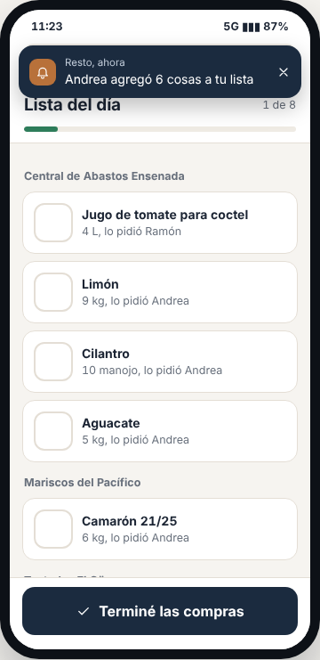
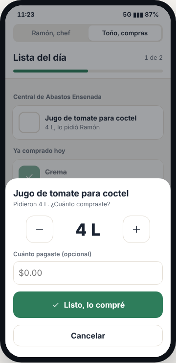
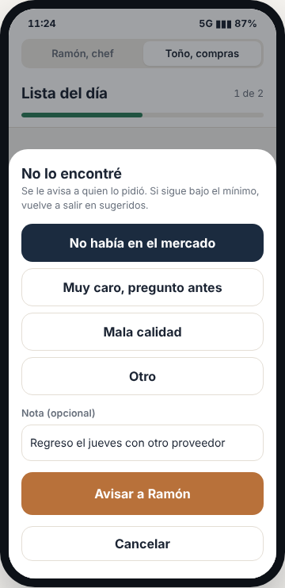
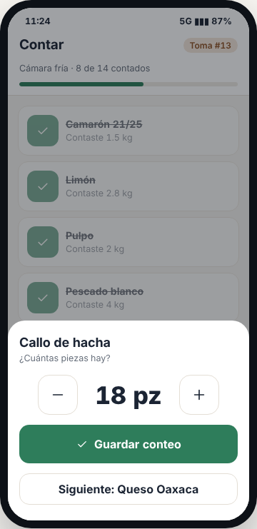

# E11 · Móvil → Chef y compras · Spec

| | |
|---|---|
| **Epic** | E11 |
| **Superficie** | Móvil (MAUI en Android y iOS) |
| **Ola** | 1 · Operación |
| **Responsable** | Por definir |
| **Revisa** | Por definir |
| **Estado** | Borrador para revisión |
| **Depende de** | E00 (PIN y *push*), E04 (faltantes), E06 (solicitudes de compra) |
| **Lo usan** | — |
| **Diseño** | Demo → Celular chef y compras. Capturas en [`img/`](img/) |

## 1. Problema

El chef no tiene tiempo de sentarse en una computadora a hacer la lista, y el comprador está en la central de abastos con el celular en una mano y las bolsas en la otra.

**Lo que queremos:** la misma app en el celular, que cambia según quién entra.
- **Chef:** ve lo que falta y lo manda a compras con un toque por insumo.
- **Comprador:** ve su lista agrupada por proveedor y la va palomeando.

Los dos reciben aviso de lo que hace el otro. Es el principio número 1: **no darle más trabajo a nadie**.

## 2. Quién lo usa

| Rol | Permiso | Qué ve |
|---|---|---|
| Chef | `purchasing.request` (y `inventory.adjust` para *Contar*) | Pestañas *Faltan*, *Agregar otro*, *Mis pedidos* y *Contar* |
| Compras | `purchasing.buy` | *Lista del día* |
| Gerente | Ambos | Un selector arriba para cambiar de vista |

## 3. Pantallas

Tema claro siempre. Botones de 44 px como mínimo y el botón principal abajo.

### 3.1 Chef · Faltan

- "Esto está bajo el mínimo según el inventario. Un toque y va a la lista."
- Una tarjeta por insumo bajo el mínimo y sin pedir, con "Hay 2.1 kg, mínimo 4 kg" y el botón cobre **+ Agregar**.
- Al tocarlo, cambia a verde **✓ Listo** y aparece el ajuste − 6 kg + para cambiar la cantidad sugerida.
- Aparece el botón fijo **Enviar a compras (N)**.
- Abajo, la barra de pestañas: *Faltan* (con contador), *Agregar otro* y *Mis pedidos* (con pendientes).

### 3.2 Chef · Agregar otro

Un buscador grande "¿Qué más necesitas?" y una lista de insumos con "Hay N" y *+ Agregar*, o "Ya pedido" si ya está en la lista.

### 3.3 Chef · Mis pedidos

Lo que pidió este chef, de lo más nuevo a lo más viejo, con cantidad, hora y estado (*Pendiente*, *Comprado por Toño a las 11:20* o *No se consiguió*).

### 3.4 Compras · Lista del día

- **Encabezado:** "Lista del día", "3 de 8" y barra de avance.
- **Grupos por proveedor** ("Central de Abastos Ensenada"). En cada uno, tarjetas con casilla vacía, insumo, cantidad (en unidad de compra si tiene, por ejemplo "3 cajas (150 pz)") y "lo pidió Ramón".
- **"Ya comprado hoy"**: atenuado, con palomita, la cantidad real y lo pagado.
- Botón fijo **Terminé las compras**.

### 3.5 Compras · Marcar comprado

Al tocar una tarjeta sube una hoja con:
- Nombre del insumo y "Pidieron 4 L. ¿Cuánto compraste?".
- Ajuste grande − **4 L** + (paso de 0.5 en kg y L, 1 en piezas, o 1 unidad de compra).
- Campo "Cuánto pagaste (opcional)".
- Botón verde **Listo, lo compré**, el botón secundario **No lo encontré** y *Cancelar*.

### 3.6 Chef · Contar (conteo desde el celular)

Es la segunda forma de llenar el inventario sin ir a la computadora. Una cuarta pestaña, **Contar**:
- **Si hay una toma de inventario abierta (E04 3.6):** muestra los insumos de su alcance agrupados por almacén. Cada uno trae un ajuste grande − N + y el teclado numérico, y se marca ✓ al capturarlo. Arriba: "Cámara fría · 8 de 14 contados". No se muestra la existencia teórica.
- **Si no hay toma abierta:** *Conteo rápido* de un insumo: buscar, escribir lo que hay y *Guardar conteo*. Crea un `PhysicalCount` directo (E04 BR-INV-09).
- **Recibir sin pedido:** *Entrada rápida* para lo que llegó sin estar en la lista (por ejemplo, el proveedor trajo de más). Pide cantidad y lo pagado opcional, y genera un `ManualEntry`.

### 3.7 Avisos

- **Chef:** "Toño compró 4 L de Jugo de tomate para coctel", "Toño terminó las compras: 5 listas, 1 no se consiguió" y "Aguacate bajó del mínimo (1.4 kg). Ya aparece en faltantes."
- **Comprador:** "Ramón te mandó 3 cosas por comprar. Toca para abrir la lista."

## 4. Historias de usuario

| ID | Como… | Quiero… | Para… |
|---|---|---|---|
| US-CHF-01 | chef | ver lo que falta y mandarlo con un toque | no hacer la lista a mano |
| US-CHF-02 | chef | ajustar la cantidad antes de mandarla | pedir de más si viene un evento |
| US-CHF-03 | chef | pedir algo que no está bajo el mínimo | cubrir necesidades especiales |
| US-CHF-04 | chef | ver qué ya compraron de lo que pedí | planear la cocina |
| US-CHF-05 | comprador | ver mi lista por proveedor | comprar en orden |
| US-CHF-06 | comprador | marcar lo comprado con la cantidad y lo que pagué | que el inventario y el costo se actualicen |
| US-CHF-07 | comprador | marcar lo que no encontré | que el chef se entere |
| US-CHF-08 | comprador | avisar que terminé | que el chef sepa que ya puede contar con todo |
| US-CHF-09 | chef | contar el inventario con el celular en la cámara fría | no apuntar en papel y luego capturar |
| US-CHF-10 | chef | registrar una entrada que llegó sin pedido | que el inventario no quede corto |

## 5. Reglas de negocio

| ID | Regla |
|---|---|
| **BR-CHF-01** | *Faltan* muestra los insumos de `IReorderQuery` (E04) que **no** tienen una solicitud pendiente. |
| **BR-CHF-02** | **Lo seleccionado se guarda en el celular** hasta tocar *Enviar a compras*, y se envía con `IPurchaseRequests.AddManyAsync` en una sola operación con **un solo aviso** (E06 BR-COM-03). |
| **BR-CHF-03** | **Paso del ajuste:** 0.5 en kg y L, 1 en piezas y manojos, o 1 unidad de compra si el insumo la tiene (por ejemplo, de caja en caja). Nunca baja de un paso. |
| **BR-CHF-04** | **Marcar comprado** y **No lo encontré** siguen E06 BR-COM-04 y 05. **Terminé las compras** sigue BR-COM-06. |
| **BR-CHF-05** | La vista depende del permiso: con `purchasing.buy` se ve *Lista del día*; con `purchasing.request`, las pestañas del chef; con ambos, aparece el selector arriba. |
| **BR-CHF-06** | **Sin conexión:** el chef puede seleccionar y enviar (va a la cola de E00). El comprador puede marcar comprado (va a la cola) y la tarjeta se ve palomeada con "pendiente de enviar". |
| **BR-CHF-07** | *Ya comprado hoy* muestra lo comprado en el día de operación actual (E00 BR-PLT-11). |
| **BR-CHF-08** | **Contar** requiere `inventory.adjust`. Los conteos funcionan sin conexión y se envían con la cola de E00. Si dos personas cuentan el mismo insumo en una toma, gana el último y queda el historial de ambos. |

## 6. Criterios de aceptación

| ID | Dado… | Cuando… | Entonces… |
|---|---|---|---|
| AC-CHF-01 | 6 insumos bajo el mínimo y 1 ya pedido | Ramón abre *Faltan* | ve 5 tarjetas, y la pestaña dice 5 |
| AC-CHF-02 | Camarón | toca *+ Agregar* y luego + | cambia a *✓ Listo* con 6.5 kg |
| AC-CHF-03 | Camarón y Cilantro seleccionados | toca *Enviar a compras (2)* | se crean 2 solicitudes, Toño recibe **un** aviso "Ramón te mandó 2 cosas por comprar" y Ramón pasa a *Mis pedidos* |
| AC-CHF-04 | Tostadas con caja de 50 | el comprador las ve | "3 cajas (150 pz)" |
| AC-CHF-05 | Jugo de tomate pedido en 4 L | Toño pone 4 L y $140 y toca *Listo, lo compré* | se palomea, el inventario sube 4 L con costo de $35.00 por L, y Ramón recibe el aviso |
| AC-CHF-06 | Cilantro pedido | Toño toca *No lo encontré* | sale de la lista y Ramón recibe "Toño no encontró Cilantro" |
| AC-CHF-07 | 5 compradas y 1 no encontrada | Toño toca *Terminé las compras* | Ramón recibe "Toño terminó las compras: 5 listas, 1 no se consiguió" |
| AC-CHF-08 | sin internet en la central | Toño marca 3 compras | se ven palomeadas con "pendiente de enviar" y se sincronizan solas al volver la señal |
| AC-CHF-09 | Andrea (gerente) | abre la app | ve el selector "Chef / Compras" |
| AC-CHF-10 | una toma abierta de *Cámara fría* con 14 insumos | Ramón cuenta 8 en el celular | la computadora muestra 8 de 14 contados y Ramón no ve la existencia teórica |
| AC-CHF-11 | sin toma abierta | Ramón hace un conteo rápido del Limón en 2.5 kg | se crea un `PhysicalCount` de Limón con su nombre |
| AC-CHF-12 | el proveedor trajo 2 kg de cebolla sin pedido | Ramón usa *Entrada rápida* | la existencia sube 2 kg con un `ManualEntry` |

## 7. Fuera de alcance

- Foto del ticket del proveedor (E06 P-02).

## 8. Preguntas abiertas

| ID | Pregunta | Contesta | Estado |
|---|---|---|---|
| P-01 | ¿El comprador debe ver el **precio de la última compra** de cada insumo como referencia? | Equipo | Abierta |
