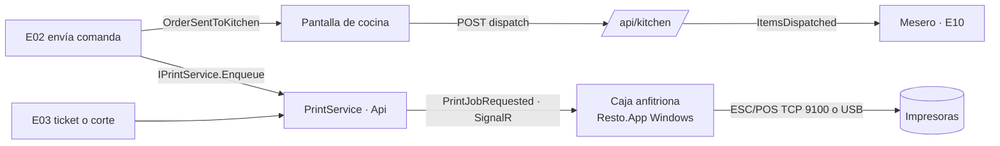

# E12 · Cocina → Pantalla e impresión · Plan técnico

## 1. Resumen



## 2. Modelo de datos

| Tabla | Columnas | Notas |
|---|---|---|
| `print_jobs` | `Id`, `RestaurantId`, `PrinterId`, `Kind` (`KitchenTicket`, `KitchenCancel`, `Bill`, `Receipt`, `CashCut`, `Test`, `OpenDrawer`), `PayloadJson`, `Status` (`Pending`, `Sent`, `Printed`, `Failed`), `Attempts`, `LastError`, `CreatedAt`, `PrintedAt` | BR-COC-11 |
| `printers` (antes en E08) | `Id`, `RestaurantId`, `Name`, `Connection` (`Network`, `Usb`), `Host`, `Port`, `UsbName`, `UsbDeviceId` (dispositivo de E00), `PaperWidthMm`, `HasCashDrawer` | BR-CFG-07, BR-COC-13 |
| `restaurant_settings.PrintHostDeviceId` | (columna nueva en la tabla de E08) | BR-COC-10 |

Los tiempos de cocina se toman de `order_items.SentAt` y `ServedAt` (E02). No se duplican.

## 3. `Resto.Printing` (biblioteca sin dependencias de UI)

| Archivo | Contenido |
|---|---|
| `EscPosBuilder.cs` | API fluida: `Text`, `Bold`, `DoubleHeight`, `Invert`, `Center`, `Line`, `Qr(data)`, `Cut()` → `byte[]`. Ancho de 32 caracteres (58 mm) o 48 (80 mm). Codificación CP850 para acentos y ñ. |
| `Templates/KitchenTicketTemplate.cs`, `KitchenCancelTemplate.cs`, `BillTemplate.cs`, `ReceiptTemplate.cs`, `CashCutTemplate.cs`, `TestPageTemplate.cs` | De DTO a `byte[]` |
| `Transports/NetworkPrinterTransport.cs` | TCP al puerto 9100 con timeout de 3 s |
| `Transports/WindowsUsbPrinterTransport.cs` | Envío RAW a una impresora instalada en Windows (`winspool`), solo en `net10.0-windows` |
| `PrintQueueWorker.cs` | Corre en la caja anfitriona: recibe `PrintJobRequested`, imprime, reintenta y reporta el resultado |

## 4. Contrato que ofrece

```csharp
public interface IPrintService   // E02, E03, E08 y E14
{
    Task EnqueueAsync(PrintRequest request, CancellationToken ct); // Kind, PrinterId o StationId, Payload
}
```

- **Del lado del servidor:** guarda el `print_job` y lo manda a la caja anfitriona.
- **Del lado de la app sin conexión:** `LocalPrintService` imprime directo con `NetworkPrinterTransport` (BR-COC-10).

## 5. API (`/api/kitchen`)

| Método y ruta | Permiso |
|---|---|
| `GET /api/kitchen/tickets?stationId=` (tarjetas pendientes + despachadas en los últimos 10 min + indicadores) | `kitchen.view` |
| `POST /api/kitchen/items/dispatch` `{ OrderId, ItemIds[] }` | `kitchen.view` |
| `POST /api/kitchen/orders/{id}/dispatch?stationId=` | `kitchen.view` |
| `POST /api/kitchen/items/undo` `{ OrderId, ItemIds[] }` (≤ 10 min) | `kitchen.view` |
| `POST /api/kitchen/orders/{id}/reprint?stationId=` | `kitchen.view` |
| CRUD `/api/settings/printers` · `POST /api/settings/printers/{id}/test` (BR-CFG-07) | `settings.manage` |
| `GET /api/printing/jobs?status=Failed` · `POST /api/printing/jobs/{id}/retry` | `cash.view` |
| `POST /api/cash/drawer/open` `{ Reason }` (BR-COC-13; acepta `X-Override-Token`; lo construye E03-T010b) | `cash.withdraw` |

**Tiempo real:** escucha `OrderSentToKitchen`, `OrderItemCancelled` y `ItemsDispatched` (de otras tablets de la misma estación). Emite `ItemsDispatched` y `PrintJobRequested`/`PrintJobFailed`.

## 6. Pantallas (`Resto.UI/Features/Kitchen/`)

| Componente | Captura |
|---|---|
| `KitchenDisplayPage.razor` (`/cocina`, tema oscuro forzado, pantalla completa, *wake lock*) | 01 |
| `StationFilter.razor`, `KitchenStats.razor` | 01, 02 |
| `KitchenTicketCard.razor` + `KitchenLine.razor` | 01 |
| `RecentlyDispatched.razor` | 03 |
| `PrintFailuresBanner.razor` (en la caja) | — |

## 7. Pruebas

| Proyecto | Qué cubre |
|---|---|
| Domain.Tests (o Printing.Tests) | **Pruebas de referencia** de bytes ESC/POS por plantilla: se compara contra un `.bin` guardado. Acentos y ñ en CP850. QR. |
| Domain.Tests | Orden, colores, filtro por estación y promedio (BR-COC-02, 03, 05 y 09) |
| Api.Tests | AC-COC-03, 04, 06 y 10 |
| Manual | AC-COC-07 a 09 con una Epson TM-T20 real; la pantalla en una tablet Android y en el navegador de una TV |

## 8. Paquetes

Ninguno. El constructor ESC/POS es propio, porque es poco código y así controlamos las plantillas. Si la P-02 suma otras marcas, se evalúa `ESCPOS_NET`.
