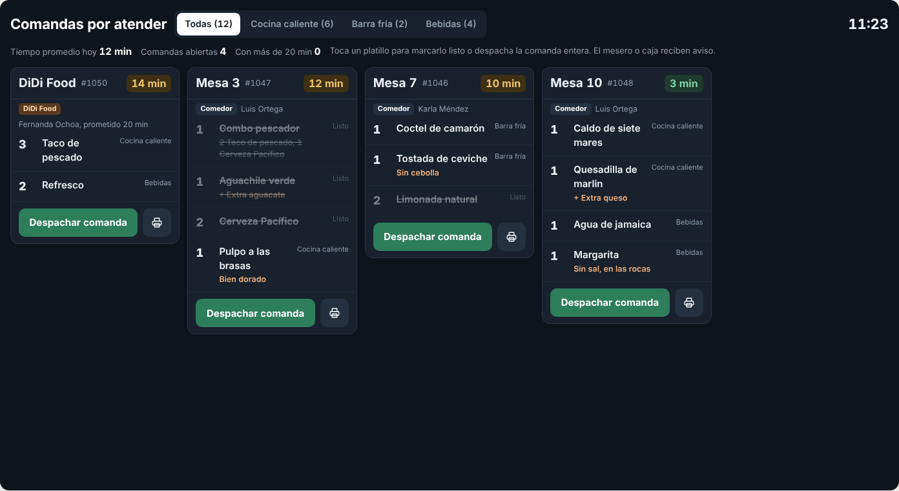
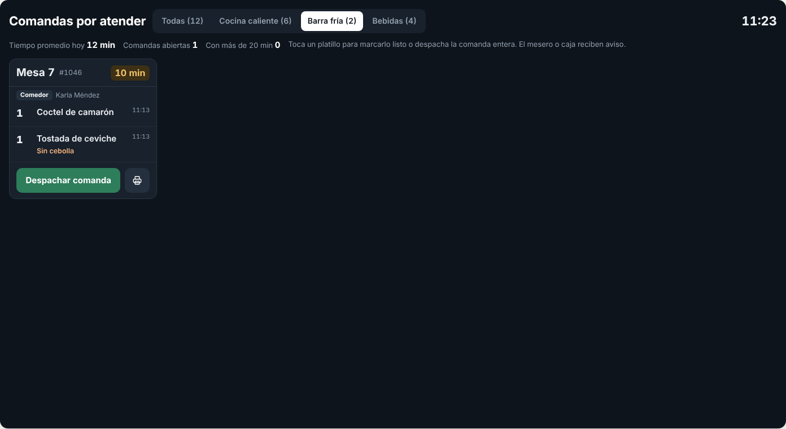
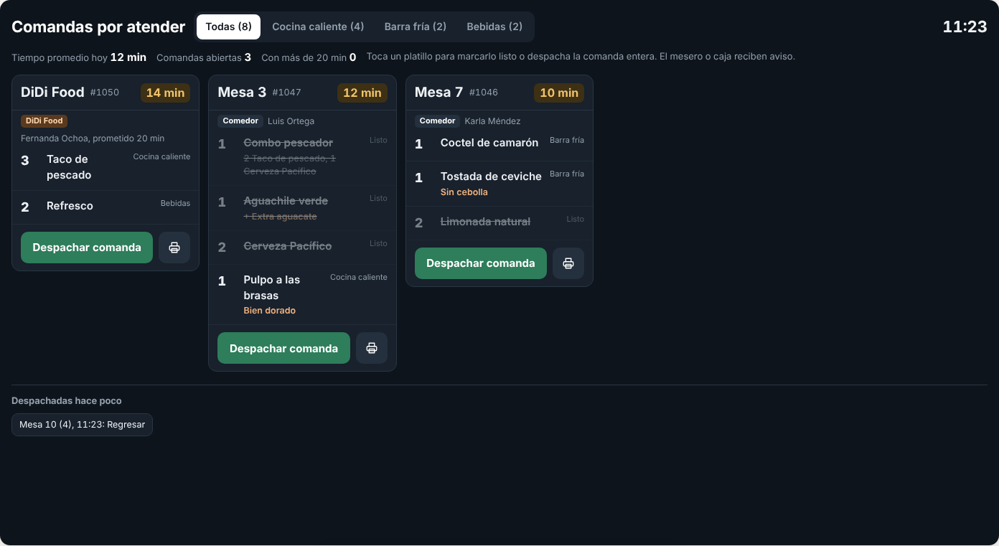
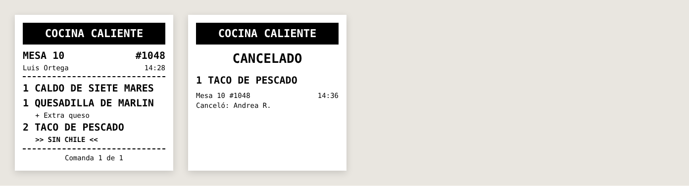

# E12 · Cocina → Pantalla e impresión · Spec

| | |
|---|---|
| **Epic** | E12 |
| **Superficie** | Cocina (tablet o TV con la app MAUI en Android o con navegador) e impresoras |
| **Ola** | 1 · Operación |
| **Responsable** | Por definir |
| **Revisa** | Por definir |
| **Estado** | Borrador para revisión |
| **Depende de** | E00, E02 (comandas), E08 (estaciones, impresoras y tiempos) |
| **Lo usan** | E02 (comanda y cuenta), E03 (ticket y corte), E10 (avisos "ya salió"), E14 (QR en el ticket), E18 (listo para entregar) |
| **Diseño** | Demo → Pantalla de cocina. Capturas en [`img/`](img/) |

## 1. Problema

En cocina se pierden comandas de papel, no se sabe cuál lleva más tiempo y el mesero tiene que asomarse a preguntar si ya salió su platillo.

**Lo que queremos:**
- Comandas que llegan solas a la estación correcta, en papel o en pantalla (o en ambas).
- Que la pantalla ordene por antigüedad y pinte lo atrasado.
- Que cocina marque lo que sale con un toque y el mesero se entere al momento.
- Que cualquier ticket del sistema (comanda, cuenta, ticket de pago o corte) se imprima igual de bien en cualquier impresora térmica.

## 2. Quién lo usa

| Rol | Permiso |
|---|---|
| Chef, cocineros (pantalla siempre abierta en modo cocina) | `kitchen.view` |
| Sistema | Imprime en nombre de otros epics |

## 3. Pantallas

### 3.1 Comandas por atender



**Pantalla oscura siempre**, pensada para leerse a 2 metros.

- **Barra superior:**
  - Título "Comandas por atender".
  - Filtro de estación: *Todas (N)*, *Cocina caliente (N)*, *Barra fría (N)* y *Bebidas (N)*. En cada tablet se guarda su estación por defecto.
  - Reloj grande.
- **Indicadores:** tiempo promedio hoy, comandas abiertas, cuántas llevan más de 20 minutos (en rojo si hay) y una línea de ayuda.
- **Tarjetas** de la más vieja a la más nueva. Cada una lleva:
  - Mesa o canal, folio y un contador de minutos: verde, ámbar desde 10 min y rojo desde 20 min (E08).
  - Etiqueta de canal (*Comedor*, o *Uber Eats* en otro color para delivery), mesero o cliente, y "prometido 20 min" si es delivery.
  - Líneas con cantidad grande y nombre. Abajo de cada una van los componentes del paquete, los extras ("+ Extra aguacate") y la nota en cobre. A la derecha, la estación (en *Todas*) o la hora.
  - Al tocar una línea, se marca **lista** (tachada y atenuada). Al tocarla otra vez, se regresa.
  - Botón verde **Despachar comanda** y botón para **reimprimir**.
- Una comanda nueva entra con un destello cobre y un sonido (BR-COC-07).





**"Despachadas hace poco":** botones con "Mesa 10 (4), 14:32: Regresar" para deshacer.

**Estados:**

| Estado | Qué se ve |
|---|---|
| Sin comandas | "Sin comandas pendientes. Las nuevas aparecen aquí en cuanto el mesero las envía." |
| Sin conexión | Franja ámbar arriba "Sin conexión. Las comandas siguen saliendo en la impresora." Al volver, se recarga todo. |

### 3.2 Comanda impresa

Formato en papel de 80 mm (o 58 mm):

```
================================
       COCINA CALIENTE
================================
MESA 10            #1048
Luis Ortega        14:28
--------------------------------
1  CALDO DE SIETE MARES
1  QUESADILLA DE MARLIN
   + Extra queso
2  TACO DE PESCADO
   >> SIN CHILE <<
--------------------------------
        Comanda 1 de 1
```

- La estación va en grande e invertida (blanco sobre negro).
- Los platillos van en doble alto.
- La nota va entre `>> <<` y en negritas.
- Al cancelar un platillo ya impreso, se imprime en su estación una **comanda de cancelación**: "CANCELADO · 1 TACO DE PESCADO · Mesa 10 #1048".



### 3.3 Otros formatos que imprime este epic

| Formato | Lo pide | Contenido |
|---|---|---|
| Cuenta (precuenta) | E02 | Restaurante, mesa, folio, mesero, líneas con importe, desglose de E02 BR-POS-08 y "Esta no es una factura" |
| Ticket de pago | E03 | Lo anterior + pagos, cambio, propina y QR de facturación (E14) |
| Corte X y Z | E03 | E03 BR-CAJ-12 |
| Hoja de prueba | E08 | Estación, fecha y "Prueba de Resto" |
| Apertura del cajón | E03 | Solo el pulso, sin papel (BR-COC-13) |

## 4. Historias de usuario

| ID | Como… | Quiero… | Para… |
|---|---|---|---|
| US-COC-01 | cocinero | ver solo las comandas de mi estación | concentrarme en lo mío |
| US-COC-02 | chef | ver primero lo más viejo y lo atrasado en rojo | no dejar a nadie esperando |
| US-COC-03 | cocinero | marcar platillo por platillo lo que sale | que el mesero lo recoja |
| US-COC-04 | cocinero | despachar la comanda completa con un toque | ir rápido |
| US-COC-05 | cocinero | deshacer un despacho equivocado | corregir sin lío |
| US-COC-06 | cocinero | ver claramente notas, extras y lo que lleva un paquete | prepararlo bien a la primera |
| US-COC-07 | chef | que también salga en papel | tener respaldo si la pantalla falla |
| US-COC-08 | chef | saber el tiempo promedio de cocina | mejorar la operación |
| US-COC-09 | cajero | que el cajón se abra solo al cobrar en efectivo | no buscar la llave |

## 5. Reglas de negocio

| ID | Regla |
|---|---|
| **BR-COC-01** | Cada platillo va a la estación definida en E05. Un **paquete** va a la estación del paquete y muestra sus componentes. |
| **BR-COC-02** | Una tarjeta aparece si la orden tiene al menos una línea *En cocina* de la estación filtrada. Se ordenan por la hora de envío de su línea pendiente más vieja. |
| **BR-COC-03** | **Tiempo** = minutos desde el envío de la línea pendiente más vieja de esa tarjeta. Color: verde < aviso ≤ ámbar < atraso ≤ rojo (E08, por defecto 10 y 20). |
| **BR-COC-04** | **Despachar un platillo:** pasa a *Servido* con su hora y se emite `ItemsDispatched`. Si la orden tiene mesero, se le avisa a él (E10). Si es prepagada (delivery o kiosko) y ya no le queda nada pendiente, se avisa a caja con "listo para entregar". |
| **BR-COC-05** | **Despachar comanda** marca como servidas **solo** las líneas pendientes de la estación filtrada (en *Todas*, todas). |
| **BR-COC-06** | **Regresar:** una línea servida vuelve a *En cocina* durante los 10 minutos siguientes, y eso queda en el historial de la orden. |
| **BR-COC-07** | **Comanda nueva:** destello de 2 s y sonido corto, si la tablet tiene el sonido activo (el navegador exige un primer toque para permitir audio). |
| **BR-COC-08** | **Cancelaciones:** la línea cancelada desaparece de la tarjeta y se imprime la comanda de cancelación si la original ya se había impreso. |
| **BR-COC-09** | **Tiempo promedio hoy** = promedio de (hora de servido − hora de envío) de las líneas servidas en el día de operación. |
| **BR-COC-10** | **Quién imprime:** cada restaurante tiene una **caja anfitriona de impresión** (la caja Windows principal). El servidor manda cada trabajo por tiempo real a esa caja y ella imprime por red o USB. Sin internet, el dispositivo que origina la comanda imprime directo a la impresora de red si está en la misma red local. |
| **BR-COC-11** | **Cola de impresión:** si una impresora no responde, se reintenta a los 5, 15 y 30 s. Después se avisa en la caja "No se pudo imprimir en Barra fría. Revisa papel y conexión." con el botón *Reintentar*. Ningún trabajo se pierde: queda pendiente. |
| **BR-COC-12** | La pantalla de cocina **no se bloquea** por inactividad y pide mantener la pantalla encendida. |
| **BR-COC-13** | **Cajón de dinero:** se abre solo (pulso ESC/POS `ESC p`) al registrar un pago con parte en efectivo o un retiro, en la impresora de caja con *Tiene cajón*. El botón **Abrir cajón** de *Caja* sin venta pide `cash.withdraw` o PIN de gerente y un motivo, y queda en auditoría como "Abrió cajón sin venta". Más de 5 aperturas sin venta en un turno levanta alerta en E09. |

## 6. Criterios de aceptación

| ID | Dado… | Cuando… | Entonces… |
|---|---|---|---|
| AC-COC-01 | la Mesa 7 con 2 líneas de *Barra fría* y la Mesa 10 con líneas de *Cocina caliente* | filtro *Barra fría* | veo solo la tarjeta de la Mesa 7 |
| AC-COC-02 | una comanda enviada hace 11 min | la veo | el contador está en ámbar; a los 20 min pasa a rojo y sube el indicador "Con más de 20 min" |
| AC-COC-03 | la Mesa 10 de Luis | toco *Despachar comanda* | todas sus líneas quedan tachadas, la tarjeta sale de la lista, aparece "Mesa 10 (4): Regresar" y Luis recibe "Mesa 10: ya salió…" |
| AC-COC-04 | lo anterior | toco *Regresar* a los 2 min | las líneas vuelven a *En cocina* y la tarjeta regresa |
| AC-COC-05 | un *Combo pescador* | lo veo | dice "2 Taco de pescado, 1 Cerveza Pacífico" debajo |
| AC-COC-06 | un pedido de Uber Eats con todas sus líneas servidas | se despacha | caja recibe "Uber Eats, Héctor Lugo listo para entregar" |
| AC-COC-07 | la caja anfitriona y una impresora de red | se envía una comanda | sale en papel en la estación correcta en menos de 3 s, con el formato de la sección 3.2 |
| AC-COC-08 | la impresora de Barra fría apagada | se envía una comanda | tras los reintentos, la caja muestra el aviso. Al prenderla y tocar *Reintentar*, sale. |
| AC-COC-09 | sin internet y la impresora en la misma red | el mesero envía desde el celular | la comanda sale impresa igual |
| AC-COC-10 | un taco ya impreso | se cancela | sale "CANCELADO · 1 TACO DE PESCADO · Mesa 10 #1048" en su estación y desaparece de la pantalla |
| AC-COC-11 | un cobro de $616 en efectivo en la caja con cajón | se registra el pago | el cajón se abre; con tarjeta no se abre |
| AC-COC-12 | Diana (cajera) toca *Abrir cajón* sin venta | Andrea pone su PIN y el motivo "Cambio para el repartidor" | se abre y la auditoría dice "Abrió cajón sin venta · Diana · autorizó Andrea" |

## 7. Fuera de alcance

- Pantalla para el cliente con turnos ("tu pedido está listo"). Ver P-01.
- Rutas de producción por pasos (primero parrilla, luego emplatado).

## 8. Preguntas abiertas

| ID | Pregunta | Contesta | Estado |
|---|---|---|---|
| P-01 | ¿Hace falta una **pantalla de turnos** para el cliente (kiosko y para llevar)? | Equipo | Abierta |
| P-02 | ¿Qué marcas de impresora vamos a soportar oficialmente? La propuesta es Epson TM-T20 y compatibles ESC/POS. | Equipo | Abierta |
