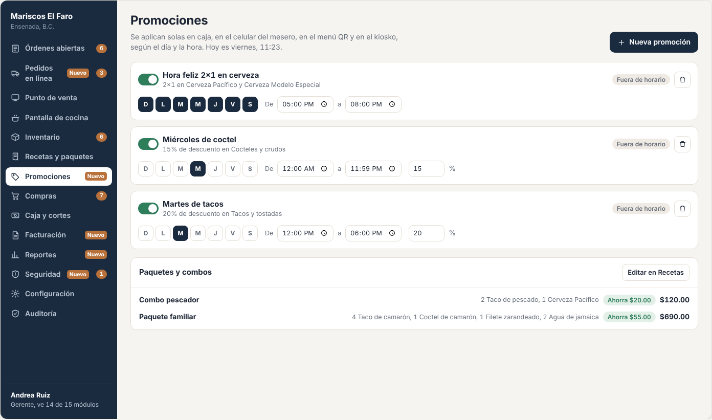
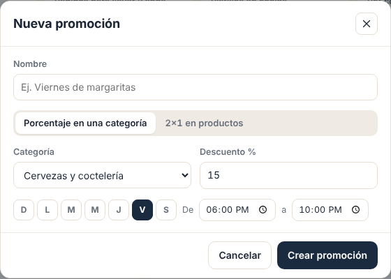
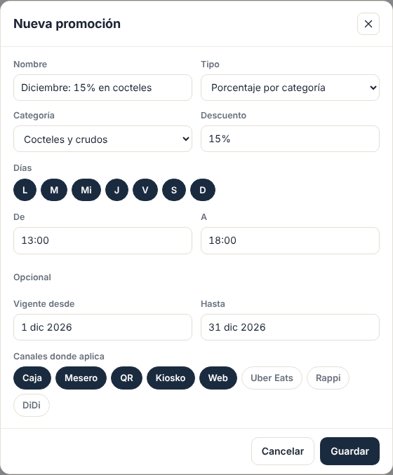
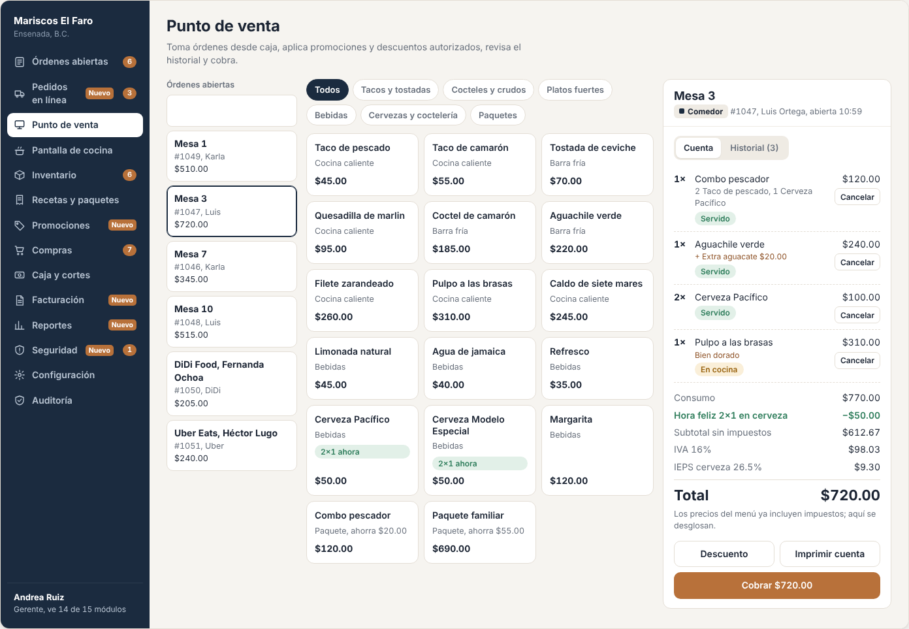

# E13 · Escritorio → Promociones · Spec

| | |
|---|---|
| **Epic** | E13 |
| **Superficie** | Escritorio (se aplica en caja, mesero, QR, kiosko y web) |
| **Fase** | 3 · Negocio · paso 14 de 22 en el [orden de construcción](../../docs/epics.md) |
| **Responsable** | Por definir |
| **Revisa** | Por definir |
| **Estado** | Borrador para revisión |
| **Depende de** | E00, E02 (`OrderPricing`), E05 (platillos y categorías) |
| **Lo usan** | E02, E10, E15 (cuánto dio cada promo), E17, E19 |
| **Diseño** | Demo → Escritorio → Promociones. Capturas en [`img/`](img/) |

## 1. Problema

Las promociones como la hora feliz o el "miércoles de coctel" se aplican a mano: el cajero se olvida, el mesero no sabe si ya empezó, y nadie sabe cuánto costó la promoción.

**Lo que queremos:** configurar la promoción una vez (qué, cuándo y dónde) y que se aplique **sola** en cualquier canal, que se vea en la cuenta con su nombre, y que al final se sepa cuánto dio.

## 2. Quién lo usa

| Rol | Permiso |
|---|---|
| Gerente | `promos.manage` |

## 3. Pantallas

### 3.1 Promociones

- **Encabezado:** "Se aplican solas en caja, en el celular del mesero, en el menú QR y en el kiosko, según el día y la hora. Hoy es miércoles, 14:32." Botón *Nueva promoción*.
- **Una tarjeta por promoción:**
  - Switch de activa, nombre y descripción ("2x1 en Cerveza Pacífico y Cerveza Modelo Especial" o "15% de descuento en Cocteles y crudos").
  - Estado: *Aplicando ahora* (verde), *Fuera de horario* o *Apagada*.
  - Eliminar.
  - Días (D L M M J V S), horario de/a y el porcentaje si aplica.
- **Panel "Paquetes y combos":** los paquetes de E05 con su ahorro, más la liga *Editar en Recetas*.

### 3.2 Nueva promoción (modal)

- **Nombre.**
- **Tipo:**
  - *Porcentaje en una categoría*
  - *Porcentaje en productos*
  - *2x1 en productos*
  - *3x2 en productos*
- **Objetivo:** categoría (selector) o productos (chips).
- **Días y horario.**
- **Opcional:** vigencia de fechas (del 1 al 31 de diciembre) y canales donde aplica.

### 3.3 Así se ve en la cuenta

- En el menú del punto de venta, los platillos con promoción activa llevan la etiqueta "2×1 ahora" o "−15% ahora".
- En la cuenta aparece una línea verde por promoción: "Hora feliz 2×1 en cerveza −$50.00".

## 4. Historias de usuario

| ID | Como… | Quiero… | Para… |
|---|---|---|---|
| US-PRO-01 | gerente | crear promociones por día y horario | atraer gente en horas flojas |
| US-PRO-02 | gerente | que se apliquen solas | que nadie se olvide ni las aplique fuera de horario |
| US-PRO-03 | mesero y cajero | ver qué platillos tienen promoción ahora | ofrecerlos |
| US-PRO-04 | gerente | apagar una promoción con un toque | cortarla si se acaba el producto |
| US-PRO-05 | dueño | saber cuánto dio cada promoción | decidir si la sigo |

## 5. Reglas de negocio

| ID | Regla |
|---|---|
| **BR-PRO-01** | Una promoción está **vigente** si está activa, hoy es uno de sus días, la hora está dentro del horario (inclusivo) y, si tiene fechas, hoy está dentro de la vigencia. Un horario que **cruza la medianoche** (22:00 a 02:00) pertenece al día en que empieza. |
| **BR-PRO-02** | Se evalúa con la **hora en que se agregó cada línea** a la orden, no con la hora del cobro. Así, una cerveza pedida a las 19:50 conserva el 2x1 aunque se cobre a las 21:00. |
| **BR-PRO-03** | **NxM** (2x1 o 3x2): se juntan las unidades elegibles de toda la cuenta (pueden ser productos distintos de la misma promoción) y por cada grupo de N se regalan N−M unidades, empezando por **la más barata**. |
| **BR-PRO-04** | **Porcentaje:** se aplica sobre el precio con extras de cada línea elegible. |
| **BR-PRO-05** | **No se acumulan:** a cada línea se le aplica como máximo una promoción, la que dé **más descuento**. El descuento manual (E02) se aplica después, sobre lo que queda. |
| **BR-PRO-06** | Los **paquetes** no participan en promociones a menos que se seleccionen como producto. |
| **BR-PRO-07** | **Canales:** por defecto, todos. Si se eligen canales, fuera de ellos no aplica (por ejemplo, la hora feliz solo en comedor). |
| **BR-PRO-08** | Cada descuento aplicado guarda el `PromotionId` en la línea, para reportar cuánto dio cada promoción (E15). |
| **BR-PRO-09** | Todo cambio queda en auditoría. Apagar o cambiar una promoción afecta solo a las líneas **agregadas después**. |

## 6. Criterios de aceptación

| ID | Dado… | Cuando… | Entonces… |
|---|---|---|---|
| AC-PRO-01 | "Hora feliz 2x1" de 17:00 a 20:00 todos los días | a las 18:00 agrego 2 Pacífico ($50 c/u) | la cuenta muestra "Hora feliz 2×1 en cerveza −$50.00" |
| AC-PRO-02 | lo anterior | agrego 1 Pacífico y 1 Modelo (ambas $50) | también aplica: −$50.00 |
| AC-PRO-03 | 3 cervezas elegibles | veo la cuenta | se regala 1 (no 1.5): −$50.00 |
| AC-PRO-04 | 2 Pacífico agregadas a las 19:50 | cobro a las 21:00 | el 2x1 sigue aplicado |
| AC-PRO-05 | "Miércoles de coctel 15%" y es miércoles | agrego un Coctel de camarón ($185) | descuento de $27.75 |
| AC-PRO-06 | un coctel con 15% de una promo y 20% de otra que también le aplica | veo la cuenta | solo se aplica la de 20% |
| AC-PRO-07 | "Martes de tacos" de 12:00 a 18:00 | es martes a las 18:30 | la tarjeta dice *Fuera de horario* y no aplica |
| AC-PRO-08 | una promo de 22:00 a 02:00 solo los viernes | es sábado a la 01:00 | aplica (pertenece al viernes) |
| AC-PRO-09 | una nueva promo sin días | guardo | "Elige al menos un día." |
| AC-PRO-10 | hora feliz solo para *Comedor* | un pedido del kiosko a las 18:00 | no aplica |

## 7. Fuera de alcance

- Cupones y códigos de descuento. Ver P-01.
- Programa de lealtad (puntos o sellos). Ver P-02.

## 8. Preguntas abiertas

| ID | Pregunta | Contesta | Estado |
|---|---|---|---|
| P-01 | ¿Cupones con código para redes sociales ("TACO10")? | Equipo | Abierta |
| P-02 | ¿Programa de **lealtad** (cada 10 visitas, 1 gratis)? | Equipo | Abierta |
| P-03 | ¿El mismo tipo "precio fijo" (cualquier cerveza a $35) es necesario además del porcentaje? | Equipo | Abierta |
