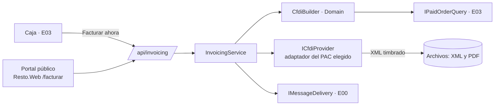

# E14 · Escritorio → Facturación · Plan técnico

## 1. Resumen



## 2. Modelo de datos

| Tabla | Columnas |
|---|---|
| `invoice_settings` | `RestaurantId`, `IssuerRfc`, `IssuerName`, `IssuerRegime`, `ExpeditionZip`, `Series`, `NextFolio`, `GlobalSeries`, `DefaultProductKey`, `DefaultUnitKey`, `SelfInvoiceDays`, `PacProvider`, `PacCredentialsEncrypted`, `CsdCerEncrypted`, `CsdKeyEncrypted`, `CsdPasswordEncrypted`, `CsdValidUntil` |
| `menu_category_fiscal_keys` | `MenuCategoryId`, `ProductKey`, `UnitKey` |
| `invoices` | `Id`, `RestaurantId`, `Kind` (`Individual`, `Global`), `Series`, `Folio`, `Uuid`, `Status` (`Issued`, `CancelPending`, `Cancelled`), `CustomerRfc`, `CustomerName`, `CustomerRegime`, `CustomerZip`, `CfdiUse`, `Email`, `Subtotal`, `Discount`, `Taxes`, `Total`, `PaymentForm`, `IssuedAt`, `IssuedBy` (o `PublicPortal`), `XmlPath`, `PdfPath`, `CancelReason`, `ReplacedByUuid` |
| `invoice_orders` | `InvoiceId`, `OrderId` (una global tiene varios) |
| `fiscal_customers` | `RestaurantId`, `Rfc`, `Name`, `Regime`, `Zip`, `CfdiUse`, `Email`, `LastUsedAt` |

Los secretos se cifran con ASP.NET Data Protection, con llaves en Key Vault o el equivalente (E00 P-01).

## 3. Domain (`Resto.Domain/Invoicing/`)

| Archivo | Contenido | Reglas |
|---|---|---|
| `RfcValidator.cs` | Formato | BR-FAC-02 |
| `CfdiBuilder.cs` | Del pedido pagado (`PriceBreakdown` + pagos) a un modelo neutro `CfdiDocument` (emisor, receptor, conceptos, impuestos, totales) | BR-FAC-03 y 04 |
| `GlobalInvoiceBuilder.cs` | De N tickets a una global con *InformacionGlobal* | BR-FAC-05 |
| `PaymentFormResolver.cs` | De los pagos a la clave de forma de pago | BR-FAC-04 |

`CfdiDocument` no depende del PAC. Cada adaptador lo traduce al formato de su API.

## 4. Contratos

Implementa `IPersonalDataEraser` de E00 para `fiscal_customers`: RFC, razón social y correo pasan a "Eliminado"; las facturas timbradas se conservan.

```csharp
public interface ICfdiProvider          // un adaptador por PAC, en Infrastructure
{
    Task<StampResult> StampAsync(CfdiDocument doc, IssuerCredentials cred, CancellationToken ct);
    Task<CancelResult> CancelAsync(string uuid, string reason, string? replacementUuid, IssuerCredentials cred, CancellationToken ct);
}

public interface IInvoicingService      // E03 y E21
{
    Task<InvoiceDto> IssueForOrderAsync(Guid orderId, FiscalCustomer customer, CancellationToken ct);
    Task<InvoiceDto> IssueGlobalAsync(DateOnly businessDay, CancellationToken ct);
}
```

`FakeCfdiProvider` regresa UUID falsos para desarrollo y pruebas. Se usa hasta decidir P-01 y en todo entorno que no sea producción.

## 5. API

| Método y ruta | Permiso |
|---|---|
| `GET /api/invoicing/invoices?from=&to=` · `GET …/{id}/xml` · `…/{id}/pdf` · `POST …/{id}/resend` | `invoicing.issue` |
| `GET /api/invoicing/pending?day=` | `invoicing.issue` |
| `POST /api/invoicing/orders/{orderId}` `{ Customer }` | `invoicing.issue` |
| `GET /api/invoicing/customers/{rfc}` | `invoicing.issue` |
| `POST /api/invoicing/global` `{ BusinessDay }` | `invoicing.global` |
| `POST /api/invoicing/invoices/{id}/cancel` `{ Reason, ReplacementUuid? }` | `invoicing.cancel` |
| `GET/PUT /api/invoicing/settings` · `POST …/settings/csd` (multipart) | `invoicing.settings` |
| **Público:** `POST /public/invoicing/{restaurantSlug}/lookup` `{ Ticket, Total }` · `POST …/issue` | Sin sesión, con *rate limit* (BR-FAC-07) |

## 6. Pantallas

| Componente | Dónde | Captura |
|---|---|---|
| `InvoicingPage.razor` (`/facturacion`) + `InvoicesTable` + `PendingTickets` | UI | 01, 02 |
| `InvoiceFormDialog.razor` (lo reutiliza el portal) | UI | 04 |
| `GlobalInvoiceDialog.razor` | UI | 05 |
| `PortalPreview.razor` | UI | 03 |
| `PublicInvoicingPage.razor` (`/facturar/{slug}`, SSR estático + formulario interactivo) | Web | — |
| `InvoiceSettingsTab.razor` en Configuración | UI | — |

PDF de la factura con QuestPDF (ya incluido en E03), con el formato de representación impresa que exige el CFDI 🧾.

## 7. Pruebas

| Proyecto | Qué cubre |
|---|---|
| Domain.Tests | `RfcValidator`; `CfdiBuilder` cuadra al centavo con `OrderPricing` en 20 tickets de ejemplo (con promos, descuento y paquetes); global de 12 tickets |
| Api.Tests | AC-FAC-01 a 10 con `FakeCfdiProvider`; *rate limit* del portal |
| Manual | Timbrado real en el ambiente de pruebas del PAC elegido; revisión del contador |

## 8. Paquetes

| Paquete | Para qué |
|---|---|
| SDK o cliente HTTP del PAC elegido (P-01) | Timbrar y cancelar |
