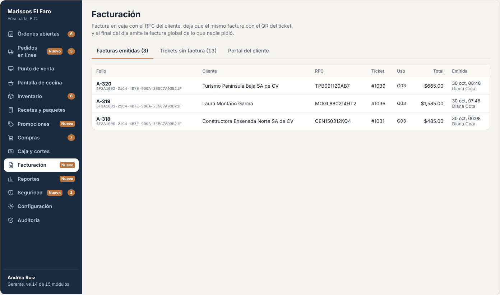
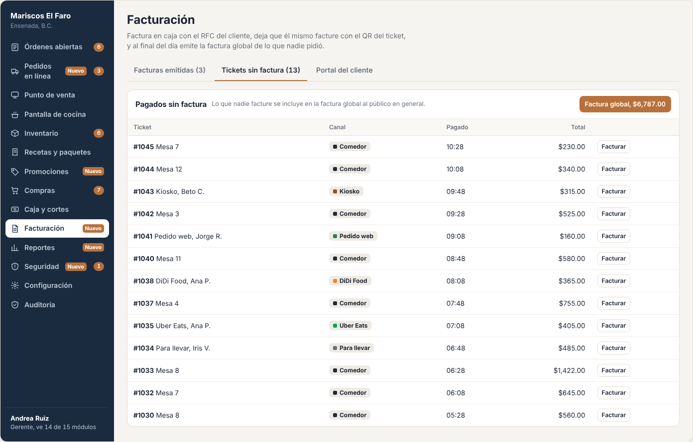
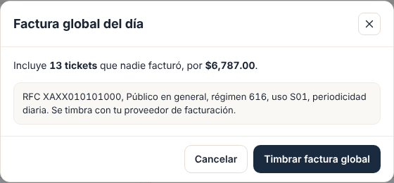
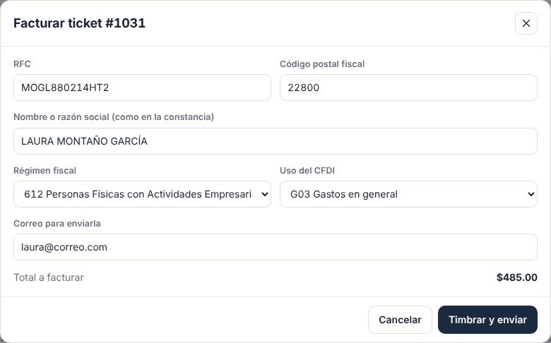
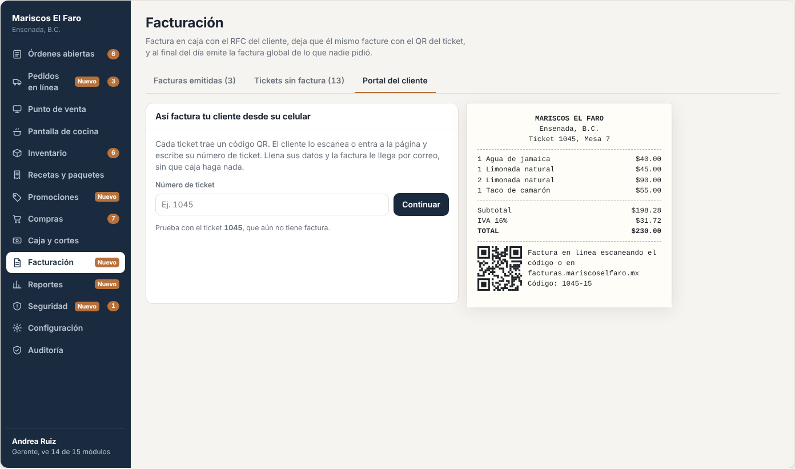
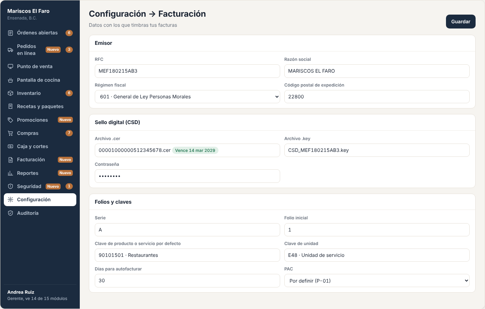

# E14 · Escritorio → Facturación · Spec

| | |
|---|---|
| **Epic** | E14 |
| **Superficie** | Escritorio + portal web público para el cliente |
| **Fase** | 3 · Negocio · paso 15 de 22 en el [orden de construcción](../../docs/epics.md) |
| **Responsable** | Por definir |
| **Revisa** | Por definir **+ contador** |
| **Estado** | Borrador para revisión |
| **Depende de** | E00, E03 (tickets pagados), E08 (impuestos), E12 (QR en el ticket) |
| **Lo usan** | E03 (*Facturar ahora*), E21 (facturar nuestra propia licencia) |
| **Diseño** | Demo → Escritorio → Facturación. Capturas en [`img/`](img/) |

> ⚠️ **Este epic es fiscal.** Cada regla marcada con 🧾 debe confirmarla un contador antes de salir a producción. La spec describe el comportamiento esperado, no sustituye la asesoría fiscal.

## 1. Problema

En México, el cliente pide factura y el restaurante tiene que emitir un CFDI 4.0 válido, con datos exactos del cliente, y al final del día emitir una **factura global** con lo que nadie pidió. Hacerlo a mano en el portal del SAT o en otro sistema es lento y se presta a errores.

**Lo que queremos:**
- Facturar en caja en segundos.
- Que el cliente se autofacture con el QR del ticket desde su casa.
- Que la factura global se haga con un botón.
- Todo timbrado por un PAC.

## 2. Quién lo usa

| Rol | Permiso |
|---|---|
| Cajero | `invoicing.issue` |
| Gerente | `invoicing.global`, `invoicing.cancel` |
| Administrador | `invoicing.settings` (datos fiscales, sellos y PAC) |
| Comensal | Portal público, sin cuenta |

## 3. Pantallas

### 3.1 Facturas emitidas

- Pestañas *Facturas emitidas (N)*, *Tickets sin factura (N)* y *Portal del cliente*.
- **Tabla:**
  - Folio con su UUID abajo (en letra monoespaciada).
  - Cliente, RFC, ticket y uso.
  - Total.
  - Fecha y hora, con quién la emitió.
  - Acciones: *Reenviar por correo*, *Descargar XML/PDF* y *Cancelar*.

### 3.2 Tickets sin factura y factura global

- "Pagados sin factura. Lo que nadie facture se incluye en la factura global al público en general."
- Botón **Factura global, $X**.
- Tabla con ticket, canal, hora de pago, total y *Facturar*.

### 3.3 Facturar un ticket (modal)

| Campo | Regla |
|---|---|
| RFC | 12 caracteres (persona moral) o 13 (física), con formato válido (BR-FAC-02), en mayúsculas |
| Código postal fiscal | 5 dígitos |
| Nombre o razón social | Exacto como en la Constancia de Situación Fiscal, sin régimen societario ("SA DE CV") 🧾 |
| Régimen fiscal | Catálogo del SAT (601, 605, 612, 626, 616…) |
| Uso del CFDI | Catálogo (G03, S01, CP01…), filtrado por régimen 🧾 |
| Correo | Para enviar XML y PDF |

- Muestra el total a facturar y el botón **Timbrar y enviar**.
- Si el RFC ya facturó antes en este restaurante, **los datos se llenan solos** al escribirlo.

### 3.4 Portal del cliente

- Explica cómo factura el cliente y deja probar con un ticket.
- **El portal real** es una página pública `facturas.resto.mx/{restaurante}`:
  1. El cliente escribe el número de ticket y el total (o escanea el QR, que ya trae ambos).
  2. Llena el mismo formulario de 3.3.
  3. Recibe su factura por correo y puede descargarla.
- Lleva el logo del restaurante y sus colores.

### 3.5 Datos fiscales

En *Configuración → Facturación*:
- RFC emisor, razón social, régimen y código postal de expedición.
- Sello digital (CSD): archivos `.cer` y `.key` + contraseña.
- Serie y folio inicial.
- Clave de producto o servicio y clave de unidad por defecto, y por categoría del menú 🧾.
- Días para autofacturar.
- Proveedor PAC y sus credenciales.

## 4. Historias de usuario

| ID | Como… | Quiero… | Para… |
|---|---|---|---|
| US-FAC-01 | cajero | facturar un ticket con los datos del cliente | dar la factura al momento |
| US-FAC-02 | comensal | facturar yo mismo con el QR del ticket | no esperar en caja |
| US-FAC-03 | gerente | emitir la factura global con un botón | cumplir con lo que nadie facturó |
| US-FAC-04 | gerente | cancelar una factura con motivo | corregir errores |
| US-FAC-05 | cajero | que se llenen los datos de un cliente que ya facturó | no volver a capturarlos |
| US-FAC-06 | administrador | cargar mis sellos y datos fiscales | empezar a facturar |

## 5. Reglas de negocio

| ID | Regla |
|---|---|
| **BR-FAC-01** | Se factura un **ticket pagado** completo, sin la propina 🧾. Un ticket se factura **una sola vez** mientras su factura esté vigente. |
| **BR-FAC-02** | **RFC:** `^[A-ZÑ&]{3,4}\d{6}[A-Z0-9]{3}$`. El PAC además valida que el RFC exista en la lista del SAT y que el nombre y el código postal coincidan. Si no, se muestra el mensaje del PAC traducido ("El nombre no coincide con el registrado en el SAT para ese RFC"). |
| **BR-FAC-03** | **Conceptos:** una línea por platillo vendido con su clave de producto y unidad, cantidad, valor unitario sin impuestos, descuentos (promociones y manual) y los impuestos de E08 trasladados por línea. Los totales deben coincidir **al centavo** con el ticket (`OrderPricing`). 🧾 |
| **BR-FAC-04** | **Forma de pago** según los pagos de E03: efectivo 01, transferencia 03, tarjeta de crédito 04 y tarjeta de débito 28. Con varios métodos, el de mayor monto 🧾. **Método de pago** PUE. |
| **BR-FAC-05** | **Factura global:** RFC `XAXX010101000`, nombre "PUBLICO EN GENERAL", régimen 616, uso S01 y código postal = lugar de expedición, con *InformacionGlobal* (periodicidad diaria, mes y año). Incluye los tickets pagados y no facturados del día de operación, una línea por ticket 🧾. |
| **BR-FAC-06** | Un ticket que **ya entró a una global** no se puede facturar individual: "Este ticket ya se incluyó en la factura global del 14 oct." 🧾 (ver P-02). |
| **BR-FAC-07** | **Autofactura:** el portal acepta tickets pagados de los últimos N días (por defecto, el mismo mes calendario) y que no estén en una global. Se valida número de ticket + total para evitar que alguien facture tickets ajenos adivinando números. Máximo 10 intentos por hora por IP. |
| **BR-FAC-08** | **Cancelación:** motivo del catálogo (01 a 04) y UUID de sustitución si el motivo es 01. Se cancela con el PAC. Algunas cancelaciones requieren que el receptor acepte; mientras tanto queda *En proceso de cancelación* 🧾. |
| **BR-FAC-09** | Los **sellos digitales y contraseñas** se guardan cifrados y nunca se muestran de nuevo. Solo se pueden reemplazar. |
| **BR-FAC-10** | **Sin conexión** no se factura (E00 BR-PLT-08). El ticket conserva su QR para autofacturar después. |
| **BR-FAC-11** | **Clientes frecuentes:** RFC + nombre + régimen + uso + código postal + correo se guardan por restaurante después de la primera factura. |

## 6. Criterios de aceptación

| ID | Dado… | Cuando… | Entonces… |
|---|---|---|---|
| AC-FAC-01 | el ticket #1031 pagado | facturo a MOGL880214HT2, Laura Montaño García, CP 22800, régimen 612, uso G03 | se timbra, aparece en *Emitidas* con folio A-321 y su UUID, y llegan XML y PDF a su correo |
| AC-FAC-02 | un RFC "MOGL88" | toco *Timbrar* | "El RFC no tiene el formato correcto. Son 12 caracteres para empresa o 13 para persona física." |
| AC-FAC-03 | el ticket ya facturado | intento facturarlo otra vez | "Este ticket ya tiene la factura A-321" |
| AC-FAC-04 | Laura ya facturó antes | escribo su RFC | se llenan nombre, régimen, uso, código postal y correo |
| AC-FAC-05 | 12 tickets sin factura del día por $6,480.00 | toco *Factura global* y timbro | se emite G-41 a PÚBLICO EN GENERAL por $6,480.00 y los 12 tickets salen de *Sin factura* |
| AC-FAC-06 | un ticket incluido en la global | el cliente intenta autofacturarlo | "Este ticket ya se incluyó en la factura global del…" |
| AC-FAC-07 | el portal | escribo un ticket existente con un total distinto | "No encontramos un ticket con esos datos" (sin decir cuál dato está mal) |
| AC-FAC-08 | la factura A-321 | la cancelo con motivo 02 | queda *Cancelada* (o *En proceso*) y el ticket vuelve a poder facturarse |
| AC-FAC-09 | sin internet | abro Facturación | "Requiere internet" |
| AC-FAC-10 | un ticket con hora feliz y 15% manual | lo facturo | el XML trae los descuentos por línea y el total del CFDI = total del ticket sin propina |

## 7. Fuera de alcance

- Complementos de pago (PPD) y notas de crédito. Ver P-03.
- Contabilidad electrónica.

## 8. Preguntas abiertas

| ID | Pregunta | Contesta | Estado |
|---|---|---|---|
| P-01 | ¿Con qué **PAC** vamos? Por ejemplo, Facturama, FacturAPI, SW Sapien o Finkok. Hay que comparar precio por timbre, API y soporte. | Equipo | Abierta |
| P-02 | ¿Qué hacer si un cliente pide factura de un ticket que ya entró a la global: rechazar, o cancelar y sustituir la global? | Contador | Abierta |
| P-03 | ¿Se necesitan **notas de crédito** por devoluciones o cancelaciones de cobro? | Contador | Abierta |
| P-04 | Claves de producto y unidad para restaurante, el tratamiento de la propina, el IEPS en paquetes (E02 P-01) y la frontera norte (E08 P-01). | Contador | Abierta |
