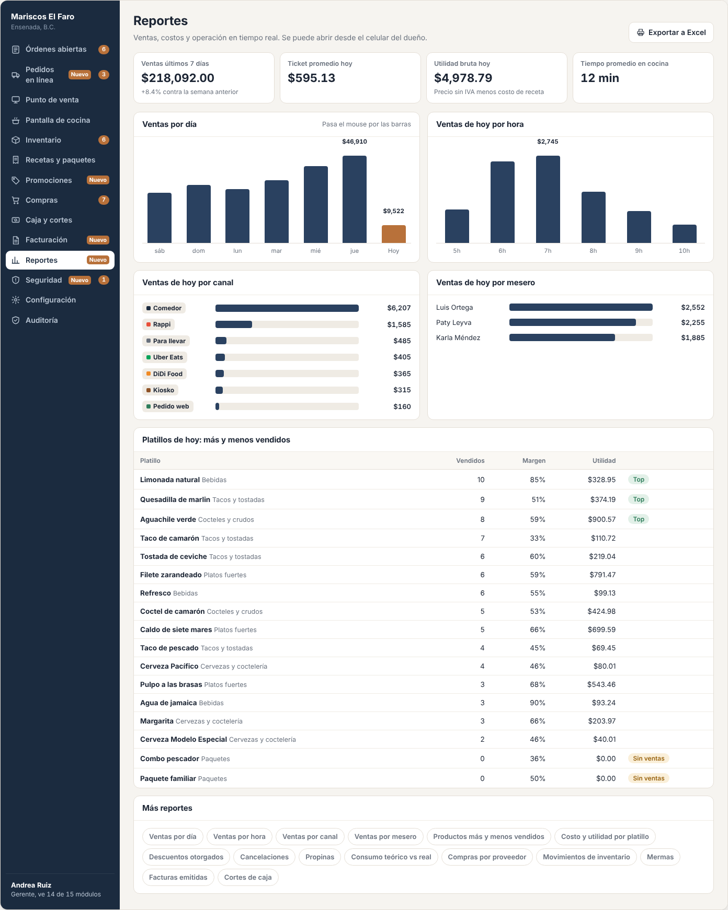
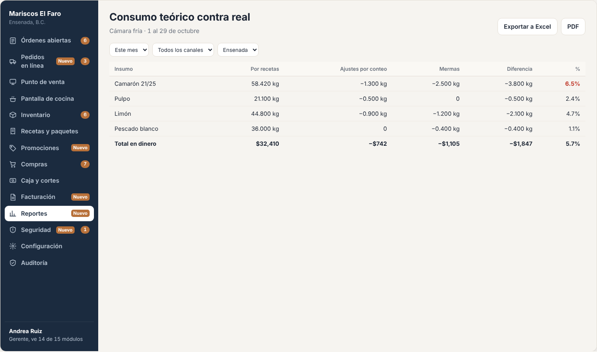

# E15 · Escritorio → Reportes · Spec

| | |
|---|---|
| **Epic** | E15 |
| **Superficie** | Escritorio y web (se puede ver desde el celular del dueño) |
| **Ola** | 2 · Cobro y control |
| **Responsable** | Por definir |
| **Revisa** | Por definir |
| **Estado** | Borrador para revisión |
| **Depende de** | E02, E03 (ventas y pagos), E04 (movimientos), E05 (costos), E06 (compras), E13 (promociones), E14 (facturas) |
| **Lo usan** | E20 (consolidado por sucursal) |
| **Diseño** | Demo → Escritorio → Reportes. Captura en [`img/`](img/) |

## 1. Problema

El dueño quiere saber cuánto vendió, qué se vende y qué no, cuánto le deja cada platillo, quién vende más y cuánto se pierde en merma. Hoy lo arma en Excel con días de atraso, si es que lo arma.

**Lo que queremos:**
- Un tablero con lo importante, al día y comparado con el periodo anterior.
- Un catálogo de reportes detallados con filtros, exportables a Excel y PDF.
- Que se pueda ver desde el celular.

## 2. Quién lo usa

| Rol | Permiso |
|---|---|
| Dueño, Gerente | `reports.view` |

## 3. Pantallas

### 3.1 Tablero

- **Encabezado:** selector de periodo (*Hoy*, *Ayer*, *Últimos 7 días*, *Este mes*, *Mes pasado* o *Personalizado*), canal, sucursal (E20) y *Exportar a Excel*.
- **Indicadores:**
  - Ventas del periodo con su variación contra el periodo anterior ("+8.4% contra la semana anterior").
  - Ticket promedio.
  - Utilidad bruta.
  - Tiempo promedio en cocina.
- **Gráficas:**
  - Ventas por día (barra cobre para el día en curso).
  - Ventas por hora.
  - Ventas por canal (barras horizontales con la etiqueta del canal).
  - Ventas por mesero.
  - Cada barra muestra su valor al pasar el mouse o tocarla. Los valores máximo y actual van escritos.
- **Tabla de platillos:** vendidos, margen, utilidad y etiquetas *Top* o *Sin ventas*.
- **"Más reportes":** chips que abren cada reporte del catálogo.

### 3.2 Catálogo de reportes

Cada reporte abre una pantalla con filtros (periodo, canal y sucursal, más los propios del reporte), una tabla con totales y *Exportar a Excel* / *PDF*.

| Reporte | Columnas principales |
|---|---|
| Ventas por día | Día, tickets, ventas, descuentos, propinas, ticket promedio |
| Ventas por hora | Hora, tickets, ventas (promedio por día de la semana si el periodo es largo) |
| Ventas por canal | Canal, tickets, ventas, % del total |
| Ventas por mesero | Mesero, tickets, ventas, propinas, cancelaciones |
| Platillos más y menos vendidos | Platillo, categoría, unidades, ventas, costo, utilidad, margen |
| Costo y utilidad por platillo | Precio, costo de receta actual, margen, cambio de costo en el periodo |
| Descuentos otorgados | Ticket, tipo (promoción o manual), motivo, monto, quién autorizó |
| Promociones | Promoción, veces aplicada, monto descontado, ventas con promoción |
| Cancelaciones | Ticket, platillo, estado al cancelar, motivo, quién, quién autorizó |
| Propinas | Mesero, propina en efectivo, con tarjeta, total |
| Consumo teórico contra real | Insumo, consumo por recetas, ajustes por conteo físico, mermas, diferencia y % |
| Compras por proveedor | Proveedor, compras, monto pagado, insumos |
| Movimientos de inventario | Kardex filtrable por insumo y tipo |
| Mermas | Insumo, cantidad, costo, quién y nota |
| Facturas emitidas | Folio, cliente, total, estado |
| Cortes de caja | Fecha, tipo, cajero, ventas, diferencia |

## 4. Historias de usuario

| ID | Como… | Quiero… | Para… |
|---|---|---|---|
| US-REP-01 | dueño | ver el resumen del periodo con su comparación | saber si voy mejor o peor |
| US-REP-02 | dueño | ver mis platillos ordenados por venta y utilidad | decidir qué promover y qué quitar |
| US-REP-03 | dueño | ver las ventas por hora | ajustar el personal por turno |
| US-REP-04 | dueño | comparar el consumo teórico contra el real | detectar fugas de inventario |
| US-REP-05 | gerente | exportar cualquier reporte a Excel | trabajarlo o mandarlo al contador |
| US-REP-06 | dueño | verlo desde mi celular | revisar sin ir al restaurante |

## 5. Reglas de negocio

| ID | Regla |
|---|---|
| **BR-REP-01** | Todo se agrupa por **día de operación** (E00 BR-PLT-11) y en la zona del restaurante. |
| **BR-REP-02** | **Ventas** = Σ total cobrado **sin propina** (con impuestos) de órdenes pagadas y no anuladas. **Venta neta** = ventas − impuestos. |
| **BR-REP-03** | **Utilidad bruta** = venta neta − costo teórico. El costo teórico es el costo de receta (E05) al momento de la venta: se guarda en la línea cuando se envía a cocina, para que un cambio de costo posterior no cambie el pasado. |
| **BR-REP-04** | **Variación** = (periodo − periodo anterior de igual duración) ÷ periodo anterior. Si el anterior es 0, se muestra "—". |
| **BR-REP-05** | **Consumo teórico contra real** por insumo. Teórico = Σ `SaleConsumption` del periodo. Real = teórico + ajustes negativos por conteo físico + mermas registradas. Diferencia % = (real − teórico) ÷ teórico. Más de 5% se marca en rojo. |
| **BR-REP-06** | **Hoy** se calcula en vivo. Los días cerrados se leen de un resumen diario que se genera al terminar cada día de operación, para que los reportes de meses abran en menos de 2 s. |
| **BR-REP-07** | **Exportar** respeta los filtros y deja una entrada de auditoría. El PDF lleva el logo, el periodo y la fecha de generación. |

## 6. Criterios de aceptación

| ID | Dado… | Cuando… | Entonces… |
|---|---|---|---|
| AC-REP-01 | ventas de $46,910 el martes y $41,280 el lunes | veo *Ventas por día* | las barras coinciden y la del día en curso va en cobre |
| AC-REP-02 | una orden de $560 con $56 de propina | veo ventas | cuenta $560 (no $616) |
| AC-REP-03 | un Taco de pescado vendido con costo de $21.43, cuyo costo sube después a $23 | veo la utilidad de ese día | usa $21.43 |
| AC-REP-04 | 10 kg de pescado por recetas, 0.8 kg de ajuste negativo y 0.2 kg de merma | veo *Consumo teórico contra real* | real 11 kg, diferencia **+10%**, en rojo |
| AC-REP-05 | el periodo *Últimos 7 días* | exporto a Excel | se descarga un `.xlsx` con lo mismo que en pantalla y queda en auditoría |
| AC-REP-06 | 6 meses de datos | abro *Este mes* y *Últimos 6 meses* | abre en menos de 2 s |
| AC-REP-07 | un usuario sin `reports.view` | entra a `/reportes` | "No tienes acceso a este módulo" |
| AC-REP-08 | el celular del dueño (390 px) | abre el tablero | indicadores en 2 columnas, gráficas a lo ancho y nada se sale de la pantalla |

## 7. Fuera de alcance

- Reportes contables o fiscales.
- Reportes personalizados por el usuario (armar sus propias columnas).

## 8. Preguntas abiertas

| ID | Pregunta | Contesta | Estado |
|---|---|---|---|
| P-01 | ¿Un **resumen diario por correo o WhatsApp** al dueño con los indicadores, además del corte? | Equipo | Abierta |
