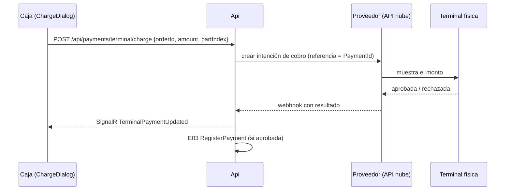

# E16 · Plataforma → Pagos con terminal · Plan técnico

## 1. Resumen



La mayoría de las terminales en México se integran **por la nube del proveedor** (intención de cobro + *webhook*), no por cable. Este diseño asume eso. Si el proveedor elegido (P-01) usa SDK local, el adaptador corre en la app de la caja y el resto no cambia.

## 2. Modelo de datos

| Tabla | Columnas |
|---|---|
| `payment_terminals` | `Id`, `RestaurantId`, `Provider`, `ExternalDeviceId`, `Name`, `RegisterDeviceId?`, `IsActive`, `LastSeenAt` |
| `terminal_transactions` | `Id` (= `PaymentId` de E03), `TerminalId`, `ExternalId`, `Amount`, `Tip`, `Status` (`Pending`, `Approved`, `Declined`, `TimedOut`, `Cancelled`, `Refunded`), `CardBrand`, `Last4`, `CardType`, `AuthCode`, `DeclineReason`, `CreatedAt`, `ResolvedAt`, `RawJson` |
| `settlements` | `Id`, `RestaurantId`, `Provider`, `Date`, `Gross`, `Fee`, `FeeTax`, `Net`, `ImportedAt` |
| `settlement_lines` | `SettlementId`, `ExternalId`, `Amount`, `Fee`, `MatchedTransactionId?` |

## 3. Contrato

```csharp
public interface IPaymentTerminal   // E03 y E19
{
    Task<TerminalCharge> StartChargeAsync(Guid paymentId, Guid terminalId, decimal amount, bool askTip, CancellationToken ct);
    Task<TerminalCharge> GetStatusAsync(Guid paymentId, CancellationToken ct);  // BR-PAG-01
    Task CancelAsync(Guid paymentId, CancellationToken ct);
    Task<RefundResult> RefundAsync(Guid paymentId, CancellationToken ct);
}
```

Hay un adaptador por proveedor en `Infrastructure/Payments/{Proveedor}/`, más `FakePaymentTerminal` para desarrollo, que aprueba o rechaza según los centavos del monto (por ejemplo, `.13` = rechazada).

## 4. API

| Método y ruta | Permiso |
|---|---|
| `POST /api/payments/terminal/charge` · `GET …/charge/{paymentId}` · `POST …/charge/{paymentId}/cancel` | `cash.charge` |
| `POST /api/payments/terminal/{paymentId}/refund` `{ OverrideToken? }` | `cash.refund` u *override* |
| `POST /webhooks/payments/{provider}` | firma del proveedor |
| CRUD `/api/payments/terminals` · `POST …/terminals/pair` | `cash.settings` |
| `GET /api/payments/reconciliation?day=` · `POST …/reconciliation/import` | `cash.settings` |

**Tiempo real:** `TerminalPaymentUpdated` al usuario que inició el cobro.

## 5. Pantallas

| Componente | Captura |
|---|---|
| `TerminalChargePanel.razor`, dentro de `ChargeDialog` de E03 (estados esperando, aprobada, rechazada y sin respuesta) | 01, 02 |
| `TerminalsSettingsTab.razor` | — |
| `ReconciliationPage.razor` | — |

## 6. Pruebas

| Proyecto | Qué cubre |
|---|---|
| Api.Tests | Con `FakePaymentTerminal`: AC-PAG-01 a 04 y 06; *webhook* duplicado (idempotente); firma inválida rechazada |
| Domain.Tests | Conciliación (BR-PAG-05), AC-PAG-05 |
| Manual | Terminal real del proveedor en su ambiente de pruebas |

## 7. Paquetes

SDK del proveedor elegido (P-01), si lo tiene para .NET. Si no, cliente HTTP propio.
