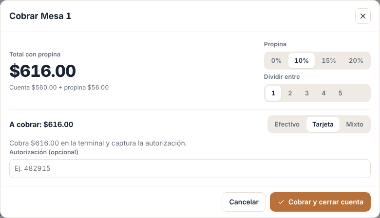
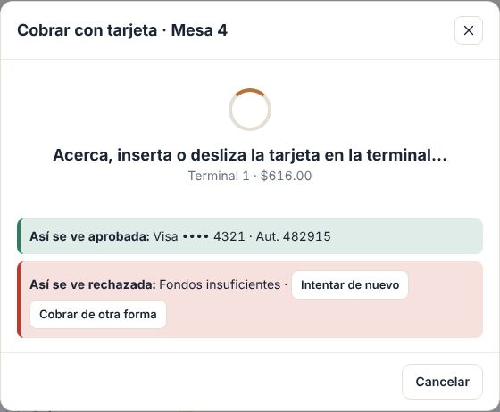
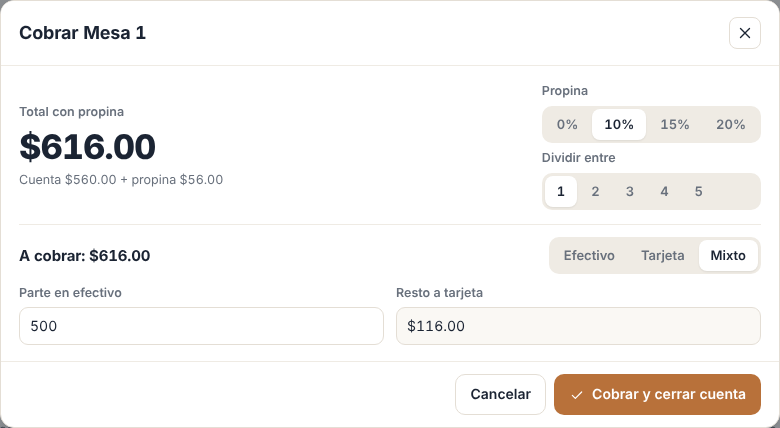
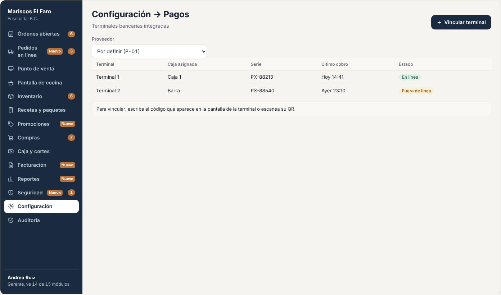
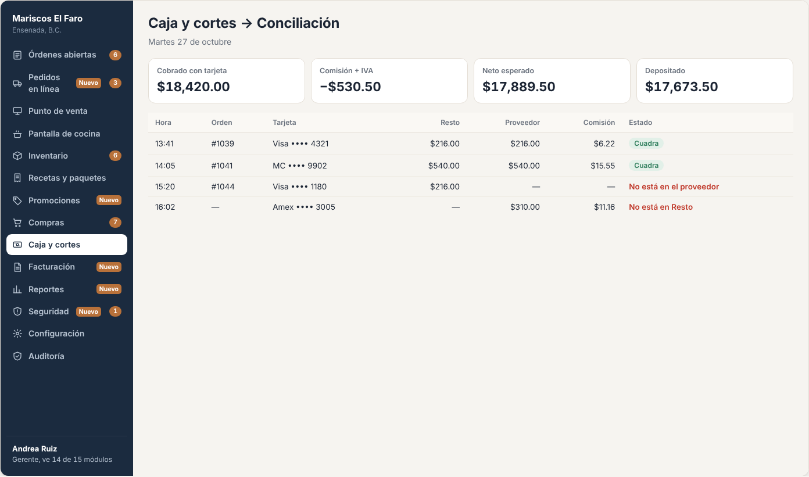

# E16 · Plataforma → Pagos con terminal · Spec

| | |
|---|---|
| **Epic** | E16 |
| **Superficie** | Plataforma (caja y kiosko) |
| **Fase** | 3 · Negocio · paso 16 de 22 en el [orden de construcción](../../docs/epics.md) |
| **Responsable** | Por definir |
| **Revisa** | Por definir |
| **Estado** | Borrador para revisión |
| **Depende de** | E03 (cobro y turno) |
| **Lo usan** | E03, E19 (kiosko) y E18 (pago en línea del pedido web, ver P-02) |
| **Diseño** | Demo → Cobrar con tarjeta y mixto. Capturas en [`img/`](img/) |

## 1. Problema

Hoy el cajero teclea el monto en la terminal bancaria y después lo captura en el sistema. Se equivoca de monto, olvida capturar la autorización, y al final del día los cobros con tarjeta no cuadran con lo que depositó el banco.

**Lo que queremos:** que el monto viaje solo del sistema a la terminal, que la respuesta (aprobada o rechazada, con autorización y últimos 4 dígitos) regrese sola, y que el corte se pueda conciliar contra lo que liquida el proveedor.

## 2. Quién lo usa

| Rol | Permiso |
|---|---|
| Cajero | `cash.charge` |
| Gerente | `cash.settings` (vincular terminales y conciliar) |

## 3. Pantallas

### 3.1 Cobro con tarjeta

**Con la terminal integrada:**
- El campo de autorización se sustituye por el botón **Enviar a terminal ($616.00)**.
- Al tocarlo, el modal muestra el estado:
  - "Acerca, inserta o desliza la tarjeta en la terminal…", con un *spinner* y el botón *Cancelar*.
  - **Aprobada**: franja verde con "Visa •••• 4321 · Aut. 482915" y la cuenta se cierra sola.
  - **Rechazada**: franja roja con el motivo del banco y los botones *Intentar de nuevo* o *Cobrar de otra forma*.
  - **Sin respuesta en 90 s**: "No hubo respuesta de la terminal. Revisa la pantalla de la terminal antes de volver a cobrar." con *Consultar estado*.

- Si la terminal permite propina en pantalla, se ofrece *Pedir propina en la terminal*.

### 3.2 Cobro mixto

Se registra la parte en efectivo y el resto se manda a la terminal con el mismo flujo.

### 3.3 Más pantallas (capturas de maqueta)

| Pantalla | Contenido |
|---|---|
| **Terminales** (Configuración → Pagos) | Proveedor, *Vincular terminal* (código o lectura de QR según el proveedor), nombre ("Terminal 1") y caja asignada. Estado *En línea* o *Fuera de línea*.  |
| **Conciliación** (Caja y cortes → Conciliación) | Por día: cobros con tarjeta en Resto contra transacciones del proveedor, comisión, IVA de la comisión y neto depositado. Las diferencias se marcan en rojo con el detalle de cada transacción que no cuadra.  |

## 4. Historias de usuario

| ID | Como… | Quiero… | Para… |
|---|---|---|---|
| US-PAG-01 | cajero | mandar el monto a la terminal con un toque | no teclear dos veces ni equivocarme |
| US-PAG-02 | cajero | ver si se aprobó o rechazó sin revisar la terminal | cerrar la cuenta rápido |
| US-PAG-03 | gerente | vincular las terminales del restaurante | usarlas desde cualquier caja |
| US-PAG-04 | dueño | conciliar los cobros contra los depósitos | saber cuánto me cobran de comisión y que no falte nada |
| US-PAG-05 | gerente | reembolsar un cobro con tarjeta | devolver al cliente sin ir al portal del banco |

## 5. Reglas de negocio

| ID | Regla |
|---|---|
| **BR-PAG-01** | Cada cobro a la terminal lleva una **referencia única** (`PaymentId`). Si se reintenta, se consulta primero el estado con esa referencia para **no cobrar dos veces**. |
| **BR-PAG-02** | La cuenta solo se cierra con respuesta **Aprobada**. Rechazada o sin respuesta no registran pago. |
| **BR-PAG-03** | Se guarda: proveedor, terminal, marca, últimos 4 dígitos, autorización, tipo (crédito o débito) y estado. **Nunca** el número completo de la tarjeta. |
| **BR-PAG-04** | **Reembolso:** solo de cobros aprobados del mismo día de operación o de los N días que permita el proveedor. Requiere `cash.refund` o PIN (E09) y anula el pago en E03 (BR-CAJ-11). |
| **BR-PAG-05** | **Conciliación:** se importa diario la liquidación del proveedor (por API o archivo). Una transacción cuadra si coinciden referencia (o autorización) y monto. |
| **BR-PAG-06** | Sin internet, la terminal integrada no funciona (E00 BR-PLT-08). Queda la captura manual de E03 como respaldo, y eso se marca en el pago como "manual". |
| **BR-PAG-07** | El débito o crédito que reporta la terminal define la forma de pago para la factura (E14 BR-FAC-04). |

## 6. Criterios de aceptación

| ID | Dado… | Cuando… | Entonces… |
|---|---|---|---|
| AC-PAG-01 | una terminal vinculada | cobro $616.00 y el cliente paga | en menos de 5 s después de la aprobación la cuenta se cierra con "Visa •••• 4321 · Aut. 482915" |
| AC-PAG-02 | la tarjeta rechazada | pasa | se ve el motivo y la cuenta sigue abierta |
| AC-PAG-03 | un cobro sin respuesta | toco *Consultar estado* y la terminal lo había aprobado | la cuenta se cierra **sin** volver a cobrar |
| AC-PAG-04 | un mixto de $500 en efectivo | mando el resto | la terminal cobra $116.00 |
| AC-PAG-05 | 40 cobros con tarjeta del día y la liquidación del proveedor | abro la conciliación | 40 cuadran y se muestran la comisión y el neto |
| AC-PAG-06 | un cobro aprobado | el gerente lo reembolsa con PIN | el proveedor confirma el reembolso, el pago queda anulado y se levanta la alerta |

## 7. Fuera de alcance

- Pagos con QR (CoDi o DiMo). Ver P-03.

## 8. Preguntas abiertas

| ID | Pregunta | Contesta | Estado |
|---|---|---|---|
| P-01 | ¿Con qué **proveedor de terminal** vamos? Opciones con API de integración en México: Mercado Pago Point, Clip, y la terminal de algún banco. Hay que comparar comisión, API, hardware y si permite propina en pantalla. | Equipo | Abierta |
| P-02 | ¿El **pedido web** (E18) se paga en línea con el mismo proveedor (por ejemplo, Mercado Pago Checkout)? | Equipo | Abierta |
| P-03 | ¿Aceptar **CoDi o DiMo** por QR? | Equipo | Abierta |
