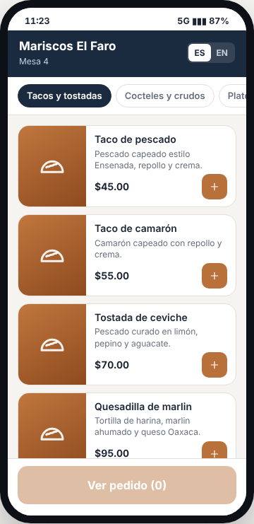
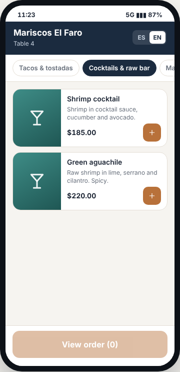
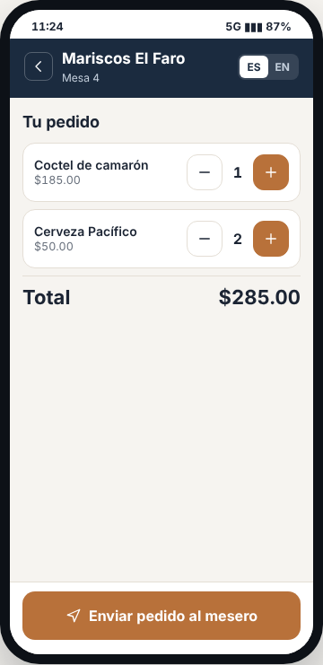
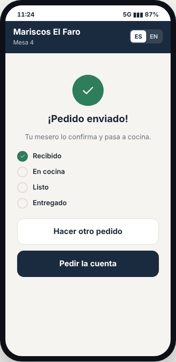
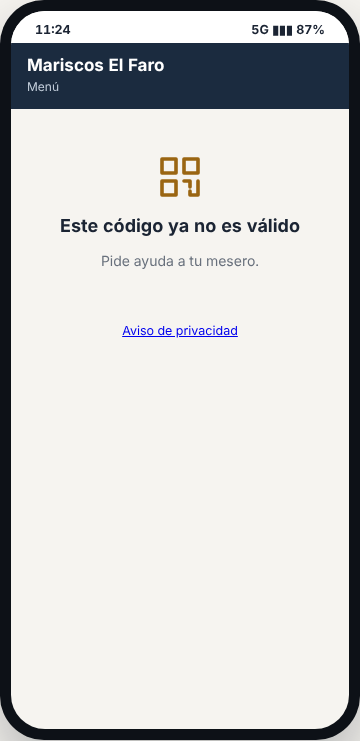
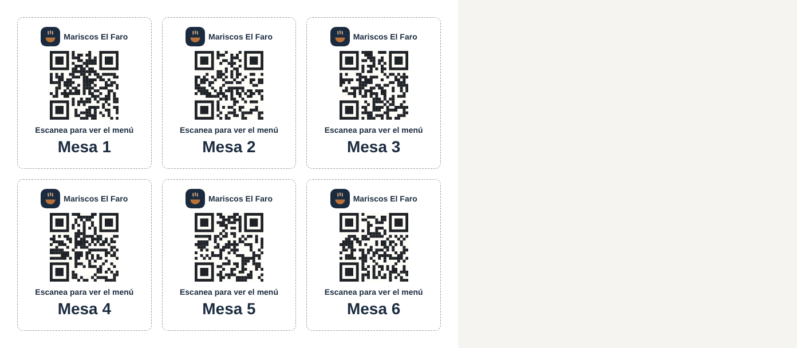

# E17 · Cliente → Menú QR · Spec

| | |
|---|---|
| **Epic** | E17 |
| **Superficie** | Cliente (web pública en el celular del comensal) |
| **Ola** | 3 · Canales y sucursales |
| **Responsable** | Por definir |
| **Revisa** | Por definir |
| **Estado** | Borrador para revisión |
| **Depende de** | E05 (menú con fotos e inglés), E13 (promociones), E18 (los pedidos entran como `IncomingOrder`), E10 (el mesero confirma) |
| **Lo usan** | E18 y E19 (los componentes del menú del cliente se comparten) |
| **Diseño** | Demo → Cliente → QR en la mesa. Capturas en [`img/`](img/) |

## 1. Problema

El cliente espera a que le traigan la carta, espera a que vuelva el mesero para pedir, y espera otra vez para pedir la cuenta. Los turistas no entienden el menú en español.

**Lo que queremos:** que el cliente escanee un QR en su mesa y vea el menú con fotos, en español o inglés, con las promociones del momento. Que pueda pedir desde ahí (el mesero confirma antes de que llegue a cocina) y que pida la cuenta con un botón.

## 2. Quién lo usa

| Rol | Cómo |
|---|---|
| Comensal | Sin cuenta ni app: escanea el QR de su mesa |
| Mesero | Confirma el pedido (E10) |
| Gerente | Imprime los QR (`settings.manage`) |

## 3. Pantallas

### 3.1 Menú

- **Encabezado azul:** nombre del restaurante, "Mesa 4" y el selector **ES | EN**.
- **Chips de categoría** con scroll.
- **Tarjeta por platillo:**
  - Foto a la izquierda. Si no hay foto, un fondo del color de la categoría con su ícono.
  - Nombre, descripción corta y etiquetas: "Promoción activa: 2x1" o "ahorra $55" en paquetes.
  - Íconos de **alérgenos** con texto ("Mariscos", "Picante") y calorías si el platillo las tiene (E05 BR-REC-13).
  - Precio y botón **+** (que muestra cuántos llevas). "Agotado" si no hay.
- **Botón fijo abajo:** "Ver pedido (3) $285.00".

### 3.2 Tu pedido

- Líneas con − N +, las promociones aplicadas y el total.
- Botón **Enviar pedido al mesero**.

### 3.3 Pedido enviado

- Palomita verde, "¡Pedido enviado! Tu mesero lo confirma y pasa a cocina."
- Estado en vivo: *Recibido → En cocina → Listo → Entregado*.
- Botones *Hacer otro pedido* y **Pedir la cuenta**.

### 3.4 Más pantallas (capturas de maqueta)

| Pantalla | Contenido |
|---|---|
| **QR inválido o vencido** | "Este código ya no es válido. Pide ayuda a tu mesero."  |
| **Pedidos por QR apagados** | El menú se ve, pero sin botones +, con "Para pedir, llama a tu mesero". |
| **Imprimir QR** (Configuración → Mesas) | Un PDF con un QR por mesa (tamaño tarjeta de mesa), con el logo, "Escanea para ver el menú" y el número de mesa. Botón *Regenerar QR* por mesa.  |

## 4. Historias de usuario

| ID | Como… | Quiero… | Para… |
|---|---|---|---|
| US-QR-01 | comensal | ver el menú con fotos en mi celular | decidir sin esperar la carta |
| US-QR-02 | turista | ver el menú en inglés | entender qué pido |
| US-QR-03 | comensal | pedir desde la mesa | no esperar al mesero |
| US-QR-04 | comensal | ver si mi pedido ya está en cocina | saber cuánto falta |
| US-QR-05 | comensal | pedir la cuenta con un botón | irme cuando quiera |
| US-QR-06 | gerente | imprimir un QR por mesa | ponerlos en las mesas |

## 5. Reglas de negocio

| ID | Regla |
|---|---|
| **BR-QR-01** | Cada mesa tiene un **token** aleatorio en su QR (`menu.resto.mx/m/{token}`). Al regenerarlo, el anterior deja de funcionar. Con el token se sabe el restaurante y la mesa, sin mostrar ningún `Id` interno. |
| **BR-QR-02** | El menú muestra solo platillos con el canal *QR* activo (E05 BR-REC-08). Los precios y promociones son los mismos que en caja (E13, con canal *QR*). |
| **BR-QR-03** | **Idioma:** se usa el del celular (si es inglés, EN; si no, ES), y se puede cambiar con el selector. Un platillo sin traducción muestra el español. |
| **BR-QR-04** | **Enviar pedido** crea un `IncomingOrder` (E18) de canal *QR* para esa mesa. **No** va a cocina hasta que el mesero lo confirme (E10 BR-MES-08). |
| **BR-QR-05** | **Límites:** máximo 30 platillos por pedido y 1 pedido cada 30 s por mesa. Si hay un pedido sin confirmar de esa mesa, el nuevo se agrega a ese mismo. |
| **BR-QR-06** | **Pedir la cuenta** solo si la mesa tiene una orden abierta. Hace lo mismo que E10 BR-MES-06. |
| **BR-QR-07** | **Estado** en vivo: se consulta cada 10 s, o en tiempo real si la conexión lo permite. |
| **BR-QR-08** | **Rendimiento:** el menú se renderiza en el servidor (SSR) y debe cargar en menos de 2 s con 4G. Las fotos van en WebP con `loading="lazy"` y máximo 600 px de ancho. |

## 6. Criterios de aceptación

| ID | Dado… | Cuando… | Entonces… |
|---|---|---|---|
| AC-QR-01 | el QR de la Mesa 4 | lo escaneo | veo "Mesa 4" y el menú en menos de 2 s |
| AC-QR-02 | un celular en inglés | abro el menú | sale en inglés ("Shrimp cocktail", "Cocktails & raw bar") |
| AC-QR-03 | la hora feliz activa | veo las cervezas | tienen la etiqueta "Promoción activa: 2x1" y el total de 2 cervezas es $50 |
| AC-QR-04 | 1 Coctel y 2 Pacífico en el pedido | toco *Enviar* | Luis (o todos los meseros, si la mesa está libre) recibe "Mesa 4 pidió desde el QR", y en *Pedidos en línea* aparece en *Nuevos* |
| AC-QR-05 | lo anterior | el mesero confirma | mi pantalla pasa a *En cocina* |
| AC-QR-06 | la Mesa 4 abierta | toco *Pedir la cuenta* | caja recibe "Mesa 4 pide la cuenta desde el QR" |
| AC-QR-07 | el QR viejo de una mesa con el QR regenerado | lo escaneo | "Este código ya no es válido…" |
| AC-QR-08 | el canal QR en pausa (E18) | abro el menú | se ve sin botones de pedir |

## 7. Fuera de alcance

- Pagar desde el celular. Ver P-01.
- Llamar al mesero sin pedir nada ("necesito servilletas"). Ver P-02.

## 8. Preguntas abiertas

| ID | Pregunta | Contesta | Estado |
|---|---|---|---|
| P-01 | ¿El comensal puede **pagar** desde el QR (tarjeta en línea) y dividir? | Equipo | Abierta |
| P-02 | ¿Botón **"Llamar al mesero"**? | Equipo | Abierta |
| P-03 | ¿Además de inglés, otros idiomas (por ejemplo, para cruceros en Ensenada)? | Equipo | Abierta |
