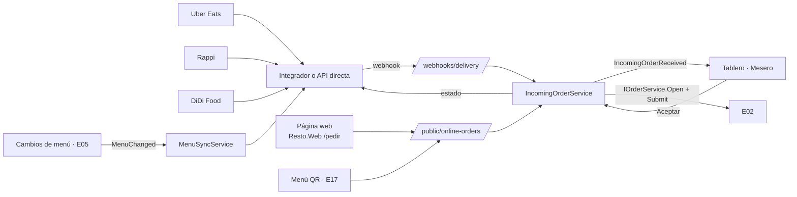

# E18 · Escritorio → Pedidos en línea · Plan técnico

## 1. Resumen



## 2. Modelo de datos

| Tabla | Columnas |
|---|---|
| `incoming_orders` | `Id`, `RestaurantId`, `Channel`, `ExternalId`, `CustomerName`, `Phone`, `Address`, `AddressRef`, `TableId?` (QR), `ItemsJson`, `Total`, `PaymentStatus` (`PaidOnline`, `PayOnDelivery`, `PayAtTable`), `Status` (`New`, `Accepted`, `Rejected`, `CancelledByChannel`), `PromisedMinutes`, `ReceivedAt`, `RespondedAt`, `RespondedBy`, `RejectReason`, `OrderId?` |
| `channel_settings` | `RestaurantId`, `Channel`, `IsEnabled`, `IsPaused`, `CredentialsEncrypted`, `DefaultPrepMinutes` |
| `channel_prices` | `MenuItemId`, `Channel`, `Price` |
| `web_ordering_settings` | `RestaurantId`, `Slug`, `MinOrder`, `DeliveryFee`, `ZoneKind` (`Radius`, `Neighborhoods`), `ZoneRadiusKm`, `ZoneCenterLat/Lng`, `Neighborhoods[]`, `HoursJson`, `AcceptCashOnDelivery`, `AcceptOnlinePayment` |

## 3. Contratos

Implementa `IPersonalDataEraser` de E00 para `incoming_orders`: nombre, teléfono, correo y dirección pasan a "Eliminado"; la venta se conserva.

```csharp
public interface IIncomingOrders    // E17 y el endpoint público de la web
{
    Task<Guid> ReceiveAsync(IncomingOrderDraft draft, CancellationToken ct);
    Task<IncomingOrderStatusDto> GetStatusAsync(Guid id, CancellationToken ct); // para la pantalla del cliente
}

public interface IDeliveryChannelGateway   // un adaptador por app o integrador
{
    Task AcknowledgeAsync(string externalId, int prepMinutes, CancellationToken ct);
    Task RejectAsync(string externalId, string reason, CancellationToken ct);
    Task MarkReadyAsync(string externalId, CancellationToken ct);
    Task SetPausedAsync(bool paused, CancellationToken ct);
    Task SyncMenuAsync(IReadOnlyList<MenuEntryDto> menu, CancellationToken ct);
}
```

`FakeDeliveryChannelGateway` + `POST /dev/simulate-incoming?channel=rappi` permiten probar sin las apps.

## 4. API

| Método y ruta | Permiso |
|---|---|
| `GET /api/online/board` | `online.manage` |
| `POST /api/online/{id}/accept` `{ PrepMinutes }` · `POST …/{id}/reject` `{ Reason }` | `online.manage` |
| `POST /api/online/orders/{orderId}/delivered` | `online.manage` |
| `GET/PUT /api/online/channels` · `PUT /api/online/web-settings` · `PUT /api/online/prices` | `online.manage` |
| `POST /webhooks/delivery/{provider}` | firma del proveedor |
| **Públicos:** `GET /public/{slug}/menu` (de E05), `POST /public/{slug}/orders` (web), `GET /public/orders/{id}/status` | sin sesión, con *rate limit* |

## 5. Pantallas

| Componente | Dónde | Captura |
|---|---|---|
| `OnlineOrdersPage.razor` (`/pedidos-en-linea`) + `ChannelToggles` + `IncomingCard` + `InPrepCard` + `ReadyCard` | UI | 01 |
| `RejectDialog.razor` | UI | — |
| `OnlineSettingsTab.razor` | UI | — |
| `PublicOrderPage.razor` (`/pedir/{slug}`) + `CheckoutForm` + `OrderStatusPage` (comparten componentes con E17 en `Features/CustomerMenu/`) | Web | 03 |

## 6. Pruebas

| Proyecto | Qué cubre |
|---|---|
| Api.Tests | Con `FakeDeliveryChannelGateway`: AC-LIN-01 a 08; *webhook* duplicado; cancelación por la app; pedido web fuera de zona |
| Domain.Tests | Atrasado (BR-LIN-04); zona por radio con la fórmula de Haversine |
| Manual | Con el ambiente de pruebas del integrador elegido |

## 7. Paquetes

SDK o cliente del integrador o las apps (P-01).
