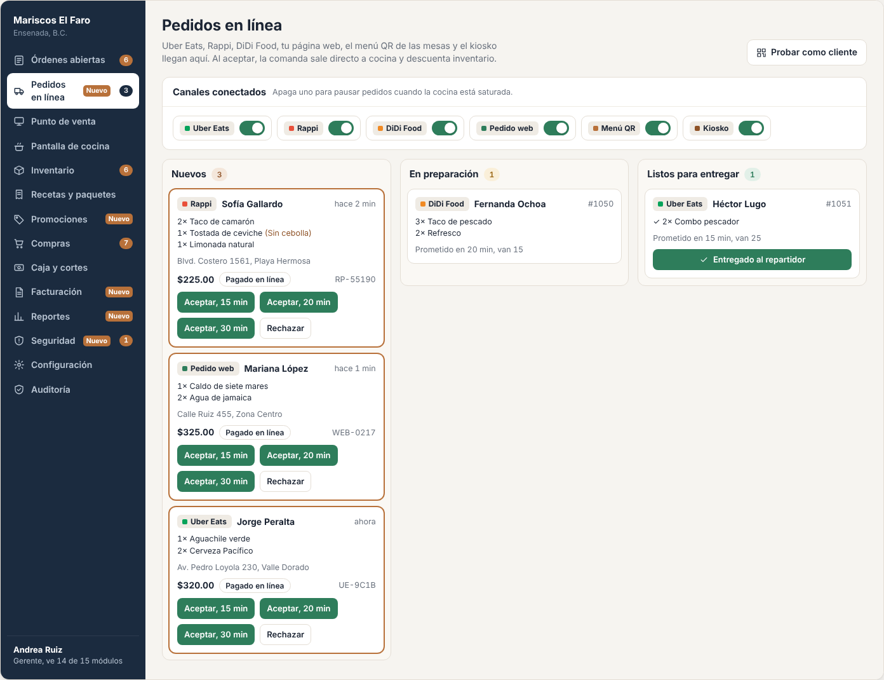
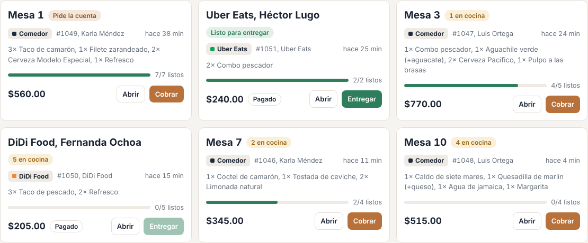
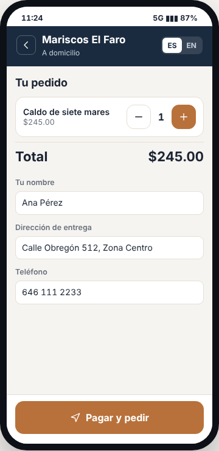
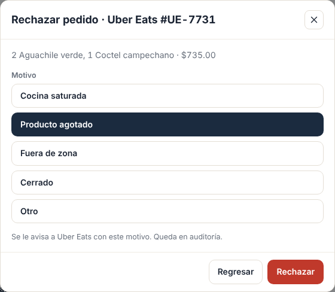
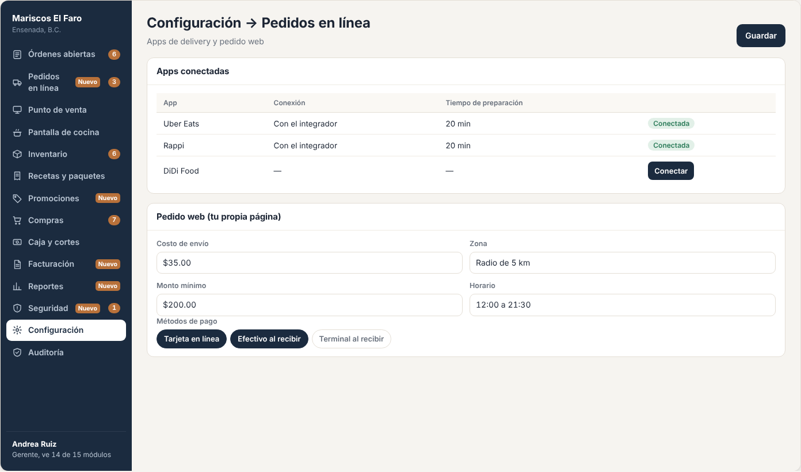

# E18 · Escritorio → Pedidos en línea · Spec

| | |
|---|---|
| **Epic** | E18 |
| **Superficie** | Escritorio (tablero) + página web de pedidos del restaurante |
| **Ola** | 3 · Canales y sucursales |
| **Responsable** | Por definir |
| **Revisa** | Por definir |
| **Estado** | Borrador para revisión |
| **Depende de** | E02 (crear órdenes), E05 (menú), E12 (cocina), E16 (pago en línea, ver su P-02) |
| **Lo usan** | E17 (los pedidos del QR entran por aquí), E10 (confirmar QR) |
| **Diseño** | Demo → Escritorio → Pedidos en línea. Capturas en [`img/`](img/) |

## 1. Problema

El restaurante tiene una tablet por cada app de delivery (Uber Eats, Rappi y DiDi Food), y alguien recaptura cada pedido en el punto de venta. Se equivocan, tardan, y el inventario no se descuenta. Además, quieren recibir pedidos en su propia página sin pagar comisión a las apps.

**Lo que queremos:** un solo tablero donde lleguen los pedidos de las apps, de la página web del restaurante y del menú QR. Que se acepten con un toque y salgan directo a cocina como cualquier comanda. Que se puedan pausar canales cuando la cocina está saturada.

## 2. Quién lo usa

| Rol | Permiso |
|---|---|
| Cajero, Gerente | `online.manage` |
| Cliente final | Página web de pedidos (pública) |

## 3. Pantallas

### 3.1 Tablero de pedidos en línea

- **Encabezado** con la ayuda y el botón *Probar como cliente*.
- **Canales conectados:** un switch por canal (Uber Eats, Rappi, DiDi Food, Pedido web, Menú QR y Kiosko) con su color. "Apaga uno para pausar pedidos cuando la cocina está saturada."
- **Tres columnas:**
  - **Nuevos:** cada tarjeta trae borde cobre, el canal, el cliente (o "Mesa 4"), cuánto hace que llegó, los platillos con notas, la dirección, el total, "Pagado en línea" o "Paga en mesa", y el código de la app. Botones *Aceptar, 15 / 20 / 30 min* y *Rechazar*. Para el QR, *Confirmar y enviar a cocina*.
  - **En preparación:** platillos con palomita en los listos, "Prometido en 20 min, van 12" y la etiqueta *Atrasado* en rojo si se pasa.
  - **Listos para entregar:** botón *Entregado al repartidor* o *Entregado al cliente*.
- Un **sonido** suena cada 30 segundos mientras haya pedidos nuevos sin atender.

### 3.2 En Órdenes abiertas

Los pedidos aceptados aparecen como cualquier orden, con su canal y la etiqueta *Pagado*. El botón es *Entregar* en lugar de *Cobrar*.

### 3.3 Página web de pedidos (para el cliente)

`pedidos.resto.mx/{restaurante}` (o el dominio propio del restaurante):
- El mismo menú del QR (E17), con fotos, inglés y promociones.
- Al terminar, pide nombre, dirección de entrega (calle, número y colonia), teléfono de 10 dígitos y, opcionalmente, referencias.
- Pago en línea (E16 P-02) o en efectivo al recibir, según lo que configure el restaurante.
- Muestra el estado del pedido: *Recibido → En cocina → Listo → Entregado*.

### 3.4 Más pantallas (capturas de maqueta)

| Pantalla | Contenido |
|---|---|
| **Rechazar** | Motivos: *Cocina saturada*, *Producto agotado*, *Fuera de zona*, *Cerrado* u *Otro*. Se le comunica a la app o al cliente.  |
| **Configuración → Pedidos en línea** | Conectar cada app (credenciales o con el integrador), costo de envío propio y zona (radio en km o lista de colonias), monto mínimo, horario de pedidos web, métodos de pago web y tiempo de preparación por defecto.  |

## 4. Historias de usuario

| ID | Como… | Quiero… | Para… |
|---|---|---|---|
| US-LIN-01 | cajero | ver todos los pedidos externos en un solo lugar | no tener una tablet por app |
| US-LIN-02 | cajero | aceptar con el tiempo de preparación | que el cliente y el repartidor sepan cuándo llegar |
| US-LIN-03 | cajero | rechazar con motivo | no aceptar lo que no puedo cumplir |
| US-LIN-04 | gerente | pausar un canal | no saturar la cocina |
| US-LIN-05 | cajero | marcar entregado al repartidor | cerrar el pedido |
| US-LIN-06 | dueño | tener mi propia página de pedidos | vender sin pagar comisión a las apps |
| US-LIN-07 | dueño | que el menú de las apps se actualice solo desde Resto | no editarlo en cada app |

## 5. Reglas de negocio

| ID | Regla |
|---|---|
| **BR-LIN-01** | Un pedido externo llega como `IncomingOrder` en estado *Nuevo*. **No** existe como orden ni descuenta inventario hasta que se acepta. |
| **BR-LIN-02** | **Aceptar** crea la orden (E02) con canal, etiqueta "Rappi, Sofía Gallardo", dirección, teléfono, código externo y `PrepaidMethod`. La envía a cocina (inventario y comanda) y le avisa a la app o al cliente con el tiempo prometido. |
| **BR-LIN-03** | Las **apps** cancelan solas si no se acepta en su tiempo límite (definido por cada app). Al cancelarse, desaparece de *Nuevos* con el aviso "Rappi canceló el pedido de Sofía: no se aceptó a tiempo". |
| **BR-LIN-04** | **Atrasado:** minutos desde que se aceptó > tiempo prometido. |
| **BR-LIN-05** | **Entregado** cierra la orden como pagada. El pago se registra en E03 con método *Plataforma* (apps y web pagado) o *Efectivo* (web contra entrega, que lo cobra caja o el repartidor propio). |
| **BR-LIN-06** | **Pausar un canal:** se le informa a la app (si lo permite) o se cierra la página web con "Pedidos en pausa. La cocina está llena. Intenta en unos minutos." |
| **BR-LIN-07** | **Precios en apps:** cada platillo puede tener un precio distinto por app (las apps cobran comisión). Por defecto es el mismo. |
| **BR-LIN-08** | **Sincronizar menú:** al cambiar platillos, precios o "agotado hoy" (E05), se manda a las apps conectadas. Un platillo agotado se marca no disponible en todas. |
| **BR-LIN-09** | **Pedido web:** dirección obligatoria, teléfono de 10 dígitos, monto mínimo y zona de entrega. Si la dirección está fuera de zona: "Lo sentimos, no llegamos a esa dirección." |
| **BR-LIN-10** | Los pedidos del **QR** (E17) llegan aquí y al mesero. Se confirman en cualquiera de los dos (E10 BR-MES-08). No tienen tiempo prometido. |

## 6. Criterios de aceptación

| ID | Dado… | Cuando… | Entonces… |
|---|---|---|---|
| AC-LIN-01 | un pedido de Rappi de Sofía Gallardo | llega | aparece en *Nuevos*, suena la alerta y caja y gerente reciben "1 pedido nuevo de Rappi" |
| AC-LIN-02 | lo anterior | toco *Aceptar, 20 min* | pasa a *En preparación*, se crea la orden #N con etiqueta "Rappi, Sofía Gallardo", sale la comanda, se descuenta inventario y Rappi recibe "aceptado, 20 min" |
| AC-LIN-03 | un pedido de Uber Eats | lo rechazo por *Producto agotado* | desaparece y Uber Eats recibe el rechazo con su motivo |
| AC-LIN-04 | un pedido aceptado hace 22 min con 20 prometidos | lo veo | tiene la etiqueta *Atrasado* |
| AC-LIN-05 | cocina despacha todo un pedido de DiDi | lo veo | pasa a *Listos*. Al tocar *Entregado al repartidor* la orden se cierra y cuenta en el corte como "Apps y en línea". |
| AC-LIN-06 | Rappi en pausa | un cliente intenta pedir en Rappi | el restaurante sale como no disponible en Rappi |
| AC-LIN-07 | la página web | un cliente pide sin dirección | "Escribe la dirección completa: calle, número y colonia." |
| AC-LIN-08 | el Pulpo marcado "Agotado hoy" | pasa 1 minuto | sale no disponible en las 3 apps y en la web |

## 7. Fuera de alcance

- Gestión de repartidores propios (asignar, rastrear en el mapa). Ver P-02.

## 8. Preguntas abiertas

| ID | Pregunta | Contesta | Estado |
|---|---|---|---|
| P-01 | ¿Integramos cada app directo (requiere ser socio de integración de cada una) o con un **integrador** que ya las tiene (por ejemplo, Deliverect)? El integrador cobra, pero ahorra meses de trabajo. | Equipo | Abierta |
| P-02 | ¿Hace falta manejar **repartidores propios**? | Equipo | Abierta |
| P-03 | ¿La página web de pedidos va en un subdominio nuestro o con el dominio propio del restaurante? | Equipo | Abierta |
