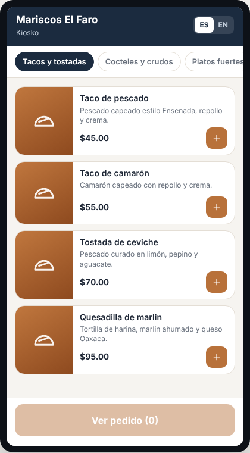
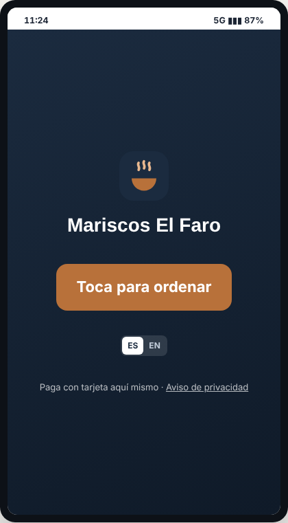
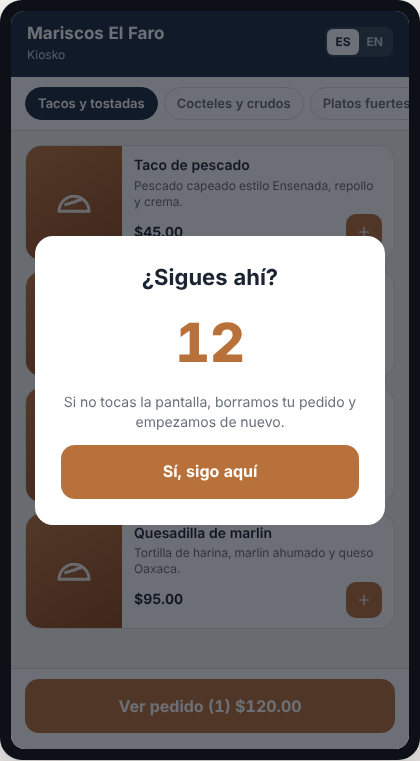
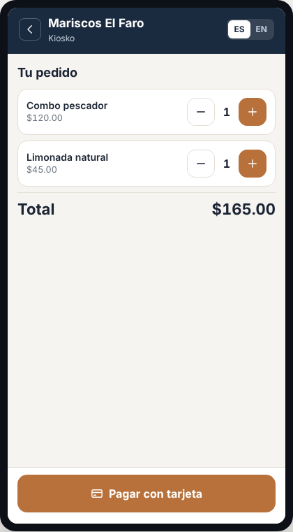
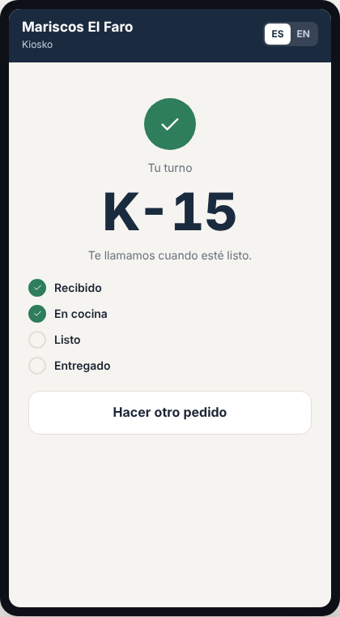

# E19 · Cliente → Kiosko · Spec

| | |
|---|---|
| **Epic** | E19 |
| **Superficie** | Cliente (tablet o pantalla táctil con la app MAUI en modo kiosko) |
| **Ola** | 3 · Canales y sucursales |
| **Responsable** | Por definir |
| **Revisa** | Por definir |
| **Estado** | Borrador para revisión |
| **Depende de** | E17 (componentes del menú del cliente), E16 (terminal de pago), E02 (orden), E12 (cocina e impresión) |
| **Lo usan** | — |
| **Diseño** | Demo → Cliente → Kiosko. Capturas en [`img/`](img/) |

## 1. Problema

En hora pico, la fila para pedir en mostrador es el cuello de botella, y la caja no da abasto.

**Lo que queremos:** una pantalla de autoservicio donde el cliente arma su pedido, paga con tarjeta, recibe un turno y su pedido sale directo a cocina sin pasar por la caja.

## 2. Quién lo usa

| Rol | Cómo |
|---|---|
| Cliente | Sin sesión, en la pantalla del kiosko |
| Gerente | Registra el dispositivo como *Kiosko* (E00) y le asigna una terminal (E16) |

## 3. Pantallas

Pantalla vertical, tema claro y botones de al menos 56 px.

### 3.1 Inicio y menú

- **Pantalla de bienvenida:** logo, "Toca para ordenar" y selector ES | EN. Vuelve aquí tras 60 s sin uso (BR-KIO-04).
- **Menú:** los mismos componentes que el QR (E17), más grandes. Encabezado "Kiosko" y botón fijo "Ver pedido (N) $X".

 

### 3.2 Tu pedido y pago

- Líneas con − N + y total.
- Botón **Pagar con tarjeta**, que inicia el cobro en la terminal (E16) con el mismo panel de estados.
- Campo opcional "¿A nombre de quién?" para llamar al cliente.

### 3.3 Turno

- Palomita, "Tu turno" y el número enorme **K-15**.
- "Te llamamos cuando esté listo."
- Estado en vivo.
- Se imprime el ticket con el turno y el QR de facturación.
- A los 15 s regresa solo a la bienvenida.

## 4. Historias de usuario

| ID | Como… | Quiero… | Para… |
|---|---|---|---|
| US-KIO-01 | cliente | armar mi pedido en la pantalla | no hacer fila |
| US-KIO-02 | cliente | pagar con tarjeta ahí mismo | irme a esperar mi turno |
| US-KIO-03 | cliente | recibir un turno impreso | saber cuándo me toca |
| US-KIO-04 | gerente | que el kiosko vuelva al inicio solo | que el siguiente cliente no vea el pedido anterior |

## 5. Reglas de negocio

| ID | Regla |
|---|---|
| **BR-KIO-01** | Solo se paga con **terminal integrada** (E16). Sin terminal en línea, el kiosko muestra "Por ahora pide en caja" y no deja ordenar. |
| **BR-KIO-02** | Con el pago **aprobado**: se crea la orden (canal *Kiosko*, etiqueta "Kiosko, turno K-15", `PrepaidMethod = tarjeta`), se registra el pago en el turno de caja designado y se envía a cocina. Todo en una sola operación. Si el pago no se aprueba, no se crea nada. |
| **BR-KIO-03** | **Turno:** "K-" + consecutivo del día de operación por restaurante, que empieza en 1. |
| **BR-KIO-04** | **Inactividad:** a los 45 s sin tocar aparece "¿Sigues ahí?" con 15 s de cuenta regresiva. Si nadie toca, se borra el carrito y vuelve a la bienvenida. |
| **BR-KIO-05** | El dispositivo funciona en **modo kiosko**: pantalla completa, sin salir de la app (*screen pinning* en Android y Acceso Guiado en iOS), pantalla siempre encendida y sin bloqueo por PIN (E00 BR-PLT-04). Salir requiere el PIN de un gerente. |
| **BR-KIO-06** | Cuando cocina despacha todo, caja recibe "Kiosko, turno K-15 listo para entregar" (E12 BR-COC-04), y si hay pantalla de turnos (E12 P-01) aparece ahí. |
| **BR-KIO-07** | El canal se puede pausar desde E18 y entonces el kiosko muestra "Por ahora pide en caja". |

## 6. Criterios de aceptación

| ID | Dado… | Cuando… | Entonces… |
|---|---|---|---|
| AC-KIO-01 | un Combo pescador y una limonada | pago con tarjeta aprobada | aparece "K-15", se imprime el ticket, la comanda sale a cocina y la orden aparece en *Órdenes abiertas* como *Pagado* |
| AC-KIO-02 | la tarjeta rechazada | pasa | se muestra el motivo, el carrito se conserva y no se crea ninguna orden |
| AC-KIO-03 | un carrito armado | nadie toca en 60 s | vuelve a la bienvenida con el carrito vacío |
| AC-KIO-04 | la terminal fuera de línea | un cliente toca la pantalla | "Por ahora pide en caja" |
| AC-KIO-05 | cocina despacha el K-15 | se despacha | caja recibe "Kiosko, turno K-15 listo para entregar" |
| AC-KIO-06 | el kiosko | alguien intenta salir de la app | pide el PIN de gerente |

## 7. Fuera de alcance

- Pago en efectivo en el kiosko (requiere hardware que acepta billetes).
- Hardware: se usa una tablet comercial con soporte; la terminal es la de E16.

## 8. Preguntas abiertas

| ID | Pregunta | Contesta | Estado |
|---|---|---|---|
| P-01 | ¿Qué hardware recomendamos (tablet de 10" o 15" con base, impresora)? Hay que armar un paquete probado. | Equipo | Abierta |
| P-02 | ¿Venta sugerida ("¿Le agregas una cerveza por $35?") antes de pagar? | Equipo | Abierta |
