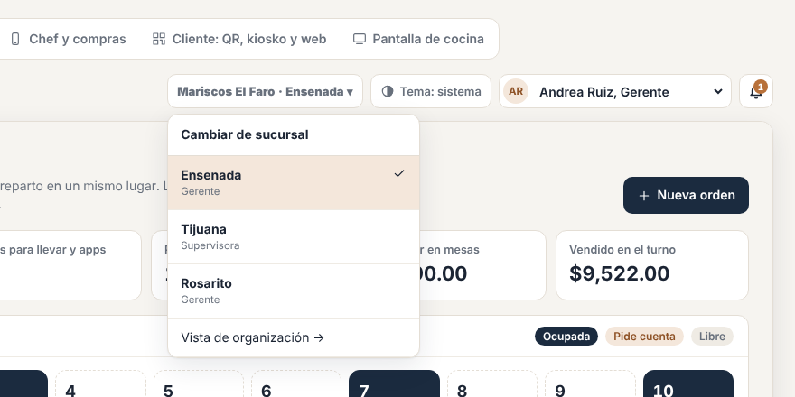
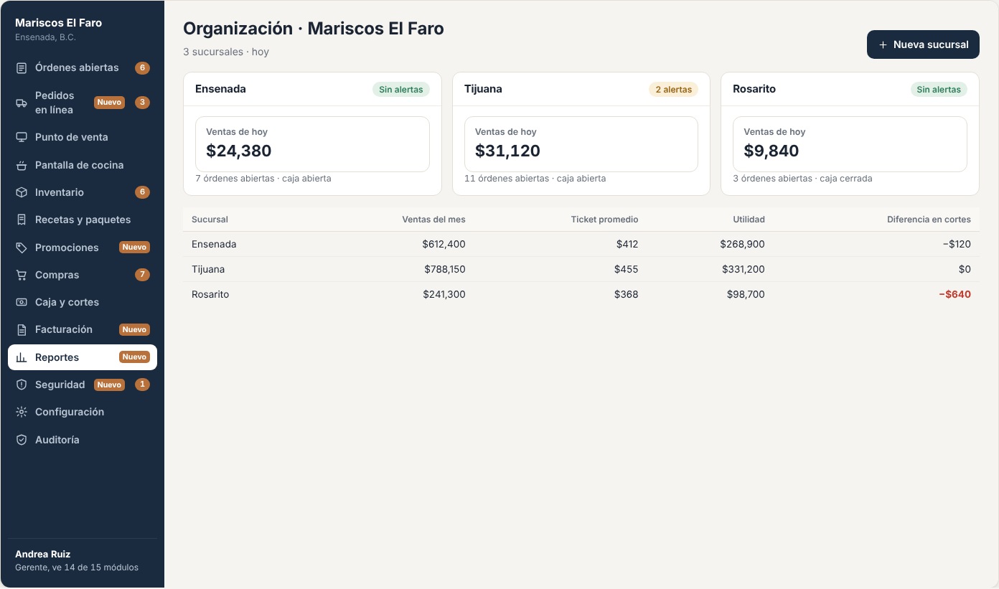
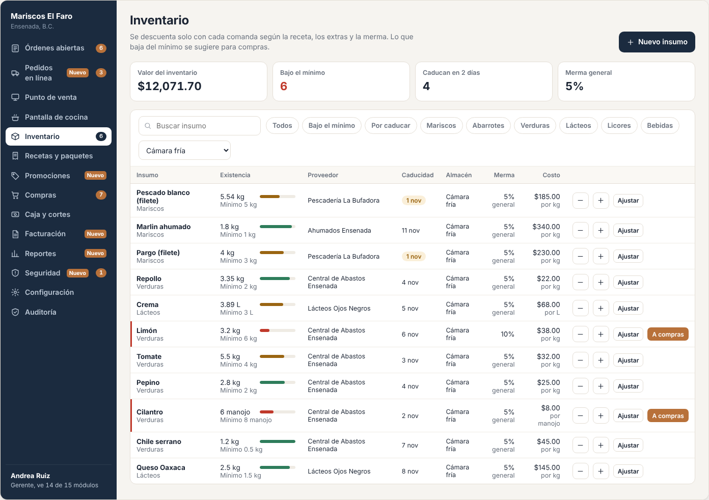
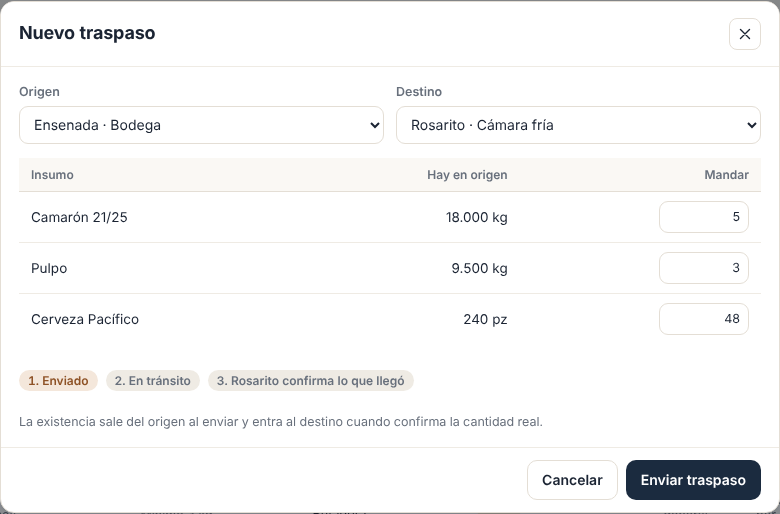

# E20 · Plataforma → Multisucursal · Spec

| | |
|---|---|
| **Epic** | E20 |
| **Superficie** | Plataforma + escritorio (vista de organización) |
| **Fase** | 4 · Canales · paso 22 de 22 en el [orden de construcción](../../docs/epics.md) |
| **Responsable** | Por definir |
| **Revisa** | Por definir |
| **Estado** | Borrador para revisión |
| **Depende de** | Fases 0 a 2 terminadas, más E15 (reportes) |
| **Lo usan** | E21 (cobro por sucursal) |
| **Diseño** | Filtro por almacén del demo y capturas de maqueta en [`img/`](img/) |

## 1. Problema

Cuando un cliente abre su segunda sucursal, quiere el mismo menú en las dos (con algún precio distinto), ver las ventas juntas y por separado, mover producto de una a otra, y que su gerente general entre a ambas con un solo usuario.

**Lo que queremos:** que una **organización** tenga varias sucursales, cada una operando de forma independiente, con catálogos compartidos, usuarios que pueden estar en varias, almacenes con traspasos y reportes consolidados.

> E00 ya modela `Organization → Restaurant` desde el día uno, así que este epic **no** requiere migrar datos. Solo agrega funciones.

## 2. Quién lo usa

| Rol | Permiso |
|---|---|
| Dueño, gerente general | `branches.manage` (a nivel organización) |
| Personal de cada sucursal | Sus permisos normales, por sucursal |

## 3. Pantallas

### 3.1 Selector de sucursal (barra superior)

Junto al usuario aparece "Mariscos El Faro · Ensenada ▾". Lo ve quien tiene acceso a más de una sucursal, y al cambiar se recarga todo con la otra sucursal. En dispositivos registrados (caja, celulares y cocina) **no** aparece, porque el dispositivo pertenece a una sola sucursal.

### 3.2 Vista de organización (`/organizacion`)

- **Tarjetas por sucursal:** ventas de hoy, órdenes abiertas, caja abierta o cerrada y alertas sin revisar.
- **Tabla comparativa del periodo:** ventas, ticket promedio, utilidad y diferencia en cortes.
- Botón *Nueva sucursal* (alta: nombre, dirección, zona horaria y si copia el menú y la configuración de otra).

### 3.3 Menú compartido

En *Recetas y paquetes* aparece un selector "Menú de la organización / Solo esta sucursal".
- Un platillo de la organización se edita una vez y se ve en todas.
- Cada sucursal puede **cambiar su precio**, marcarlo *No disponible aquí* o tener platillos propios.

### 3.4 Almacenes y traspasos

- Hoy "Almacén" es una propiedad de texto (E04). Aquí pasa a ser una **ubicación real**: cada sucursal tiene uno o más almacenes (Cámara fría, Almacén seco, Bodega bar) y la existencia es **por almacén**.
- **Traspaso:** origen (almacén o sucursal), destino, insumos y cantidades → *En tránsito* → el destino confirma la recepción (con la cantidad real) → se mueven las existencias.

- La receta descuenta de un **almacén de consumo** por estación (Cocina caliente consume de la Cámara fría).

### 3.5 Usuarios en varias sucursales

En *Usuarios*, cada persona puede tener **un rol distinto por sucursal** (gerente en Ensenada, supervisor en Tijuana).

## 4. Historias de usuario

| ID | Como… | Quiero… | Para… |
|---|---|---|---|
| US-SUC-01 | dueño | ver todas mis sucursales en un tablero | comparar cómo van |
| US-SUC-02 | dueño | abrir una sucursal nueva copiando la configuración | arrancar en un día |
| US-SUC-03 | dueño | tener un menú único con precios por sucursal | no capturar todo dos veces |
| US-SUC-04 | gerente general | entrar a cualquier sucursal con mi usuario | supervisar sin tener varias cuentas |
| US-SUC-05 | chef | pasar producto de una sucursal a otra con registro | no perder rastro del inventario |
| US-SUC-06 | chef | manejar varios almacenes en mi sucursal | saber dónde está cada cosa |
| US-SUC-07 | dueño | ver reportes consolidados y por sucursal | entender el negocio completo |

## 5. Reglas de negocio

| ID | Regla |
|---|---|
| **BR-SUC-01** | Cada sucursal tiene su folio de órdenes, su caja, sus cortes, sus impuestos, su inventario y sus dispositivos. **Nada operativo se mezcla.** |
| **BR-SUC-02** | **Catálogo compartido:** un platillo de organización tiene un precio base, y una sucursal puede **sobrescribir** el precio, la disponibilidad y la estación. La receta es la misma en todas, salvo que la sucursal la sobrescriba completa. |
| **BR-SUC-03** | **Usuarios:** un usuario pertenece a la organización y tiene acceso por sucursal con un rol de esa sucursal. El PIN es único **por sucursal**. |
| **BR-SUC-04** | **Almacenes:** cada insumo tiene existencia por almacén, y la existencia de la sucursal es la suma. Mínimos y sugeridos se calculan por sucursal. La receta descuenta del almacén de consumo de la estación. |
| **BR-SUC-05** | **Traspaso:** sale del origen al enviarlo (movimiento `TransferOut`) y entra al destino al confirmarlo (`TransferIn`), con la cantidad recibida. La diferencia queda registrada como *Merma en traslado*. Se mueve con el costo del origen. |
| **BR-SUC-06** | **Reportes consolidados:** suman las sucursales en la moneda común (MXN). Cada reporte de E15 acepta *Todas* o una sucursal. |
| **BR-SUC-07** | **Nueva sucursal copiando otra:** copia configuración, impuestos, estaciones, roles, categorías y menú (sin existencias, órdenes, usuarios ni dispositivos). |

## 6. Criterios de aceptación

| ID | Dado… | Cuando… | Entonces… |
|---|---|---|---|
| AC-SUC-01 | Ensenada y Tijuana | el dueño abre `/organizacion` | ve las 2 tarjetas con ventas de hoy y la tabla comparativa |
| AC-SUC-02 | el Taco de pescado de la organización a $45 | Tijuana lo sobrescribe a $50 | Ensenada cobra $45 y Tijuana $50 |
| AC-SUC-03 | Andrea, gerente en Ensenada y supervisora en Tijuana | cambia a Tijuana | ve solo lo que permite el rol de supervisora |
| AC-SUC-04 | 5 kg de camarón enviados de Ensenada a Tijuana | Tijuana confirma 4.8 kg | Ensenada −5, Tijuana +4.8 y 0.2 kg registrados como merma en traslado |
| AC-SUC-05 | la Cámara fría con 3 kg de pescado y el Almacén seco con 0 | se vende un taco de la Cocina caliente | se descuenta de la Cámara fría |
| AC-SUC-06 | una sucursal nueva copiada de Ensenada | se crea | tiene el mismo menú, impuestos y roles, sin existencias ni usuarios |
| AC-SUC-07 | el reporte de ventas en *Todas* | lo abro | la suma coincide con la suma de los reportes de cada sucursal |

## 7. Fuera de alcance

- Franquicias con dueños distintos (otra organización).
- Producción central (comisariato) con recetas que generan insumos. Relacionado con E05 P-02.

## 8. Preguntas abiertas

| ID | Pregunta | Contesta | Estado |
|---|---|---|---|
| P-01 | ¿Los **almacenes** (sección 3.4) los necesita también un restaurante de una sola sucursal desde antes de este epic? Si sí, sus tareas (Bloque B) se pasan a E04 **antes de empezar E04**, para no partir ningún epic. Hay que contestarla antes de la Fase 1. | Equipo | Abierta |
| P-02 | ¿Un **comisariato** (cocina central que surte a las sucursales)? | Equipo | Abierta |
