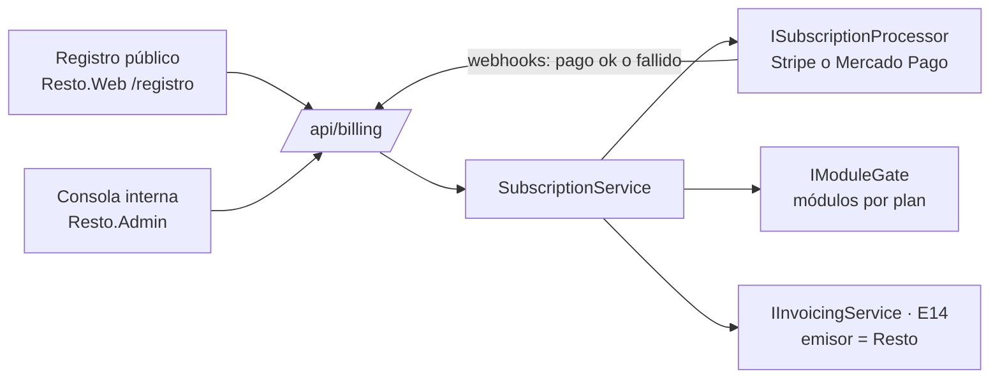

# E21 · Plataforma → Suscripciones y planes · Plan técnico

## 1. Resumen



Se agrega el proyecto `Resto.Admin` (Blazor Web App, solo para el equipo) con su propio login y lista de correos permitidos.

## 2. Modelo de datos (esquema `platform`, sin filtro por restaurante)

| Tabla | Columnas |
|---|---|
| `plans` | `Key` (`essential`, `complete`, `pro`), `Name`, `MonthlyPrice`, `AdditionalBranchDiscount`, `IncludedStamps`, `ModulesJson` |
| `subscriptions` | `OrganizationId`, `PlanKey`, `Status` (`Trial`, `Active`, `PastDue`, `ReadOnly`, `Suspended`, `Cancelled`), `TrialEndsAt`, `CurrentPeriodEnd`, `PendingPlanKey`, `BillingCycle` (`Monthly`, `Annual`), `ProcessorCustomerId`, `ProcessorSubscriptionId`, `CardLast4`, `FiscalRfc`, `FiscalName`, `FiscalRegime`, `FiscalZip`, `FiscalUse`, `FiscalEmail` |
| `subscription_charges` | `Id`, `OrganizationId`, `Amount`, `Tax`, `Status`, `ProcessorChargeId`, `InvoiceUuid`, `ChargedAt` |
| `module_trials` | `OrganizationId`, `Module`, `EndsAt` |
| `support_sessions` | `Id`, `OrganizationId`, `AgentEmail`, `StartedAt`, `EndsAt`, `Reason` |

## 3. Módulos por plan

- `Modules` (en Contracts): enum con un valor por epic que se vende por separado (`Inventory`, `Recipes`, `Purchasing`, `Kds`, `Promotions`, `Reports`, `Invoicing`, `TableQr`, `Terminal`, `OnlineOrders`, `Kiosk`, `MultiRegister`, `WhatsAppCuts`).
- **Endpoints:** `.RequireModule(Modules.Inventory)`, junto a `.RequirePermission(...)`. El filtro consulta `IModuleGate.IsEnabled(org, module)`, cacheado 60 s, y responde 402 si no está.
- **UI:** `NavRail` (E00) muestra el candado. `<ModuleView Module="…">` envuelve las secciones.
- **Solo lectura:** un filtro global bloquea `POST`, `PUT`, `PATCH` y `DELETE` (salvo login y pago) cuando el estado es `ReadOnly` o `Suspended`, y responde 402 `{ Code: "SubscriptionInactive" }`.

## 4. Contratos

```csharp
public interface IModuleGate { bool IsEnabled(Guid organizationId, Modules module); }

public interface ISubscriptionProcessor   // un adaptador por procesador
{
    Task<string> CreateCustomerAsync(OrganizationInfo org, CancellationToken ct);
    Task<string> CreateCheckoutForCardAsync(string customerId, string returnUrl, CancellationToken ct); // página del procesador: nunca tocamos datos de tarjeta
    Task<SubscriptionInfo> SubscribeAsync(string customerId, decimal monthlyAmount, BillingCycle cycle, CancellationToken ct);
    Task ChangeAmountAsync(string subscriptionId, decimal newAmount, bool prorate, CancellationToken ct);
    Task CancelAtPeriodEndAsync(string subscriptionId, CancellationToken ct);
}
```

## 5. API

| Método y ruta | Permiso |
|---|---|
| `POST /public/signup` `{ Account, Restaurant }` | público, con *rate limit* y captcha |
| `GET /api/billing` (plan, estado, cobros) | `billing.manage` |
| `POST /api/billing/card` → URL del procesador | `billing.manage` |
| `POST /api/billing/plan` `{ PlanKey, Cycle }` · `POST /api/billing/cancel` · `PUT /api/billing/fiscal` | `billing.manage` |
| `POST /api/billing/module-trial` `{ Module }` | `billing.manage` |
| `POST /webhooks/billing/{processor}` | firma del procesador |
| `/admin/api/*` (organizaciones, extender, descuento, suspender, modo soporte y métricas) | equipo interno |

**Jobs:** `TrialReminderJob` (días 23 y 27) y `SubscriptionStateJob` (pasa a solo lectura o suspendida según BR-SUS-01 y 03).

## 6. Pantallas

| Componente | Dónde | Captura |
|---|---|---|
| `SignupPage.razor` (3 pasos, casilla de aviso de privacidad) | Web | 01 |
| `OnboardingWizard.razor` (menú de ejemplo por giro, importar Excel, personal y dispositivo) | UI | — |
| `MyPlanTab.razor` + `PlanComparison.razor` + `ChargesHistory.razor` | UI | 02 |
| `LockedModulePage.razor` | UI | 03 |
| `ReadOnlyBanner.razor` ("Tu cuenta está en solo lectura…") | UI | — |
| `AdminOrganizationsPage`, `AdminOrganizationDetail` y `AdminMetricsPage` | Admin | 04 |
| `HelpPanel.razor` (centro de ayuda, WhatsApp de soporte y estado del servicio; artículos en Markdown en `Resto.Web/help/`) | UI | 05 |

## 7. Pruebas

| Proyecto | Qué cubre |
|---|---|
| Domain.Tests | Precio por sucursales y ciclo (AC-SUS-03), prorrateo y transiciones de estado (BR-SUS-01, 03, 04 y 07) |
| Api.Tests | AC-SUS-01, 02 y 04 a 07 con `FakeSubscriptionProcessor`; prueba de que **todo endpoint** declara su módulo o está marcado como "incluido en todos los planes" |
| Manual | Flujo completo en el modo de pruebas del procesador |

## 8. Paquetes

SDK del procesador elegido (P-01), por ejemplo `Stripe.net`.
