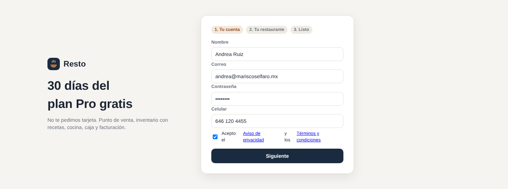
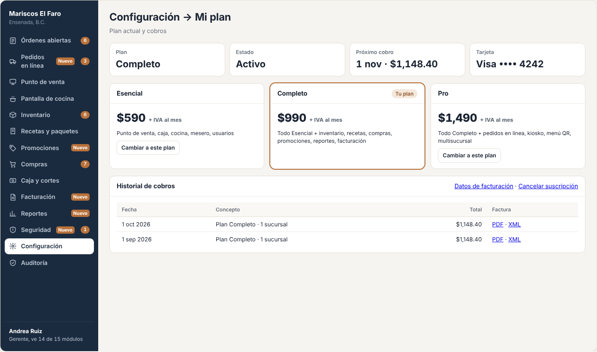
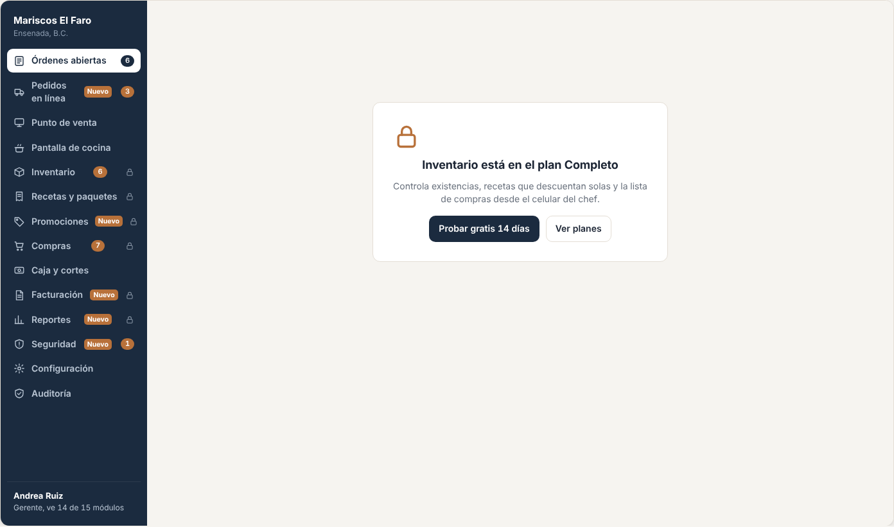
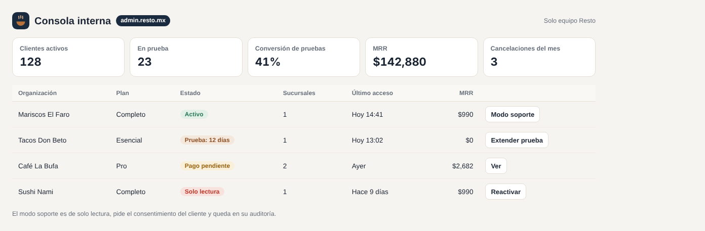
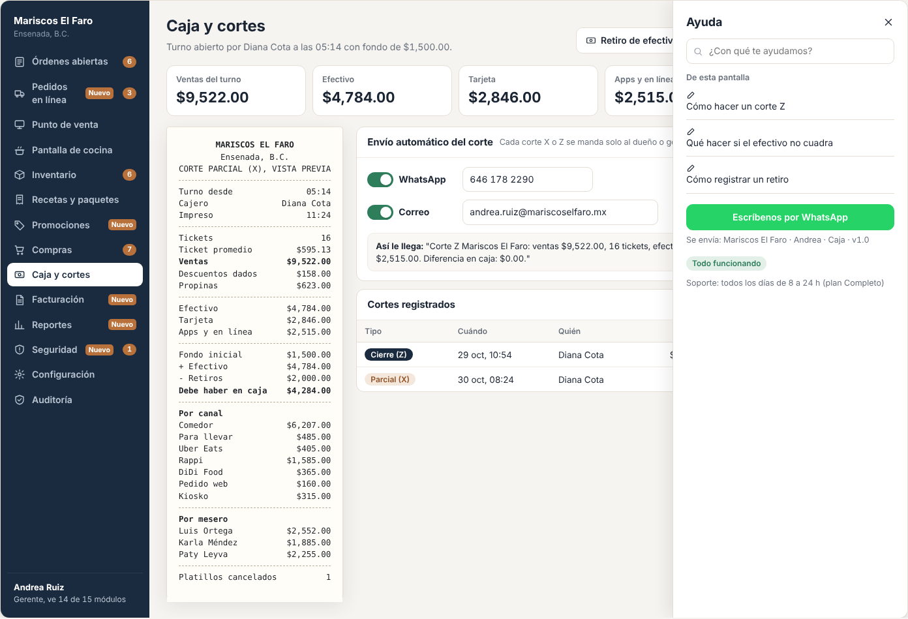

# E21 · Plataforma → Suscripciones y planes · Spec

| | |
|---|---|
| **Epic** | E21 |
| **Superficie** | Plataforma (registro público, módulo del cliente y consola interna de Resto) |
| **Fase** | 3 · Negocio · paso 18 de 22 en el [orden de construcción](../../docs/epics.md) |
| **Responsable** | Por definir |
| **Revisa** | Por definir |
| **Estado** | Borrador para revisión |
| **Depende de** | E00 (organizaciones), E07 (permiso `billing.manage`), E14 (para facturar nuestra propia licencia) |
| **Lo usan** | Todos (los módulos se encienden o apagan según el plan) |
| **Diseño** | Capturas de maqueta en [`img/`](img/). Precios del análisis de competencia. |

> Este epic no estaba en el mapa original. Es **cómo Resto le cobra a los restaurantes**. Sin él, cada alta y cada cobro serían manuales.

## 1. Problema

Para vender Resto a muchos restaurantes hace falta que puedan registrarse solos, probar gratis, elegir un plan, pagar con tarjeta cada mes y recibir su factura. Y que el sistema encienda solo los módulos de su plan.

**Lo que queremos:** registro en línea, 30 días de prueba, tres planes con cobro recurrente y factura automática, cambio de plan en cualquier momento, y una consola interna para nosotros.

## 2. Planes (propuesta del análisis de precios)

| Plan | Precio mensual + IVA por sucursal | Módulos |
|---|---|---|
| **Esencial** | $590 | E01 Órdenes, E02 Punto de venta, E03 Cobro y cortes, E07 Usuarios, E08 Configuración, E09 Auditoría, E10 App del mesero, E12 Cocina (solo impresión) |
| **Completo** | $990 | Esencial + E04 Inventario, E05 Recetas, E06 Compras, E11 App chef y compras, E12 Pantalla de cocina, E13 Promociones, E15 Reportes, E17 Menú QR, E14 Facturación (con paquete de timbres) |
| **Pro** | $1,490 | Completo + E16 Terminal integrada, E18 Pedidos en línea, E19 Kiosko, varias cajas y envío del corte por WhatsApp |

- **Sucursal adicional:** −20%.
- **Pago anual:** 12 meses por el precio de 10.
- **Timbres extra** (por encima del paquete): se venden por bloque. El precio se define después de elegir PAC (E14 P-01).

## 3. Pantallas

### 3.1 Registro público (`resto.mx/registro`)

1. **Tu cuenta:** nombre, correo, contraseña y celular.
2. **Tu restaurante:** nombre, ciudad, número de mesas y giro (mariscos, tacos, cafetería…).
   - Casilla obligatoria: "Acepto el *Aviso de privacidad* y los *Términos y condiciones*" (E00 BR-PLT-16).
3. **Listo:** "Tienes 30 días del plan Pro gratis. No te pedimos tarjeta." y el botón *Entrar*.

Al entrar, un **asistente inicial**:
- Carga un menú de ejemplo del giro o importa insumos desde Excel (E04).
- Crea a tu personal.
- Registra el primer dispositivo.

### 3.2 Mi plan (`Configuración → Mi plan`, permiso `billing.manage`)

- Plan actual, sucursales, próximo cobro, tarjeta (•••• 4242) y estado (*Prueba: quedan 12 días*, *Activo* o *Pago pendiente*).
- **Tabla comparativa de los 3 planes** con *Cambiar a este plan*.
- **Historial de cobros** con la factura de cada uno (PDF y XML).
- *Datos de facturación* (RFC del restaurante para la factura de la licencia) y *Cancelar suscripción*.

### 3.3 Módulo no incluido

Si el plan no incluye un módulo, aparece en el menú lateral con un candado. Al tocarlo: "Inventario está en el plan Completo. Pruébalo gratis 14 días." con los botones *Probar* y *Ver planes*.

### 3.4 Consola interna (solo el equipo de Resto)

`admin.resto.mx`:
- Organizaciones con plan, estado, sucursales, último acceso y MRR.
- Por cliente: extender la prueba, aplicar un descuento, cambiar el plan, suspender o reactivar, y entrar en **modo soporte**. El modo soporte da acceso de solo lectura y requiere el consentimiento del cliente; queda en su auditoría.
- Métricas: altas, pruebas que convierten, cancelaciones y MRR.

### 3.5 Ayuda y soporte

Un botón **?** en la barra superior (todas las pantallas) abre un panel con:
- **Centro de ayuda:** artículos cortos con capturas por módulo ("Cómo hacer un corte Z", "Cómo importar insumos"), con buscador. Si la pantalla actual tiene artículo, aparece primero.
- **Escríbenos por WhatsApp:** abre WhatsApp con el número de soporte y un mensaje que ya trae el restaurante, el usuario, la pantalla y la versión.
- **Estado del servicio:** "Todo funcionando" o el aviso de la falla en curso (sale del monitoreo de E00).
- Horario de soporte por plan: Esencial 9 a 21 h, Completo y Pro todos los días de 8 a 24 h.

## 4. Historias de usuario

| ID | Como… | Quiero… | Para… |
|---|---|---|---|
| US-SUS-01 | dueño de restaurante | registrarme y probar sin tarjeta | ver si me sirve sin compromiso |
| US-SUS-02 | dueño | arrancar con un menú de ejemplo o importando mi Excel | no empezar en blanco |
| US-SUS-03 | dueño | elegir plan y pagar con tarjeta mes a mes | sin contratos |
| US-SUS-04 | dueño | recibir mi factura de cada cobro | deducirlo |
| US-SUS-05 | dueño | subir o bajar de plan | pagar solo lo que uso |
| US-SUS-06 | equipo de Resto | ver y administrar a todos los clientes | dar soporte y medir el negocio |

## 5. Reglas de negocio

| ID | Regla |
|---|---|
| **BR-SUS-01** | **Prueba:** 30 días de Pro sin tarjeta. A los 23 días y a los 27 días se avisa por correo y en la app. Al terminar sin tarjeta, la cuenta pasa a **solo lectura** (se ve todo, no se puede vender) durante 30 días. Después se suspende. Los datos se conservan 90 días más. |
| **BR-SUS-02** | **Cobro recurrente** con tarjeta mediante el procesador de suscripciones (P-01) en la fecha de aniversario. Precio = plan × sucursales (con −20% desde la segunda) + IVA. |
| **BR-SUS-03** | **Pago fallido:** se reintenta a los 3, 5 y 7 días con aviso cada vez. A los 7 días sin pago, se pasa a solo lectura. Al pagar, se reactiva al momento. |
| **BR-SUS-04** | **Subir de plan:** inmediato, se cobra la parte proporcional. **Bajar:** al siguiente ciclo, y se avisa qué módulos se apagan. Los datos de los módulos apagados **no se borran**. |
| **BR-SUS-05** | **Módulos por plan:** cada endpoint y cada pantalla declara su módulo. Si el plan no lo incluye, el servidor responde 402 `{ Code: "PlanRequired", Plan: "Completo" }` y la UI muestra el candado. Esto se valida **además** de los permisos (E00 y E07). |
| **BR-SUS-06** | **Factura de la licencia:** cada cobro exitoso genera un CFDI de Resto como emisor al RFC del cliente (o a público en general si no dio datos), con el motor de E14. |
| **BR-SUS-07** | **Cancelar:** el plan sigue hasta el fin del periodo pagado y después pasa a solo lectura (BR-SUS-01). |
| **BR-SUS-08** | **Modo soporte:** solo con un permiso interno, solo lectura, con duración de 60 min, y queda en la auditoría del cliente como "Soporte Resto entró a la cuenta". |

## 6. Criterios de aceptación

| ID | Dado… | Cuando… | Entonces… |
|---|---|---|---|
| AC-SUS-01 | la página de registro | completo los 3 pasos | se crean la organización, la sucursal, el administrador, los roles iniciales (E07) y la configuración por defecto (E08), y entro con "Prueba Pro: 30 días" |
| AC-SUS-02 | una prueba que vence hoy sin tarjeta | mañana abro la app | todo se ve, pero *Nueva orden*, *Cobrar* y *Enviar a cocina* dicen "Tu prueba terminó. Elige un plan para seguir vendiendo." |
| AC-SUS-03 | plan Completo con 2 sucursales | llega el cobro | se cobran ($990 + $792) + IVA = **$2,067.12** y llega la factura |
| AC-SUS-04 | plan Esencial | abro Inventario | candado y "Inventario está en el plan Completo…"; la API responde 402 |
| AC-SUS-05 | plan Pro | bajo a Completo | sigo con Pro hasta fin de mes. Después, *Pedidos en línea* y *Kiosko* muestran candado y sus datos siguen ahí. |
| AC-SUS-06 | un cobro rechazado | pasan 7 días sin pagar | la cuenta pasa a solo lectura. Al pagar, se reactiva al momento. |
| AC-SUS-07 | soporte entra a una cuenta | revisa | no puede modificar nada y el cliente ve el registro en su auditoría |
| AC-SUS-08 | estoy en *Caja* | toco **?** → *Escríbenos por WhatsApp* | se abre WhatsApp con "Mariscos El Faro · Andrea · Caja · v1.0" ya escrito |
| AC-SUS-09 | el registro sin marcar la casilla de privacidad | toco *Crear cuenta* | no avanza y dice "Necesitas aceptar el aviso de privacidad" |

## 7. Fuera de alcance

- Pago con transferencia o en OXXO de la licencia. Ver P-02.
- Distribuidores y socios comerciales con comisión. Ver P-03.

## 8. Preguntas abiertas

| ID | Pregunta | Contesta | Estado |
|---|---|---|---|
| P-01 | ¿Qué procesador usamos para la suscripción? Stripe opera en México y tiene suscripciones; Mercado Pago también tiene suscripciones. Hay que comparar comisión y facilidad. | Equipo | Abierta |
| P-02 | ¿Aceptar pago anual por transferencia u OXXO? | Equipo | Abierta |
| P-03 | ¿Vamos a vender por **distribuidores** (como hace la competencia) con comisión? | Equipo | Abierta |
| P-04 | ¿Se confirman los precios ($590, $990 y $1,490 + IVA) y lo que incluye cada plan? | Equipo | Abierta |
| P-05 | ¿Qué dominio usamos? En las specs dice `resto.mx` (con `menu.`, `pedidos.`, `facturas.` y `admin.`) como provisional. Hay que confirmar que esté disponible y registrarlo. | Equipo | Abierta |
